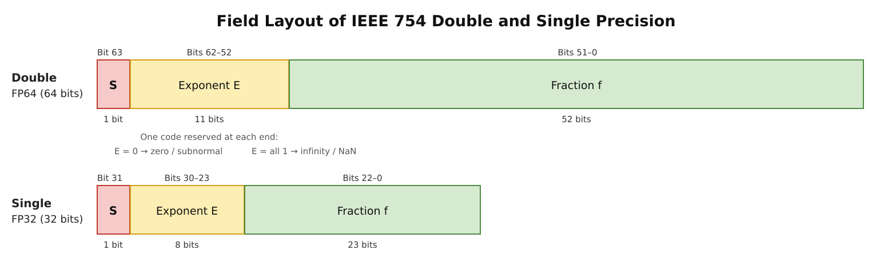

# The Algorithm and Code of Scalar Floating-Point Multiplication

# I. The Algorithm

As far as its numerical value is concerned, a single `fmul` instruction does only one thing: it takes the sign, the exponent and the significand out of each operand, computes them separately, and then assembles the three parts back into a floating-point number. The three parts are computed separately because they do not interfere with each other—the sign needs only an XOR, the exponents undergo an addition, and only the significands involve a genuine multiplication. Among the three, only the significand path produces width: two 24-bit significands multiplied together give 48 bits. These 48 bits are not a floating-point number but a fixed-point integer, and several steps are still needed to turn them back into a floating-point number. Normalization moves the leading 1 to the left of the radix point, rounding discards the excess low bits according to the rounding mode, the exponent is adjusted accordingly, and finally we decide whether the exponent is out of range and whether the operands are special values that do not take the regular path.

The following sections follow the data flow. Section 1 looks at how the three fields are laid out; Section 2 splits the multiplication into three paths; Section 3 turns the significands into integers; Section 4 performs the multiplication itself; Sections 5 and 6 turn the product back into a floating-point number—first normalizing it and deciding which bits to keep, then discarding the rest according to the rounding mode; Section 7 checks whether the exponent is out of range; Section 8 handles the cases such as NaN and infinity that do not take the regular path.

The whole part is carried by the same pair of operands:

$$a = 1.10000000000000000000001_2 \times 2^{1}, \qquad b = 1.1110110_2 \times 2^{0}$$

## 1. The Floating-Point Format



A single-precision number has a 1-bit sign field, an 8-bit exponent field and a 23-bit fraction field, with an exponent bias $\mathrm{bias}$ = 127. Double precision uses the same layout, only with wider fields (an 11-bit exponent field, a 52-bit fraction field, and $\mathrm{bias}$ = 1023). The derivations and examples below are all in single precision; double precision differs only in the number of bits, and the rules are exactly the same.

| Kind | Sign bit $s$ | Exponent field $E$ | Fraction field $f$ | Value |
| --- | --- | --- | --- | --- |
| Zero | 0/1 | all 0 | all 0 | $\pm 0$ |
| Subnormal number | 0/1 | all 0 | not all 0 | $(-1)^s \times 0.f \times 2^{1-\mathrm{bias}}$ |
| Normalized number | 0/1 | neither all 0 nor all 1 | any | $(-1)^s \times 1.f \times 2^{E-\mathrm{bias}}$ |
| Infinity | 0/1 | all 1 | all 0 | $\pm \infty$ |
| Quiet NaN (qNaN) | any | all 1 | not all 0, most significant bit 1 | not a number; raises no flag when used in an operation |
| Signaling NaN (sNaN) | any | all 1 | not all 0, most significant bit 0 | not a number; raises invalid operation when used in an operation |

Several things in this table will be used in every section that follows. Only the middle range of the exponent field (1 through 254) belongs to ordinary finite numbers; one code is reserved at each end: all 0 is left for subnormal numbers and zero, all 1 for infinity and NaN. Testing whether the exponent field is all 0 or all 1 therefore separates these classes, and this is exactly the criterion used for special values in Section 8. **The exponent field of a subnormal number is all 0, and its exponent is computed as $1-\mathrm{bias}(-126)$, not $0-\mathrm{bias}(-127)$**, so that the largest subnormal number and the smallest normalized number join end to end and there is no gap on the number line. This is called gradual underflow.

The sign bit and the fraction field each also have a detail that will be used later. Zero has two forms, $+0$ and $-0$, distinguished as usual by the sign bit, and when the product of a multiplication is zero its sign is still the product sign (the XOR of the two sign bits); this is the basis for that rule. A NaN only requires the fraction field to be non-zero, and the most significant bit of the fraction field distinguishes quiet from signaling: 1 means a quiet NaN, 0 means a signaling NaN; the former raises no flag when used in an operation, the latter raises invalid operation.

The difference between quiet and signaling is more than that one bit. The bit patterns of the three kinds of NaN are

$$\begin{aligned}
\text{quiet NaN}:\quad & 0\ \underbrace{1111\,1111}_{E\ \text{all 1}}\ 1xx\ldots x\\
\text{signaling NaN}:\quad & 0\ \underbrace{1111\,1111}_{E\ \text{all 1}}\ 0xx\ldots x\quad(\text{fraction not all 0})\\
\text{canonical NaN}:\quad & 0\ \underbrace{1111\,1111}_{E\ \text{all 1}}\ 100\ 0000\,0000\,0000\,0000\,0000_2
\end{aligned}$$

The $x$ in the first two lines stands for any value; the two differ only in the most significant bit of the fraction field. A quiet NaN passes through an operation unchanged and raises no flag; a signaling NaN raises the invalid operation flag when it is consumed. The remaining fraction bits are the payload, which the standard only recommends to propagate unchanged but does not require; XiangShan always reduces them to the canonical NaN, the pattern shown in the third line, 0x7FC00000 (Section 8). Quiet and signaling NaNs thus only ever appear as operands; the result of an operation is always the canonical NaN, so a signaling NaN lives for exactly one generation—it is a marker left for uninitialized data, and as soon as it takes part in an operation the flag is raised and it does not keep propagating silently.

Read the pair of operands from the beginning through this table. $a$ = 0x40400001 has sign bit 0, exponent field $10000000_2$ = 128, and fraction field $10000000000000000000001_2$, whose most and least significant bits are 1. $b$ = 0x3FF60000 has sign bit 0, exponent field $01111111_2$ = 127, and a fraction field consisting of $1110110_2$ followed by sixteen 0s. Both exponent fields lie between 1 and 254, so both are normalized numbers.

## 2. The Multiplication Splits into Three Parts Mathematically

In the table of the previous section, the value of a normalized number is

$$v = (-1)^s \times 1.f \times 2^{E-\mathrm{bias}}$$

Multiplying two such numbers:

$$a \times b = (-1)^{s_a \oplus s_b} \times (1.f_a \times 1.f_b) \times 2^{(E_a-\mathrm{bias}) + (E_b-\mathrm{bias})}$$

The three parts are independent: the sign is the product sign, the significands multiply on their own, and the exponents are added and then have $\mathrm{bias}$ subtracted once. Hardware therefore splits them into three parallel paths.

For the running example the three paths separate here: both sign bits are 0, so the XOR gives 0 and the result is positive; the exponents are 1 and 0, whose sum is 1; the significand path is left with the product $1.10000000000000000000001_2 \times 1.1110110_2$, which the next two sections compute. The three paths rejoin after Section 5.

## 3. The Implicit Bit of the Significand, and Subnormal Numbers

The significand of a normalized number is $1.f$; the 1 in the integer position is not in the fraction field but implicit. A subnormal number has an exponent field of 0 but a significand of $0.f$, with an implicit bit of 0. Whether the implicit bit is 1 or 0 depends on whether the number is normalized or subnormal—and the criterion happens to be exactly "is the exponent field all zero". No branch is needed in the implementation: concatenate "the exponent field is non-zero" with the fraction field, and one operation covers both cases.

The exponent works the same way. Rewriting the 0 in a subnormal number's exponent field as 1 makes its exponent match the $1-\mathrm{bias}$ prescribed by the format, and the rest of the datapath no longer has to distinguish the two—the entire difference between normalized and subnormal numbers is carried by the implicit bit.

Both numbers in the example are normalized, so both implicit bits are 1 and the significands are $1.10000000000000000000001_2$ and $1.1110110_2$. Before entering the multiplier they are written as integers, that is, the radix point is moved 23 places to the right:

$$A = 110000000000000000000001_2 = \texttt{0xC00001}, \qquad B = 111101100000000000000000_2 = \texttt{0xF60000}$$

The position of the radix point is left to the exponent handling in Section 5; here only the integer multiplication is done. The fraction field of $b$ has only 7 bits, so once written as 24 bits its low 16 bits are all 0. These 0s are not meaningless padding: Section 4 will show that they make 8 of the 13 groups produce no partial product.

## 4. Multiplying the Significands: Booth Encoding and Carry-Save Addition

Multiplying two 24-bit significands gives a product of up to 48 bits. Computing the partial products bit by bit yields 24 of them, which a reduction tree must then compress; the more partial products there are, the deeper and larger the tree, and such a naive implementation is often hard to accept. For this reason radix-4 Booth encoding is used, attacking the number of partial products through the representation of the multiplier:

What it saves is not the multiplication itself but the way the multiplier is written. The binary representation of a number is not unique: as long as digits may be negative, the same string of bits can be written in several ways, based on the most elementary identity—$2^k$ can also be written as $2^{k+1}-2^k$, so a run of consecutive 1s in the multiplier can be replaced as a whole. [Booth's multiplication algorithm](https://en.wikipedia.org/wiki/Booth%27s_multiplication_algorithm)

$$01110_2 = 10000_2 - 00010_2 = 16-2 = 14$$

Three 1s originally required three partial products; now only one addition and one subtraction remain, and the value is unchanged. The multiplicand is still nothing but a number of shifts of $A$; the structure of the multiplication does not change, only the number of non-zero digits in the multiplier. The number of partial products equals the number of non-zero digits, and the number of kinds equals the values a digit can take; by changing the representation of the multiplier, both can be reduced at once.

Applying this freedom to a 24-bit multiplier is what Booth's method does. The multiplier is cut into groups of two bits; a group originally takes a value from 0 to 3, corresponding to $0$, $A$, $2A$, $3A$. The first three need not be generated: 0 produces no partial product, $A$ is the multiplicand itself, and $2A$ is $A$ shifted left by one, **both easy to implement in hardware**; only $3A$ cannot be obtained by shifting and would require an $A+2A$ addition first. That addition is expensive: every group might need $3A$, which amounts to a row of adders in front of the reduction tree, cancelling out the area one hoped to save. Since digits may be negative, a group need not reach 3: if the high bit of the two is 1, subtract 4 from the group and carry 1 into the next higher group. After subtracting 4, 3 becomes $-1$ and 2 becomes $-2$, so every group falls in $\{-2,-1,0,1,2\}$, leaving only the multiples $A$ and $2A$, whose negatives are obtained by inversion.

The 1 carried into the next group need not be computed separately—it is simply the high bit of this group's two bits. Conversely, the carry this group receives is the high bit of the next lower group's two bits. Each group therefore needs to look at only three bits: its own two plus the high bit of the lower group. Writing "subtract 4 from the group's original value and add the incoming carry" as an expression:

$$2b_{2i+1}+b_{2i}-4b_{2i+1}+b_{2i-1}$$

Collecting like terms gives this group's digit:

$$d_i = -2b_{2i+1} + b_{2i} + b_{2i-1}$$

There is no carry chain here: the 1 each group carries into the next comes from a bit already present in the multiplier, not from a ripple propagated from below, so all 13 groups can proceed **simultaneously**. The three bits have eight combinations, which fall into only five values:

| $(b_{2i+1},b_{2i},b_{2i-1})$ | $d_i$ | Partial product |
| --- | --- | --- |
| 001, 010 | $+1$ | $+A$ |
| 011 | $+2$ | $+2A$ |
| 100 | $-2$ | $-2A$ |
| 101, 110 | $-1$ | $-A$ |
| 000, 111 | $0$ | $0$ |

Work through $B = 01110110_2$ (decimal 118) as an example. Append a 0 below the least significant bit as $b_{-1}$, and cut the number into groups of two from low to high:

| $i$ | Two-bit group $(b_{2i+1}b_{2i})$ | High bit is 1? | Carry received ($b_{2i-1}$) | $d_i$ | Weight $4^i$ |
| --- | --- | --- | --- | --- | --- |
| 0 | 10 | yes, subtract 4 | 0 | $2-4+0=-2$ | $1$ |
| 1 | 01 | no | 1 | $1+1=+2$ | $4$ |
| 2 | 11 | yes, subtract 4 | 0 | $3-4+0=-1$ | $16$ |
| 3 | 01 | no | 1 | $1+1=+2$ | $64$ |

Adding the four digits back with their weights gives $-2\times 1+2\times 4-1\times 16+2\times 64=118$, exactly $B$; multiplying by $A$ then amounts to adding four partial products:

$$A\times 118 = -2A+8A-16A+128A = 118A$$

A 24-bit multiplier is cut the same way: append one 0 below $b_{23}\cdots b_0$ and two 0s above, giving 27 bits, then cut into groups of two with adjacent groups sharing one bit, for exactly 13 groups. Two 0s are appended above rather than one because $b_{23}$ can only serve as the carry into the top group, whose own two bits must be filled by the appended 0s. Negative multiples need no real subtraction in hardware: invert $A$ and add one, and that "add one" can be folded into the reduction tree. The multiplication has now been broken into 13 terms of the form $\pm A\cdot 2^{2i}$ or $\pm 2A\cdot 2^{2i}$.

Why not go on to radix 8? Doubling the radix again would force digits up to $\pm 4$, which requires precomputed $3A$ and brings back the extra addition. Radix 4 sits exactly at the intersection of "half as many digits" and "the fewest kinds of multiples".

The multiplier in the example, $B = 111101100000000000000000_2$, is 24 bits; with one 0 appended below and two above it has 27 bits, so the two leading 0s and the trailing 0 in the line below are all appended, the trailing one being $b_{-1}$. Cutting into groups of two, each window taking one more bit to the right, the division comes out as follows:

```text
      (0 0)1 1 1 1 0 1 1 0 0 0 0 0 0 0 0 0 0 0 0 0 0 0 0 0(0)
i=12   0 0 1                     d12 = +1
i=11       1 1 1                 d11 =  0
i=10           1 1 0             d10 = -1
i=9                0 1 1         d9  = +2
i=8                    1 0 0     d8  = -2
i=7~0                      0 0 0 d7~d0 =  0
```

The six windows come from the same 27-bit string, each successive group shifting two characters to the right, so adjacent rows always overlap in one bit: the two bits on the left of a window are the group's own $b_{2i+1}b_{2i}$, and the rightmost bit comes from the lower group. The low 16 bits of $B$ are all 0, so the eight groups $i = 0$ through $7$ all have digit 0; only the five groups $i = 8$ through $12$ carry digits, shown by the last five windows above, with digits $d_8 = -2$, $d_9 = +2$, $d_{10} = -1$, $d_{11} = 0$, $d_{12} = +1$—four non-zero digits. Whether the digits reconstruct the multiplier can be checked first:

$$-2\cdot 4^{8} + 2\cdot 4^{9} - 4^{10} + 4^{12} = 16121856 = \texttt{0xF60000}$$

This agrees with $B$. Multiplying by the multiplicand $A$ and adding the four partial products:

$$A \times B = -2A\cdot 4^{8} + 2A\cdot 4^{9} - A\cdot 4^{10} + A\cdot 4^{12} = 101110001000000000000000111101100000000000000000_2$$

The result is the 48-bit product, still an integer without a radix point; where the radix point belongs is settled in Section 5.

> **Note**　Omitting a term with digit zero on paper and omitting that group in the circuit mean different things. When a digit is zero, the partial product generated by that group is an all-zero vector, and adding it to the sum changes nothing, so the term can be left out of the expression; in hardware, however, none of the 13 groups can be dropped. Each still produces a partial product and still occupies an input of the reduction tree, and the tree does not accept one fewer input because some group is zero. The area gain comes from the number of groups itself: for the same product of two 24-bit numbers, generating partial products bit by bit requires 24 of them, while radix-4 Booth encoding reduces this to 13, and the reduction tree narrows accordingly, regardless of whether particular groups are zero. In this section's example the low 16 bits of $B$ happen to be all zero, but that is an accident of this pair of operands; with another multiplier those eight groups would carry non-zero digits as usual. The corresponding implementation is in Part II, Section 4.

## 5. Normalization and the Exponent

The product of two numbers in $[1,2)$ lies in $[1,4)$: the leading 1 is either immediately left of the radix point ($1.xxx$) or one place further left ($10.xxx$). Normalization aims to put the leading 1 immediately to the left of the radix point, moving the radix point accordingly: one place to the right adds one to the exponent; one place to the left subtracts one. When the product lies in $[1,2)$ it is already in form, the radix point does not move, and the exponent is the sum of the two true exponents; when it falls in $[2,4)$ it has one extra bit, so the radix point moves right by one place and the exponent increases by one. Addition and subtraction must move the radix point right to restore leading zeros lost to cancellation, but multiplication has no such case—cancellation requires the two numbers to be close, whereas multiplying two numbers in $[1,2)$ can only make the result larger, and the leading 1 never retreats to the right of the radix point. Moving the radix point right does arise in multiplication for another reason: when an operand is subnormal its implicit bit is 0 and its significand is below 1, so the leading 1 of the product lies to the right of the radix point; the number of places moved right is the number of leading zeros, and the exponent decreases by the same amount. All three rules presuppose that the exponent is still within the format's range; when the true exponent is below $-126$ the radix point cannot be moved into place, and the result can only be delivered as a subnormal number, which is left to Section 7.

On the exponent side two numbers must first be told apart. What the format stores is the exponent field $E$, which is already biased, $E = e + \mathrm{bias}$, where $e$ is the true exponent. The true exponent of the product is $e_a + e_b$, which in terms of exponent fields is $E_a + E_b - \mathrm{bias}$ (each exponent field carries one $\mathrm{bias}$, so adding them counts it twice, and it is subtracted here). When normalization moves the radix point right by one, the true exponent increases by one and the exponent field follows; moving left is the opposite. If a rounding carry makes the significand one bit longer, normalization is needed once more: $1.111\ldots1$ plus one gives $10.000\ldots0$, the radix point moves right by one and the exponent increases by one, the bit moved out is 0, the significand returns to $1.000\ldots0$, and the leading 1 will not be moved out again—normalization happens at most twice.

For the example, $E_a$ = 128 and $E_b$ = 127; subtracting $\mathrm{bias}$ from each and adding gives an exponent of 1. The product of the two significands is $10.1110001\ldots_2$, with two bits before the radix point, one more than the standard form. Moving the radix point right by one removes it, the significand becomes $1.01110001\ldots_2$, the exponent increases by one to 2, and the exponent field is $10000001_2$.

## 6. Rounding

Multiplying two 24-bit significands gives 48 bits, while the target format keeps only 24, so the remaining low bits must be discarded. The discarding cannot be arbitrary: the same instruction on the same pair of operands must produce the same number in every implementation and at every moment, and the error must be bounded. This rule is rounding—truncate first, then decide whether to add one to the last kept bit, based on how the discarded part compares with half a unit in the last place and on the sign of the result.

The discarded part can be up to 24 bits, but keeping it bit by bit is unnecessary; three bits cover all the information needed. The bit immediately below the truncation point is the guard bit, the next one down is the round bit, and if any lower bit is 1 the rest collapses into a single sticky bit.

Comparing the discarded part with $\frac12$ has only three outcomes: a guard bit of 0 means below the midpoint; a guard bit of 1 with round and sticky both 0 means exactly at the midpoint; a guard bit of 1 with either round or sticky 1 means above the midpoint.

The five modes each give their own criterion on this basis; all are defined by IEEE 754 and all are implemented by RISC-V. In what follows, "round up" means adding one to the last kept bit; when the discarded part is zero the true value is itself representable and none of the five modes rounds up, so only the non-zero case is discussed.

- **RNE (Round to Nearest, ties to Even)**, the default mode: take the representable number nearer to the true value, and when the two candidates are equidistant take the one that is even. Above the midpoint, that is, guard bit 1 and round or sticky non-zero, round up; below the midpoint, that is, guard bit 0, truncate; exactly at the midpoint, that is, guard bit 1 with round and sticky both 0, ties-to-even applies, so round up only if the last kept bit is odd.
- **RMM (Round to Nearest, ties to Max Magnitude)**: likewise take the nearer one, except that at the midpoint parity is ignored and the larger magnitude is always taken, so the criterion reduces to the guard bit alone: 1 rounds up, 0 truncates. It differs from RNE only in the case "at the midpoint and the last kept bit is even".
- **RTZ (Round towards Zero)**: take the candidate nearer to zero, that is, always truncate; no case rounds up.
- **RDN (Round Down, towards $-\infty$)**: take the smaller of the two candidates. For a positive result, truncate; for a negative result, round up if any of guard, round and sticky is 1.
- **RUP (Round Up, towards $+\infty$)**: take the larger of the two candidates. For a positive result, round up if any of guard, round and sticky is 1; for a negative result, truncate.

> **Note**　In single precision, the two nearest modes (RNE and RMM) have an error of at most half a unit in the last place per operation, a relative error of at most $2^{-24}$; the three directed modes (RTZ, RDN and RUP) have an error of less than one unit in the last place, a relative error of less than $2^{-23}$. Both RNE and RMM take the nearest representable number; they differ at the midpoint, where RNE takes the candidate with an even last bit and may round up or truncate. Over many operations the errors of rounding up and truncating cancel, so there is no statistical bias; RMM always rounds up at the midpoint, taking the larger magnitude, so its error accumulates in one direction and drifts more than RNE over a chain of operations. In implementation RNE needs the round and sticky bits to recognize the midpoint and is more complex; RMM needs only the guard bit and is comparatively simple.

The 48-bit product in the example is

$$A \times B = 10.111000\,10000000\,00000000\,11110110\,00000000\,00000000_2$$

Moving the radix point right by one, to just after the most significant bit, the boundary between the significand and the three bits is

$$1.\underbrace{01110001\,000000000000000}_{23\ \text{bits, kept}}\;\underbrace{1}_{\text{guard}}\;\underbrace{1}_{\text{round}}\;\underbrace{1101100000000000000000}_{\text{sticky}=1}$$

The first 23 bits after the radix point are what the format can hold and are all kept; the two bits immediately after are the guard and round bits, and the 22 bits below them are no longer kept individually but ORed into the sticky bit. Here guard and round are both 1 and there are further non-zero bits below, so the discarded part is above the midpoint, and the five modes give:

- **RNE**: above the midpoint, round up; after adding one to the last bit the significand is $1.01110001\,000000000000001_2$, which assembles to 0x40B88001.
- **RMM**: also above the midpoint, round up, giving 0x40B88001.
- **RTZ**: always truncate, giving 0x40B88000.
- **RDN**: the result is positive, truncate, giving 0x40B88000.
- **RUP**: the result is positive, round up, giving 0x40B88001.

Check against direct calculation: the two operands are 3.00000024 and 1.921875, and their product 5.76562546 is 0.96 of a unit in the last place above the truncated value 5.765625 (the unit in the last place at this magnitude is $2^{-21}$)—past half, so it rounds up to 5.7656255.

> **Note**　The result here is positive; the difference between RDN and RUP shows only on a negative result. Negating this pair of operands swaps their choices: RDN gives 0xC0B88001 and RUP gives 0xC0B88000. The difference between RNE and RMM shows only exactly at the midpoint; this example is above the midpoint, so both give 0x40B88001. Take $a$ = 1.5 and $b = 1 + 3 \times 2^{-23}$: the product is half a unit in the last place above the truncated value, whose last bit is 0; RNE ties to even and still gives 0x3FC00004, while RMM rounds up and gives 0x3FC00005.

The relative error bound of $2^{-24}$ given above assumes the result is a normalized number; the subnormal range has no such fixed bound. The exponent field is fixed at 0, so the weight of the last bit is always $2^{-149}$ and does not shrink with magnitude, while the rounding error is still bounded by half a unit in the last place, $2^{-150}$; as a relative error this is $2^{-150}/|v|$, which grows as the significand has fewer significant bits.

## 7. Overflow and Underflow

Multiplying significands only makes the number longer, but adding exponents can go out of range, and the exponent field leaves only 1 through 254 for finite numbers: all 1 is where infinity and NaN live, 0 where zero and subnormal numbers live. An exponent above the upper bound overflows; one below the lower bound underflows. Both come with inexactness.

**What counts as overflow.** The criterion involves only one quantity: the exponent after rounding, computed without restricting the exponent range. In single precision let the largest finite number be

$$MaxFinite = (2 - 2^{-23}) \times 2^{127}$$

Once the exponent after rounding exceeds 127, the exponent field is all 1, and all 1 encodes infinity and NaN, leaving no exponent field for a finite number. The criterion applies after rounding, so whether the true value exceeds $MaxFinite$ plays no part in the decision: if rounding brings the exponent back to 127 or below, the result is still finite, merely inexact.

**What to deliver on overflow.** It is decided by the rounding direction; the five modes give the following results at the two signs:

| Rounding mode | Positive overflow | Negative overflow |
| --- | --- | --- |
| RNE (nearest, ties to even) | $+\infty$ | $-\infty$ |
| RMM (nearest, ties to max magnitude) | $+\infty$ | $-\infty$ |
| RTZ (towards zero) | $+MaxFinite$ | $-MaxFinite$ |
| RDN (towards $-\infty$) | $+MaxFinite$ | $-\infty$ |
| RUP (towards $+\infty$) | $+\infty$ | $-MaxFinite$ |

The two nearest modes always give $\pm \infty$; among the three directed modes, the infinity end of the rounding direction coincides with the sign of the result only for RUP with a positive result and RDN with a negative result, and only these two combinations give infinity—the rest land on the maximum finite number. The flags do not depend on the mode: always overflow (OF) plus inexact (NX). Whether the value delivered is infinity or the maximum finite number, it differs from the true value, even when the true value is something as tidy as $2^{128}$. Double precision follows the same rules with the bounds replaced by $2^{1024}$ and $2^{-1022}$; only the bit counts differ.

**What counts as underflow.** The condition is that "tiny" and "inexact" hold at the same time. Tiny means that after rounding the true value to 24-bit precision without restricting the exponent range, its magnitude is still below the smallest normalized number $2^{-126}$; inexact means the discarded part is non-zero, that is, one of guard, round and sticky is 1.

Four cases follow:

| Result after rounding | Tiny | Inexact | Underflow |
| --- | --- | --- | --- |
| Subnormal, discarded part zero | yes | no | not raised |
| Subnormal, discarded part non-zero | yes | yes | raised |
| Zero, discarded part non-zero | yes | yes | raised |
| Normalized | no | undetermined | not raised |

**What to deliver on underflow.** The significand is no longer normalized: the implicit bit is 0, the exponent field is fixed at 0, and the fraction field $m$ directly carries bits with weights from $2^{-127}$ downwards, $|v| = m \times 2^{-149}$, the last bit having weight $2^{-149}$; rounding proceeds as usual. When the true value is so small that it is below half a unit in the last place, $2^{-150}$, only zero and the smallest subnormal remain as candidates, and the five modes give

| Rounding mode | Positive result | Negative result |
| --- | --- | --- |
| RNE (nearest, ties to even) | $+0$ | $-0$ |
| RMM (nearest, ties to max magnitude) | $+0$ | $-0$ |
| RTZ (towards zero) | $+0$ | $-0$ |
| RDN (towards $-\infty$) | $+0$ | $-2^{-149}$ |
| RUP (towards $+\infty$) | $+2^{-149}$ | $-0$ |

Only RDN with a negative result and RUP with a positive result give $2^{-149}$; everything else is a signed zero. The smaller $m$ is, the fewer significant bits remain in the fraction field, down to the single bit $2^{-149}$. The cost is precision: in the subnormal range half a unit in the last place is already more than $2^{-24}$ relative to the true value. What it buys is that results need not simply flush to zero, preserving properties such as $x - y$ being non-zero when $x \neq y$. Double precision follows the same rules, with the smallest normalized number $2^{-1022}$ and the last-bit weight $2^{-1074}$.

**Which flags to raise.** The inexact flag (NX) looks only at the discarded part and is raised whenever it is non-zero, regardless of the magnitude of the result; the underflow flag (UF) requires both conditions above. Overflow and underflow never occur together: the exponent either goes above the upper bound or falls into the subnormal range.

**Is "tiny" judged before or after rounding?** The two judgements diverge in exactly one case: the true value lies below $2^{-126}$, within half a unit in the last place ($2^{-150}$), and rounds upward. Judging before rounding compares the true value, calls it tiny, and raises underflow; judging after rounding compares the magnitude after rounding, which has now reached $2^{-126}$, calls it not tiny, and raises no underflow. The former raises a false alarm; the latter exists precisely to avoid it. IEEE 754 permits either, leaving the choice to the implementation, and RISC-V explicitly takes the latter—the manual's wording is tininess is detected after rounding.

| Judgement | Quantity compared | True value below $2^{-126}$ but rounding reaches $2^{-126}$ | True value so small that rounding gives zero |
| --- | --- | --- | --- |
| Before rounding | the true value before rounding | tiny, underflow raised | tiny, underflow raised |
| After rounding (RISC-V) | the magnitude after rounding | not tiny, no underflow | tiny, underflow raised |

The column where the result flushes to zero raises underflow under both judgements: although the delivered number is zero, the magnitude obtained after rounding is not zero, so it still counts as tiny.

The exponent of the result in the earlier example is 2, far from both ends of the format, so neither flag of this section is raised; different operands are used here. The overflow side depends only on the exponent: take $a = 2^{64}$ (0x5F800000) and $b = 1.5 \times 2^{64}$ (0x5FC00000); the exponents add to 128, the significands 1.0 and 1.5 multiply to a value still in $[1,2)$, so the radix point need not move, and the exponent field is $128 + 127 = 255$, all 1s, which is exactly the exponent encoding of infinity. RNE, RMM and RUP give positive infinity 0x7F800000; RTZ and RDN give the maximum finite number 0x7F7FFFFF, with the same flags of overflow plus inexact. On the negative side the two groups swap: RDN gives 0xFF7FFFFF and RUP gives 0xFF800000.

Underflow requires both "tiny" and "inexact", which operands whose exponent sum is already out of range satisfy. Take $a = 1.5 \times 2^{-64}$ (0x1FC00000) and $b = (1 + 2^{-23}) \times 2^{-64}$ (0x1F800001); the exponents add to $-128$, below the smallest normalized number's $-126$. Multiplying the significands gives

$$A \times B = 1.100\,0000\,0000\,0000\,0000\,0000_2 \times 1.000\,0000\,0000\,0000\,0000\,0001_2 = 01.10\,0000\,0000\,0000\,0000\,0000\,1100\,0000\,0000\,0000\,0000\,0000_2$$

The product of the significands still has non-zero bits beyond bit 23, so packing the 48-bit product into 24 bits must be inexact. The exponent $-128$ is two steps below the smallest normalized number's $-126$, so the radix point must move right by two places to reach the subnormal range, the exponent is restored to $-126$, the implicit bit becomes 0, and the weight of the last bit is therefore $2^{-149}$:

$$0.\underbrace{01100000000000000000000}_{23\ \text{bits, kept}}\;\underbrace{0}_{\text{guard}}\;\underbrace{1}_{\text{round}}\;\underbrace{1000000000000000000000}_{\text{sticky}=1}$$

The 23 kept bits are the fraction field 0x300000. Here the guard bit is 0, below the midpoint, so RNE, RMM, RTZ and RDN all truncate, giving 0x00300000; RUP rounds up, giving 0x00300001. The discarded 0.375 of a unit in the last place is non-zero, so inexact is raised; the result is still subnormal, so underflow is raised as well.

> **Note**　Whether underflow is raised is independent of which number is finally delivered; only "tiny" and "inexact" before and after rounding matter. Take $a = (2 - 2^{-23}) \times 2^{-63}$ (0x207FFFFF) and $b = 2^{-64}$ (0x1F800000); the true value $(1 - 2^{-24}) \times 2^{-126}$ falls exactly halfway between 0x007FFFFF and 0x00800000. RNE ties to even and RMM and RUP take the larger, all three rounding up to 0x00800000; after rounding the result is no longer tiny, so only inexact is raised. RTZ and RDN truncate to 0x007FFFFF, still tiny and inexact, so underflow is raised. The same pair of operands with only the rounding mode changed turns the flags from "inexact only" to "underflow plus inexact"; judging "tiny" after rounding is exactly what removes the extra underflow that judging before rounding would report.

## 8. Special Values

Several kinds of value need not and cannot take part in the numerical path above: the results of 0, NaN and infinity are decided directly from the operands, and only finite numbers take that path. Overflow is different: its operands are ordinary finite numbers, the path computes as usual, and only the exponent of the result exceeds what the format can represent, so it must be delivered as infinity or the maximum finite number. The standard prescribes these results case by case; the implementation combines them into one set of decisions taken in priority order:

1. **NaN**: if either operand is NaN, the result is the canonical NaN;

2. **Infinity**: if an operand is infinity the result is infinity, with the product sign. The special case $\infty \times 0$ is an exception and gives the canonical NaN as an invalid operation;

3. **Overflow**: finite operands multiply and the exponent after rounding exceeds 127, so the result is infinity or the maximum finite number;

4. **Zero**: if either operand is zero the result is zero, with the product sign;

5. **Regular result**: when none of the above holds, the numerical path of the preceding sections takes over.

In this set of decisions the first two items cannot be exchanged with the rest. NaN has the widest scope: if any operand is NaN the result is NaN. The zero case must therefore exclude infinity: $\infty \times 0$ is caught by item 2, whose result, like item 1's, is the canonical NaN. Infinity precedes overflow because of what the standard says about infinity arithmetic—arithmetic involving infinity is exact and raises no flag other than invalid operation—whereas overflow asks whether the rounded result exceeds the largest finite number the format can represent, and $\infty \times 2^{64}$ is not such a case; treating it as overflow would raise an extra overflow and inexact.

### NaN

NaN has the widest scope of the three and the most rules:

- **Quiet NaN**: only propagates through operations, raising no flag;
- **Signaling NaN**: besides giving NaN, raises the invalid operation flag;
- **Result bit pattern**: the operand NaN's fraction is not preserved; the result is always sign 0, exponent field all 1, and fraction field with only the most significant bit set, which in single precision is 0x7FC00000—the canonical NaN;
- **Payload**: IEEE 754 would like the payload of an input NaN to propagate unchanged, while also saying explicitly that when more than one input is NaN it does not prescribe which one supplies it; RISC-V does not implement this. Propagation would require carrying an extra fraction and a set of selection logic, and code that depends on it is not portable anyway; the trade-off is to guarantee only the canonical NaN, so the NaN produced by an operation carries no information about any input operand.

### Infinity

The sign of the infinity case is the product sign as usual, and the result falls into two cases:

- **Infinity times a finite non-zero number, or infinity times infinity**: the result is infinity;
- **Infinity times zero**: not infinity arithmetic; handled as an invalid operation, giving the canonical NaN and raising invalid operation. Here RISC-V is stricter than IEEE 754: in a multiply-add, the $\infty \times 0$ addend raises invalid operation even if it is a quiet NaN;
- **Flags**: none are raised, with the single exception of $\infty \times 0$—the standard's rule for infinity arithmetic is "exact, raising no flag other than invalid operation", so inexact and underflow cannot arise and the overflow criterion does not apply.

### Zero

The zero case is the simplest; the standard has no separate "zero" rule and the result follows from ordinary arithmetic:

- **Zero times a finite number**: the result is zero with the product sign, and it is exact—neither inexact nor underflow is raised. Underflow is raised only for results that are non-zero and tiny, and inexact requires the delivered result to differ from the exact value; neither holds for zero.

# II. The Implementation in FloatFMA

Pure multiplication has no hardware of its own. `fmul.s` / `fmul.d` / `fmul.h` are decoded at `VecDecoder.scala:548-550` into `FuType.fmac` plus `VfmaType.vfmul`, sharing the `FMA` unit with the floating-point fused multiply-add: the outer `FMA.scala:13-48` only does wiring and the NaN-boxing check, and all the arithmetic is in `FloatFMA` in `yunsuan/src/main/scala/yunsuan/fpu/FloatFMA.scala`. The unit has a fixed latency and no handshake; how many cycles an instruction spends in the unit and what each cycle does is described in Section 1.

Because the unit is shared, the numbering below follows Part I, each section corresponding to the same-numbered subsection. Section 1 of Part I is about the format, which in the code amounts to picking fields out by bit position; this section takes the opportunity to describe the unit's position, its ports and its three-stage pipeline. From Section 2 on, the algorithm is the subject. The algorithm is shared with the multiply-add, and the difference is concentrated in one place: **pure multiplication sets the addend c to 0**, which sidelines the entire addend path.

## 1. The Unit, Its Ports and the Three-Stage Pipeline

Start with the overall picture. `FloatFMA` is a fixed-latency three-stage pipeline: an instruction passes through three registers from issue to result, advancing one stage per cycle, with neither handshake nor backpressure. The whole datapath from operands to result consists of four combinational segments—fetching and encoding, reduction and addition, normalization shifting, rounding and selection—and the three registers separate them:

| Cycle | What this segment does | Registers written at the end |
| --- | --- | --- |
| Cycle 0 (issue) | Extract sign, exponent and fraction, build the significands; shift the addend c by the exponent difference; Booth encoding; the first four levels of the reduction tree | the set enabled by `fire` |
| Cycle 1 | The last level of the reduction tree; 3:2 compression; the final adder, adding the product to the aligned c | the set enabled by `fire_reg0` |
| Cycle 2 | Leading-zero count; normalization shift; extraction of guard, round and sticky | the set enabled by `fire_reg1` |
| Cycle 3 | Rounding; overflow and underflow decisions; result selection and packing | none; combinational logic drives `fp_result` directly |

The cycle numbers in the table count the issue cycle as cycle 0; a result is available at the end of the third cycle after an instruction is issued.

The interface is defined at `FloatFMA.scala:14-25`:

    val io = IO(new Bundle() {
      val fire                 = Input (Bool())               // this cycle carries a valid instruction
      val fp_a, fp_b, fp_c     = Input (UInt(floatWidth.W))   // three source operands, always 64 bits
      val round_mode           = Input (UInt(3.W))            // rounding mode
      val fp_format            = Input (UInt(2.W))            // b01 half, b10 single, b11 double
      val op_code              = Input (UInt(4.W))            // multiplication and the four multiply-add variants
      val fp_result            = Output(UInt(floatWidth.W))   // 64-bit result
      val fflags               = Output(UInt(5.W))            // NV, DZ, OF, UF, NX
      val fp_aIsFpCanonicalNAN = Input(Bool())                // set when a narrow value is not NaN-boxed, treated as canonical NaN
      val fp_bIsFpCanonicalNAN = Input(Bool())
      val fp_cIsFpCanonicalNAN = Input(Bool())
    })

All three precisions share the same set of source operand ports; this is discussed in Section 9.

The unit has no handshake, and the contract with the caller is written in the functional unit's configuration (`FuConfig.scala:715-728`):

    val FmacCfg = FuConfig(
      name = "fmac",
      fuType = FuType.fmac,
      fuGen = (p: Parameters, cfg: FuConfig) => Module(new FMA(cfg)(p).suggestName("Fmac")),  // instantiate the FMA unit
      srcData = Seq(
        Seq(FpData(), FpData(), FpData()),   // three floating-point source operands
      ),
      piped = true,                          // pipelined unit, accepts a new instruction every cycle
      writeFpRf = true,                      // writes the floating-point register file
      writeFflags = true,                    // writes inexact, overflow, underflow, invalid operation and other flags
      latency = CertainLatency(3),           // fixed latency of three cycles
      destDataBits = 64,                     // 64-bit result data
      needSrcFrm = true,                     // needs the rounding mode
    )

Among these, `latency` fixes the latency at three cycles so the caller can pick up the result after a fixed number of cycles; `piped` says the unit works as a pipeline; `writeFflags` is enabled because multiplication writes the inexact, overflow, underflow and invalid operation flags; `needSrcFrm` routes the rounding mode into the unit. The pipeline is therefore driven by a single valid bit (`FloatFMA.scala:48-50`):

    val fire      = io.fire
    val fire_reg0 = GatedValidRegNext(fire)       // register into the first stage
    val fire_reg1 = GatedValidRegNext(fire_reg0)  // register into the second stage

`GatedValidRegNext` is defined at `yunsuan/src/main/scala/yunsuan/util/ClockGatedReg.scala:6-12`:

    def apply(next: Bool, init: Bool = false.B): Bool = {
      val last = Wire(next.cloneType)
      last := RegEnable(next, init, next || last)   // write only when the input or the output is 1
      last
    }

The enable condition is `next || last`: if the input is 1 or this stage is already 1, the register is written this cycle as usual; when both are 0 the register stays 0 without toggling. Functionally it still delays the valid bit by one cycle; the difference is only that the register stands still through consecutive idle cycles, which is what the file name's clock gated refers to.

The data registers do not follow the valid chain; each is enabled by the valid of the stage it belongs to: intermediate values computed in cycle 0 are written to the next stage when `fire` is 1, and those computed in cycle 1 when `fire_reg0` is 1. The adder result is registered in the latter way (`FloatFMA.scala:450`):

    val adder_f64_reg1 = RegEnable(adder_f64, fire_reg0)   // write the adder result to the next stage only when cycle 1 carries an instruction

The adder result, the two reduction-tree vectors, the aligned addend and the rounding bits—all these wide registers follow this pattern (for example `FloatFMA.scala:192`, `FloatFMA.scala:237`, `FloatFMA.scala:448`). In idle cycles they keep their previous values, neither toggling with invalid operands nor sampling uninitialized X into the state. The pipeline's alignment is guaranteed by the valid chain; the enable governs whether there is anything to advance this cycle.

Where the three cuts fall is decided by data dependencies and by the critical path. Fetching the operands, building the significands and Booth encoding form a chain of direct dependencies, and after encoding the first four levels of the reduction tree still fit in the same cycle; after the product is added to the addend only normalization remains, and the shift amount depends on the leading-zero count of the sum, so these two steps are serial and together take one cycle; rounding and result selection depend on the rounding mode and several flags and get a cycle of their own. The critical path of each cycle therefore carries only one stretch of reduction or one shift, never the depth of the tree and a shift in series.

That the reduction tree is cut into two pieces is no accident. `FloatFMA.scala:264` passes `pipeLevel = 5` to the reduction tree, which inserts registers at the inputs of level 5 (`FloatFMA.scala:1041-1052`); compressing 27 inputs to 2 takes only five levels, so the register lands just before the last level. The first four levels share a cycle with Booth encoding, and the last level shares a cycle with the final adder, so the depth of the tree never lies on any one segment's critical path.

The result is packed at `FloatFMA.scala:854-868`:

    io.fp_result := Mux(is_fp64_reg2, fp_result_f64,
      Mux(is_fp32_reg2, Cat(Fill(32, 1.U), fp_result_f32),    // single precision occupies the low 32 bits, upper bits filled with 1
                        Cat(Fill(48, 1.U), fp_result_f16)))   // half precision occupies the low 16 bits, upper bits filled with 1
    io.fflags := Mux(is_fp64_reg2, fflags_f64,
      Mux(is_fp32_reg2, fflags_f32, fflags_f16))              // NV, DZ, OF, UF, NX

Filling with 1 is RISC-V's NaN-boxing convention: when a narrower value is stored in a 64-bit floating-point register, the upper bits must all be 1. What the outer `FMA.scala:25-30` checks is exactly this; a narrow value whose upper bits are not all 1 is treated as a canonical NaN.

## 2. Where the Three Paths Separate

A floating-point multiply-add is not computed along a single line in the implementation but is split into three independent paths: the sign is one bit, the exponent a small integer, the significand a wide bit vector. Each draws its material from the operand fields, and they rejoin only in the result-selection cycle. The entry point of each is one line (`FloatFMA.scala:97`, `FloatFMA.scala:153`, `FloatFMA.scala:137`):

    val sign_a_b_f64 = (fp_a_f64(63) ^ fp_b_f64(63)).asBool    // sign: XOR of the two sign bits
    val Eab_f64 = Cat(0.U, Ea_fix_f64 +& Eb_fix_f64).asSInt - biasF64.S + rshiftBasicF64.S  // exponent: add, remove bias, keep the placement offset
    val fp_a_significand_f64 = Cat(Ea_f64_is_not_zero, fp_a_f64.tail(exponentWidth+1))      // significand: append the implicit bit

All three are computed in the same cycle. The exponent separately extracts the three fields `Ea`, `Eb`, `Ec` (`FloatFMA.scala:109-111`); the sign has another path that selects the final sign, where `FloatFMA.scala:488-490` chooses between two candidates according to whether the result falls in the negative range, and pure multiplication uses only the XOR path.

## 3. Implicit Bit and Subnormals: One Concatenation, One OR

The significand path must solve two problems: where the implicit bit of a normalized number comes from, and how a subnormal number is represented. The implementation has no branch; both depend only on the single criterion "is the exponent field zero". First the implicit bit (`FloatFMA.scala:137`):

    fp_a_significand_f64 = Cat(Ea_f64_is_not_zero, fp_a_f64.tail(exponentWidth+1))  // implicit bit = exponent field non-zero

The implicit bit directly takes the boolean value "exponent field non-zero", giving 1 for normalized and 0 for subnormal, with no branch.

The exponent fix is at `FloatFMA.scala:142`:

    Ea_fix_f64 = Cat(Ea_f64.head(exponentWidth-1), !Ea_f64_is_not_zero | Ea_f64(0))  // OR the lowest bit to 1 for subnormals

When the exponent field is non-zero, `!Ea_f64_is_not_zero` is 0, the lowest bit keeps `Ea_f64(0)`, and the whole value equals Ea itself; when the exponent field is 0 the upper 10 bits are already 0, the lowest bit is ORed to 1, and the result is exactly 1—the true exponent of a subnormal number. A single OR gate delivers both "turn a subnormal's 0 into 1" and "leave a normalized number unchanged".

Infinity and NaN have an exponent field of all 1s; `Ea_fix` keeps them unchanged, and the subsequent fixed-point arithmetic produces meaningless values, but the result is entirely overridden by the special-value decisions of Section 8, so there is no need to exclude them here.

## 4. Generating and Reducing the Partial Products

Multiplying two significands is not done in one shot: Booth encoding first generates a set of partial products, the reduction tree compresses them into sum and carry vectors, and a final carry propagation yields the product. The multiplier is first padded with one 0 on each side to 55 bits (`FloatFMA.scala:885-893`), then cut into groups of two bits from the least significant end with adjacent groups sharing a bit, for 27 groups; each group together with the bit from the adjacent position—3 bits in all—is looked up (`FloatFMA.scala:898`), and the encoding table is at `FloatFMA.scala:900-907`:

| 3-bit group | 001 / 010 | 011 | 100 | 101 / 110 | 000 / 111 |
| --- | --- | --- | --- | --- | --- |
| Multiple | +1 | +2 | −2 | −1 | 0 |

Exactly one bit of the lookup result is 1, so it can directly select the partial product (`FloatFMA.scala:917-920`):

    pp_seq_f64(i) := Fill(width+1, booth_4bit_onehot(i)(3)) & Cat(0.U, io.in_a)     // +1
                  | Fill(width+1, booth_4bit_onehot(i)(2)) & Cat(io.in_a, 0.U)      // +2
                  | Fill(width+1, booth_4bit_onehot(i)(1)) & Cat(1.U, ~io.in_a)     // −1
                  | Fill(width+1, booth_4bit_onehot(i)(0)) & Cat(~io.in_a, 1.U)     // −2

A negative multiple is "invert the multiplicand and fill the high bits with 1", which produces a value one less than the true negative multiple; the missing 1 is not restored by an extra addition but left to `sign_seq` below, which adds it back during packing—`sign_seq` is set exactly for negative multiples.

The 27 partial products are arranged into vectors of equal width according to their weights (`FloatFMA.scala:954-972`): group $i$ starts at bit $2i$, with sign extension in the highest bits; the 1 that group $i$ must add has weight $2i$, which coincides with the least significant bit of group $i$'s partial product, so it is placed in the low bits of the next vector. This arrangement works because the next stage, the CSA tree, merely adds the 27 numbers without regard to order, and the positions of the numbers do not affect the set it receives.

The number of partial products is fixed at 27 in the implementation, independent of precision: `FloatFMA.scala:876` has `outNum = width/2 + 1`, and `width` comes from `FloatFMA.scala:12` as 53. Single precision does not need that many; indices 13 through 26 are tied directly to constant 0 (`FloatFMA.scala:986-989`), while the reduction tree is still built for 27 inputs (`FloatFMA.scala:264`). The same applies to a group whose digit is zero: it generates an all-zero partial product that occupies the position rather than being removed from the tree. So "omit the term when the digit is zero" in Part I, Section 4 is only an omission on paper.

The reduction tree is `CSA_Nto2With3to2MainPipeline` at `FloatFMA.scala:1014-1075`, with sizes 27 → 18 → 12 → 8 → 4 → 2. Each level compresses with `CSA3to2` (`FloatFMA.scala:1076-1090`, sum = XOR of the three, carry = majority of the three) or `CSA4to2` (`FloatFMA.scala:1091-1138`); the width does not change between levels and there is no carry chain across them. `pipeLevel = 5` means registers are inserted at the inputs of level 5, so the compression depth does not lie on the critical path.

Finally `FloatFMA.scala:307`, `adder_lowbit_f64 = out_sum + out_car`, performs the one real carry propagation, turning the two vectors back into the product.

## 5. Normalization and the Exponent

This arithmetic was written for the multiply-add, and pure multiplication is only a special case of it; first see the framework. A multiply-add computes $a \times b + c$, and the product and the addend must meet at the same adder, so the exponents must first be aligned: `FloatFMA.scala:158`, `rshift_value_f64 = Eab_f64 - Ec_fix_f64`, takes the difference of the two exponents, and `FloatFMA.scala:170` uses it to shift the significand of $c$ right; the bits shifted out, together with the lower bits, are reduced to the guard, round and sticky bits (`FloatFMA.scala:188-204`), while the product side stays put and enters the adder whole. When $c$'s exponent is larger the shift amount is negative, and `FloatFMA.scala:175`, `Ec_is_too_big`, leaves it unshifted; when it is so small that the shift amount exceeds the limit, $c$ is shifted out entirely and sticky simply takes whether its significand is non-zero (`FloatFMA.scala:200`).

Pure multiplication's handling of the third operand is a single line (`FloatFMA.scala:86`):

    fp_c_f64 = Mux(is_fmul, 0.U(64.W), sign_inv(io.fp_c(63,0), fp_c_is_sign_inv))  // the third operand is discarded under pure multiplication

`is_fmul` comes from `FloatFMA.scala:51` (`io.op_code === FmaOpCode.fmul`, op code `0000`). Under pure multiplication the third source operand supplied by the outer wrapper is discarded outright, c is always 0, and the entire addend path is sidelined: c's significand is all 0, still all 0 after the aligning shift, the guard, round and sticky bits it contributes are all 0, and both the shift amount and the rounding bits examined in this section come only from the product side.

c being 0 has one further consequence: `FloatFMA.scala:642`, `fp_c_is_zero_f64`, is therefore always 1 (the boxing-failure flag `fp_cIsFpCanonicalNAN` has already been disabled for vfmul at `FMA.scala:29`), so `FloatFMA.scala:651`, `has_zero_f64_reg2`, is always 1. The `has_zero` branch of the result-selection chain at `FloatFMA.scala:769-786` therefore catches every ordinary multiplication, and this is how the product gets out—a branch nominally called the "zero special case" is in fact carrying the "regular path with an addend of zero".

The left-shift amount is the leading-zero count of the adder result, but it is limited by a mask. `FloatFMA.scala:415-423` ORs the result with a mask before counting leading zeros: the mask's upper bound is `E_greater − 1`, which prevents the normalization shift from pushing the exponent below zero (the comment at `FloatFMA.scala:388` reads guard the exponent not be zero after lshift). When all of the significand's bits fall within the mask, the ORed result equals the mask itself, which is what `FloatFMA.scala:433-437`, `lshift_mask_valid`, reports—the left-shift amount is then clamped to the upper bound and the exponent is left at 1, the very case examined by the underflow criterion in Section 7. `FloatFMA.scala:403-412` has another path that bit-reverses the result and uses `LZD` to count trailing zeros as `tzd`, which gives the bits discarded by rounding.

The final exponent is this line (`FloatFMA.scala:584`):

    exponent_result_add_value_f64 = Mux(exponent_add_1_f64 | is_fix_reg2,
      E_greater_f64_reg2 - lshift_value_reg2 + 1.U,   // rounding carry: exponent plus one
      E_greater_f64_reg2 - lshift_value_reg2)         // otherwise only subtract the shift amount

`E_greater` (`FloatFMA.scala:363`) takes the larger of the product exponent `Eab` and the addend exponent; under pure multiplication the addend exponent is 1 after the fix, and within the normal range `Eab` is larger, so `Eab` is taken. The extra `rshiftBasicF64 = 56` in `Eab` (`FloatFMA.scala:66`) compensates for a fixed placement offset. Take $1.0 \times 1.0$: multiplying the two significands gives $2^{104}$, and this 1 lands at bit 106 of the adder with exactly 56 leading zeros before it; thus `Eab` $= 1023 + 1023 - 1023 + 56$, and normalization subtracts the 56 that was shifted, bringing the exponent back to exactly $\mathrm{bias}$.

The `+1` term comes from `exponent_add_1` at `FloatFMA.scala:573`: when the significand is all 1s a rounding carry reaches the implicit bit, and the exponent must increase by one.

## 6. Rounding

This stage answers one question: should the kept bits be incremented. The decision rests on the guard, round and sticky bits extracted during normalization and on the current rounding mode, all of which have been carried to this stage. `FloatFMA.scala:513-519` takes the round and guard bits at fixed positions in the shifted result, and sticky at `FloatFMA.scala:504-510` is "the bits dropped by shifting c" OR "the bits still below round after the shift". A separate group of `_uf_` sticky and round bits (`FloatFMA.scala:508-510`, `FloatFMA.scala:534-539`), each one position lower, serves the underflow decision.

This path also keeps a correction for negative results: a negative result is carried in one's complement, which is one less than the true value, and its low bits take the opposite values, so `FloatFMA.scala:521-527` first XORs these bits back to the original-code semantics according to the sign, and the last term of the round-up criterion, `adder_is_negative & !guard & !round & !sticky` (`FloatFMA.scala:546`), adds back the missing 1. Pure multiplication has no use for this—both significands are unsigned magnitudes, their product is always positive, and the adder's most significant bit can only be 0 (`FloatFMA.scala:341`).

The criteria of the five modes are at `FloatFMA.scala:541-546`:

    round_add1_f64 :=
      RNE_reg2 & (guard_f64 & (fraction_result_no_round_f64_reg2(0) | round_f64 | sticky_f64_reg2)) |  // nearest: at the midpoint look at the parity of the kept bits
      RDN_reg2 & sign_result_temp_f64_reg2 & (guard_f64 | round_f64 | sticky_f64_reg2) |              // down: round up a negative result
      RUP_reg2 & !sign_result_temp_f64_reg2 & (guard_f64 | round_f64 | sticky_f64_reg2) |             // up: round up a positive result
      RMM_reg2 & guard_f64 |                                                                          // nearest, away: the midpoint rounds up
      adder_is_negative_f64_reg2 & !guard_f64 & !round_f64 & !sticky_f64_reg2                          // one's-complement fix: add back the missing 1

Each corresponds to Part I: RTZ does not appear because truncation never rounds up; RNE rounds up when guard is 1 and any of the kept bits, round or sticky is 1, all three being 0 means exactly at the midpoint where the kept bit is already even and no rounding up occurs; RDN and RUP look at the sign of the result and round only towards the larger magnitude; RMM looks only at guard and rounds up even at the midpoint.

The significand is chosen at `FloatFMA.scala:618-620`: if rounding up, take the incremented low bits; otherwise take them unchanged.

## 7. Overflow and Underflow

An out-of-range exponent has two sides: a result too large is overflow, too small is underflow. Each computes a boolean in this cycle, and the result-selection chain picks the corresponding constant. The overflow criterion is at `FloatFMA.scala:597`:

    exponent_overflow_f64 = exponent_result_add_value_f64.head(1).asBool | exponent_result_add_value_f64.tail(1).andR  // bit 12 is 1, or the low 11 bits are all 1

Two ways to hit it: the resulting exponent exceeds the range 11 bits can represent (bit 12 is 1), or the low 11 bits are themselves all 1—the exponent encoding of infinity, which can no longer represent a finite number.

Which result overflow delivers depends on the rounding direction (`FloatFMA.scala:764`): RTZ, or RDN with a positive result, or RUP with a negative result, take the maximum finite number at `FloatFMA.scala:665`; all the rest take $\pm \infty$ at `FloatFMA.scala:662`. The flags are fixed at `00101`, that is, overflow plus inexact (`FloatFMA.scala:777`).

Underflow is at `FloatFMA.scala:632`:

    UF_f64 = NX_f64 & exponent_is_min_f64 & (!exponent_add_1_f64 | !(guard_f64 & round_add1_uf_f64))  // inexact, exponent clamped to the minimum, and not pushed back to a normalized number by rounding

Inexact comes first, then the exponent must already be clamped to the minimum, and finally the case "rounding happens to push the subnormal back up to a normalized number" is excluded. `exponent_is_min_f64` (`FloatFMA.scala:602`) checks that the most significant bit is still 0 after the shift and that the mask has reached its upper bound—the significand cannot reach the implicit bit however far it is shifted, so the result can only be a subnormal number or zero.

## 8. Special Values

After the regular path has done its arithmetic, the last step is to let special values override it. NaN, infinity, overflow and zero are decided in parallel in this cycle, the result-selection chain picks one in fixed priority order, and the computed regular result is used only when none of the four is hit. Which class an operand belongs to depends on a few conditions (`FloatFMA.scala:669-705`, taking a as the example):

    val fp_a_is_nan_f64  = io.fp_aIsFpCanonicalNAN | Ea_f64.andR & fp_a_significand_f64.tail(1).orR  // exponent all 1s, fraction non-zero
    val fp_a_is_snan_f64 = !io.fp_aIsFpCanonicalNAN & Ea_f64.andR &
                           !fp_a_significand_f64.tail(1).head(1) & fp_a_significand_f64.tail(2).orR  // fraction's top bit 0, some lower bit 1
    val fp_a_is_inf_f64  = !io.fp_aIsFpCanonicalNAN & Ea_f64.andR & !fp_a_significand_f64.tail(1).orR  // exponent all 1s, fraction all 0s

All three are ORed with the corresponding operand's `IsFpCanonicalNAN`, so the boxing check is not merely "which 32 bits to take"—it takes part directly in special-value classification.

The result constants are at `FloatFMA.scala:711-717`: `result_nan` is sign 0, exponent all 1s, fraction's top bit 1, exactly the canonical NaN; `result_inf` is exponent all 1s, fraction all 0s.

Invalid operation is at `FloatFMA.scala:754-760`: an SNaN, or $\infty \times 0$, or an infinity addition where c and the product have opposite signs—under pure multiplication c is always 0, so the last term never fires.

The result priority is a chain of `when`s at `FloatFMA.scala:769-786`:

    when(has_nan_f64_reg2){                       // 1. NaN
      fp_result_f64 := result_nan_f64
    }.elsewhen(has_inf_f64_reg2){                 // 2. infinity
      fp_result_f64 := Mux(has_inf_f64_is_NV_reg2, result_nan_f64, Cat(has_inf_f64_result_inf_sign_reg2, result_inf_f64))
    }.elsewhen(is_overflow_f64_reg2){             // 3. overflow
      fp_result_f64 := Mux(is_overflow_f64_down_reg2, result_overflow_down_f64, result_overflow_up_f64)
    }.elsewhen(has_zero_f64_reg2){                // 4. zero
      fp_result_f64 := Mux(fp_a_or_b_is_zero_f64_reg2, fp_result_f64_fp_a_or_b_is_zero_reg2,
        Mux(normal_result_is_zero_f64_reg2, Cat(RDN_reg2, 0.U((64-1).W)), normal_result_f64))
    }.otherwise{                                  // 5. regular result
      fp_result_f64 := normal_result_f64
    }

The first hit overrides everything after it, and the order matches the decision sequence given in Part I.

The `DZ` bit is declared at `FloatFMA.scala:622-624` and never assigned afterwards, so it is always 0—"multiplication has no division by zero", as Part I puts it, is this in the code.

## 9. All Three Precisions Share One Path

The preceding sections quote widths for double precision, but single and half precision do not have a separate circuit; they travel the same 53-bit path. The significand of a narrow format is first zero-extended to 53 bits (`FloatFMA.scala:241-258`):

    val booth_in_a = Mux(is_fp64, fp_a_significand_f64,
      Mux(is_fp32, Cat(0.U(29.W), fp_a_significand_f32),   // 24-bit significand padded with 29 zeros
                   Cat(0.U(42.W), fp_a_significand_f16)))   // 11-bit significand padded with 42 zeros

Inside the encoder the bits are taken according to the format (`FloatFMA.scala:885-893`):

    val in_b_cat = Mux(io.is_fp64, Cat(Fill(2-(width%2), 0.U), io.in_b, 0.U),  // pad both sides with 0 to make 55 bits
      Mux(io.is_fp32, Cat(0.U(30.W), io.in_b.tail(29), 0.U),                   // use only the low 24 bits
                      Cat(0.U(43.W), io.in_b(10,0), 0.U)))                     // use only the low 11 bits

Partial products are generated only for the low groups (`FloatFMA.scala:923-944`), and the results are left-padded with zeros to the double-precision width (`FloatFMA.scala:984-989`, `FloatFMA.scala:1002-1007`), then sent to the reduction tree through one level of three-way selection (`FloatFMA.scala:1008-1012`).

The price is area. The number of Booth encoders is fixed by `width = 53` (`FloatFMA.scala:12`, `FloatFMA.scala:876`), so the 27 partial products and the 107-bit-wide reduction tree cannot be reduced by a single one for single or half precision; the extra partial products are always 0 yet still occupy width and wires, and the adders and shifters are sized for the largest format. What this buys is that the decoder recognizes only one unit, `FuType.fmac`, all three precisions share one set of control logic, and multiplication differs from multiply-add only by one addend.

Few places really branch by format: the exponent fix uses its own bias and offset for each format (`FloatFMA.scala:142-155`), the shift limit for addend alignment takes its value by format (`FloatFMA.scala:66-71`), the final adder's low result is truncated by format (`FloatFMA.scala:307-309`), and the closing step reassembles 16, 32 or 64 bits by format and fills in the all-1s used for boxing (`FloatFMA.scala:854-862`). The path described in Sections 2 through 8 is the same set for all three precisions.
