# Execution Process of a CSR Write Instruction

This chapter analyzes the complete process of a CSR write instruction, `csrw mtvec, t0`, from fetch to commit. Compared with multiply and add instructions that "compute a result and write it back to a physical register," it travels the same frontend/backend pipeline, but differs completely at several key points: **it does not allocate a destination physical register**, **it does not write the register file**, and **it modifies the architectural CSR right inside the execution unit**.

The key point here is not "how slow CSR instructions are," but rather: **a CSR write instruction relies on serialization to guarantee that, when it executes, no instruction it might affect—or that might affect it—is in the pipeline. Precisely because of this guarantee, the hardware dares to rewrite mtvec directly in the execute stage without waiting for commit.**

The test program follows the write with a `csrr t1, mtvec` readback and a `bne` self-check. These two instructions form a perfect contrast: **both are CSR instructions, yet the write must be serialized while the read is allowed to be out of order**. Section 4 examines this pair specifically.

The program:

```c
#define MT_VEC_VAL 0x80001234UL

int main(const char *args) {
    (void)args;
    asm volatile(
        "li    t0, 0x80001234\n"
        "csrw  mtvec, t0\n"
        "csrr  t1, mtvec\n"
        "li    t2, 0x80001234\n"
        "bne   t1,t2,  1f\n"
        "j     2f\n"
        "1:    j 1b\n"
        "2:    j 2b\n"
    );
    return 0;
}
```

## 1. Test Program and Observation Targets


### (1) Disassembly


`li` is a pseudo-instruction and expands differently depending on the value. The most significant bit of `0x80001234` is 1, so the standard two-instruction `lui+addi` form would be wrong (reason below); GCC therefore expands it into four instructions:

```asm
8000012c: 000802b7    lui     t0,0x80
80000130: 2285        addiw   t0,t0,1          # 2-byte compressed encoding
80000132: 02b2        slli    t0,t0,0xc        # 2-byte compressed encoding
80000134: 23428293    addi    t0,t0,564        # t0 = 0x80001234
80000138: 30529073    csrw    mtvec,t0         # = csrrw x0,mtvec,t0, <- the instruction tracked in this article
8000013c: 30502373    csrr    t1,mtvec         # = csrrs t1,mtvec,x0, readback check
80000140: 000803b7    lui     t2,0x80
80000144: 2385        addiw   t2,t2,1
80000146: 03b2        slli    t2,t2,0xc
80000148: 23438393    addi    t2,t2,564        # t2 = 0x80001234
8000014c: 00731363    bne     t1,t2,0x80000152
80000150: a011        j       0x80000154
80000152: a001   1:   j       1b               # not equal: stop here (check failed)
80000154: a001   2:   j       2b               # equal: stop here (check passed)
```

### (2) Why `li` Expands into Four Instructions

Bit 31 of `0x80001234` is 1. If one copies the 32-bit form:

```asm
lui  t0, 0x80001      # t0 = 0xFFFF_FFFF_8000_1000  <- note the upper 32 bits are sign-extended
addi t0, t0, 0x234    # t0 = 0xFFFF_FFFF_8000_1234  ✗
```

`lui` sign-extends bit 31 of the immediate into bits 63:32, so what gets written into `mtvec` becomes a value with "all high bits set," and the readback check is bound to fail.

The correct construction first builds a value with a zero high bit, then shifts left:

| Instruction | Value of t0 |
|---|---|
| `lui t0,0x80` | `0x0000_0000_0008_0000` |
| `addiw t0,t0,1` | `0x0000_0000_0008_0001` |
| `slli t0,t0,0xc` | `0x0000_0000_8000_1000` |
| `addi t0,t0,564` | `0x0000_0000_8000_1234` ✓ |

Here `slli 12` turns `0x80001` into `0x8000_1000`, neatly avoiding sign extension. **This must also be verified on the waveform**: when `csrw` executes, `wdata` must be `0x0000_0000_8000_1234`, with all high 32 bits zero. If you see `0xFFFF_FFFF_8000_1234`, the expansion of `li` is wrong.

### (3) The Instruction Under Analysis

`csrw mtvec, t0` is a pseudo-instruction whose machine encoding corresponds to `csrrw x0, mtvec, t0`, **encoding `0x30529073`**:

| Field | Bits | Value | Meaning |
|---|---|---|---|
| `csr` | `[31:20]` | `0x305` | mtvec |
| `rs1` | `[19:15]` | `0b00101` = x5 | t0, the value to write |
| `funct3` | `[14:12]` | `0b001` | CSRRW |
| `rd` | `[11:7]` | `0b00000` = x0 | do not read back the old value, pure write |
| `opcode` | `[6:0]` | `0b1110011` | SYSTEM |

Concatenating them: `0x305 << 20 | 5 << 15 | 1 << 12 | 0 << 7 | 0x73 = 0x30529073`.


**Three things are to be observed**: what this instruction is decoded into at the decode stage (`FuType`, `FuOpType`, source operands, destination register); whether it allocates a physical register at rename; and how it "monopolizes the pipeline" on its way to the execution unit and modifies `mtvec` there.

## 2. The Execution Process of `csrw mtvec, t0`

From decode to commit, this instruction passes through seven stages. The first four determine how it reaches the execution unit; the last three determine on what basis it can rewrite state there. Let us go through these seven segments in order.

| Stage | What happens at this stage | Result for `csrw mtvec, t0` |
|---|---|---|
| Decode | Look up the decode table, pack the immediate | `fuType=csr`, `fuOpType=wrt`, `imm=0x05305`; `rfWen` is cleared by `ldest=0` |
| Rename | Read the RAT, decide whether to request a physical register | no `pdest` requested, RAT not written; `waitForward`/`blockBackward` stay 1 |
| Dispatch | Wait for the ROB to drain, choose an IQ | held by `blockedByWaitForward`; once released, sent to BJU3 |
| IQ | Wait for source operands, issue | sources are already ready; issues the cycle after enqueue |
| Execute | Compute read/write enables, rewrite the CSR | `wen=1, ren=0`; `mtvec` becomes `0x80001234` |
| Writeback | Produce a writeback event | does not write the register file, but the ROB `uopNum` drops to 0 |
| Commit | Head-of-ROB commit | the change is retroactively accepted as architectural state; `hasBlockBackward` clears |

### (1) Decode

First, pull up the decode-stage waveform.

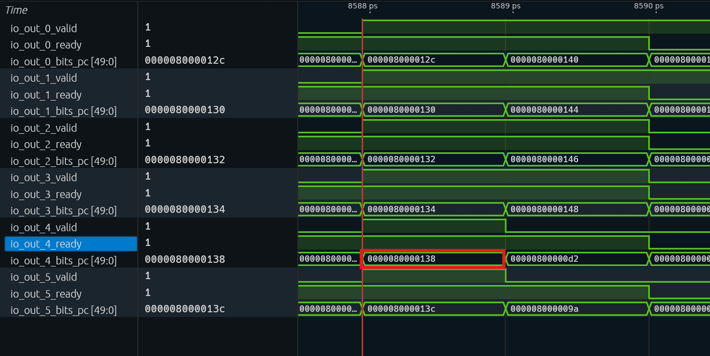

Find the instruction whose PC is `0x80000138`: it is in the lane with index `i=4` (`io_out_4_*`), and at waveform cursor 8588 that lane's `pc` is exactly `0x80000138`. Extract the decode fields of that lane in this cycle:

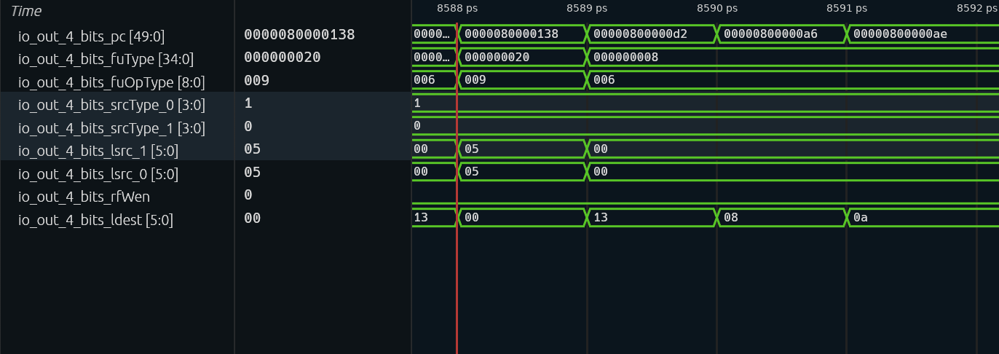
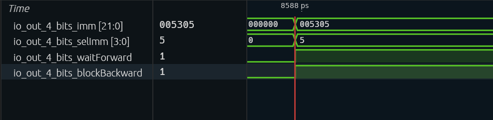

| Signal | Waveform measurement (i=4, cycle 8588) | Expected | Notes |
|---|---|---|---|
| `pc` | `0x80000138` | `0x80000138` | confirms this lane holds the `csrw` tracked here |
| `fuType` | `0x20` | `FuType.csr` | one-hot, bit 5 (counting from 0); sent to the CSR execution unit |
| `fuOpType` | `0x9` | `CSROpType.wrt` | `b001_001`, CSRRW → write |
| `srcType(0)` | `1` | `reg` | source 0 reads an integer register |
| `srcType(1)` | `0` | `imm` | source 1 is an immediate, no register read |
| `lsrc(0)` | `5` | `5` (t0) | the only real source operand |
| `lsrc(1)` | `5` | unused | `[24:20]` holds the low 5 bits of the CSR address, not rs2 |
| `ldest` | `0` | `0` | `rd=x0` |
| `rfWen` | `0` | `0` | **the decode table says 1, gated off by `ldest=0`** |
| `imm` | `0x05305` | `0x05305` | the packed `Imm_Z` |
| `selImm` | `5` | `IMM_Z` | selects the `Imm_Z` packer |
| `waitForward` | `1` | `1` | default serialization flag |
| `blockBackward` | `1` | `1` | default serialization flag |

In the same cycle, that lane's `instr` is `0x30529073`. Reading the table's fields together gives one sentence: **read x5 (t0), do not write any integer register, and perform one CSRRW write for the CSR unit.**

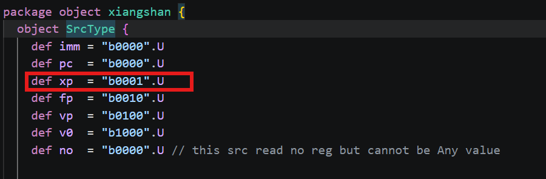

Look at the source operands first. `srcType(0)=1` (`reg`) means source 0 reads an integer register, and `lsrc(0)=5` is x5/t0; its value is `0x80001234`, computed by the preceding `addi t0,t0,564` (decode only provides logical number 5; the real value is read from the physical register after rename). `srcType(1)=0` (`imm`) means source 1 is not a register but an immediate, taken from the `imm` field. Therefore, **only x5 is a source that actually needs a register read** in the decode result.

The waveform also shows `lsrc(1)` as 5, which easily suggests a second register read. In fact, the decoder simply copies the instruction's RS1 and RS2 fields into `lsrc(0)` and `lsrc(1)`; the `[24:20]` field of a CSR instruction is not rs2 but part of the 12-bit CSR address—the low 5 bits of `0x305` happen to be `0b00101`, so `lsrc(1)` also reads 5. Because `srcType(1)=imm`, the rename stage never uses `lsrc(1)` to look up the RAT, and this 5 does not become a second source register. Now look at the destination register and the operation. `ldest=0` corresponds to `rd=x0`, so `rfWen` is cleared to 0 at the decode output: this instruction writes no integer register.

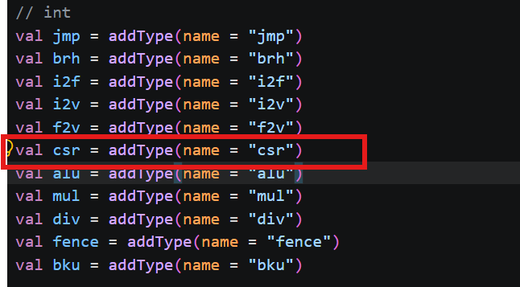

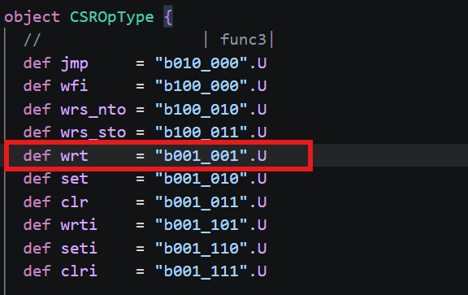

`fuType=0x20` (one-hot bit 5) selects the CSR execution unit, and `fuOpType=0x9` (`b001_001`) is `CSROpType.wrt`. So at execute it does not perform ALU addition or subtraction, but one CSR read-modify-write: the CSR unit extracts `addr=0x305` from `imm`, uses `src1` (t0's value `0x80001234`) as the write data, and writes it into mtvec with `wen=1`; the old value is read out but discarded because `rd=x0`.

The CSRRW entry in the decode table fixes the three source positions as "register, immediate, unused": the first source is read as an integer register, the second is treated as an immediate, and the third does not participate; the execution unit is CSR, the opcode is `wrt`, and the immediate format is `IMM_Z`. This entry also carries two flags, `noSpec` and `blockBack`, corresponding to `DynInst.waitForward` and `blockBackward` respectively (field order in `Bundles.scala:132-133`); they are the origin of the two serialization flags in the table above. It also sets the write enable `xWen` to true.

This `xWen` only means "whether the instruction semantically needs to write an integer register": `csrrw` with `rd≠x0` indeed writes the old value back to `rd`. But in this example `rd=x0`, and at `DecodeUnit.scala:1152` the decode unit ANDs the write enable from the table entry with a "destination register is not 0" condition, so the `rfWen` actually delivered to the backend becomes 0. This step determines all later behavior: rename does not allocate a physical register and does not write the RAT; dispatch does not occupy a BusyTable entry for it (`allocPregsValid` at `NewDispatch.scala:240` takes `rfWen` directly); and the execution unit's output does not write the register file either. If the waveform shows the table entry's write enable as 1 while the output port's `rfWen` is 0, that is not a contradiction but the result of this AND.

Another detail is `imm`. A CSR instruction packs three things—`rd`, `rs1`, and `csr`—into the 22-bit `Imm_Z` immediate field: the high 5 bits hold `rd`, the middle 5 bits hold `rs1`, and the low 12 bits hold the CSR address. In this example `rd=0`, `rs1=5`, `csr=0x305`, giving `0x05305`. The execution unit later uses this to recover the address and the data source.

`csrw` is a 4-byte instruction (CSRRW has no compressed form). Two of the three instructions before it are compressed to 2 bytes, so in this cycle the IBuffer delivers a mix of "4/2/2/4" widths, and `csrw` lands at the 4-byte-aligned address `0x80000138`.

### (2) Rename

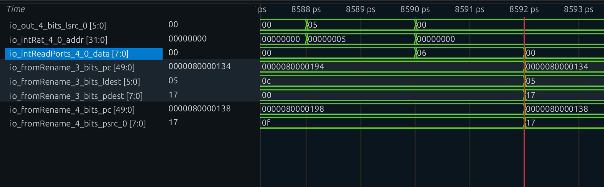

The decode stage has already begun reading the RAT: the decode stage directly connects this lane's `lsrc(0)` to the integer rename table's read address, i.e., it looks up logical number `x5`. On the waveform, at cycle 8588 both `lsrc(0)` and the `intRat` read address are `5`, and on the next cycle the RAT read port returns `io_intReadPorts_4_0_data=0x06`—the mapping of `x5` before this rename.

But the `psrc(0)` finally written into the uop is not `0x06` but `0x17`. The reason is that the `addi t0,t0,564` (`0x80000134`) producing `x5` is in lane 3 of the same rename group, and in this cycle it has just been allocated `pdest=0x17`. The same-group bypass logic in rename compares each older lane's `ldest` with this lane's `lsrc` one by one, finds that lane 3 writes `x5`, and bypasses its `pdest` to lane 4. On the waveform, at cycle 8592 lane 3's `pdest` and lane 4's `psrc(0)` become `0x17` at the same time, which is the result of this bypass. In other words, **the physical register read by `csrw` is indeed the one allocated to the preceding `addi`; only in this example it comes from the same-group bypass rather than directly from the RAT read port**.

| Signal | Waveform measurement | Notes |
|---|---|---|
| `lsrc(0)` (cycle 8588) | `5` | logical source `x5` |
| `intRat` read address (cycle 8588) | `5` | decode stage directly drives the RAT read address |
| RAT read data (cycle 8590) | `0x06` | mapping of `x5` before this rename |
| lane 3 `ldest` / `pdest` (cycle 8592) | `5` / `0x17` | the older `addi` in the same group writes `x5` |
| lane 4 `psrc(0)` (cycle 8592) | `0x17` | same-group bypass obtains the `addi`'s new physical register |

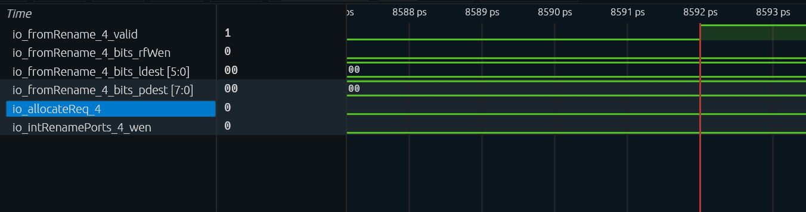

Next comes the place where this instruction differs most from ordinary instructions. The function in rename that decides "whether to allocate a destination register for an instruction" is called `needDestReg`, and it branches by register type: the integer branch does no extra checking and directly returns the `rfWen` computed at decode; only types such as floating-point and vector have their own additional conditions. In other words, for an integer instruction, if decode says "no write," rename accepts that conclusion.

`rfWen` has already been cleared by `ldest=0` at decode, so the first factor of the FreeList allocation condition—"needs an integer destination register, and is not a move that omits its destination"—is 0, and the whole condition is false.

Consequently, the instruction neither requests a physical register from the FreeList nor generates a `pdest`, and the `intRat` write port naturally has no share for it; the ROB entry's `realDestSize` also counts one fewer item.

| Signal (i=4, cycle 8592) | Waveform measurement | Notes |
|---|---|---|
| `rfWen` | `0` | already gated off at decode by `ldest=0` |
| `ldest` | `0` | `rd=x0` |
| `pdest` | `0` | no request, hence no allocation |
| `intFreeList.io.allocateReq(4)` | `0` | FreeList allocation condition does not hold |
| `io_intRenamePorts_4_wen` | `0` | RAT write enable is false |

Now the serialization flags. The relaxation applies only to "pure CSR reads," and the judgment has two steps. First, determine "is this a CSR instruction" (`isCsr`): the opcode is SYSTEM and the low two bits of `funct3` are not both 0—the latter half excludes the `funct3=000` system instructions such as `ecall`, `ebreak`, and `mret`. Then determine "is this a pure CSR read" (`isCsrr`): on top of `isCsr`, `funct3` has the form `?1?` (i.e., the CSRRS/CSRRC family, where bit 1 must be 1), and `rs1=0`—a CSRRS/CSRRC whose source operand is not `x0` writes the CSR while reading it, so it does not count as a pure read. When assigning the two flags `waitForward` and `blockBackward` to the uop, each is ANDed with "is not a csrr in the relaxation list": those matching the list get the flag removed, and the rest keep it unchanged.

`csrrw` has `funct3=001`, whose bit 1 is 0, so `isCsrr` does not hold. Therefore **even for `csrw` with `rd=x0`, which writes no register, `waitForward` and `blockBackward` remain unchanged at 1**. This is the foundation of every later conclusion in this article.

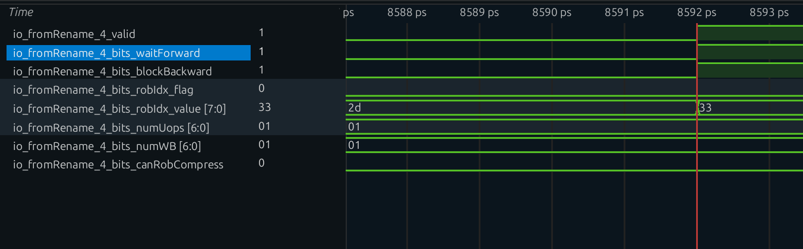

On the same cycle, `robIdx` is allocated normally; this instruction occupies a ROB entry alone, with `numUops=1` and `numWB=1`. ROB compression does not happen: compression requires adjacent instructions to be mergeable into the same entry, but instructions after `csrw` cannot even enter until it commits, so they simply cannot get together. No snapshot is generated either; snapshots are made only for CFIs, and `csrw` is not a control-flow instruction.

| Signal (i=4, cycle 8592) | Waveform measurement | Notes |
|---|---|---|
| `waitForward` | `1` | `csrrw` is not in the `isCsrr` relaxation list |
| `blockBackward` | `1` | `csrrw` is not in the `isCsrr` relaxation list |
| `robIdx_flag` / `robIdx_value` | `0` / `0x33` | allocated ROB entry `0x33` |
| `numUops` / `numWB` | `1` / `1` | single uop, produces one writeback event |
| `canRobCompress` | `0` | not compressed with an adjacent instruction into the same entry |

### (3) Dispatch

After entering Dispatch, this instruction is held up. The dispatcher computes a `blockedByWaitForward` for each slot entering in the same cycle. The condition for slot 0 is the most direct: there are still instructions in the ROB (`!io.enqRob.isEmpty`) and this slot's uop carries `waitForward`; when both hold, it is blocked. Each subsequent slot adds one more level of recursion on top: either the previous slot is already blocked (the whole group must proceed in order), or "the ROB is non-empty, or there is still a valid uop ahead in the same group" and it itself carries `waitForward`. The "there is still a valid uop ahead" half of the latter term exists to make order within the same group hold as well—even if the ROB happens to be empty, as long as some uop ahead has not left, a younger instruction carrying `waitForward` may not go first.

The other criterion, `notBlockedByPrevious`, looks the opposite way: it governs "whether the instructions ahead allow this one to pass them." The dispatcher first computes `nextCanOut` for each slot: this slot is either invalid or not a `blockBackward` instruction; then slot i's `notBlockedByPrevious` is the AND of `nextCanOut` over all slots ahead of it. As long as there is one valid `blockBackward` instruction ahead, this AND is 0. One criterion asks "must I wait?", the other asks "do those ahead let me through?"; ANDing both with the ROB's enqueue permission yields whether this cycle can actually dispatch.

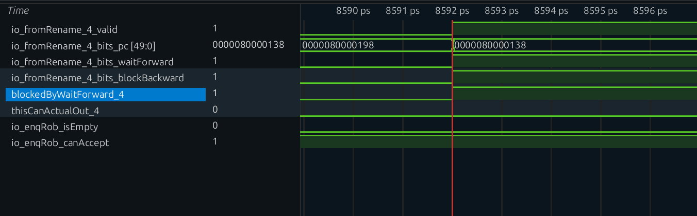

The cursor stops at cycle 8592: `io_fromRename_4_valid=1`, `pc=0x80000138`, and both `waitForward` and `blockBackward` are 1; above, `blockedByWaitForward_4` is 1, so `thisCanActualOut_4` is 0. In the same cycle `io_enqRob_isEmpty=0` and `io_enqRob_canAccept=1`—what blocks it is not ROB space but "there are older instructions in the ROB."

The two flags act on different objects:

| Flag | Object acted on | Effect |
|---|---|---|
| `waitForward=1` → `blockedByWaitForward` | **this instruction itself** | does not dispatch while the ROB is non-empty; must wait until all older instructions commit and the ROB drains |
| `blockBackward=1` | **instructions behind it** | younger instructions may not dispatch past it |

So the waveform shows an obvious wait: `csrw` sits between rename and dispatch, `enqRob.isEmpty` stays 0, and only after the four preceding instructions `lui/c.addiw/c.slli/addi` commit one after another and the ROB drains does `blockedByWaitForward` drop.

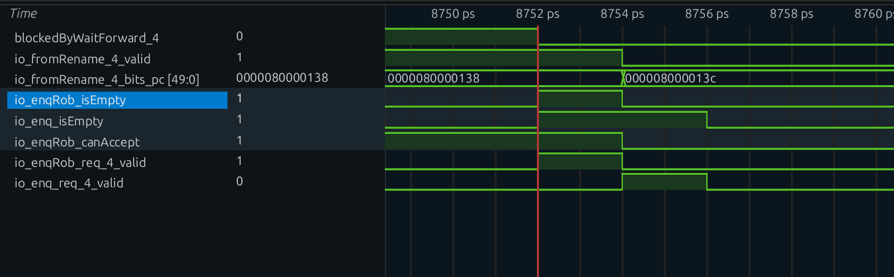

At cycle 8752 `blockedByWaitForward_4` drops and `thisCanActualOut_4` rises; `io_enqRob_isEmpty` changes from 0 to 1; at cycle 8754 `io_fromRename_4_valid` goes to zero and `pc` changes to `0x8000013c`, while `io_enq_req_4_valid` only appears at the same time. The two `isEmpty` signals are one cycle apart: the dispatch-port-side `io_enqRob_isEmpty` is 1 at cycle 8752 and returns to 0 at 8754 because of an in-flight request, while the ROB-internal `io_enq_isEmpty` only goes to 0 at cycle 8756.

After the ROB drains, `csrw` becomes the **only** instruction in the ROB. When accepting an enqueue request, the ROB checks the request's `blockBackward` flag: as soon as one instruction carrying this flag is successfully enqueued, the internal `hasBlockBackward` register is set. This register is then folded into the ROB's enqueue permission, so `io.enq.canAccept` stays false and none of the following `csrr t1, mtvec`, `li t2`, or `bne` can get in. This is the "exclusive window": it does not open only when some instruction reaches a certain stage; rather, it closes the moment `csrw` enters the ROB and only loosens when `csrw` leaves the ROB.

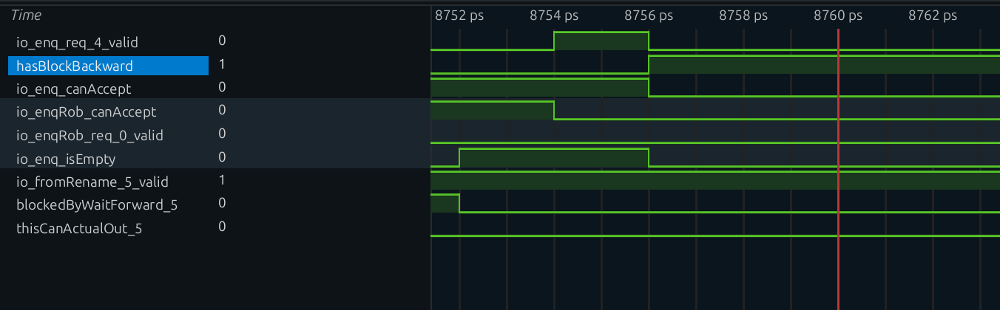

`io_enq_req_4_valid` is a narrow pulse from 8754–8756; at cycle 8756 `hasBlockBackward` rises and `io_enq_canAccept` falls from 1 to 0 (the dispatch port's `io_enqRob_canAccept` falls one cycle earlier, already at 8754). Throughout the window `fromRename_5_valid=1` while `thisCanActualOut_5=0`, and `csrr` waits in slot 5; only at cycle 8770 does `thisCanActualOut_5` rise, and at 8772 `io_enq_req_0_valid` appears—after the window closes, subsequent instructions resume entering the ROB.

Next, see which IQ it is dispatched to. In the configuration, the CSR execution unit sits in BJU3 of the 4th IssueBlock. This execution unit's configuration attaches three functional units together: `CsrCfg`, `FenceCfg`, and `DivCfg`, with the writeback port `IntWB(port = 4, 1)`. In other words, CSR does not have a dedicated scheduling queue; it shares the BJU3 issue and writeback resources with Fence and Div.

`CsrCfg` exists only once in the entire backend, and the constraint "only this one IQ can issue `CsrCfg`" uniquely determines the selection port—on the waveform, that path's `issueBlockReq` is valid only for the 3rd integer IssueBlock (BJU3). This also explains why, when looking at IQ waveforms later, the queue name contains `Alu`, `Csr`, `Fence`, and `Div` together: they belong to the same IssueBlock.

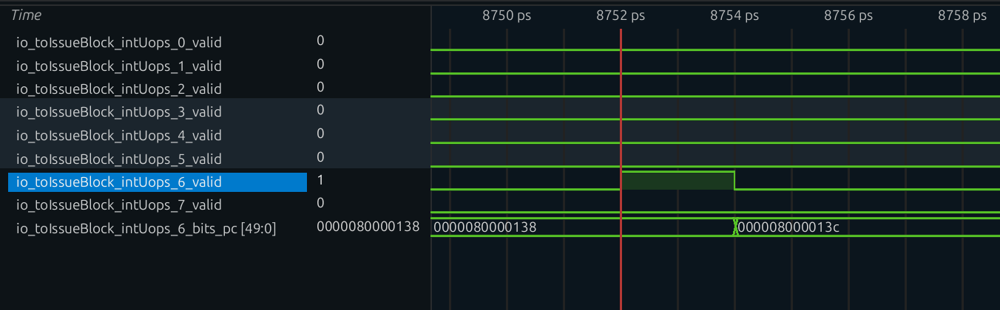

Among the 8 `intUops_*_valid` signals, only `intUops_6_valid` is 1 at cycle 8752 and the rest are 0; its `pc` is `0x80000138` at 8752 and changes to `0x8000013c` (`csrr`) at 8754. `csrw` leaves through enqueue port 6 of the 4th IssueBlock; port 7 is empty in this cycle.

### (4) Inside the IQ

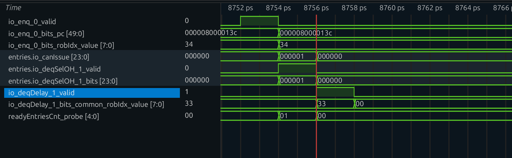

`io_enq_0_valid` is 1 at cycle 8752 with `pc=0x80000138`; the entry only becomes "issuable" at cycle 8754—`entries.io_canIssue=0x000001`, `deqSelOH_1_valid=1`, and `deqSelOH_1_bits=0x000001` all appear together, and `readyEntriesCnt_probe` also changes from 0 to 1. On the next cycle (8756), `io_deqDelay_1_valid=1` and `robIdx=0x33`, while the three entry signals from 8754 have already gone to zero. The three cycles 8752, 8754, and 8756 exactly correspond to "enqueue—select—enter the issue register."

`csrw`'s source operand `x5` was written long ago by the `addi`, and the corresponding BusyTable bit has long been cleared, so when it enters the IQ all `srcState` bits are ready and no wakeup wait is needed.

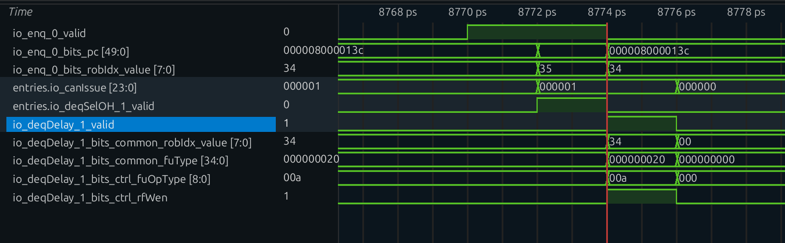

`io_enq_0_valid` stays high from 8770 through 8774; `pc` switches from `0x8000013c` to `0x80000140` at cycle 8772, and `robIdx` switches from `0x34` to `0x35`—the same enqueue port takes `csrr` and `lui` back to back. At cycle 8772, `entries.io_canIssue=0x000001` and `deqSelOH_1_valid=1`; at 8774 `io_deqDelay_1_valid=1`, whose `fuOpType=0x00a` (`set`) and `rfWen=1` contrast with `csrw`'s `wrt`/`rfWen=0`.

It usually **issues on the cycle after enqueue** for three reasons: the source operands are already ready; the CSR execution unit is not pipelined (`piped=false`) and accepts only one instruction at a time; and, thanks to the preceding serialization, at this point the IQ basically contains only this one valid instruction, so there is no competitor requiring arbitration.

Several other fields in this `FuConfig` are worth explaining. `fuType` is `FuType.csr`, which determines that it can only enter the queue carrying `CsrCfg`; `piped=false` means the execution unit has no internal pipeline and accepts only one instruction at a time, so later requests must wait for the previous one to leave; `writeIntRf=true` only says that this execution path "is capable" of writing the integer register file—whether a particular instruction writes is still determined by its own `rfWen`; `flushPipe=true` means the execution pipeline must be flushed on a redirect; and `latency` is given as `UncertainLatency()`.

`UncertainLatency()` here does not mean a specific wait length—an ordinary `csrw mtvec` does not take the AIA asynchronous path, and inside the execution unit `s_idle → s_finish` completes in one cycle. It merely tells the wakeup logic "this instruction's completion time is not fixed; do not guess a fixed number of cycles," preventing later instructions from being woken up too early with a wrong latency.

### (5) Execute

The CSR execution unit consists of two layers: `wrapper.CSR` handles interface adaptation and the read/write enables, and `NewCSR` handles the actual CSR logic. This section answers only two questions: where the address and data come from, and on what basis the write happens before commit.

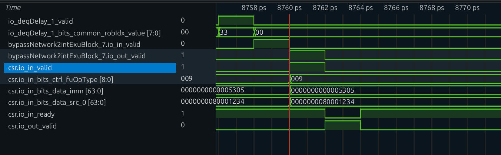

`io_deqDelay_1_valid` is 1 at cycle 8756; at 8758 it enters `bypassNetwork2intExuBlock_7.io_in`, and at 8760 `io_out_valid` and `csr.io_in_valid` are 1 at the same time—this is the cycle in which the execution unit actually accepts the request. At this point `csr.io_in_bits_data_imm=0x5305`, `src_0=0x80001234`, `fuOpType=0x009` (`wrt`), and `csr.io_in_ready` is also 1; at 8762 `csr.io_out_valid` rises and the request completes.

**Layer one: the wrapper computes the address and enables.** The `imm` sent from decode is a 22-bit `Imm_Z` immediate, which the wrapper splits into three parts: the low 12 bits are the CSR address, the next 5 bits are the source register number `rs1`, and the high 5 bits are the destination register number `rd`. For this example, the split gives address `0x305`, `rs1=5`, and `rd=0`.

The write data is selected by a mux tree indexed by the opcode `func`: `wrt` (CSRRW) takes the source operand value directly; `set` (CSRRS) takes the OR of the CSR's current value and the source operand; `clr` (CSRRC) takes the AND of the CSR's current value and the inverted source operand; the `i`-suffixed `wrti`/`seti`/`clri` replace the source operand with an immediate, with the same operation. This example is `wrt`, so what is written is `0x80001234` from `t0`.

Each of the two enables is the OR of several conditions. The write enable `csrWen` requires the instruction to be valid and either "is CSRRW (unconditional write)" or "is CSRRS/CSRRC and `rs1≠0` (only when the source operand is not `x0` is there really something to write)". The read enable `csrRen` requires the instruction to be valid and either "is CSRRW and `rd≠0` (the old value needs to be read back only when there is a destination register)" or "is CSRRS/CSRRC (these two always read, regardless of `rd`)". In this example `func=wrt` and `rd=0`, so the write enable is 1 and the read enable is 0—modify without reading, so the old value need not even be fetched.

For this example:

| Signal | Value | Reason |
|---|---|---|
| `wen` | **1** | CSRRW writes unconditionally |
| `ren` | **0** | `rd=x0`, no readback needed |
| `addr` | **`0x305`** | mtvec |
| `wdata` | **`0x0000_0000_8000_1234`** | from `src(0)`, i.e. t0 |

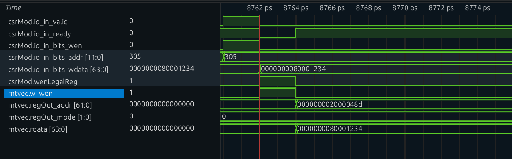

`csrMod.io_in_valid` is 1 at cycle 8760, with `wen=1` and `addr=0x305`; but `csrMod.io_in_bits_wdata` only becomes `0x80001234` at cycle 8762, the same cycle in which `wenLegalReg` rises and `mtvec.w_wen` is 1. At 8764 `mtvec.regOut_addr=0x2000048d` and `rdata=0x80001234`, with `mode` remaining 0. Looking only at cycle 8760, `wdata` is still 0; this is exactly the "write data is one cycle late" mentioned above.

**Layer two: NewCSR actually rewrites mtvec.** The key is when the write happens. `NewCSR` first obtains `wenLegal` from the permission-check module, which answers "whether this write is legal"; it then registers it for one cycle with `GatedValidRegNext` to obtain `wenLegalReg`. The code then walks the entire `csrRwMap`—the read/write description table for machine-level, supervisor-level, and virtualization-level CSRs—and connects each CSR module's write port to the condition "`wenLegalReg` is true and the address hits itself," while the write data port is uniformly connected to `wdata`. For `mtvec`, the hit is the path with address `0x305`.

Applied to a single `Bool`, `GatedValidRegNext` is just `RegNext`, so `wenLegalReg` is `wenLegal` delayed by one cycle: **the CSR register is written on the cycle after the request is accepted, the same cycle in which the state machine enters `s_finish`, not at commit**. For the `mtvec` `CSRModule`, the `wBundle.wen` of the `addr === 0x305` path rises, and `addr[63:2]` (BASE) and `mode[1:0]` (MODE, WARL; `00` = Direct in this example) are updated to `0x80001234`.

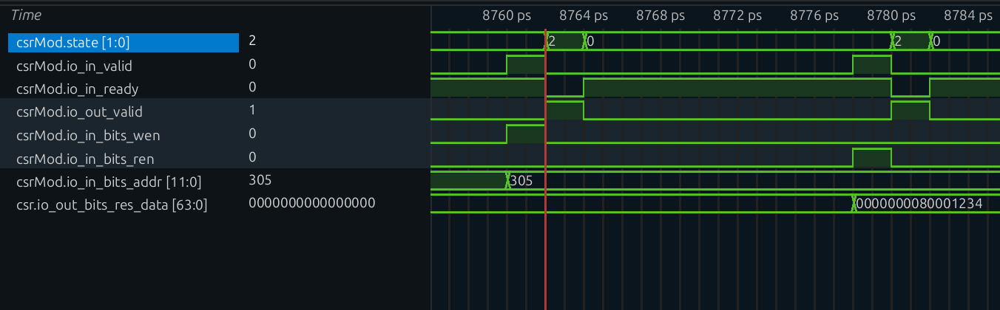

`csrMod.state` switches between idle and `s_finish` (encoding 2). At cycle 8760 `io_in_valid=1` and `ready=1`; at 8762 it enters `s_finish` and raises `io_out_valid`; at 8764 `ready` recovers. When the second `csrr` arrives at cycle 8778, `io_in_bits_ren=1` and `addr=0x305`; at 8780 it enters `s_finish` again with `csr.io_out_bits_res_data=0x80001234`. The same state machine and the same datapath carry `wen` and `ren` at different times.

The way to identify this cycle is: the moment the `Mtvec` module's internal register (or `mtvec.regOut`) jumps from its reset value to `0x80001234` is **earlier than** the moment the ROB entry commits.

`wenLegal` is provided by `CSRPermitModule` as "whether this write is legal"; an illegal write (insufficient privilege, writing a read-only CSR) never produces `wenLegalReg`—the protection "raise an exception and do not change state" is independent of serialization.

The execution unit's state machine has only three states: `s_idle`, `s_waitIMSIC`, and `s_finish`. The input port's `ready` rises only in `s_idle`, so only one CSR instruction is accepted at a time; the output port's `valid` holds when the state machine enters `s_finish` (or the AIA asynchronous path is ready) and the current request has not been flushed by a redirect. An ordinary CSR access does not enter `s_waitIMSIC`—that is the AIA asynchronous path, and `csrw mtvec` has nothing to do with it.

The cycle after the request is accepted, the state machine enters `s_finish`, the same cycle as the register write described in the previous paragraph; `redirectFlush` affects only the output, not the register write that has already happened. This shows indirectly that the correctness of a CSR write is not guaranteed by "taking effect only at commit," but by the layer of serialization in front of it.

### (6) Writeback

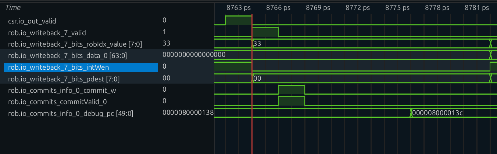

`csr.io_out_valid` is 1 at cycle 8762, and `rob.io_writeback_7_valid` only becomes 1 at cycle 8764 with `robIdx=0x33`—the intervening stage is the CtrlBlock register. In that cycle `data_0=0`, `intWen=0`, and `pdest=0`; the three "empty" signals show that it does not write the register file. But `rob.io_commits_info_0_commit_w` and `commitValid_0` rise at cycle 8766, proving that this writeback event was accounted for by the ROB.

The writeback interface is `IntWB(port = 4, 1)`, i.e. BJU3's writeback port. In this cycle there are two paths in different directions. One does not go to the register file: `rfWen=0`, the physical register file is not written, and `res.data` on the output port is the read data for the `csrRen=0` case, which is simply discarded. The other goes to the ROB: the completion event is produced as usual, because the ROB's accounting does not look at `rfWen`.

When a ROB entry is enqueued, `numWB` records "how many writeback events this instruction will produce," determined by `instrSizes - number of eliminated moves`, independent of `rfWen`; for a single-uop `csrw` this value is 1. Another field computed at enqueue time is "whether a std writeback is needed": the ROB checks each enqueue request one by one, with a single criterion—whether the functional unit type is store.

Only stores need a "std writeback"; `csrw` is not a store, so its `stdWritebacked` is set true at enqueue, and the remaining `uopNum` is decremented to 0 by the `exuWriteback` on the BJU3 path. Therefore **even though it does not write the register file, this instruction must still produce one writeback event, otherwise it would never finish in the ROB**.

After writeback, the entry has `uopNum=0` and `stdWritebacked=1`, `isWritebacked` holds, and it can commit.

### (7) Commit

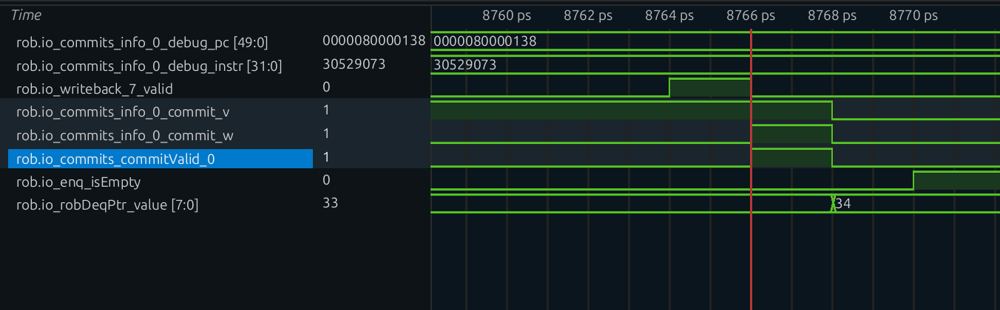

`debug_pc=0x80000138` and `debug_instr=0x30529073`, exactly the `csrw`; `commit_v` is 1 from cycle 8758 onward, while `commit_w` and `commitValid_0` only become 1 at cycle 8766—the commit condition is met one cycle after writeback (8764), and they all go to zero at 8768.

`csrw` is the only instruction in the ROB and the head of it, so it commits on the next cycle:

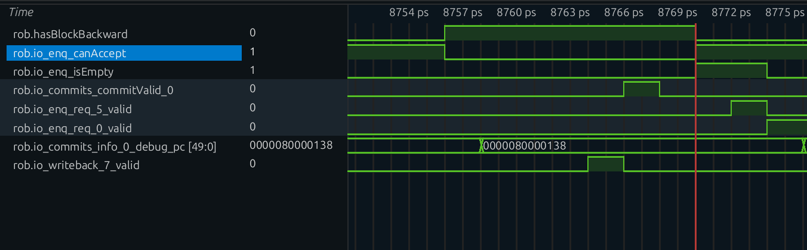

At cycle 8770 `rob.hasBlockBackward` falls from 1 to 0, `io_enq_canAccept` returns to 1, and `io_enq_isEmpty=1`; at 8772 `io_enq_req_5_valid=1` (`csrr` reaches the ROB), and at 8774 `io_enq_req_0_valid` also rises, so subsequent instructions resume. `robDeqPtr_value` has already changed from `0x33` to `0x34` at cycle 8768, two cycles before the ROB becomes empty—the pointer advances in the commit cycle itself.

Two things are worth watching in the commit cycle. The value of `mtvec` does not change again because of commit—it was written long ago; commit merely "retroactively acknowledges" this change as architectural state, and in this example nothing can roll it back. Then the ROB becomes empty, `hasBlockBackward` clears accordingly, and only then do instructions such as the following `csrr t1, mtvec` begin to be accepted.

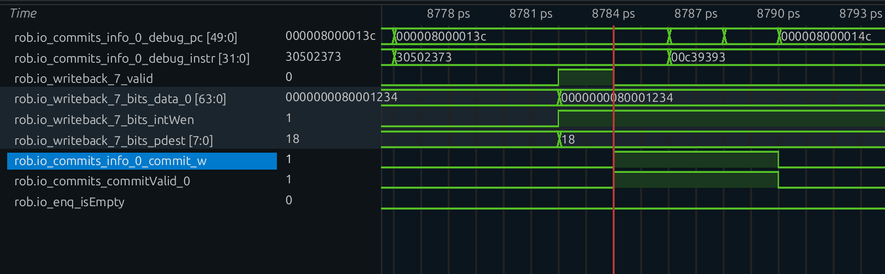

`rob.io_writeback_7_valid` is 1 at cycle 8782, with `data_0=0x80001234`, `intWen=1`, and `pdest=0x18`; this is the `csrr`'s writeback. At 8784 `commit_w` and `commitValid_0` are 1, with `debug_pc=0x8000013c` and `debug_instr=0x30502373`. The `csrr`'s writeback and commit use the same set of signals; only the data and destination register are no longer zero.

This can be verified on the waveform: the interval during which `hasBlockBackward` is high is exactly the interval during which "`csrw` is alone in the ROB."

## 3. Serialization: Why a CSR Can Rewrite Architectural State at Execute Time

The phenomena seen above can be summed up in one question: if a physical register is written wrongly, there is a second mapping to fall back on, but `mtvec` has none—so why does the hardware still dare to change it at execute time? The answer is not inside the CSR unit, but in the three gates it passes through before entering the execution unit.

The reason an ordinary instruction can "write its result to a physical register first and become architectural state only at commit" is that the physical register itself is a speculative resource: if it is wrong, the mapping can be changed and the value does not matter. **But `mtvec` is not a speculative resource**—it is a globally unique architectural register read directly by trap hardware, with no second copy to roll back to. So a CSR write must use a different kind of guarantee.

XiangShan uses three pillars:

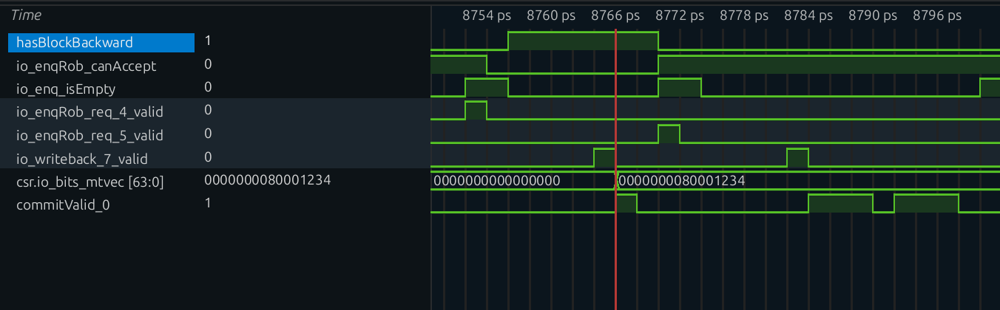

**Pillar one: the ROB must drain before dispatch (`waitForward`).**
`blockedByWaitForward` ensures that when `csrw` dispatches, all older instructions have already committed. In other words, when `csrw` executes it is itself the oldest instruction, so there is no possibility that "older instructions have not committed yet but have already been affected by its write."

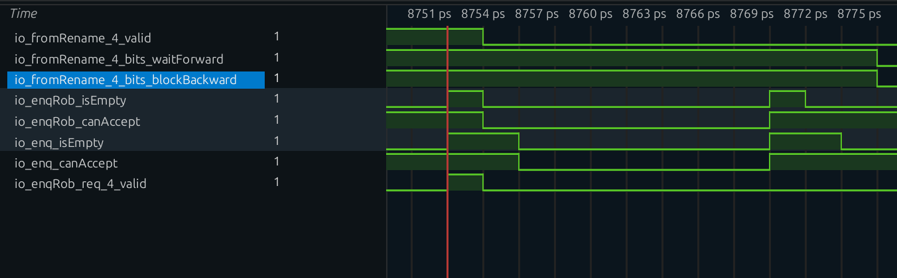

**Pillar two: younger instructions may not enter (`blockBackward`).**
`hasBlockBackward` keeps `io.enq.canAccept` false until the ROB drains. Instructions after `csrw` cannot even enter the ROB, let alone be affected by the early modification of `mtvec`. Thus `csrw` sits in a window that is "empty on both sides": the old have left, and the new have not arrived.

**Pillar three: no interrupt can slip into this window (`hasWaitForward`).**

The interrupt enable is the AND of four conditions: the interrupt bit sent by the CSR unit is set (`intrBitSetReg`, `intrBitSet` registered for one cycle), no `hasWaitForward` exists in the ROB, the head entry itself is interrupt-safe (`interrupt_safe`), and the flush state `deqHasFlushed` from handling that redirect has not yet been set.

As long as there is an instruction carrying `waitForward` in the ROB, the second condition keeps interrupts outside; an interrupt is not allowed to be taken. So it is impossible for "an interrupt to arrive while `csrw` is halfway through its write and the handler to read a half-stale `mtvec`."

Putting the three together yields this window:

| Point in time | ROB state | `mtvec` | Who might be affected |
|---|---|---|---|
| Before `csrw` dispatches | older instructions present | old value | nobody |
| `csrw` executes (writes mtvec) | **only itself** | **new value** | nobody (the old have all committed, the new cannot enter) |
| After `csrw` commits | empty | new value | subsequent instructions enter in order and see the new value |

In such a window, "write at execute" and "write at commit" are completely equivalent to software. The hardware chooses the former because registers such as `mtvec` are read in real time by trap logic, and delaying the write to commit would only increase timing coupling.

The converse also holds: **if someone were to remove `waitForward`/`blockBackward`, writing at execute would immediately become a bug**. This is exactly the key to the "relax only pure CSR reads" judgment in `Rename.scala`—it guards this boundary. The next section looks at the class of instructions that is "relaxed."

## 4. Readback Check: Why `csrr t1, mtvec` Still Comes After the Write

The program follows `csrw` immediately with a `csrr t1, mtvec`, then compares it with `0x80001234`.

### (1) It Is a "Pure CSR Read", So Both Flags Are Cleared

`csrr t1, mtvec` expands to `csrrs t1, mtvec, x0` (encoding `0x30502373`): `funct3=010` satisfies `b?1?`, and `rs1=x0`, so `isCsrr=1`. Looking at the two exception tables of `CSROoORead`, `mtvec` is in neither of them. Therefore:

| Flag | `csrw mtvec, t0` | `csrr t1, mtvec` |
|---|---|---|
| `waitForward` | **1** (kept) | **0** (cleared) |
| `blockBackward` | **1** (kept) | **0** (cleared) |
| Result | fully serialized | out-of-order read allowed |

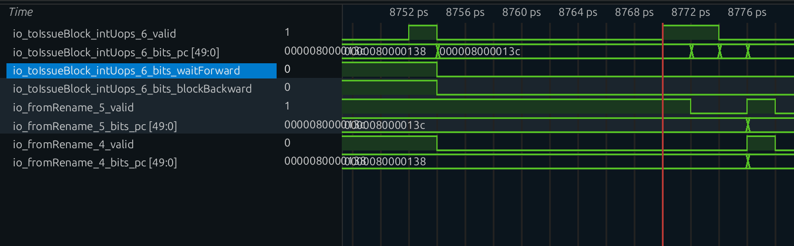

Putting the `waitForward`/`blockBackward` of the two instructions side by side on the waveform makes the contrast very intuitive—this is also the live version of the three behaviors "out-of-order read / in-order read / write" in [`csr-out-of-order-read-write.md`](csr-out-of-order-read-write.md).

### (2) But Its Order Is Still Guaranteed by the Preceding Write

`csrr` itself can execute out of order, but the `blockBackward=1` of the `csrw` before it is still in effect: before the ROB drains, `csrr` cannot even enter dispatch. So the actual timing is

```text
csrw executes (writes mtvec) → csrw commits → ROB empty → csrr dispatches → csrr executes (reads mtvec)
```

By the time `csrr` really reads, `mtvec` has long been the new value. **This is not because the read is specially protected, but because the write empties the entire pipeline.**

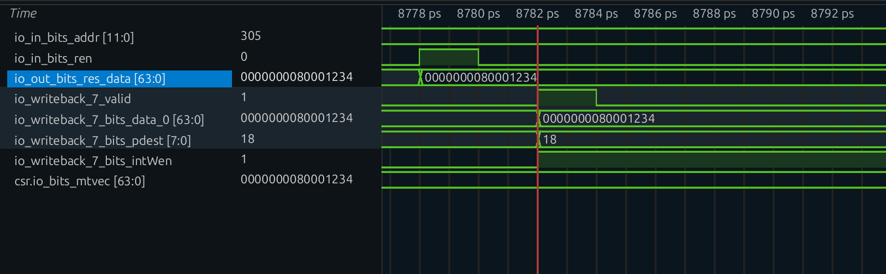

Think about it the other way: if `csrw` also had `blockBackward` removed like `csrr`, then `csrr` could run before or in the middle of the write and read the old value—this is exactly why CSR writes cannot be relaxed.

### (3) Judging the Self-Check Result from the PC

The direction taken by `bne t1,t2,1f` determines where the program finally gets stuck:

| Case | Direction | Final PC |
|---|---|---|
| `t1 == 0x80001234` (check passed) | `bne` not taken → `j 2f` | stops at `j 2b` at `2:` |
| `t1 != 0x80001234` (check failed) | `bne` taken | stops at `j 1b` at `1:` |

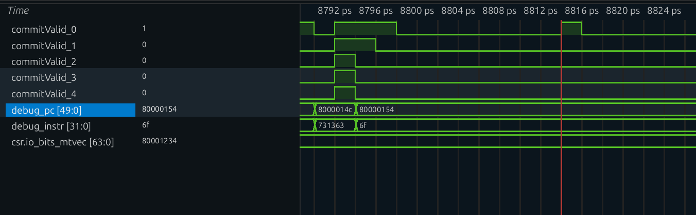

At the end of the waveform, check which PC the IFU keeps fetching to determine whether the self-check passed. You can also directly check whether the `bne` is taken in the ROB commit record.

## 5. Putting the Whole Chain Together

| Observation point | What `csrw mtvec, t0` is doing | What it means for the rest of the machine |
|---|---|---|
| Decode | `fuType=csr`, `fuOpType=wrt`, `imm=0x05305`; `rfWen` gated off by `ldest=0` | from this point the backend knows "this instruction does not write the register file" |
| Rename | reads the RAT to get the `psrc` of `x5`; allocates no `pdest` and does not write the RAT | one fewer physical-register allocation; the FreeList is untouched |
| Rename | `isCsrr=0`, so `waitForward`/`blockBackward` stay 1 | everything after it must be serialized |
| Dispatch | `blockedByWaitForward` rises; waits until the ROB drains | guarantees it is the oldest when it executes |
| Dispatch | sent to BJU3 (the only IQ containing `CsrCfg`); `hasBlockBackward` blocks subsequent enqueues | guarantees nobody is behind it when it executes |
| IQ | sources already ready, issues immediately after enqueue; `piped=false` | the CSR unit handles one instruction at a time |
| Execute | `wen=1, ren=0, addr=0x305, wdata=0x80001234`; one cycle after `wenLegalReg`, **writes mtvec** | architectural state changes at execute time |
| Writeback | goes through `IntWB(4)`, does not write the register file, but produces one ROB writeback event | `uopNum` drops to 0 and the instruction can commit |
| Commit | head-of-ROB commit; `hasBlockBackward` clears accordingly | instructions such as `csrr t1, mtvec` begin to enter the ROB |
| Afterwards | although `csrr` is allowed to be out of order, it is ordered after `csrw` by the latter's `blockBackward` and reads the new value | the `bne` self-check passes and the program stops at `2:` |

CSR writes and multiplication take two routes to obtaining parallelism: multiplication relies on "**predictable latency**," while CSR writes rely on an "**unspeculatable serial window**"—the former pursues speed, the latter correctness. Both run on the same pipeline, relying respectively on the wakeup queue and on the two groups of control bits `waitForward`/`blockBackward`.

## 6. Source Code and Further Reading

Local verification paths are based on `/nfs/home/yaoliping/XiangShan` (`kunminghu-v2`, `e7bab53e6`), with paths relative to the source root `src/main/scala/xiangshan/`:

| File | Locations used in this article |
|---|---|
| `backend/decode/DecodeUnit.scala` | `CSRRW` decode table entry (line 212), `rfWen` gating by `ldest≠0` (line 1152), `Imm_Z` packing and unpacking (lines 615–644) |
| `backend/decode/DecodeStage.scala` | RAT read-address generation (lines 263–288) |
| `backend/rename/Rename.scala` | `needDestReg` (lines 126–132), `isCsr/isCsrr` and retention of `waitForward/blockBackward` (lines 290–307), FreeList request (line 340), `numWB` accounting (lines 346–366) |
| `backend/dispatch/NewDispatch.scala` | `blockedByWaitForward` / `nextCanOut` (lines 795–819), BusyTable's `allocPregsValid` (line 240) |
| `backend/rob/Rob.scala` | `hasBlockBackward`/`hasWaitForward` (lines 186–187), enqueue gating (lines 192, 458–460), `isEmpty` clearing (lines 395–397), interrupt enable (line 575), writeback accounting (lines 1009–1059) |
| `backend/rob/RobBundles.scala` | `isWritebacked` (line 99), `commit_w` (line 173) |
| `backend/fu/FuConfig.scala` | `CsrCfg` (lines 299–311) |
| `backend/fu/wrapper/CSR.scala` | `Imm_Z` unpacking, `wdata`, `csrWen`/`csrRen` (lines 50–52, 74–91) |
| `backend/fu/NewCSR/NewCSR.scala` | `wenLegalReg` and CSR register writes (lines 322, 329, 466–479), state machine (lines 1039–1106) |
| `backend/fu/NewCSR/MachineLevel.scala` | `Mtvec` module and WARL handling of `mode` (lines 122–136) |
| `backend/fu/NewCSR/CSROoORead.scala` | out-of-order read exception lists (lines 10–55; why `csrr` can have the flags removed) |
| `Parameters.scala` | BJU3 execution-unit configuration (line 413) |

For further reading, the theoretical version of Section 4 is in [CSR Out-of-Order Read/Write Scenario Analysis](csr-out-of-order-read-write.md), which compares all three classes of CSR access (out-of-order read / in-order read / write) in full; `csr-lifecycle-analysis.md` in the same directory is another organization of the same instruction, leaning toward a "signal and configuration checklist"; `csr-format.md` is the quick reference for CSR instruction encoding and address mapping.
