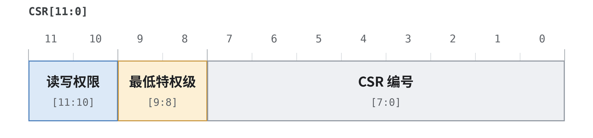
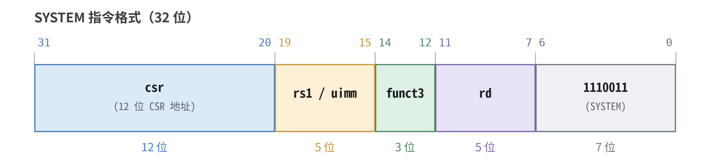

# CSR Format and Related Instructions

> This article provides a systematic overview of RISC-V CSRs (Control and Status Registers): starting from what a CSR is, it dissects the 12-bit address encoding bit by bit (privilege encoded in the address), the encoding and semantics of the six CSR instructions, pseudo-instructions, privileged/system instructions, and finally the source-level hardware implementation in XiangShan Kunminghu V2, ending with the complete journey of one instruction.

---

## 1. What Is a CSR: An Independent "Address Space"

A RISC-V processor has three kinds of places that can "store things." Once their roles are clear, CSRs become natural:

| Type | Address/Index | Count | Access Method | Characteristics |
|---|---|---|---|---|
| General-purpose registers x0–x31 | 5-bit index | 32 | Ordinary integer instructions (`add`, `ld`, …) | Data only, no side effects, freely renamed by the pipeline |
| Memory | 64-bit address | Huge | `load/store` | Has addresses, caches, and a memory pipeline |
| **CSR** | **12-bit address** | **Up to 4096 (2¹²)** | **Only via CSR instructions (or automatically updated by hardware on traps)** | **Modifies the processor's own state/control** |

The key is the last row: **a CSR does not change "data," but "how the processor is running"**—for example, `mtvec` determines where traps jump to, `mstatus` determines whether interrupts are enabled, and `satp` determines whether address translation is on. Therefore, CSRs cannot be reordered, speculated on, or renamed like general-purpose registers; the hardware must provide a separate, controlled path for them.

### 1.1 Why "Independent Addressing"

Giving CSRs their own 12-bit space, rather than placing them among general-purpose registers or memory, brings three benefits:

1. **Security isolation**: A lower privilege level cannot touch control state belonging to a higher privilege level. This check needs only the top 4 address bits (see Section 2), with no extra lookup table.
2. **Atomicity**: A CSR "read-modify-write" completes within one instruction and cannot be split by an interrupt (for example, toggling `mstatus.MIE` must be atomic).
3. **Clear semantics**: CSR instructions are distinguished from ordinary ALU/memory instructions at the encoding level (`opcode=SYSTEM`), so the pipeline can immediately recognize "this is a state operation that needs special handling."

A filing-cabinet analogy:

| Analogy | Meaning |
|---|---|
| Filing cabinet (CSR address space) | An independently addressed space of 4096 slots, unrelated to general-purpose registers or memory |
| File number (CSR address) | A 12-bit address, such as `0x180` (satp), `0x300` (mstatus), `0x305` (mtvec) |
| The number's "prefix" (top 4 address bits) | Directly encodes "who can read it and whether it can be written" (self-carried privilege) |
| Borrowing/returning (CSR instructions) | The only way to touch a file; hardware also updates some CSRs automatically on traps |

---

## 2. CSR Address Encoding: Privilege Written into the Address

RISC-V's cleverness: **instead of maintaining a separate permission table for "who can access which CSR," it encodes privilege directly into the top 4 bits of the address.** The address itself is thus a privilege declaration, and hardware decodes privilege at the same time as it decodes the address.

### 2.1 Bit-Field Layout



| Bit Field | Value | Meaning |
|---|---|---|
| `CSR[11:10]` | `00` / `01` / `10` | Read/write; `01/10` are reserved by the specification |
| | `11` | **Read-only** |
| `CSR[9:8]` | `00` | Minimum access privilege = U (User) |
| | `01` | Minimum access privilege = S (Supervisor) |
| | `10` | Minimum access privilege = H / HS (Hypervisor) |
| | `11` | Minimum access privilege = M (Machine) |
| `CSR[7:0]` | Any | Which CSR this is (the index) |

**Conclusion**: A lower privilege level attempting to access a higher-privilege CSR → illegal-instruction exception; writing a read-only CSR → illegal-instruction exception. Both rules follow directly from the high address bits.

### 2.2 Decoding a Few Addresses by Hand

Write each address as 12 binary bits; the top 4 bits directly reveal read/write permission and privilege level:

| CSR | Address (hex) | Address (12-bit binary) | `[11:10]` | `[9:8]` | Conclusion |
|---|---|---|---|---|---|
| `fflags` | `0x001` | `0000_0000_0001` | `00` | `00` | Writable, accessible at U level |
| `satp` | `0x180` | `0001_1000_0000` | `00` | `01` | Writable, requires S level |
| `mstatus` | `0x300` | `0011_0000_0000` | `00` | `11` | Writable, requires M level |
| `mtvec` | `0x305` | `0011_0000_0101` | `00` | `11` | Writable, requires M level |
| `mscratch` | `0x340` | `0011_0100_0000` | `00` | `11` | Writable, requires M level |
| `mvendorid` | `0xF11` | `1111_0001_0001` | `11` | `11` | **Read-only**, requires M level |

Taking `mvendorid = 0xF11` as an example:


So both "writing `mvendorid`" and "reading `mvendorid` in U mode" trigger an illegal-instruction exception—a direct demonstration that the address carries its own privilege.

### 2.3 XiangShan Implementation: CSRPermitModule

In `CSRPermitModule.scala`, XiangShan reproduces the specification's read-only encoding with **one line**:

```scala
// CSRPermitModule.scala — the top 2 address bits directly determine read-only
private val csrIsRO = addr(11, 10) === "b11".U     // [11:10] == 11 → read-only
private val rwIllegal = csrIsRO && wen             // a write to a read-only CSR → illegal
```

`addr(11,10) === "b11".U` corresponds to "permission bit = read-only," and `rwIllegal` turns "write to a read-only CSR" into an illegal-instruction exception, exactly matching the table in 2.2. Permission checking no longer needs a 4096-entry read/write table, so the hardware cost is extremely low.

---

## 3. CSR Instruction Format: Encoded Down to Every Bit

All CSR instructions share the same **SYSTEM opcode** (opcode = `1110011`, i.e. `0x73`), and `funct3` distinguishes which one it is.

### 3.1 Complete 32-Bit Layout



| Field | Bits | Description |
|---|---|---|
| `csr` | `[31:20]` | 12-bit address of the target CSR |
| `rs1` / `uimm` | `[19:15]` | Source register (register form), or a 5-bit zero-extended immediate (immediate form) |
| `funct3` | `[14:12]` | Distinguishes the six instructions plus privileged instructions |
| `rd` | `[11:7]` | Destination register, receives the "old value read out" |
| `opcode` | `[6:0]` | `1110011` (SYSTEM / 0x73) |

### 3.2 Bit-Level Meaning of funct3

The three bits of `funct3` each have a role; this is not an arbitrary numbering table:

```
funct3[2]   = 1 → immediate form ([19:15] is zimm, not rs1)
funct3[1:0] = 01 → write (CSRRW, direct overwrite)
            = 10 → set (CSRRS, OR)
            = 11 → clear (CSRRC, AND NOT)
funct3      = 000 → not a CSR access; a privileged/system instruction
```

That is: **`funct3[2]` selects the "source" (register / immediate), and `funct3[1:0]` selects the "action" (write / set / clear)**. The only difference between `001` (write) and `101` (write-immediate) is the top bit.

### 3.3 funct3 → CSROpType Mapping

During decode, `funct3` is encoded into XiangShan's `CSROpType`. According to [`package.scala`][OP] lines 232–259: **bit 3 of `FuOpType` is `isCsrAccess`, and the low 3 bits are funct3**. For example, `CSROpType.wrt = b001_001` (bit 3 = 1 means this is a CSR access, and the low 3 bits `001` are CSRRW's funct3):

| funct3 | CSROpType | Corresponding Instruction |
|---|---|---|
| `001` | `wrt` | CSRRW |
| `010` | `set` | CSRRS |
| `011` | `clr` | CSRRC |
| `101` | `wrti` | CSRRWI |
| `110` | `seti` | CSRRSI |
| `111` | `clri` | CSRRCI |
| `000` | `jmp` / `wfi` | Privileged instructions (ECALL/EBREAK/SRET/MRET… / WFI, see Section 6) |

### 3.4 Machine-Code Examples

Take `csrrw t0, mstatus, t1` (read the old mstatus value into t0 while writing t1 into mstatus):

- `csr = mstatus = 0x300` (12 bits)
- `rs1 = t1 = x6` (5 bits)
- `funct3 = 001` (CSRRW)
- `rd = t0 = x5` (5 bits)
- `opcode = 1110011`

```
  [31:20]   [19:15] [14:12] [11:7]  [6:0]
  0x300      00110    001     00101  1110011
  0011 0000 0000 | 00110 | 001 | 00101 | 1110011
= 0011 0000 0000 0011 0001 0010 1111 0011
= 0x300312F3
```

The immediate form `csrrwi t0, mstatus, 5` (funct3=101, with the source replaced by the 5-bit zero-extended immediate 5):

```
  [31:20]   [19:15] [14:12] [11:7]  [6:0]
  0x300      00101    101     00101  1110011
= 0x3002D2F3
```

> The comparison shows: `[14:12]` (bit 2 of funct3) changes from `001` to `101`; `[19:15]` also changes from `rs1` (t1 = x6, `00110`) to the 5-bit zero-extended immediate `5` (`00101`). These two places capture exactly the difference between "register source" and "immediate source."

### 3.5 How XiangShan Unpacks These Fields: SelImm.IMM_Z

CSR instructions **pack** `rs1`, the CSR address, `rd`, and the immediate **together** into a unified immediate field, which the execution unit then unpacks. Decode uses `SelImm.IMM_Z`:

```scala
// DecodeUnit.scala — CSRRW decode
CSRRW -> XSDecode(SrcType.reg, SrcType.imm, SrcType.X,
  FuType.csr, CSROpType.wrt, SelImm.IMM_Z, xWen = T, noSpec = T, blockBack = T)
```

The execution unit uses four `Imm_Z()` getters to unpack the fields ([`wrapper/CSR.scala`][WCSR] lines 49–55):

```scala
Imm_Z().getCSRAddr   // [31:20] → CSR address
Imm_Z().getRD        // [11:7]  → rd
Imm_Z().getRS1       // [19:15] → rs1
Imm_Z().getImm5      // [19:15] → 5-bit zero-extended immediate (immediate form)
```

---

## 4. Semantics of the Six Instructions: Read the Old Value First, Then Modify and Write

### 4.1 Semantics Summary (`t = old CSR value`)

| Instruction | `funct3` | Semantics | Read-modify-write Action | Analogy |
|---|---|---|---|---|
| **CSRRW** | `001` | `rd = t; CSR = rs1` | Write (direct overwrite) | Swap the sheet—take down the old sheet for rd, hang up the new one |
| **CSRRS** | `010` | `rd = t; CSR = t \| rs1` | Set (OR) | Tick a box—old sheet OR mask |
| **CSRRC** | `011` | `rd = t; CSR = t & ~rs1` | Clear (AND NOT) | Erase a tick—old sheet AND inverse mask |
| **CSRRWI** | `101` | `rd = t; CSR = zimm` | Write immediate | Same as above, with the new value in the instruction |
| **CSRRSI** | `110` | `rd = t; CSR = t \| zimm` | Set immediate | Same as above (immediate tick) |
| **CSRRCI** | `111` | `rd = t; CSR = t & ~zimm` | Clear immediate | Same as above (immediate erase) |

### 4.2 Two Rules That Always Apply

1. **Read before write**: `rd` always receives the CSR's **old value**, regardless of whether a new value will be written afterwards. This is the "read" half of "read-modify-write," and the reason hardware uses `rData` (the old value) as the writeback data (see `csr-lifecycle-analysis.md` 2.6).
2. **`rs1 = x0` does not write**: In CSRRS/CSRRC, if the source is x0, then `t|x0 = t` and `t&~x0 = t`, which amounts to "read only, no write." This is exactly how the pseudo-instruction `csrr` is implemented (see Section 5).

### 4.3 Write-Enable Determination in XiangShan's Wrapper Layer

The write enable `csrWen` is determined strictly by "does this really write" ([`wrapper/CSR.scala`][WCSR] lines 74–94):

```scala
csrWen := valid && (isCSRRW || (isCSRRSorRC && rs1 =/= 0))
```

- `CSRRW` always writes (even `csrw` with `rd=x0` writes).
- `CSRRS/CSRRC` writes only when `rs1 ≠ 0`; when `rs1=0` it degenerates into a pure read and `csrWen=0`.

This corresponds exactly to rule 2 in Section 4.2: at the write-enable layer, hardware filters out the "fake write" when `rs1=x0`.

---

## 5. Pseudo-Instructions: Making Assembly Easier

In many cases, only a "read" or only a "write" is wanted, with no interest in the return value. The RISC-V assembler provides pseudo-instructions that expand into special cases of the six instructions:

| Pseudo-Instruction | Expands To | Effect |
|---|---|---|
| `csrr rd, csr` | `csrrs rd, csr, x0` | Read only (`rs1=x0`; OR does not change the value) |
| `csrw csr, rs` | `csrrw x0, csr, rs` | Write only (`rd=x0`; discards the old value) |
| `csrs csr, rs` | `csrrs x0, csr, rs` | Set only |
| `csrc csr, rs` | `csrrc x0, csr, rs` | Clear only |
| `csrwi csr, zimm` | `csrrwi x0, csr, zimm` | Write immediate only |
| `csrsi csr, zimm` | `csrrsi x0, csr, zimm` | Set immediate only |
| `csrci csr, zimm` | `csrrci x0, csr, zimm` | Clear immediate only |

Two "magic registers" play a key role:

- **`x0` as source (rs1)** → makes CSRRS/CSRRC degenerate into "read only," i.e. `csrr`.
- **`x0` as destination (rd)** → discards the old value read out, i.e. the `csrw` family's "write only."

In hardware terms: when `rd=x0`, `rfWen=0` (do not write the integer register file); only "pure write" instructions such as `csrw` (CSRRW) also have `csrRen=0` (do not read back the old value), see [`wrapper/CSR.scala`][WCSR] lines 311–318. Note that `csrRen=0` holds only for CSRRW—although `csrs`/`csrc` have `rd=x0`, they still need the old value for OR / AND-NOT, so `csrRen` remains 1 (see the signal table in Section 7.4). In task #104's configuration program `csr-scenario.c`, `csr_read`/`csr_write` use `csrr` and `csrw`.

---

## 6. Related Privileged Instructions: The Same SYSTEM Opcode

CSR instructions are not the whole of the SYSTEM opcode (`1110011`). The `funct3 = 000` slot is reserved for a group of **privileged/system instructions**. They also go through the CSR execution unit but are distinguished by the `csr` field (`[31:20]` of the instruction).

### 6.1 Privileged Instructions at a Glance (with Complete Machine Code)

| Instruction | `funct3` | `[31:20]` | Complete Machine Code | Purpose |
|---|---|---|---|---|
| **ECALL** | `000` | `0x000` | `0x00000073` | Environment call—trap, raises an exception |
| **EBREAK** | `000` | `0x001` | `0x00100073` | Breakpoint—raises a breakpoint exception |
| **WFI** | `000` | `0x105` | `0x10500073` | Wait for interrupt—enter low-power wait |
| **SRET** | `000` | `0x102` | `0x10200073` | Return from S-mode trap |
| **MRET** | `000` | `0x302` | `0x30200073` | Return from M-mode trap |
| **MNRET** | `000` | `0x702` | `0x70200073` | Return from machine-level NMI trap |
| **DRET** | `000` | `0x7B2` | `0x7B200073` | Return from debug mode |

> Reuse trick: instructions with `funct3=000` treat `[31:20]` as an **instruction number** (`0x000`=ecall, `0x302`=mret, …), not as a real CSR address. The same field means different things under different funct3 values. For xRET instructions, `[31:20]` is actually a 12-bit immediate formed by `funct7(imm[11:5]) + rs2(imm[4:0])`.

> Note that although `SFENCE.VMA` (`0x12000073`) also has `funct3=000`, it **does not go through the CSR execution unit**; in XiangShan it uses `FuType.fence`—it is an address-translation flush instruction, semantically different from "read-modify-write a CSR state."

### 6.2 XiangShan: Decode-Layer Mapping

These privileged instructions also map to `FuType.csr` during decode, but their internal operation type is `jmp` (jump type) or `wfi`:

```scala
// DecodeUnit.scala — privileged instructions also use FuType.csr
EBREAK -> XSDecode(..., FuType.csr, CSROpType.jmp, ..., noSpec = T, blockBack = T),
ECALL  -> XSDecode(..., FuType.csr, CSROpType.jmp, ..., noSpec = T, blockBack = T),
SRET   -> XSDecode(..., FuType.csr, CSROpType.jmp, ..., noSpec = T, blockBack = T),
MRET   -> XSDecode(..., FuType.csr, CSROpType.jmp, ..., noSpec = T, blockBack = T),
DRET   -> XSDecode(..., FuType.csr, CSROpType.jmp, ..., noSpec = T, blockBack = T),
WFI    -> XSDecode(..., FuType.csr, CSROpType.wfi, ..., noSpec = T, blockBack = T),
```

Two control bits are worth remembering:

- **`noSpec = T`**: speculation is not allowed. ecall/mret change the privilege level and the control flow, so speculative execution can easily go wrong; better not to speculate at all.
- **`blockBack = T`**: block backward rollback. While such an instruction is executing, subsequent instructions must not be rolled back incorrectly.

### 6.3 XiangShan: Second-Stage Discrimination in the CSR Execution Unit

Once inside the CSR execution unit, the `jmp` type is combined with the `csr` field (the `addr` signal) for a second round of discrimination, to determine whether this is a call, a breakpoint, or a return:

```scala
// CSR.scala — jmp type + csr field → which privileged instruction this is
val isEbreak = addr === privEbreak && func === CSROpType.jmp
val isEcall  = addr === privEcall  && func === CSROpType.jmp
val isMret   = addr === privMret   && func === CSROpType.jmp
val isSret   = addr === privSret   && func === CSROpType.jmp
val isWFI    = func === CSROpType.wfi
```

Here `addr` is exactly the `[31:20]` field of the instruction—it is packed into the CSR unit's `addr` signal during decode and compared against constants such as `privEbreak / privEcall / privMret / privSret …` during execution.

---

## 7. XiangShan Hardware Implementation: A Source-Level Overview

This section strings the code scattered across the previous sections into a complete "decode-to-execute" chain.

### 7.1 Decode: DecodeUnit.scala

The six CSR instructions and the privileged instructions are decoded uniformly in [`DecodeUnit.scala`][D] (around lines 212–218). Taking CSRRW as the representative:

```scala
CSRRW  -> XSDecode(SrcType.reg, SrcType.imm, SrcType.X, FuType.csr, CSROpType.wrt,  SelImm.IMM_Z, xWen = T, noSpec = T, blockBack = T)
CSRRS  -> XSDecode(..., CSROpType.set,  ...)   // same noSpec=T, blockBack=T
CSRRC  -> XSDecode(..., CSROpType.clr,  ...)
CSRRWI -> XSDecode(..., CSROpType.wrti, ...)
CSRRSI -> XSDecode(..., CSROpType.seti, ...)
CSRRCI -> XSDecode(..., CSROpType.clri, ...)
```

Key point: all CSR instructions have `noSpec = T, blockBack = T`—this is the source of "CSR instructions are serialized by default"; only later, at rename, is the serialization conditionally removed for "pure CSR reads."

### 7.2 Permission: CSRPermitModule.scala

Read-only determination (see 2.3):

```scala
private val csrIsRO = addr(11, 10) === "b11".U
private val rwIllegal = csrIsRO && wen
```

### 7.3 Execution Unit Configuration: FuConfig.scala

```scala
FuConfig(name = "csr", fuType = FuType.csr, piped = false, writeIntRf = true,
  latency = UncertainLatency(), flushPipe = true, ...)
```

- `piped = false`: the CSR execution unit handles only one uop at a time; it is not pipelined internally.
- `latency = UncertainLatency()`: related to asynchronous AIA (IMSIC) accesses and trap handling.
- Execution port: `ExeUnitParams("BJU3", Seq(CsrCfg, FenceCfg, DivCfg), ...)`; CSR shares `BJU3` with Fence and Div ([`Parameters.scala`][PORT] lines 411–414).

### 7.4 Datapath: wrapper/CSR.scala + NewCSR

`wrapper.CSR` adapts the FuncUnit interface (read/write enables, data preparation), while `NewCSR` implements the actual CSR logic (dispatch, Mux1H selection, state machine):

| Signal | Expression/Meaning | Location |
|---|---|---|
| `csrAccess` | `valid && isCsrAccess(func)` | [WCSR][WCSR] 74–94 |
| `csrWen` | `CSRRW` always writes; `CSRRS/RC` writes only if `rs1≠0` | [WCSR][WCSR] 74–94 |
| `csrRen` | `(CSRRW && rd≠0) \|\| CSRRS/RC` | [WCSR][WCSR] 74–94 |
| `wdata` | `wrt → src1` (CSRRW uses rs1 as write data) | [WCSR][WCSR] 74–94 |
| `rdata` | `Mux1H` over `csrRwMap` selected by `raddr` | [NCSR][NCSR] 1009–1017 |
| `regOut` | `Mux1H` over `csrOutMapFilter` to get the raw value (no read mask, used for RMW) | [NCSR][NCSR] 1019–1030 |

`NewCSR` state machine ([NCSR][NCSR] lines 1039–1106):

```scala
switch(state) {
  is(s_idle)    { when(valid && !redirectFlush) { stateNext := s_finish } }
  is(s_finish)  { when(redirectFlush || io.out.ready) { stateNext := s_idle } }
}
io.in.ready := (state === s_idle)   // accept only one CSR request at a time
```

An ordinary CSR completes in a single cycle (`s_idle → s_finish`); AIA registers take the asynchronous `s_waitIMSIC` path.

---

## 8. The Complete Journey of One Instruction: From Machine Code to Execution Unit

Taking `csrrw t0, mstatus, t1` (= `0x300312F3`) as an example, here is the whole pipeline:


**Core principle**: the CSR address itself "carries" privilege information (`[11:10]` read/write, `[9:8]` privilege level), while the instruction uses `funct3` to distinguish the three read-modify-write actions (write/set/clear). Together they form the complete window through which the processor manages its own state.

---

## 9. Key Signal Table

| Signal Name | Location | Width | Meaning |
|---|---|---|---|
| `csr` / `addr` | Instruction `[31:20]` | 12 | CSR address (or privileged-instruction number) |
| `funct3` | Instruction `[14:12]` | 3 | Distinguishes the six instructions plus privileged instructions |
| `rs1` / `zimm` | Instruction `[19:15]` | 5 | Source register / 5-bit zero-extended immediate |
| `rd` | Instruction `[11:7]` | 5 | Destination register (receives the old value) |
| `csrIsRO` | CSRPermitModule | 1 | `addr(11,10)===11`, read-only determination |
| `rwIllegal` | CSRPermitModule | 1 | Write to a read-only CSR → illegal-instruction exception |
| `csrWen` | wrapper.CSR | 1 | CSR write enable |
| `csrRen` | wrapper.CSR | 1 | CSR read enable |
| `wdata` | wrapper.CSR | 64 | Write data (equals rs1 for CSRRW) |
| `rdata` | NewCSR | 64 | Old value read (with read mask) |
| `regOut` | NewCSR | 64 | Raw register value (no read mask, used for RMW) |
| `noSpec` / `blockBack` | DecodeUnit | 1 each | No speculation / block backward rollback (serialization) |
| `waitForward` / `blockBackward` | Rename→Dispatch | 1 each | Serialization control bits (derived from the previous two) |

---

## 10. Summary

### ✅ Key Takeaways

- **CSR format**: a 12-bit independent address space (up to 4096 registers); the top 4 address bits directly encode privilege—`csr[11:10]` = read/write permission (`11` = read-only), `csr[9:8]` = minimum privilege level (`00/01/10/11` = U/S/H/M).
- **CSR instructions**: six instructions share the SYSTEM opcode (`0x73`) and are distinguished by `funct3`—CSRRW(`001`)/CSRRS(`010`)/CSRRC(`011`)/CSRRWI(`101`)/CSRRSI(`110`)/CSRRCI(`111`); `funct3[2]` selects the source (register/immediate), `funct3[1:0]` selects the action (write/set/clear). All are atomic read-modify-writes that first read the old value into rd, then write back according to RW/RS/RC.
- **Pseudo-instructions**: `csrr`/`csrw`/`csrs`/`csrc`/`csrwi`/`csrsi`/`csrci` expand into special cases of the six instructions, using `x0` as the source (read only) or destination (write only).
- **Privileged instructions**: the `funct3=000` slot is reserved for ecall/ebreak/wfi/sret/mret/mnret/dret, distinguished by the `[31:20]` field; they also go through the CSR execution unit (`CSROpType.jmp`/`wfi`), but SFENCE.VMA uses `FuType.fence`.
- **XiangShan implementation**: read-only determination `addr(11,10)==="b11".U` (CSRPermitModule); read/write enables `csrWen/csrRen` (wrapper/CSR); data selection by `Mux1H` (NewCSR); `noSpec=T, blockBack=T` (serialization constraints at decode).

**One-sentence summary**: the CSR "format" writes privilege into the address, and the "instruction" writes the action into funct3—the address tells you "who can and cannot write," funct3 tells you "how to read-modify-write," and together they are the window through which the processor manages itself.

---

## Appendix: Key Code Index

| Module | File Path | Key Lines |
|---|---|---|
| CSR decode | `src/main/scala/xiangshan/backend/decode/DecodeUnit.scala` | 212–218 |
| CSROpType definition | `src/main/scala/xiangshan/package.scala` | 232–259 |
| Permission check (read-only) | `src/main/scala/xiangshan/backend/fu/NewCSR/CSRPermitModule.scala` | — |
| CSR wrapper (read/write enables/field unpacking) | `src/main/scala/xiangshan/backend/fu/wrapper/CSR.scala` | 49–119, 309–318 |
| NewCSR main module (datapath/state machine) | `src/main/scala/xiangshan/backend/fu/NewCSR/NewCSR.scala` | 1009–1140 |
| CSR FuConfig (not pipelined) | `src/main/scala/xiangshan/backend/fu/FuConfig.scala` | 299–311 |
| Execution port configuration | `src/main/scala/xiangshan/Parameters.scala` | 411–414 |

[D]: src/main/scala/xiangshan/backend/decode/DecodeUnit.scala
[R]: src/main/scala/xiangshan/backend/rename/Rename.scala
[DIS]: src/main/scala/xiangshan/backend/dispatch/NewDispatch.scala
[PORT]: src/main/scala/xiangshan/Parameters.scala
[CFG]: src/main/scala/xiangshan/backend/fu/FuConfig.scala
[WCSR]: src/main/scala/xiangshan/backend/fu/wrapper/CSR.scala
[NCSR]: src/main/scala/xiangshan/backend/fu/NewCSR/NewCSR.scala
[OP]: src/main/scala/xiangshan/package.scala

> Updated: 2026-10-14
