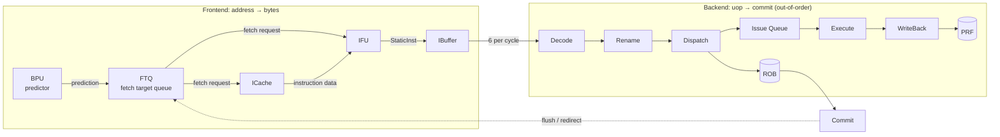
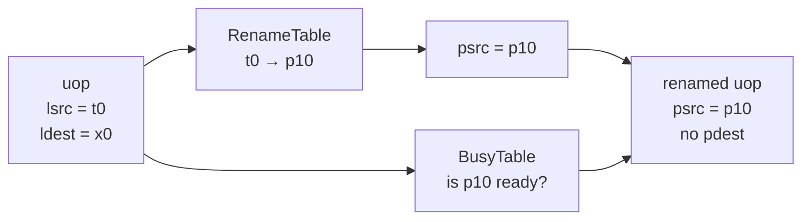
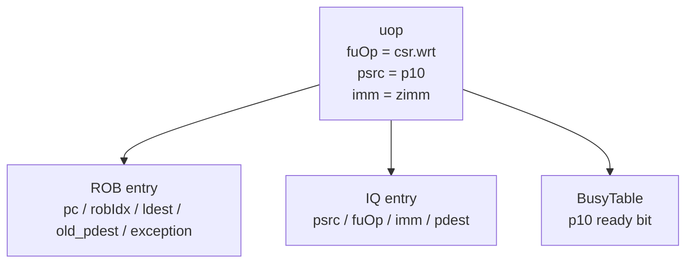
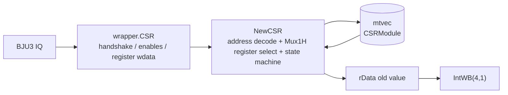
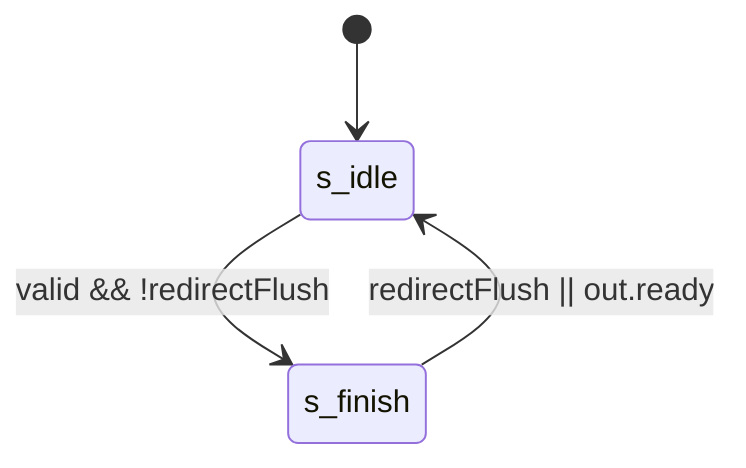
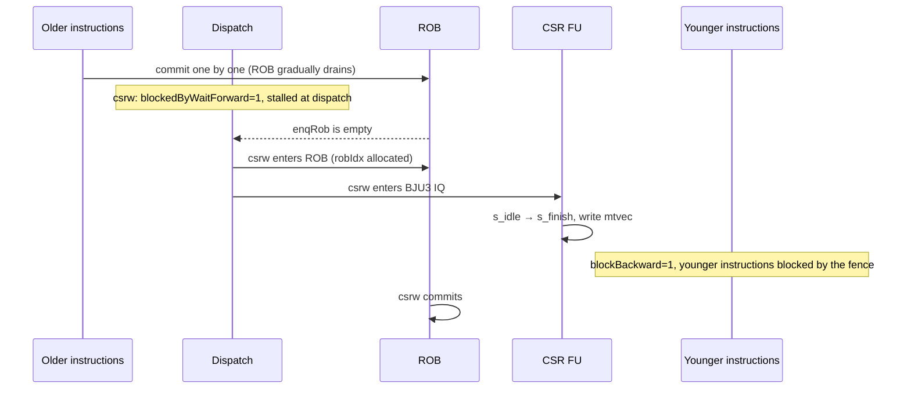

# Execution Lifecycle of a CSR Write Instruction (Using `csrw mtvec, t0` as an Example)

> This article follows a single M-mode CSR Write instruction, `csrw mtvec, t0`, through a complete lifecycle in XiangShan Kunminghu V2 (`KunminghuV2Config`): fetch → decode → rename → dispatch → issue → execute → writeback → commit.
>
> Unlike a plain signal listing, this article answers two questions at every stop: **what does this step do in microarchitectural terms, and why must it be done this way?** Readers who only want the conclusions can read §0 (machine model) and §3 (serialization mechanism).

---

## 0. Understanding the Machine First

### 0.1 The Pipeline an Instruction Traverses



Three points are enough to read this diagram:

- **The frontend is "typeless"**: BPU, FTQ, ICache, and IFU only understand addresses and bytes. Here, `csrw` is indistinguishable from `addi` or `lw`, and the frontend does not even know about `is_csr`.
- **Only the backend classifies instructions**: Decode uses the opcode to decide which functional unit the instruction goes to, how many sources it reads, and whether it writes back.
- **Out-of-order happens only in the middle**: fetch and execution can be out of order, but **commit is strictly in order**, which is the prerequisite for precise exceptions.

### 0.2 Six Key Backend Structures

| Structure | What It Stores | Problem It Solves | Relevance Here |
|---|---|---|---|
| **ROB** | Program-order uop metadata: `pc`, `pdest`, `old_pdest`, exception/branch information | In-order commit, precise exceptions, register release | ★★★ dispatch/commit |
| **RenameTable** | Logical register → physical register (speculative and committed copies) | Eliminates WAW/WAR false dependencies | ★★ |
| **BusyTable** | Whether each `psrc` value is ready | Source-operand check before issue | ★★ |
| **FreeList** | Free physical register numbers | Allocates `pdest` for `ldest` | ★ |
| **IQ (issue queue)** | Dispatched but not yet issued uops, with `psrc/fuOp/imm` | Out-of-order issue | ★★★ wait and issue |
| **PRF** | The actual register values | Data storage (ROB has no values) | ★★ read sources |

**Key insight: what flows through the ROB is not data, but "numbers" and "state."** The real values live in the PRF, result buses, and memory hierarchy.

### 0.3 Three Rules of Out-of-Order Execution

1. **In-order commit**: The architectural effect of any instruction takes effect only once it becomes the oldest instruction in the ROB.
2. **Rename eliminates dependencies**: Translate "logical register dependencies" into "physical register dependencies" so unrelated instructions can proceed in parallel.
3. **Speculation must have a way back**: All out-of-order/speculative results must be undoable by a single flush. Registers can be discarded through renaming, and branches can be rolled back through the ROB—**but operations with side effects that cannot be rolled back are the troublemakers**.

### 0.4 What Makes `csrw` Special in Microarchitecture

`csrw` lands exactly on the sore point of rule 3:

| Characteristic | `addi` | `csrw mtvec, t0` |
|---|---|---|
| Where it writes | Integer PRF | **CSR file** (core state) |
| Rename protection? | Yes (writes a new `pdest`; the old value is untouched) | **No** (there is only one global copy of a CSR) |
| Can it be rolled back? | Yes (just discard the `pdest`) | **No** (no CSR checkpoint/snapshot) |
| Side effects | None | Changes architectural behavior such as the trap entry |

The CSR file has neither renaming nor historical versions. Once a value is written, there is no hardware mechanism to "undo" it. So XiangShan did not choose to "buffer the write until commit." Instead it uses two more straightforward measures:

- **`waitForward`**: before dispatch, it must wait until the ROB is drained—ensuring that when it executes, no older instruction exists in the pipeline;
- **`blockBackward`**: instructions after it (younger) cannot dispatch past it—ensuring that a CSR access is a "fence" in program order.

These two measures are the subject of §3 and the most important microarchitectural content of this article.

### 0.5 Basic Information

| Field | Content |
|---|---|
| **Instruction name** | `csrw mtvec, rs1` (assembly mnemonic; machine encoding is `csrrw x0, mtvec, rs1`) |
| **Encoding format** | `csr[11:0]_rs1[4:0]_funct3=001_rd=00000_opcode=1110011`; the example in this article, `csrrw x0, mtvec, t0` = `0x30529073` |
| **RISC-V extension** | RV64I + `Zicsr` |
| **Compressed form?** | No (SYSTEM-class 32-bit instruction; the C extension does not cover CSR accesses, so it is only 32 bits) |
| **Instruction class** | CSR write; with `rd=x0` it does not read back the old value, so it is a pure write |
| **FuType** | `FuType.csr` |
| **FuOpType** | `CSROpType.wrt` |
| **Target FU** | `wrapper.CSR` → `NewCSR` → `Mtvec` CSRModule |
| **Source commit** |  |

The semantics of `csrw mtvec, t0` are to write the value of general-purpose register `t0` into the machine-mode CSR `mtvec` (address `0x305`). When writing `0x80001234`, according to the field layout of `mtvec` (see Section 4), `MODE=Direct` and `BASE=0x80001234`.

---

## 1. Frontend Path: Delivering Bytes to the Backend

### 1.1 Fetch

A CSR instruction is itself just an ordinary 32-bit instruction; the frontend has no CSR-specific handling. Like an ordinary integer instruction, it goes through FTQ → ICache/IFU → IBuffer.

Microarchitecturally, this step only does "data shaping," not "semantic understanding":

- **FTQ** queues the BPU's prediction results and sends fetch requests to both ICache and IFU;
- **ICache** handles address translation and data fetch, returning a **byte block + valid mask**;
- **IFU** slices the byte block into 16/32-bit instructions according to `isRVC`, attaches predecode tags, and produces `StaticInst`;
- **IBuffer** gathers instructions into groups of 6 per cycle for the backend to consume.

| Stage | Latency | Key Behavior | Code Location |
|---|---|---|---|
| ICache/MainPipe | Variable | Fetches the code block containing `csrw` | [IFU][IF] |
| IFU F0 | Request handshake | FTQ request enters IFU | [IFU][IF] lines 241–263 |
| IFU F1 | One stage when unstalled | Saves the request and advances | [IFU][IF] lines 291–304 |
| IFU F2 | Can wait | Receives the ICache response, prepares predecode input | [IFU][IF] lines 357–385 |
| IFU F3 | Can backpressure | Enqueues into IBuffer according to the valid instruction range | [IFU enqueue][IFO] lines 953–986 |

> Microarchitectural note: the frontend has **no special branch at all** for `csrw`, so its fetch latency is exactly the same as for an `addi`. All CSR specialness begins at Decode.

### 1.2 Predecode

| Item | Content |
|---|---|
| **brTable match** | Does not match a control-flow entry; gets `BrType.notCFI` |
| **PreDecodeInfo fields** | Valid 32-bit CSR instruction: `valid=1, isRVC=0, brType=notCFI, isCall=0, isRet=0` |
| **Dedicated detection logic?** | No CSR-specific frontend control-flow detection; the CSR class is determined by backend decode |

Reference: [PreDecode][PD] lines 35–82.

Predecode only answers "is this instruction control flow, and is it a compressed instruction"; it **does not parse the opcode**. This is why the frontend can stay low-latency: predecode logic depth is much smaller than full decode.

### 1.3 PredChecker Validation

| Item | Content |
|---|---|
| **Triggers remaskFault?** | This instruction is not JAL/JALR/RET, so no |
| **Triggers mispredict?** | Normally no; at a non-CFI location, an incorrectly predicted taken can be detected by `notCFITaken` |
| **Produces wbRedirect?** | This instruction produces no frontend redirect; only `xret`-class instructions produce redirects from the CSR unit |

Reference: [PredChecker][CHECK] lines 361–445.

### 1.4 IBuffer Enqueue

| Item | Content |
|---|---|
| **Enqueue width** | `PredictWidth = FetchWidth * (HasCExtension ? 2 : 1)` |
| **Can it be blocked?** | Affected jointly by IBuffer capacity, ready, valid range, and flush |
| **Key information carried** | Instruction word, PC, FTQ pointer/offset, predecode, fetch exception and trigger |
| **Code location** | [IFU enqueue][IFO], [IBuffer][IB] lines 227–305 |

IBuffer is the **decoupling point** between frontend and backend: frontend fetch jitter (ICache miss, cross-block stitching) is absorbed here and does not directly backpressure the backend; conversely, a backend stall does not immediately jam the frontend.

---

## 2. Backend Path: From uop to Commit

### 2.1 Decode: Bit String → uop

Decode processes 6 instructions per cycle, splitting 32-bit bit strings into uops. For `csrw`:

| Item | Content |
|---|---|
| **Simple/complex decode** | Direct table decode; no complex instruction splitting needed (single uop) |
| **Key decode results** | `SrcType.reg` (source = rs1), `SrcType.X` (third source), `FuType.csr`, `CSROpType.wrt`, `SelImm.IMM_Z`, `xWen=T`, `noSpec=T`, `blockBack=T` |
| **Code location** | [DecodeUnit][D] line 212 |

```scala
CSRRW -> XSDecode(SrcType.reg, SrcType.imm, SrcType.X,
  FuType.csr, CSROpType.wrt, SelImm.IMM_Z, xWen = T, noSpec = T, blockBack = T)
```

**What exactly is inside the uop** (this is the key to understanding the backend):

| Field | Value for `csrw` | Microarchitectural Role |
|---|---|---|
| `fuOp` | `FuType.csr` + `CSROpType.wrt` | Decides that it goes to BJU3 and what operation to perform |
| `lsrc[0]` | `rs1` (t0) | The value to write into the CSR |
| `lsrc[1]` | `SrcType.imm` → packed fields | Carries the CSR address / funct3 / rd |
| `ldest` | `x0` | No valid writeback destination |
| `imm` | Instruction `[31:7]` (`IMM_Z`) | The "transport carrier" for the CSR address and other fields |
| `waitForward` | 1 | Wait for the ROB to drain before dispatch |
| `blockBackward` | 1 | Blocks younger instructions |

Key points:

- **`SelImm.IMM_Z` is a "reused datapath" design**: CSR instructions need to send the CSR address (12 bits), `rs1`/5-bit immediate, `funct3`, and `rd` together to the execution unit. XiangShan did not open a new payload path for this; instead it packs the entire instruction's `[31:7]` into the unified immediate field, and the execution unit unpacks it with `Imm_Z().getCSRAddr / getRD / getRS1 / getImm5`, see [wrapper/CSR][WCSR] lines 49–55. This is also why the second source in the decode result is `SrcType.imm` rather than a register.
- `noSpec = T` and `blockBack = T`: these eventually become the uop's `waitForward` and `blockBackward`, and are the source of CSR instructions' **default serialization** (see 2.2, 2.3, §3). For write instructions such as `csrw`, neither is cleared.
- `xWen = T` but `rd=x0`: `rd=x0` is gated off by `rfWen` in the writeback stage, so no spurious integer writeback occurs.
- `FuOpType.wrt = b001_001`: in the encoding convention, bit 3 is `isCsrAccess` and `func3` sits in the low 3 bits (`wrt` corresponds to `func3=001`), see [package.scala][OP] lines 232–259.

### 2.2 Rename: Logical Number → Physical Number

The rename stage does not move values; it only changes numbers:

1. Look up the **RenameTable**: `lsrc` (t0) → `psrc`;
2. Look up the **BusyTable**: whether this `psrc` has been computed;
3. Allocate a `pdest` for `ldest` from the **FreeList**—in this example `rd=x0`, so none is allocated;
4. Record `old_pdest` for release at commit—none in this example.



| Item | Content |
|---|---|
| **Source operands** | One integer logical source `rs1` (the value to write into the CSR), mapped to a physical source |
| **Destination operands** | `rd=x0`, so no valid integer destination; no physical register is allocated to write back the old value |
| **waitForward/blockBackward** | Not cleared for write instructions; `waitForward=1` and `blockBackward=1` are retained |
| **Code location** | [Rename][R] lines 290–307 |

The rename stage's logic for CSR instructions:

```scala
isCsr  := OPCODE5Bit === SYSTEM && FUNCT3(1,0) =/= 0
isCsrr := isCsr && FUNCT3 === "b?1?" && RS1 === 0
uops(i).waitForward   := io.in(i).bits.waitForward && !isNotWaitForwardCsrr(i)
uops(i).blockBackward := io.in(i).bits.blockBackward && !isNotBlockBackwardCsrr(i)
```

`isCsrr` matches only "pure CSR reads" (`FUNCT3` bit 1 is 1 and `rs1=0`, i.e. `CSRRS/CSRRC` with `rs1=x0`, or `CSRRSI/CSRRCI` with an immediate of 0). `csrw` (`CSRRW`, `FUNCT3=001`) is not an `isCsrr`, so `waitForward/blockBackward` remain 1. This means CSR write instructions are **always serialized**—this is also the key difference between the write path and the read path in the "out-of-order read/write" analysis (see [`csr-out-of-order-read-write.md`](csr-out-of-order-read-write.md)).

> Microarchitectural note: the purpose of renaming is to eliminate false dependencies, but CSRs **cannot be renamed** (the CSR file has no physical-number copies). So it can only fall back to the most conservative serialization measures.

### 2.3 Dispatch: One uop, Two Registrations

Dispatch is where "out-of-order" really begins: the uop simultaneously enters the ROB (order-preserving) and the IQ (out-of-order), and the readiness state of source operands is written into the BusyTable.



| Item | Content |
|---|---|
| **blockedByWaitForward** | A uop with `waitForward=1` is prevented from dispatching while the ROB is non-empty; it must wait until the ROB is drained (all older instructions committed) before dispatching |
| **blockBackward** | A uop with `blockBackward=1` prevents instructions after it (younger) from dispatching past it |
| **Code location** | [NewDispatch][DIS] lines 795–819 |

```scala
blockedByWaitForward(0) := !io.enqRob.isEmpty && isWaitForward(0)
// For subsequent entries: blockedByWaitForward(i) := blockedByWaitForward(i-1) || (...) && isWaitForward(i)
val nextCanOut = VecInit((0 until RenameWidth).map(i => !isBlockBackward(i)))
```

Therefore, when a `csrw` reaches dispatch, it waits until all older instructions in the ROB have committed before being dispatched; at the same time, younger instructions after it cannot dispatch past it. This is the hardware implementation of CSR write instructions' "serialization."

**Together, these two constraints create a "global ordering point" on the CSR:**

- Looking backward: ROB drained ⇒ no older instruction can still produce a redirect;
- Looking forward: `blockBackward` ⇒ no younger instruction can access the CSR ahead of it.

### 2.4 Issue

| Item | Content |
|---|---|
| **Issue Queue** | CSR is located in execution unit `BJU3` (shared with `Fence` and `Div`), the 4th IssueBlock in the integer scheduling block |
| **Execution unit configuration** | `ExeUnitParams("BJU3", Seq(CsrCfg, FenceCfg, DivCfg), Seq(IntWB(port = 4, 1)), ...)` |
| **Wakeup condition** | `rs1` data is ready; `waitForward=1` means the ROB was already drained when this uop was dispatched, so it can usually issue as soon as it reaches the IQ |
| **Code location** | [Parameters][PORT] lines 411–414, [FuConfig][CFG] lines 299–311 |

The FuConfig for CSR is:

```scala
FuConfig(name = "csr", fuType = FuType.csr, piped = false, writeIntRf = true,
  latency = UncertainLatency(), flushPipe = true, ...)
```

**Why is it crammed into the same unit as Fence and Div?** The common trait of these three operation classes is: low frequency, non-pipelined, and latency that is either variable or very long, so they are not worth each having their own issue port. After merging, they share one port, at the cost of queuing behind one another (for example, a long division delays a subsequent `csrw`).

`piped=false` means the CSR execution unit processes only one uop at a time and is not pipelined internally; `latency=UncertainLatency` is related to asynchronous AIA (IMSIC) accesses and trap handling. For the ordinary `csrw mtvec` path, no asynchronous access is triggered, and the execution unit finishes within a single cycle (see 2.5).

### 2.5 Execute

The execution unit consists of two layers: `wrapper.CSR` (FuncUnit interface adaptation) + `NewCSR` (the actual CSR logic). The `mtvec` register is implemented by the `Mtvec` CSRModule instantiated by the `MachineLevel` trait inside `NewCSR`.



#### 2.5.1 Wrapper Layer: Read/Write Enables and Data Preparation

| Signal | Expression | Description |
|---|---|---|
| `csrAccess` | `valid && isCsrAccess(func)` | This is a CSR access |
| `csrWen` | `valid && (isCSRRW \|\| (isCSRRSorRC && rs1 ≠ 0))` | `CSRRW` always writes |
| `csrRen` | `valid && ((isCSRRW && rd ≠ 0) \|\| isCSRRSorRC)` | When `rd=x0`, `csrRen=0`, pure write |
| `wdata` | `wrt → src1` | `CSRRW` uses `rs1` as write data |

Code location: [wrapper/CSR][WCSR] lines 74–94. `wdata` is registered as `wdataReg` by `RegEnable(..., io.in.fire)` and then sent to `NewCSR`, see [wrapper/CSR][WCSR] lines 93–113.

> Microarchitectural note: **the wrapper translates "instruction semantics" into a "memory interface"**—`csrWen/csrRen/addr/wdata`, almost identical to an SRAM's read/write ports. This is the essence of the CSR file in hardware: a register table indexed by address.

#### 2.5.2 NewCSR Layer: Read/Write Datapath and State Machine

Inside `NewCSR`, `wen/ren/addr/wdata` are distributed to the various CSRModules:

- Read data `rdata`: `Mux1H` over `csrRwMap`, selecting the read value of the corresponding CSR by `raddr` (with read mask), see [NewCSR][NCSR] lines 1009–1017.
- Raw register value `regOut`: `Mux1H` over `csrOutMapFilter`, selecting the raw register value of the corresponding CSR by `raddr` (no read mask, used for RMW), see [NewCSR][NCSR] lines 1019–1030.
- State machine: `s_idle → s_finish` (an ordinary CSR completes in a single cycle); AIA registers take the asynchronous `s_waitIMSIC` path. `io.in.ready := (state === s_idle)`, i.e. only one CSR request is accepted at a time, see [NewCSR][NCSR] lines 1039–1106.



```scala
switch(state) {
  is(s_idle)      { when(valid && !redirectFlush) { stateNext := s_finish } }
  is(s_finish)    { when(redirectFlush || io.out.ready) { stateNext := s_idle } }
}
io.in.ready := (state === s_idle)
```

**Why is the `s_finish` state needed?** Both the CSR read and write are completed by combinational logic in the `s_idle` cycle (`Mux1H` selects the target register, `wfn` generates the new value); `s_finish` adds no computation—it only hands out the result and ensures no next request is accepted until the `out.ready` handshake completes. This is the concrete implementation of `piped=false`: **one at a time; send it off before accepting the next one**. Therefore, in §6 the FU internals are still counted as 1 cycle.

#### 2.5.3 Writing mtvec

`mtvec` is a `CSRModule("Mtvec", new XtvecBundle)`, see [MachineLevel][ML] lines 122–136:

```scala
val mtvec = Module(new CSRModule("Mtvec", new XtvecBundle){
  // Without enableResetMtvec, the default logic is used: CSRModule's wfn performs the writeback
}).setAddr(CSRs.mtvec)
```

In `XtvecBundle`, the fields are `mode[1:0]` (WARL) and `addr[63:2]` (WARL), see [CSRBundles][BNDL] lines 16–21. The `reconnectReg` method of the `CSRModule` base class generates write logic according to each field's read/write type (`RW/WARL/WLRL/RO`): a `WARL` field is updated only when the written value is "legal"; otherwise it keeps the old value, see [CSRModule][CMOD] lines 29–63. Therefore:

- `addr` field: directly writes `wdata[63:2]` (the base address, implicitly 4-byte aligned).
- `mode` field: `Mux(XtvecMode.isLegal(wdata.mode), wdata.mode, reg.mode)`, updated only when writing `0` (Direct) or `1` (Vectored); otherwise the old value is retained, see [MachineLevel][ML] line 130.

`csrw mtvec, t0` writing `0x80001234`: the low 2 bits are `00` (Direct), the `addr` field = `wdata[63:2]` = `0x2000048D` (corresponding to base address `0x80001234`), and finally `mtvec = 0x80001234`.

> Microarchitectural note: WARL performs **legality filtering at the write port**, rather than correcting after the write. An illegal value never enters the register, so no exception is needed and no "written but not effective" intermediate state arises.

### 2.6 Writeback

| Item | Content |
|---|---|
| **Writeback port** | `IntWB(port = 4, 1)` (the writeback port belonging to BJU3) |
| **Does it write back?** | When `rd=x0`, `rfWen=0`, so the integer register is not written; `csrRen=0`, so no read result is produced |
| **Writeback data** | `rData` (the old value read out), discarded here because this instruction has `rd=x0` |
| **Code location** | [Parameters][PORT] line 413, [wrapper/CSR][WCSR] lines 311–318 |

For `csrw` (`rd=x0`), the execution unit's output `res.data` (old CSR value) is not written back to an integer register; the instruction's "side effect" is manifested only in the CSR register itself being updated.

**Note a common point of confusion here**: the CSR update happens in the execution unit (2.5), **not through the writeback stage**; the writeback stage handles "whether to write the old value to rd" (not in this example). The two paths are separate.

### 2.7 Commit

| Item | Content |
|---|---|
| **Commit condition** | The uop has completed execution and reached the program-order prefix of the ROB, with no older exception/blocking |
| **Triggers flush?** | Ordinary `csrw mtvec` does not set `flushPipe`; only changing `satp`, `frm`, FS/VS, `vstart`, or trigger, etc. triggers `flushPipe`, see [wrapper/CSR][WCSR] line 268, [NewCSR][NCSR] lines 996–998 |
| **Triggers redirect?** | No (only `xret`-class instructions produce redirects) |
| **Code location** | [Rob][ROB] commit logic |

**What does commit mean for this instruction?** It moves no data; it only does three things: confirms the state, updates the architectural mappings, and releases resources. For `csrw` (`rd=x0`, no `pdest`), commit is mostly "confirmation"—the CSR value was already written in Section 2.5.

> Why can the CSR be written during execute without waiting for commit? Because the ROB was already drained before dispatch: when this instruction executes, **no older instruction exists** in the pipeline, so there is no older redirect that could squash it. If it raises an exception due to an illegal access, the write enable is blocked by the permission check, so it will not write first and roll back later. The CSR file has no snapshot/rollback mechanism, so the precision of this path depends entirely on the premise "drain first, then execute."

---

## 3. Serialization: The Microarchitectural Core of `csrw`

### 3.1 Why It Cannot Execute Speculatively

Imagine what happens without the restriction:

1. `csrw mtvec, t0` executes after a **mispredicted** branch and changes `mtvec`;
2. The branch is found to be mispredicted, and this `csrw` is flushed;
3. But there is nowhere to restore the `mtvec` it already changed—the CSR file has no checkpoint, and the ROB contains only numbers, not old values.

The result is that architectural state is polluted by an instruction that should never have executed. **Registers can be discarded through renaming; CSRs cannot**, so the problem must be avoided at the source: wait until all older instructions have committed (so no redirect can occur), then execute.

### 3.2 Circuit Meaning of the Two Constraints



| Constraint | What It Is in the Circuit | Semantics |
|---|---|---|
| `waitForward` | `blockedByWaitForward := !io.enqRob.isEmpty && isWaitForward` | **Look backward**: do not dispatch while the ROB is non-empty |
| `blockBackward` | `nextCanOut(i) := !isBlockBackward(i)`, propagated entry by entry | **Look forward**: younger instructions cannot pass it |

Together, the two constrain a CSR access into a **total-order point** on the time axis: all instructions before it have completed, and all instructions after it have not yet begun. This is the concrete implementation of "sequential consistency" for a single CSR instruction.

### 3.3 Why `csrr` (Pure Read) Can Be Out of Order

Rename clears these two flags only for **pure reads** (`isCsrr`). The reason is direct:

- Reads have no side effects; a wrong read can be re-read (or at least safely discarded);
- More importantly, **an older write instruction carries its own fence**: if there is a preceding `csrw`, its `blockBackward=1` prevents a later `csrr` from dispatching past it, and within the same IQ issue is age-prioritized, so the read must happen after the write;
- If the `csrr` is older than the write, it reads the old value—which is exactly what it should read.

So "reads can be out of order, writes must be serialized" is not laziness; it is **the write instruction's fence indirectly guaranteeing the read's order**.

### 3.4 Cost

| Aspect | Cost |
|---|---|
| Throughput | The CSR unit has `piped=false`, one at a time; write instructions also wait for the ROB to drain |
| Pipeline | While the ROB is draining, the backend has almost no dispatchable instructions, and IPC drops noticeably |
| Younger instructions | Blocked by `blockBackward`; cannot execute early |
| Shared port | Shares BJU3 with Fence and Div; a long division delays subsequent CSRs |

This is also why frequent CSR writes in an OS (such as `satp` when switching page tables) are regarded as "heavy operations."

---

## 4. The mtvec Register and Write Semantics

| Field | Width/Bit Field | Read/Write Type | Description |
|---|---|---|---|
| `BASE` (`addr`) | `[63:2]` | WARL | Trap-handler base address, implicitly 4-byte aligned |
| `MODE` (`mode`) | `[1:0]` | WARL | `0=Direct`, `1=Vectored`; illegal values retain the old value |

`mtvec` has address `0x305` (M mode). Defined in [MachineLevel][ML] lines 122–136, [CSRBundles][BNDL] lines 16–21, [CSRDefines][CDEF] lines 158–163.

`mtvec` is also used by `TrapHandleModule` to select the exception/interrupt entry address: `trapHandleMod.io.in.mtvec := mtvec.regOut`, see [NewCSR][NCSR] line 439. Therefore, writing `mtvec` immediately affects the target address of subsequent traps—this is also why it is an operation with "side effects that must be precise."

---

## 5. Signal Forwarding (Datapath)


| Signal Name | Direction | Width | Meaning |
|---|---|---|---|
| `io.in.valid/ready` | Upstream ↔ CSR FU | 1 each | CSR request handshake; `ready=(state==s_idle)` |
| `io.in.bits.wen/ren` | Backend → NewCSR | 1 each | Write/read enable |
| `io.in.bits.addr` | Backend → NewCSR | 12 | CSR address (`0x305`) |
| `io.in.bits.wdata` | Backend → NewCSR | 64 | Write data (`rs1`) |
| `io.out.bits.rData` | NewCSR → writeback | 64 | Old value read (discarded for `csrw`) |
| `mtvec.regOut` | Mtvec → internal | 64 | Current mtvec value (for trap/read use) |
| `waitForward/blockBackward` | Rename → Dispatch | 1 each | Serialization control (1 for write instructions) |

---

## 6. Cycle Accounting

| Stage | Fixed/Variable | Cycles | Description |
|---|---|---|---|
| Fetch → IBuffer | Variable | `T_f` | ICache miss, IBuffer stalls |
| Decode/Rename/Dispatch | Variable | `T_r+T_d` | Write instructions must wait for the ROB to drain |
| Issue | Variable | `T_i` | `rs1` ready + port arbitration |
| CSR FU internal | Fixed in source | 1 cycle (`s_idle→s_finish`) | `piped=false`, one at a time |
| Writeback → Commit | Variable | `T_c` | In-order commit |

Among these, "write instructions must wait for the ROB to drain" is the largest timing difference between `csrw` and an ordinary ALU instruction: as long as the ROB contains an uncommitted older instruction, `csrw` stays in the dispatch stage.

---

## 7. Exceptions and Special Handling

| Exception Type | Detection Location | Description |
|---|---|---|
| Illegal instruction (`EX_II`) | CSR permission module `CSRPermitModule` | Insufficient privilege, **writing** a read-only CSR, illegal address, etc. |
| Virtual instruction (`EX_VI`) | `CSRPermitModule` | Virtualization-related illegal access |
| Illegal `mtvec` MODE | `XtvecMode.isLegal` | WARL; illegal values retain the old value and do **not** raise an exception |
| Breakpoint/ecall | Wrapper exception vector | `EX_BP`/`EX_MCALL`, etc. generated by `DataHoldBypass` |

The CSR execution unit's exception outputs are `illegalInstr, virtualInstr, breakPoint, ecallU/S/VS/M`, see [FuConfig][CFG] line 309; the specific determination of `EX_II/EX_VI` is in [CSRPermitModule][PERMIT], and `noCSRIllegal` (address does not exist) is in [NewCSR][NCSR] line 1035.

In M mode, `csrw mtvec` is a legal write to `mtvec` and raises no exception.

---

## 8. Performance Characteristics

| Metric | Value | Description |
|---|---|---|
| **Execution throughput** | 1 per operation (`piped=false`), and write instructions are serialized | There is only one CSR file globally |
| **Execution latency** | 1 cycle inside the FU | Waiting for the ROB to drain before dispatch is counted separately |
| **Port usage** | `BJU3` (shared with Fence and Div), `IntWB(4,1)` | Shared execution unit |
| **Impact on the pipeline** | Write instructions' `waitForward=1` forces the ROB to drain; `blockBackward=1` blocks younger instructions | The cost of serialization |

---

## 9. Configuration Dependencies

| Parameter | Value | Impact | Location |
|---|---|---|---|
| `CsrCfg.piped` | `false` | CSR FU is not pipelined | [FuConfig][CFG] lines 299–311 |
| `CsrCfg.latency` | `UncertainLatency()` | 1 cycle for ordinary CSRs; AIA asynchronous accesses counted separately | [FuConfig][CFG] |
| `ExeUnitParams("BJU3", Seq(CsrCfg,FenceCfg,DivCfg))` | — | CSR shares an execution unit with Fence/Div | [Parameters][PORT] line 413 |
| `enableResetMtvec` | Disabled by default | When disabled, the mtvec reset value uses the default logic | [MachineLevel][ML] line 122 |

---

## 10. Microarchitectural Summary

1. **The frontend is typeless**: `csrw` and `addi` take exactly the same path through FTQ/ICache/IFU; CSR semantics begin only at Decode.
2. **The backend wins through structure**: 6-wide decode/rename/dispatch, order-preserving ROB, out-of-order IQ, value-storing PRF. To understand any instruction, first ask what traces it leaves in these structures.
3. **The difficulty of `csrw` is not in the datapath**: its data path is only "rs1 → CSR file"; the real complexity is that it **cannot be renamed and cannot be rolled back**, and therefore must be serialized.
4. **Serialization = two constraints**: `waitForward` looks backward (ROB drained), `blockBackward` looks forward (younger instructions may not pass). Together they turn a CSR access into a total-order point.
5. **Write at execute, confirm at commit**: the CSR value is written into the register in the execute cycle. This is safe because the ROB was empty before dispatch, so no older redirect exists; the CSR file has no snapshot, and precision is guaranteed by "drain first, then execute."
6. **The cost is clear**: `piped=false` + shared BJU3 ⇒ throughput of 1 per operation, and it queues behind Fence/Div; pipeline utilization drops while the ROB drains.

---

## Appendix: Key Code Index

| Module | File Path | Key Lines |
|---|---|---|
| CSR decode | `src/main/scala/xiangshan/backend/decode/DecodeUnit.scala` | 212 |
| CSR rename/out-of-order determination | `src/main/scala/xiangshan/backend/rename/Rename.scala` | 290–307 |
| Dispatch serialization | `src/main/scala/xiangshan/backend/dispatch/NewDispatch.scala` | 795–819 |
| CSR FuConfig | `src/main/scala/xiangshan/backend/fu/FuConfig.scala` | 299–311 |
| Execution port configuration | `src/main/scala/xiangshan/Parameters.scala` | 411–414 |
| CSR wrapper | `src/main/scala/xiangshan/backend/fu/wrapper/CSR.scala` | 49–119, 309–318 |
| NewCSR main module | `src/main/scala/xiangshan/backend/fu/NewCSR/NewCSR.scala` | 1009–1140 |
| mtvec definition | `src/main/scala/xiangshan/backend/fu/NewCSR/MachineLevel.scala` | 122–136 |
| XtvecBundle | `src/main/scala/xiangshan/backend/fu/NewCSR/CSRBundles.scala` | 16–21 |
| XtvecMode | `src/main/scala/xiangshan/backend/fu/NewCSR/CSRDefines.scala` | 158–163 |
| CSRModule base class | `src/main/scala/xiangshan/backend/fu/NewCSR/CSRModule.scala` | 10–87 |
| CSROpType | `src/main/scala/xiangshan/package.scala` | 232–259 |
| Permission check | `src/main/scala/xiangshan/backend/fu/NewCSR/CSRPermitModule.scala` | — |
| ROB commit | `src/main/scala/xiangshan/backend/rob/Rob.scala` | 405, 442 |
