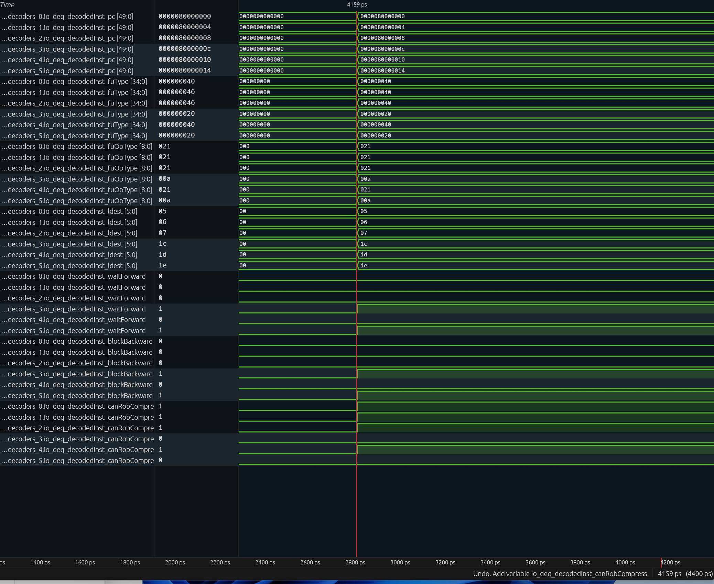
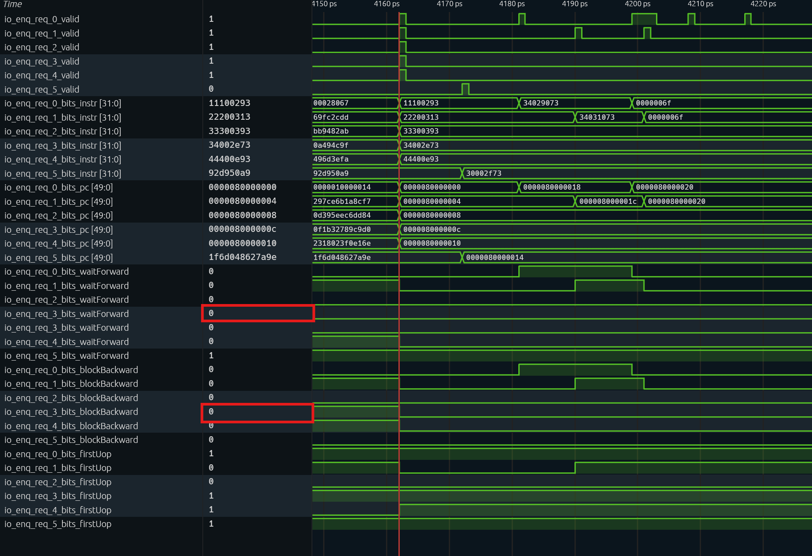
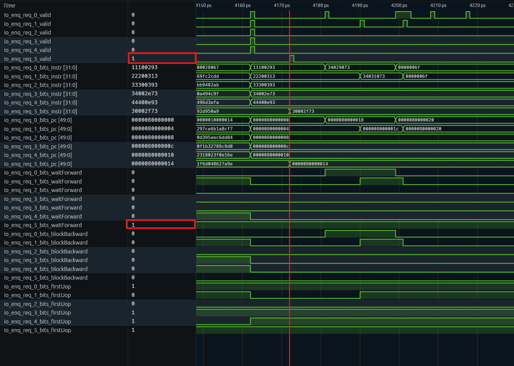
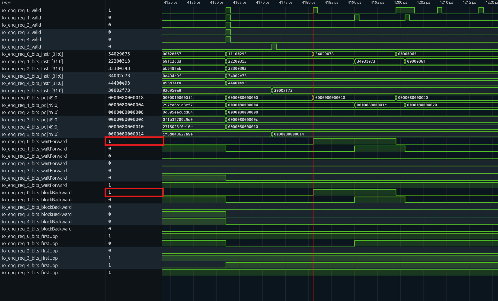
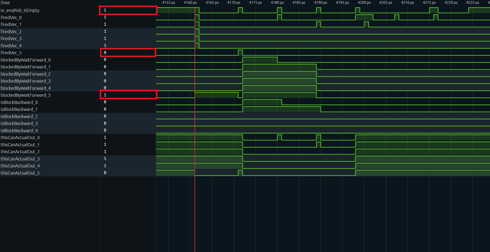
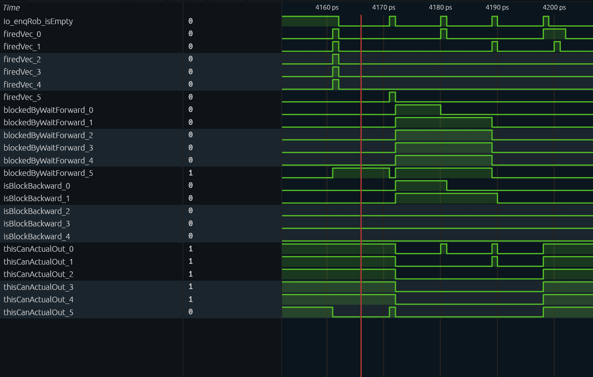
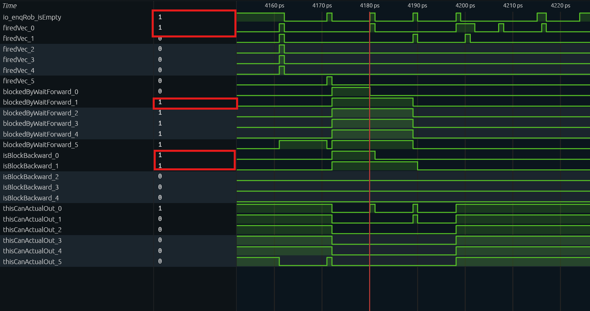

# Analysis of Out-of-Order CSR Reads and Writes

> This article analyzes XiangShan (Kunminghu V2)'s support for out-of-order CSR reads/writes: why "pure reads" of most CSRs can be out of order, why some CSR reads must be ordered, and why all CSR writes are serialized.

## 1. Background and Problem

RISC-V CSR instructions (`csrrw/csrrs/csrrc/csrrwi/csrrsi/csrrci`) have both read semantics (read back the old value) and write semantics (perform write/set/clear according to `funct3`). CSR writes have global side effects (such as modifying `mstatus.FS`, `satp`, `vstart`, or triggering a trap), so they **naturally need serialization**. The determination of a pure read is independent of rd: only CSRRS/CSRRC with rs1=x0, or CSRRSI/CSRRCI with uimm=0, are pure reads that do not write the CSR. `csrrs x0, mscratch, x0` is also a pure read; its result is simply discarded.

XiangShan's approach: **by default, mark all CSR instructions with serialization flags (`noSpecExec`/`blockBackward`), then conditionally remove these two flags for "pure CSR reads" in the rename stage**; CSR reads on the exception list remain ordered. CSR writes **always** keep the flags, i.e. they are always serialized.

## 2. Implementation Mechanism

### 2.1 Decode: All CSR Instructions Are Serialized by Default

In [DecodeUnit.scala][D] line 212, all six CSR instructions decode to `noSpec = T, blockBack = T`:

```scala
CSRRW  -> XSDecode(SrcType.reg, SrcType.imm, SrcType.X, FuType.csr, CSROpType.wrt,  SelImm.IMM_Z, xWen = T, noSpec = T, blockBack = T)
CSRRS  -> XSDecode(..., CSROpType.set, ...)   // same noSpec=T, blockBack=T
CSRRC  -> XSDecode(..., CSROpType.clr, ...)   // same noSpec=T, blockBack=T
CSRRWI -> XSDecode(..., CSROpType.wrti, ...)  // same noSpec=T, blockBack=T
CSRRSI -> XSDecode(..., CSROpType.seti, ...)  // same noSpec=T, blockBack=T
CSRRCI -> XSDecode(..., CSROpType.clri, ...)  // same noSpec=T, blockBack=T
```

`noSpec`/`blockBack` then become the uop's `waitForward`/`blockBackward` control bits.

### 2.2 Rename: Conditional Clearing for "Pure CSR Reads"

[Rename.scala][R] lines 290–307:

```scala
// read only CSRR instruction support: remove blockBackward and waitForward
inst(i) := uops(i).instr.asTypeOf(new XSInstBitFields)
isCsr(i)  := inst(i).OPCODE5Bit === OPCODE5Bit.SYSTEM && inst(i).FUNCT3(1, 0) =/= 0.U
isCsrr(i) := isCsr(i) && inst(i).FUNCT3 === BitPat("b?1?") && inst(i).RS1 === 0.U
isNotWaitForwardCsrr(i) := isCsrr(i) && LookupTreeDefault(
  inst(i).CSRIDX, true.B, CSROoORead.waitForwardInOrderCsrReadList.map(_.U -> false.B))
isNotBlockBackwardCsrr(i) := isCsrr(i) && LookupTreeDefault(
  inst(i).CSRIDX, true.B, CSROoORead.blockBackwardInOrderCsrReadList.map(_.U -> false.B))
 /*
     * For most CSRs, CSRR instructions do not need to wait forward instructions.
     *
     * For most CSRs, CSRR instructions do not need to block backward instructions.
     *
     * Signal "isCsrr" contains not only "CSRR", but also other CSR instructions that do not require writing to CSR.
     */
uops(i).waitForward   := io.in(i).bits.waitForward && !isNotWaitForwardCsrr(i)
uops(i).blockBackward := io.in(i).bits.blockBackward && !isNotBlockBackwardCsrr(i)
```

Analysis of the decision logic:

| Signal | Condition | Meaning |
|---|---|---|
| `isCsr` | `OPCODE=SYSTEM` and `FUNCT3[1:0]≠0` | One of the six CSR access instructions |
| `isCsrr` | isCsr, FUNCT3 ∈ {010, 011, 110, 111}, and RS1 field == 0 | Pure CSR read: register form with rs1=x0, immediate form with uimm=0. rd does not affect the determination; CSRRW/CSRRWI and set/clr with rs1≠0 do not count. |
| `isNotWaitForwardCsrr` | `isCsrr` and CSRIDX **not in** `waitForwardInOrderCsrReadList` | This read may drop `waitForward` |
| `isNotBlockBackwardCsrr` | `isCsrr` and CSRIDX **not in** `blockBackwardInOrderCsrReadList` | This read may drop `blockBackward` |

Key points:

- `isCsrr` covers pure reads only. `CSRRW` (`FUNCT3=001`) never matches, and `CSRRS/CSRRC` with `rs1≠0` (read-modify-write) does not match either. Therefore **any instruction containing a CSR write (including RMW) keeps `waitForward`/`blockBackward` and is always serialized**.
- For pure reads, the corresponding flag is retained only when the CSR address is on the exception list; all other CSR reads are made out-of-order.
- The clearing of the two flags is **independent**: a given CSR may drop only `waitForward` while retaining `blockBackward` (see 3.2).

### 2.3 Dispatch: Hardware Semantics of waitForward/blockBackward

[NewDispatch.scala][DIS] lines 796–819:

```scala
blockedByWaitForward(0) := !io.enqRob.isEmpty && isWaitForward(0)
// Subsequent entries propagate in order: blockedByWaitForward(i) := blockedByWaitForward(i-1) || (…) && isWaitForward(i)
val nextCanOut = VecInit((0 until RenameWidth).map(i => !isBlockBackward(i)))
```

| Flag | Dispatch Behavior When Set to 1 |
|---|---|
| `waitForward` | The uop is blocked by `blockedByWaitForward` and is dispatched only after the ROB is drained (all older instructions committed) |
| `blockBackward` | The uop prevents younger instructions after it from dispatching past it |

Therefore:

- A CSR read/write with `waitForward=1`: must wait for the ROB to drain, so that it reads a definite (correct) state.
- `blockBackward=1`: younger instructions cannot pass it, guaranteeing order.
- A CSR read with both flags cleared: **neither waits for the ROB to drain nor blocks younger instructions**; it can dispatch/execute out of order like an ordinary integer instruction.

### 2.4 Exception Lists

The exception lists are defined in [CSROoORead.scala][OOO]:

```scala
object CSROoORead {
    /**
   * "Read only" CSRs that can be fully pipelined when read in CSRR instruction.
   * Only read by csr instructions.
   */
  val waitForwardInOrderCsrReadList = List(
    CSRs.fflags, CSRs.fcsr, CSRs.vxsat, CSRs.vcsr, CSRs.vstart,
    CSRs.sstatus, CSRs.vsstatus, CSRs.mstatus, CSRs.hstatus, CSRs.mnstatus, CSRs.dcsr,
    CSRs.vtype,
    CSRs.mireg, CSRs.sireg, CSRs.vsireg,
    CSRs.mtopi, CSRs.stopi, CSRs.vstopi,
    CSRs.mtopei, CSRs.stopei, CSRs.vstopei,
    CSRs.mip, CSRs.sip, CSRs.vsip, CSRs.hip, CSRs.hvip, CSRs.mvip,
  )
  val blockBackwardInOrderCsrReadList = List(
    CSRs.mireg, CSRs.sireg, CSRs.vsireg,
    CSRs.mtopi, CSRs.stopi, CSRs.vstopi,
    CSRs.mtopei, CSRs.stopei, CSRs.vstopei,
    CSRs.mip, CSRs.sip, CSRs.vsip, CSRs.hip, CSRs.hvip, CSRs.mvip,
  )
}
```

For the contents and meaning of the lists, see Section 3.

## 3. Which CSRs Support Out-of-Order Reads

> **Pure read (`isCsrr`) with a CSR address not on the exception list** → out-of-order read; in `waitForwardInOrderCsrReadList` → ordered read (`waitForward` retained); in `blockBackwardInOrderCsrReadList` → `blockBackward` retained.
>
> Apart from those listed, all other CSRs (such as `mscratch=0x340`, `mtvec=0x305`, `mepc=0x341`, `mcause=0x342`, `mtval=0x343`, etc.) support out-of-order reads.

### 3.1 Ordered-Read List Requiring waitForward (27 entries)

| CSR | Address | Why Ordered Read |
|---|---|---|
| `fflags` | 0x001 | Updated by FPU instructions (exceptions/rounding), not only by the CSR unit |
| `fcsr` | 0x003 | Same as above |
| `vxsat` | 0x009 | Updated by the vector unit |
| `vcsr` | 0x00F | Updated by the vector unit |
| `vstart` | 0x008 | Updated by the vector unit |
| `sstatus` | 0x100 | Global state, modified by many instructions/traps |
| `vsstatus` | 0x200 | Same as above (vector) |
| `mstatus` | 0x300 | Global state, modified by many instructions/traps |
| `hstatus` | 0x600 | Hypervisor state |
| `mnstatus` | 0x744 | M-mode nested state |
| `dcsr` | 0x7B0 | Modified by the Debug module |
| `vtype` | 0xC21 | Vector configuration |
| `mireg` / `sireg` / `vsireg` | 0x351 / 0x151 / 0x251 | AIA interrupt files (asynchronous) |
| `mtopi` / `stopi` / `vstopi` | 0xFB0 / 0xDB0 / 0xEB0 | AIA interrupt priorities |
| `mtopei` / `stopei` / `vstopei` | 0x35C / 0x15C / 0x25C | AIA asynchronous accesses (the read itself has no side effects; only a write claims / clears pending, see 3.2) |
| `mip` / `sip` / `vsip` | 0x344 / 0x144 / 0x244 | Interrupt pending, updated asynchronously |
| `hip` / `hvip` / `mvip` | 0x644 / 0x645 / 0x309 | Interrupt injection/pending |

The reasons for ordered reads fall into three categories:

1. fflags/fcsr/vxsat/vcsr/vstart/mstatus/sstatus/hstatus/vsstatus/mnstatus/dcsr: these can be modified by user-mode instructions without a fence; if a CSRR is reordered before an older instruction, it would read a stale value. waitForward ensures all older instructions have committed before the read.

2. vtype: vtype is not renamed (VL is renamed), so CSRR of vtype cannot be out of order.

3. mireg/sireg/vsireg, xtopi/xtopei, xip: asynchronous accesses to AIA/interrupt state; NewCSR must wait for a response.

  Note: waitForward guarantees ordering with respect to older instructions; it does not make asynchronous sources "stable."

### 3.2 Ordered-Read List Requiring blockBackward (15 entries)

These CSRs belong to the AIA asynchronous access path: mireg/sireg/vsireg are waited on by NewCSR, and xtopi/xtopei likewise. AIA CSR reads have no side effects: reading `mtopei` does not claim; writing `mtopei` clears pending; mtopi is read-only, and writing it traps. Therefore retaining blockBackward is a microarchitectural serialization policy, not because reads modify state.

### 3.3 Summary

| Category | Example | waitForward | blockBackward | Effect |
|---|---|---|---|---|
| Ordinary CSR pure read (not on the list) | `csrr t3, mscratch` | Cleared | Cleared | Out-of-order read: does not wait for the ROB to drain and does not block younger instructions |
| State/FP/vector/debug CSR pure read | `csrr t5, mstatus` | **Retained** | Cleared | Ordered read: waits for the ROB to drain but does not block younger instructions |
| Interrupt-related CSR pure read | `csrr rd, mtopi` | **Retained** | **Retained** | Ordered read: waits for the ROB to drain and blocks younger instructions |
| Any CSR write / RMW | `csrw mscratch, t0` | **Retained** | **Retained** | Serialized: always ordered |

## 4. Code Design

The program `csr_ooo_read_write.c` constructs three classes of accesses in the same waveform, making it easy to compare `waitForward`/`blockBackward` after rename:

```asm
addi t0, x0, 0x111          # fill the pipeline
addi t1, x0, 0x222          # fill the pipeline
addi t2, x0, 0x333          # fill the pipeline
csrr t3, mscratch           # (A) out-of-order read: mscratch=0x340 is not on the list
addi t4, x0, 0x444          # (B) younger integer instruction; can execute past (A)
csrr t5, mstatus            # (C) ordered read: mstatus=0x300 is on the waitForward list
csrw mscratch, t0           # (D) CSR write: always serialized
csrw mscratch, t1           # (E) CSR write: always serialized
1: j 1b                     # halt

0000000080000000 <_start>:
    80000000:	11100293          	li	t0,273
    80000004:	22200313          	li	t1,546
    80000008:	33300393          	li	t2,819
    8000000c:	34002e73          	csrr	t3,mscratch
    80000010:	44400e93          	li	t4,1092
    80000014:	30002f73          	csrr	t5,mstatus
    80000018:	34029073          	csrw	mscratch,t0
    8000001c:	34031073          	csrw	mscratch,t1
    80000020:	a001                	j	80000020 <_start+0x20>
    80000022:	0001                	nop

```

| Instruction | Type | Expected Behavior (after rename) |
|---|---|---|
| (A) `csrr t3, mscratch` | Out-of-order read | `waitForward=0`, `blockBackward=0`: can dispatch without waiting for the ROB to drain, and does not block (B) |
| (B) `addi t4, 0x444` | Younger integer | Can dispatch/execute past (A), proving that (A)'s `blockBackward` has been cleared |
| (C) `csrr t5, mstatus` | Ordered read | `waitForward=1`, `blockBackward=0`: must wait for the ROB to drain |
| (D)(E) `csrw mscratch` | Write | `waitForward=1`, `blockBackward=1`: serialized |

## 5. Waveform Analysis

### 5.1 Decode Stage



At **cycle 4159** of program execution, the pipeline frontend dequeues 6 consecutive instructions from the IBuffer into the decoders at the same time (`decoders_0` through `decoders_5`). Combining the key signals captured in the waveform, we can clearly see the decoder's "one-size-fits-all" conservative policy for all CSR instructions:

**Key signal observations:**

1. **Instruction type identification (`fuType` and `fuOpType`)**:
   - Slots 0/1/2/4 (PC: `...00` to `...10`): `fuType = 0x40` (integer ALU), `fuOpType = 0x21`, corresponding to the `addi` instructions in the test program.
   - **Slot 3 (instruction A)** and **Slot 5 (instruction C)**: `fuType = 0x20` (CSR), `fuOpType = 0x0a` (the low 3 bits are 2, representing a CSRRS pure read).
2. **Serialization flags (`waitForward` and `blockBackward`)**:
   - Ordinary ALU instructions (Slots 0/1/2/4): both control bits are `0`.
   - **The two CSR instructions (Slots 3 and 5): both control bits are `1`.**
3. **ROB compression attribute (`canRobCompress`)**:
   - Ordinary `addi` instructions are `1`, allowing ROB compression at commit
   - CSR instructions are `0`, and do not participate in compression

### 5.2 Rename Stage

After decode, instructions enter the rename stage. This is where they are "identified": the hardware checks the instruction's machine code, and if it is a pure-read instruction whose address is not on the exception list, it removes the `waitForward` and `blockBackward` flags attached at decode.

For the instruction `csrr t3, mscratch` (`34002e73`), observe the corresponding `io_enq_req_3` port. Since this instruction is a pure CSR read and is not on the exception list, both its `waitForward` and `blockBackward` flags are cleared to 0. This was verified against the waveform and is correct.



Analyzing `csrr t5, mstatus` (`30002f73`), focus on the `io_enq_req_5` port. This instruction is also a pure CSR read, but `mstatus` is in `waitForwardInOrderCsrReadList`. Therefore its `waitForward` flag remains 1, while its `blockBackward` flag is cleared to 0.

**There is a key phenomenon here that must be viewed together with the dispatch logic:** at cycle 4161, all 6 instructions reach dispatch at the same time; lanes 0–4 dispatch normally, while lane 5's (C) is blocked. At this moment `io_enqRob_isEmpty=1`, so the direct cause is not a non-empty ROB; rather, lanes 0–4 in the same group
 are older instructions. After these 5 enter the ROB, `!io.enqRob.isEmpty` keeps blocking (C); only when they have all committed at cycle 4171 and the ROB is empty again does (C) dispatch.



Analyzing `csrw mscratch, t0` (`34029073`), observe the `io_enq_req_0` port. This instruction is a CSR write and does not satisfy the `isCsrr` pure-read condition, so the serialization flags must be retained unconditionally. Therefore both its `waitForward` and `blockBackward` remain 1. This was verified against the waveform and is correct.

Similarly, `csrw mscratch, t1` (`34031073`), as a consecutive CSR write, also has its serialization flags retained; both remain 1 in the waveform.



### 5.3 Dispatch Stage

In the dispatch stage, the `waitForward` and `blockBackward` flags generated by rename participate directly in combinational logic, deciding whether an instruction can leave the queue.

(Note: for layout clarity, the signal paths below omit the common prefix `TOP.SimTop.cpu.l_soc.core_with_l2.core.backend.inner_ctrlBlock.dispatch.`)

#### 5.3.1 Cycle 4161: (A) Dispatches Normally While (C) Is Blocked

> **Measured signals (at the red cursor):**
>
> - `io_enqRob_isEmpty = 1`
> - `firedVec_0` through `firedVec_4` = **1**, `firedVec_5` = **0**
> - `isBlockBackward_3` = **0** (the lane containing instruction (A))
> - `thisCanActualOut_4` = **1** (the lane containing instruction (B))
> - `blockedByWaitForward_5` = **1**



**Logic analysis:**

1. **(A) and (B) dispatch in the same cycle**: (A)'s (`mscratch`) `blockBackward` was cleared in rename, so the `isBlockBackward_3` signal is not asserted. As a result, the younger instruction (B)'s `thisCanActualOut_4` stays 1 and it dispatches successfully in the same cycle (`firedVec_4 = 1`). This proves that (A)'s out-of-order property is in effect and does not block the subsequent pipeline.
2. **(C) is blocked**: although the ROB is empty at this point (`io_enqRob_isEmpty = 1`), (C) is constrained by its `waitForward` flag, and lanes 0 through 4 in the same group all contain valid instructions. This triggers the blocking condition in the source (`!io.enqRob.isEmpty || Cat(fromRename.take(i).valid).orR`), so `blockedByWaitForward_5` rises and (C) cannot dispatch at this time.

#### 5.3.2 Cycles 4162–4171: Waiting for the ROB to Drain

> **Measured signals:**
>
> - Cycles 4162–4170: `blockedByWaitForward_5 = 1`, `io_enqRob_isEmpty = 0`
> - **Cycle 4171**: `io_enqRob_isEmpty = 1`, `firedVec_5 = 1`




**Logic analysis:**
The hardware semantics of `waitForward` are "wait until all preceding instructions commit (i.e. the ROB drains)." The waveform shows that as soon as `io_enqRob_isEmpty` rises, the hardware releases the block on (C) in the same cycle and lets it dispatch successfully (`firedVec_5 = 1`), demonstrating a condition-triggered mechanism with no fixed cycle delay.

#### 5.3.3 Cycles 4180–4189: The Double Serialization Constraints on CSR Writes

> **Measured signals:**
>
> - **Cycle 4180**: `firedVec_0 = 1` ((D) dispatches), `blockedByWaitForward_1 = 1` ((E) is blocked), `isBlockBackward_0 = 1`, `thisCanActualOut_1 = 0`.
> - **Cycle 4189**: `firedVec_1 = 1` ((E) dispatches successfully).



**Logic analysis:**
At cycle 4180, (E) faces double blocking constraints:

1. **Blocking by its own flag**: affected by `waitForward=1`, and with valid instruction (D) in lane 0 of the same group, `blockedByWaitForward_1 = 1`.
2. **Blocking by the preceding instruction**: although (D) is about to dispatch, its `blockBackward=1` property takes effect, making `isBlockBackward_0 = 1`. This signal pulls down the downstream `thisCanActualOut_1`, further suppressing (E)'s dequeue.

Only at cycle 4189, after (D) has committed and the ROB is empty again, does `blockedByWaitForward_1` clear, and only then does (E)'s `firedVec_1` rise successfully. This process verifies the dispatch-level `isBlockBackward = valid && blockBackward` logic; in addition, the ROB-level `hasBlockBackward` keeps younger instructions outside the ROB until (D) leaves it. Together they guarantee strict serialization between CSR writes.

### 5.4 Execute and Commit

After (A) and (B) dispatch in the same cycle 4161, they enter the CSR FU and the integer ALU respectively. (A) has several cycles of scheduling delay from dispatch to actually entering the CSR FU: at cycle 4165, `exus_7.in1ToN.io_in_valid = 1` and `exus_7.csr.csrMod.io_in_bits_op = 2`; at cycle 4166, the CSR FU outputs the old `mscratch` value `0xc4a64dd286bb263f`. Meanwhile, (B) takes the integer ALU path.

Writeback order: entry 8 (the younger (B)) writes back at cycle 4167, `debugInfo_writebackTime = 0x1048`; entry 7 (the older (A)) writes back only at cycle 4168, `writebackTime = 0x1049`. The younger (B) completes first, showing that after clearing `waitForward`/`blockBackward`, (A) really does participate in out-of-order execution.

However, after (B) writes back, it still must wait for (A) to commit before it can commit; this is "out-of-order execution, in-order commit." In addition, the CSR FU has `piped = false`, so the out-of-order behavior here is **across different FUs**; multiple CSR instructions still serialize on the CSR FU and may wait for AIA responses. Therefore this section serves only as supporting evidence; the core proof remains the dispatch behavior in 5.2/5.3.

| Cycle | Event | Key Signals |
| ---- | ------------------------ | ------------------------------------------------------------ |
| 4161 | (A)(B) dispatch in the same cycle | `dispatch.firedVec_3 = 1` ((A)), `dispatch.firedVec_4 = 1` ((B)) |
| 4165 | (A) enters the CSR FU | `exus_7.in1ToN.io_in_valid = 1`, `exus_7.csr.csrMod.io_in_bits_op = 2` |
| 4166 | (A) outputs the old `mscratch` value | `exus_7.csr.csrMod.io_out_valid = 1`, `io_out_bits_rData = 0xc4a64dd286bb263f` |
| 4167 | (B) completes writeback | `debugReg_8_debugInfo_writebackTime = 0x1048` |
| 4168 | (A) completes writeback | `debugReg_7_debugInfo_writebackTime = 0x1049` |

## 6. Conclusion

1. XiangShan **by default** marks all CSR instructions as serialized (decode with `noSpec=T, blockBack=T`).
2. In the rename stage, "pure CSR reads" (`isCsrr`) have `waitForward`/`blockBackward` conditionally removed, enabling out-of-order reads for most CSRs; CSR writes and RMW are excluded and are always serialized.
3. The exception lists in [`CSROoORead.scala`][OOO] precisely define the CSRs that must be read in order: state/FP/vector/debug-related CSRs retain `waitForward`, and interrupt-related CSRs additionally retain `blockBackward`.
4. The reproduction scenario compares three behaviors within a single waveform: "out-of-order read (mscratch)," "ordered read (mstatus)," and "write (csrw mscratch)."

## Appendix: Key Code Index

| Module | File Path | Key Lines |
|---|---|---|
| Out-of-order read exception lists | `src/main/scala/xiangshan/backend/fu/NewCSR/CSROoORead.scala` | 10–55 |
| CSR decode (serialized by default) | `src/main/scala/xiangshan/backend/decode/DecodeUnit.scala` | 212–218 |
| Conditional clearing at rename | `src/main/scala/xiangshan/backend/rename/Rename.scala` | 290–307 |
| Dispatch serialization | `src/main/scala/xiangshan/backend/dispatch/NewDispatch.scala` | 795–819 |
| CSR write/RMW enable | `src/main/scala/xiangshan/backend/fu/wrapper/CSR.scala` | 74–94 |
| CSR FuConfig (not pipelined) | `src/main/scala/xiangshan/backend/fu/FuConfig.scala` | 299–311 |
