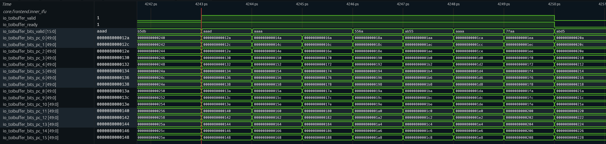
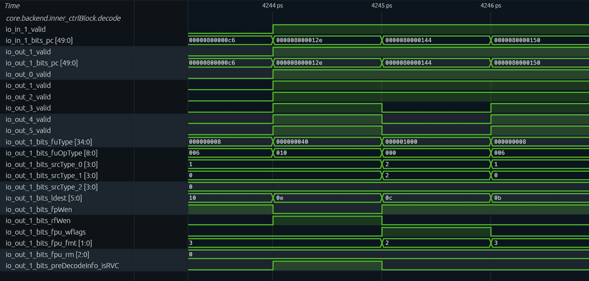
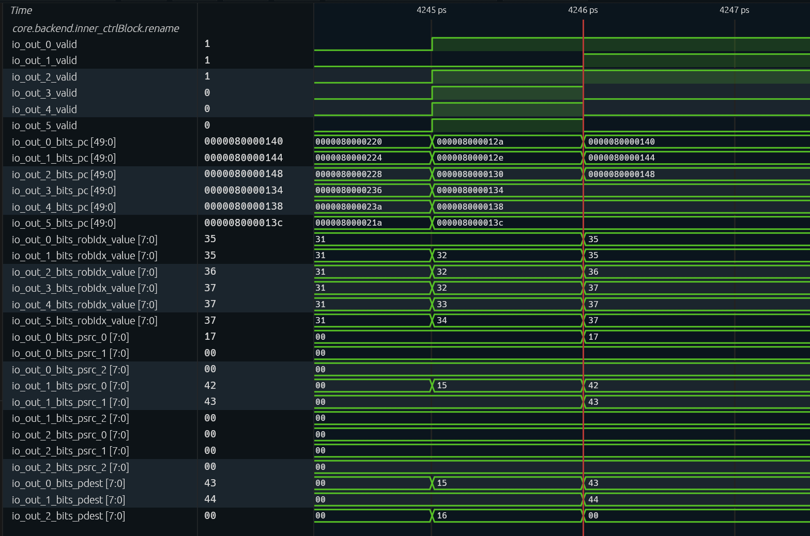
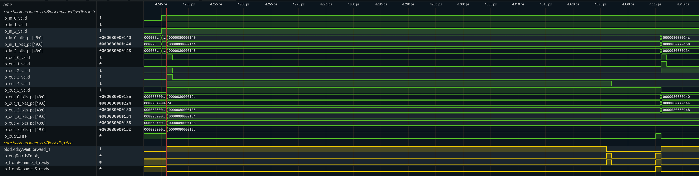
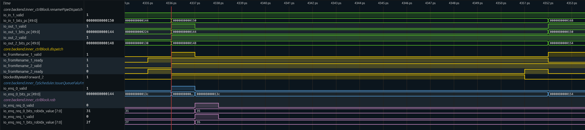
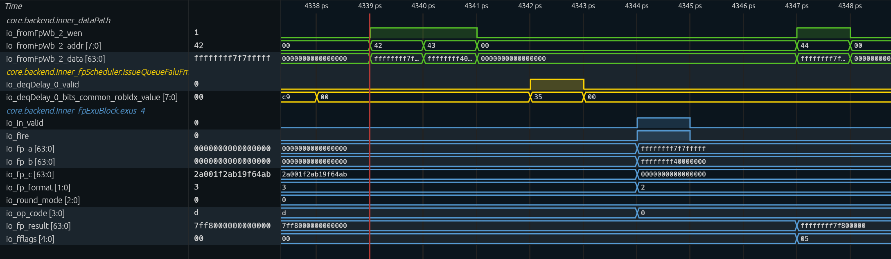
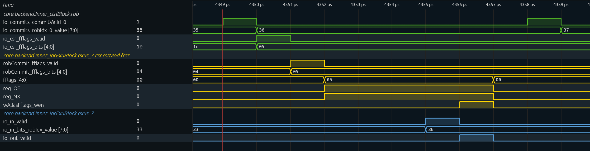
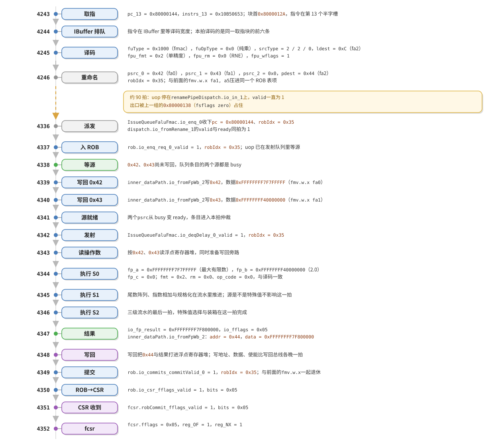

# The Execution of an Overflowing Multiplication: Where Special Operands Sit in the Pipeline

The previous article took the handling of overflow, NaN, infinity, and zero apart down to the circuit level, concluding that they share one and the same three-cycle pipeline and differ only in the final-stage selector. That conclusion can be checked directly against a waveform: feed ten multiplications covering the various kinds of special operands into XiangShan's RTL simulation, capture the waveform, and see how many cycles each takes from fetch to commit. This article first sends one multiplication that must overflow through the entire path, then has the other nine stand in contrast with it in the same simulation run.

The simulation uses the XiangShan Kunminghu V2 configuration (KunminghuV2Config, kmh-v2) at commit `e7bab53e66`; every cycle count and every signal value in this article is taken from the waveform generated by this build.

The main test case is `0x7F7FFFFF × 2.0` with RNE rounding, that is, the first `fmul.s` in `main`, whose PC is `0x80000144`. It was chosen because both its result and its flags are unique: the largest finite number times two crosses the upper bound representable in single precision, so the hardware should produce `+∞` and set `OF` and `NX` in `fflags`.

Program, binary image, and disassembly: [Attachment: fmul-inst.zip](source-code/fmul-inst.zip)

## 1. Test Program

There are only two places in the waveform to look at: the input port and the output port of the execution unit. The program therefore needs no output at all—printing would bring in a large number of instructions unrelated to floating point, and reading the results back would require several more `fmv.x.w`. The ten test cases are laid out in sequence, four instructions each, and a trap is triggered when they finish. Below is the beginning of `main` in the image, containing the first two test cases:

```asm
8000012a:  7f800737   lui     a4,0x7f800
8000012e:  377d       addiw   a4,a4,-1        # a4 = 0x7F7FFFFF
80000130:  7f8006b7   lui     a3,0x7f800      # a3 = 0x7F800000, kept for the later cases
80000134:  400007b7   lui     a5,0x40000      # a5 = 2.0
80000138:  00101073   fsflags zero
8000013c:  f0070553   fmv.w.x fa0,a4
80000140:  f00785d3   fmv.w.x fa1,a5
80000144:  10b50653   fmul.s  fa2,fa0,fa1,rne
80000148:  00101073   fsflags zero
8000014c:  f0070553   fmv.w.x fa0,a4
80000150:  f00785d3   fmv.w.x fa1,a5
80000154:  10b52653   fmul.s  fa2,fa0,fa1,rdn
```

The opening four `lui`/`addiw` instructions construct the operands: `0x7F7FFFFF` is `0x7F800000` minus one, `2.0` is `0x40000000`, and the one at `0x130` writes `0x7F800000` into `a3` for the later cases to use. The bit patterns are computed directly by integer instructions, so the patterns written down and the patterns sent to the execution unit are exactly the same, with no floating-point operation in between. The remaining nine cases insert a `lui`, `li`, or `addiw` before `fsflags` only when a new operand is needed, and otherwise reuse the values already in `a3`, `a4`, and `a5`.

Each of the four instructions in a test case carries one responsibility. `fsflags zero` assembles to `00101073` and is the pseudo-instruction for `csrw fflags, zero`: the five bits of `fflags` are sticky, and the hardware can only OR them in, so without clearing them one could not tell from the waveform which test case set which bit. The two `fmv.w.x` instructions copy the bit patterns in the integer registers into `fa0` and `fa1` verbatim; they go through the integer-to-floating-point move path and perform no numeric conversion. The fourth operand of `fmul.s` is the rounding mode, which the assembler encodes directly into `funct3`: `10b50653` has `funct3` equal to `000`, i.e. RNE; `10b52653` has `funct3` equal to `010`, i.e. RDN. The two instructions differ only in this one field, and the dynamic rounding mode in `fcsr.frm` plays no part at all.

| Order | A | B | Rounding | Type |
|---|---|---|---|---|
| 0 | `0x7F7FFFFF` | `0x40000000` | RNE | overflow, yields `+∞` |
| 1 | `0x7F7FFFFF` | `0x40000000` | RDN | overflow, yields largest finite number |
| 2 | `0x7FC00000` | `0x40000000` | RNE | quiet NaN |
| 3 | `0x7F800001` | `0x40000000` | RNE | signaling NaN |
| 4 | `0x7F800000` | `0xC0000000` | RNE | infinity times a negative finite number |
| 5 | `0x7F800000` | `0x00000000` | RNE | infinity times zero |
| 6 | `0x80000000` | `0x40000000` | RNE | negative zero times a positive number |
| 7 | `0x00000001` | `0x3F000000` | RNE | smallest subnormal times 0.5 |
| 8 | `0x00000001` | `0x40000000` | RNE | smallest subnormal times 2 |
| 9 | `0x3F800000` | `0x40400000` | RNE | ordinary value |

All ten cases are laid out in sequence in `main`, with no loop, no function call, and no read-back, so each `fmul.s` sits at a fixed PC and can be found in the waveform by PC, without guessing which iteration of a loop is running. The ten `fmul.s` instructions land in order at `0x80000144`, `0x80000154`, `0x80000168`, `0x8000017C`, `0x80000190`, `0x800001A2`, `0x800001B6`, `0x800001CC`, `0x800001DC`, `0x800001F4`. The cost is a longer `main`, but for the image as a whole this amount of code is negligible. Compiling and running take one command each:

```sh
make ARCH=riscv64-xs CROSS_COMPILE=riscv64-unknown-elf-
```

When running, add `--dump-wave --wave-path=wave.fst` to capture the waveform. The whole program has only 151 instructions and 4580 cycles, and when execution ends it prints `HIT GOOD TRAP` at `0x80000206`, showing that the RTL matches the reference model instruction by instruction. The recording window must cover the whole run, because the ten multiplications are spread over more than four thousand cycles and a short window would cover only the first few.

## 2. Learning to Read This Waveform

Signals are organized by module hierarchy under `TOP.SimTop.cpu.l_soc.core_with_l2.core`: the frontend is in `frontend.inner_ifu`, decode through commit is in `backend.inner_ctrlBlock`, the issue queues are in `backend.inner_fpScheduler`, the execution units are in `backend.inner_fpExuBlock`, and the writeback collection point is in `backend.inner_dataPath`. To observe a given stage, add that stage's IO signals to the waveform window; every path used in this article can be assembled from these prefixes.

```
TOP.SimTop.cpu.l_soc.core_with_l2.core
├── frontend.inner_ifu                    fetch, output is toIbuffer
└── backend
    ├── inner_ctrlBlock                   decode / rename / renamePipeDispatch / dispatch / rob
    ├── inner_fpScheduler                 floating-point issue queues such as IssueQueueFaluFmac
    ├── inner_fpExuBlock                  Fmac.fma on exus / exus_2 / exus_4
    └── inner_dataPath                    writeback collection, write ports of the physical register file
```

One cell on the horizontal axis is one cycle. This build's simulation generates FST through Verilator, and each simulation step is recorded as one time unit; the label 4242 on the horizontal axis is cycle 4242, and the "ps" marking is merely the name of the time unit, not real time.

Vertically, each row is the value of one signal at the end of that cycle, not at some instant in the middle of it. Which of two signals in the same column changes first is meaningless: the settling order of combinational logic does not enter the waveform, and a column is one whole state.

A handshake has two rows: `valid` says the upstream has data to send, `ready` says the downstream can accept. `fire` is not a stored state; it is the AND of the two in the same cycle, so seeing `valid` and `ready` both 1 is the same as seeing a fire. A few modules bring this term out as a port directly, and the execution unit has `Fmac.fma.io_fire`; the FMA accepts every cycle and `io_in_ready` is constantly 1, so that row coincides exactly with `io_in_valid`. Three typical shapes follow. With `valid` and `ready` both high, the transfer passes in one cycle. With `valid` high and `ready` low, the upstream is blocked and the data on the bus stays unchanged, which appears in the waveform as a long straight line. With `valid` low, this stage has no data to handle in that cycle.

There are two ways to find an instruction. Before decode only the PC can be used, because the frontend has not yet allocated a ROB entry; from rename onward one uses `robIdx`, the instruction's number in the ROB, which identifies it until commit, whereas after dispatch the PC is scattered in the low bits of various buses and is hard to search for. When this article reports a cycle count it writes "cycle N" by default, matching the horizontal axis of the waveform.

One point easily leads to misjudgment: two adjacent lanes carrying the same `robIdx` do not mean the same instruction. XiangShan packs several adjacent compressible instructions into one ROB entry, and the entry commits as a whole, so the `robIdx` on the lanes repeats. The `fmul.s` in this article happens to be packed together with the `fmv.w.x` before it, so two 0x35 appear in succession in the waveform.

## 3. Fetch: 4243, the Instruction Word First Appears on the Bus

| Signal | Width | Meaning |
|---|---|---|
| `inner_ifu.io_toIbuffer_valid` | 1 | the fetch block sends data to the IBuffer this cycle |
| `inner_ifu.io_toIbuffer_ready` | 1 | the IBuffer can accept this cycle |
| `inner_ifu.io_toIbuffer_bits_valid` | 16 | start mask for the halfword slots, bit $i$ corresponding to halfword slot $i$ |
| `inner_ifu.io_toIbuffer_bits_pc_0` … `pc_15` | 50 each | addresses of the 16 halfword slots, adjacent slots differing by 2, together covering 32 bytes |



In cycle 4243 `valid` and `ready` are both 1 and the fetch block is accepted by the IBuffer. In the eight preceding cycles, 4235 to 4242, `valid` is 0: this is the fetch bubble caused by the `jal` jumping into `main`; the cycle before that, 4234, fetched another stretch of code whose block starts at `0x80000220`. From 4243 the fetch stream resumes, sending one 32-byte window per cycle; the 4244 window starts at `0x8000014A`, and the previous window ends at `0x148`.

The block starts at `0x8000012A`, which is not 32-byte aligned, and the reason lies in the program itself: `main` is entered by a `jal` from `_trm_init`, and the entry point is only guaranteed to be halfword-aligned, so the fetch window boundary shifts with it. In the cycles where `valid` is 0, the address lines retain old data and do not represent a fetch event.

`bits_valid` = `0xAAAD`, read from the low bit, has ones at slots 0, 2, 3, 5, 7, 9, 11, 13, and 15—nine start points in all. The `lui` at `0x12A` occupies slots 0 and 1, the `0x12E` in slot 2 is a 16-bit compressed `addiw` (encoding `377d`), and from `0x130` on all are 32-bit instructions, setting one bit every other slot, so `0x144` falls exactly in slot 13. This instruction word is on `io_toIbuffer_bits_instrs_13` with value `0x10B50653`. The mask describes instruction boundaries, not the number of instructions: the same 32-byte window holds both 32-bit and compressed instructions, hence the uneven spacing of the slots.

No field at the fetch stage has anything to do with operand values. The bus carries instruction words, PCs, FTQ pointers, and predecode information; `0x7F7FFFFF` still sits in a floating-point register and has not been read out, and this stage has no way to tell this multiplication from an ordinary one.

## 4. Decode: 4245, the Encoding Becomes an fmac Uop

| Signal | Width | Meaning |
|---|---|---|
| `decode.io_in_1_valid` | 1 | decode input of lane 1 is valid |
| `decode.io_in_1_bits_pc` | 50 | PC of the lane 1 input |
| `decode.io_out_1_valid` | 1 | decode output of lane 1 is valid |
| `decode.io_out_1_bits_pc` | 50 | PC of the lane 1 output |
| `decode.io_out_0_valid` … `io_out_5_valid` | 1 each | output valid of each of the six lanes |
| `decode.io_out_1_bits_fuType` | 35 | functional unit type, one-hot encoded |
| `decode.io_out_1_bits_fuOpType` | 9 | operation type within the functional unit |
| `decode.io_out_1_bits_srcType_0` … `srcType_2` | 4 each | operand class of the three sources |
| `decode.io_out_1_bits_ldest` | 6 | architectural destination register number |
| `decode.io_out_1_bits_fpWen` | 1 | writes a floating-point register |
| `decode.io_out_1_bits_rfWen` | 1 | writes an integer register |
| `decode.io_out_1_bits_fpu_wflags` | 1 | this instruction must write `fflags` |
| `decode.io_out_1_bits_fpu_fmt` | 2 | precision |
| `decode.io_out_1_bits_fpu_rm` | 3 | rounding mode |
| `decode.io_out_1_bits_preDecodeInfo_isRVC` | 1 | whether this is a 16-bit compressed instruction |



The figure takes four columns, 4244 to 4247. Decode is a combinational table lookup with input and output in the same cycle, so `io_in_1_bits_pc` and `io_out_1_bits_pc` coincide cycle by cycle. The six lanes at 4244 are the first six instructions of the 4243 fetch block; at 4245 only lanes 0 to 2 remain, the last three of the same block: `0x80000140`, `0x80000144`, `0x80000148`. The `fmul.s` we are looking for is on lane 1 of the 4245 column.

Reading the fields on its row one by one gives the complete identity of a uop: `fuType` is `0x1000`, bit 12 of the one-hot encoding, corresponding to `fmac`, which says it will be sent to a floating-point execution unit with multiply capability; `fuOpType` is `0x0`, corresponding to pure multiply, telling the execution unit that the third source does not take part; both sources have `srcType` equal to `0x2` (floating point), and the third source is `0x0` (no register read), so this instruction needs only two floating-point registers; `ldest` is `0xC`, the architectural number of `fa2`; `fpWen` is 1 and `rfWen` is 0, writing floating point and not integer.

From 4246 all six lanes are valid again and the bus carries the next group; lane 1 has `pc` equal to `0x80000150`, and the six lanes' PCs run from `0x8000014C` to `0x80000160`. This group stays on the bus until 4336, when rename frees up room and it becomes `0x80000168`. The decode result of the `fmul.s` therefore exists only in the 4245 column, and its `fuType`, `srcType`, `fpu_fmt`, and `fpu_rm` belong to it only in that column; the constants after 4246 belong to the next group of instructions, and reading the wrong column would take them for this multiplication's decode result.

The three control fields also take their values in this cycle. `fpu_wflags` is 1, meaning the instruction will write `fflags`; this bit travels with the uop all the way to the execution unit, and writeback uses it to decide whether the flags must be collected. `fpu_fmt` is `0x2`, the 32-bit code in the `VSew` encoding, that is, single precision; inside the execution unit it is translated into "interpret source and result as 32 bits." `fpu_rm` is `0x0`, corresponding to RNE, because this program uses static rounding and `fcsr.frm` plays no part. The last field, `preDecodeInfo_isRVC`, is 0, confirming that this is a 32-bit instruction.

These field values are fixed at compile time and never change again over the instruction's lifetime. From this cycle on in the waveform, "it is a single-precision multiply that writes flags" has become a constant, and each later stage merely passes this description along.

## 5. Rename: 4246, Only Register Numbers Remain

| Signal | Width | Meaning |
|---|---|---|
| `rename.io_out_0_valid` … `io_out_5_valid` | 1 each | output valid of each of the six lanes |
| `rename.io_out_0_bits_pc` … `io_out_5_bits_pc` | 50 each | PC of each lane |
| `rename.io_out_0_bits_robIdx_value` … `io_out_5_bits_robIdx_value` | 8 each | ROB entry number allocated to each lane |
| `rename.io_out_0_bits_psrc_0` … `io_out_2_bits_psrc_2` | 8 each | physical register numbers to which the three architectural sources of lanes 0 to 2 are mapped |
| `rename.io_out_0_bits_pdest` … `io_out_2_bits_pdest` | 8 each | newly allocated physical destination register number for lanes 0 to 2 |



The figure takes four columns, 4244 to 4247. At 4244 all lanes are invalid, and `pc` and `robIdx` retain old values invalidated by the `jal` redirect. 4245 is the first six instructions of the 4243 fetch block: lane 1 is empty, and the other five lanes have `pc` equal to `0x8000012A`, `0x80000130`, `0x80000134`, `0x80000138`, `0x8000013C`. 4246 switches to this group: the first three lanes are `0x80000140`, `0x80000144`, `0x80000148`, with `robIdx` `0x35`, `0x35`, `0x36`, and lanes 3 to 5 invalid.

This `fmul.s` sits on lane 1 of the 4246 column. The only new information this stage produces is register numbers: `psrc_0` is `0x42` and `psrc_1` is `0x43`, the physical registers to which the two floating-point sources are currently mapped; `psrc_2` is `0x0`, because the third source consumes no rename resource; `pdest` is `0x44`, the physical register newly allocated to `fa2`; `robIdx` is `0x35`, which from this cycle on is the instruction's identity card.

Special values are completely invisible at this stage. A physical register holding a canonical NaN and one holding 1.0 differ only by a number in the rename table; the mapping process does not touch contents at all. So from 4246 onward no stage in the waveform takes a different shape because an operand is a special value; the only differences that can be read out are the bit patterns on the data lines and the five bits on the flag lines.

The 4246 column also has two places where the lane count does not match the instruction count. Lane 0 has `pc` equal to `0x80000140` and `robIdx` equal to `0x35` as well: the `fmv.w.x fa1, a5` before it has been packed into the same ROB entry as this `fmul.s`. The criterion for compression is that several adjacent instructions are all compressible—XiangShan marks instructions that write only one register and raise no exception as compressible, and a consecutive run of them occupies a single entry held by the last one. Entry `0x35` therefore covers both, and the `0x35` seen at commit is the joint retirement of this pair.

The same figure shows another kind of merging: the `lui` at `0x8000012A` and the 16-bit `addiw` at `0x8000012E` are fused into one uop, the `0x12E` lane is empty at the rename output, and only the `lui` occupies an entry. The two mechanisms have different names—one is uop fusion, the other ROB compression—but both result in "the lane count is not the instruction count." When reading this waveform one must not infer the number of instructions by counting lanes.

## 6. Dispatch: 4246 to 4336, Ninety Cycles Blocked by the Previous Group

| Signal | Width | Meaning |
|---|---|---|
| `renamePipeDispatch.io_in_0_valid` … `io_in_2_valid` | 1 each | valid of each of the three input lanes |
| `renamePipeDispatch.io_in_0_bits_pc` … `io_in_2_bits_pc` | 50 each | PC of the input lanes |
| `renamePipeDispatch.io_out_0_valid` … `io_out_5_valid` | 1 each | valid of each of the six output lanes |
| `renamePipeDispatch.io_out_0_bits_pc` … `io_out_5_bits_pc` | 50 each | PC of the output lanes |
| `dispatch.blockedByWaitForward_4` | 1 | lane 4 is blocked by `waitForward` |
| `dispatch.io_enqRob_isEmpty` | 1 | the ROB enqueue port is empty |
| `dispatch.io_fromRename_4_ready` | 1 | lane 4 can receive from rename |
| `dispatch.io_fromRename_5_ready` | 1 | lane 5 can receive from rename |
| `renamePipeDispatch.io_outAllFire` | 1 | all output lanes leave together this cycle |



The three lanes produced by rename first land on the input side of `renamePipeDispatch` and then go from the output side into dispatch. This fmul sits on `io_in_1` from 4246, with `valid` always 1 and `pc` always `0x80000144`; the other two lanes of the group are `0x80000140` and `0x80000148`. The output side holds the previous group throughout these ninety cycles, with `0x80000138` and `0x8000013C` on lanes 4 and 5. What blocks the exit is `0x80000138`: it is the program's first `fsflags zero`, and `blockedByWaitForward_4` is 1 from 4246 onward, so the `0x8000013C` behind it sees `fromRename_5_ready` as 0. `waitForward` requires the instruction to wait for the ROB to drain, and the corresponding signal is `dispatch.io_enqRob_isEmpty`: it first rises at 4326, `fromRename_4_ready` for `0x80000138` rises in the same cycle and the instruction leaves that cycle, and at 4327 lane 4's output is cleared; `0x8000013C` must wait once more for the enqueue port to be empty and fires only at 4335, in which cycle `io_outAllFire` rises and the register is cleared. These ninety cycles have nothing to do with the multiplication itself; the blockage comes from the flag-clearing CSR instruction in the preceding group.

| Signal | Width | Meaning |
|---|---|---|
| `renamePipeDispatch.io_in_1_valid` | 1 | input lane 1 is valid |
| `renamePipeDispatch.io_in_1_bits_pc` | 50 | PC of input lane 1 |
| `renamePipeDispatch.io_out_1_valid` | 1 | output lane 1 is valid |
| `renamePipeDispatch.io_out_1_bits_pc` | 50 | PC of output lane 1 |
| `renamePipeDispatch.io_out_2_valid` | 1 | output lane 2 is valid |
| `renamePipeDispatch.io_out_2_bits_pc` | 50 | PC of output lane 2 |
| `dispatch.io_fromRename_1_valid` | 1 | input of dispatch lane 1 is valid |
| `dispatch.io_fromRename_1_ready` | 1 | dispatch can accept lane 1 |
| `dispatch.io_fromRename_2_valid` | 1 | input of dispatch lane 2 is valid |
| `dispatch.io_fromRename_2_ready` | 1 | dispatch can accept lane 2 |
| `dispatch.blockedByWaitForward_2` | 1 | lane 2 is blocked by `waitForward` |
| `IssueQueueFaluFmac.io_enq_0_valid` | 1 | enqueue into the floating-point issue queue is valid |
| `IssueQueueFaluFmac.io_enq_0_bits_pc` | 50 | PC of the enqueued uop |
| `rob.io_enq_req_0_valid` | 1 | ROB enqueue request 0 is valid |
| `rob.io_enq_req_0_bits_robIdx_value` | 8 | ROB entry number of request 0 |
| `rob.io_enq_req_1_valid` | 1 | ROB enqueue request 1 is valid |
| `rob.io_enq_req_1_bits_robIdx_value` | 8 | ROB entry number of request 1 |



In cycle 4336 the three waiting lanes reach the output side, `0x80000144` appears on `io_out_1`, and `io_in_1` on the input side switches at the same time to `0x80000150` of the next group. In the same cycle `dispatch.io_fromRename_1` has `valid` and `ready` both 1 and the fmul is dispatched; `IssueQueueFaluFmac.io_enq_0_valid` also rises this cycle with `bits_pc` equal to `0x80000144`. The ROB is one cycle later: 4337 is the cycle in which `rob.io_enq_req_0_valid` and `req_1_valid` are both 1 and both `robIdx` values are `0x35`, because there is one register stage between dispatch and the enqueue port. The companion `0x80000148` is not dispatched along with it: `fromRename_2_valid` is 1 from 4336 and `ready` is 0, with `blockedByWaitForward_2` also 1, until 4351, when both become 1. It does not affect the multiplication ahead of it, but it is exactly the source of the twenty-odd-cycle gap between two test cases.

## 7. Issue and Execute: the Three Cycles Beginning at 4344

| Signal | Width | Meaning |
|---|---|---|
| `inner_dataPath.io_fromFpWb_2_wen` | 1 | write enable of writeback port 2 |
| `inner_dataPath.io_fromFpWb_2_addr` | 8 | physical register number written back |
| `inner_dataPath.io_fromFpWb_2_data` | 64 | writeback data, already boxed |
| `IssueQueueFaluFmac.io_deqDelay_0_valid` | 1 | the issue queue sends out a uop this cycle |
| `IssueQueueFaluFmac.io_deqDelay_0_bits_common_robIdx_value` | 8 | ROB entry number of the uop sent out |
| `exus_4.io_in_valid` | 1 | execution unit input is valid |
| `exus_4.Fmac.fma.io_fire` | 1 | the FMA accepts its inputs this cycle |
| `exus_4.Fmac.fma.io_fp_a` … `io_fp_b`, `io_fp_c` | 64 each | the three sources of the FMA |
| `exus_4.Fmac.fma.io_fp_format` | 2 | precision |
| `exus_4.Fmac.fma.io_round_mode` | 3 | rounding mode |
| `exus_4.Fmac.fma.io_op_code` | 4 | operation code |
| `exus_4.Fmac.fma.io_fp_result` | 64 | the boxed result |
| `exus_4.Fmac.fma.io_fflags` | 5 | the flags produced by this instruction |



After entering the queue it has to wait for its two sources. The producers of the two floating-point sources are the two `fmv.w.x` ahead of it, and their writebacks are the two cycles in the waveform where `inner_dataPath.io_fromFpWb_2_wen` rises: 4339 writes physical register `0x42` with value `0xFFFFFFFF7F7FFFFF`; 4340 writes `0x43` with value `0xFFFFFFFF40000000`. The all-ones upper 32 bits are boxing and the low bits are the single-precision data, so `fa0` holds `0x7F7FFFFF` and `fa1` holds `0x40000000`.

At 4342 the issue queue sends it out: `IssueQueueFaluFmac.io_deqDelay_0_valid` rises with `robIdx` equal to `0x35`. From the queue exit to the execution unit input there still lie the physical register read and the bypass selection, so `exus_4.io_in_valid` rises only at 4344, the same cycle in which `exus_4.Fmac.fma.io_fire` is 1. At this moment the hardware first obtains the values of the operands. `fp_a` is `0xFFFFFFFF7F7FFFFF`, `fp_b` is `0xFFFFFFFF40000000`, and `fp_c` is `0x0`—the third source of a pure multiply is zeroed inside the execution unit, which can be read directly from the waveform. `fp_format` is `0x2`, `round_mode` is `0x0`, and `op_code` is `0x0`; the three fields agree with what decode produced, and none of them has changed.

Three cycles later, at 4347: `io_fp_result` is `0xFFFFFFFF7F800000` and `io_fflags` is `0x05`. These three cycles are fixed: from `io_fire` to `io_fp_result` is exactly three cycles whether the input is the largest finite number, a NaN, or infinity. Section 9 lines up the readings of all ten cases so that they can be compared directly.

## 8. Commit and fcsr: 4349 to 4352

| Signal | Width | Meaning |
|---|---|---|
| `rob.io_commits_commitValid_0` | 1 | commit valid of commit port 0 |
| `rob.io_commits_robIdx_0_value` | 8 | `robIdx` of the entry committed this cycle |
| `rob.io_csr_fflags_valid` | 1 | flags sent to the CSR this cycle |
| `rob.io_csr_fflags_bits` | 5 | the five flag bits sent |
| `fcsr.robCommit_fflags_valid` | 1 | the CSR receives the commit flags |
| `fcsr.robCommit_fflags_bits` | 5 | the five flag bits received |
| `fcsr.fflags` | 5 | accumulated exception flags |
| `fcsr.reg_OF` | 1 | overflow flag |
| `fcsr.reg_NX` | 1 | inexact flag |
| `fcsr.wAliasFflags_wen` | 1 | enable for a CSR instruction writing `fflags` |
| `exus_7.io_in_valid` | 1 | input of execution unit 7 is valid |
| `exus_7.io_in_bits_robIdx_value` | 8 | `robIdx` of that uop |
| `exus_7.io_out_valid` | 1 | output of execution unit 7 is valid |



At 4349 `rob.io_commits_commitValid_0` rises and `io_commits_robIdx_0_value` is `0x35`; the two uops containing this multiplication commit together. In the next cycle, 4350, `rob.io_csr_fflags_valid` rises with `io_csr_fflags_bits` equal to `0x05`, and the flags go from the ROB to the CSR; at 4351 `fcsr.robCommit_fflags_valid` inside the CSR rises with `bits` also `0x05`. `fcsr.fflags` becomes `0x05` only at 4352, the same cycle in which `fcsr.reg_OF` and `fcsr.reg_NX` both become 1. To confirm from the waveform which flags a floating-point instruction set, the most direct place is the cycle in which `fcsr.fflags` changes; looking only at the commit cycle is off by three. The latter part of the figure shows the commit of the next instruction: at 4358 `rob.io_commits_commitValid_0` rises again and `robIdx` has changed to `0x36`.

The flags are sticky. The hardware ORs them bit by bit in `fcsr`, and once set they stay until software writes them clear. What clears them is the `csrw fflags, zero` at the start of the next test case, and it goes through a different path: at 4355 `exus_7.io_in_valid` rises with `robIdx` equal to `0x36`, which is this CSR instruction entering execution unit 7; at 4356 it leaves the execution unit and `fcsr.wAliasFflags_wen` rises in the same cycle; at 4357 `fflags` returns to `0x00`, all five bits cleared together. The instruction itself does not appear on `rob.io_commits_commitValid_0` until 4358. The write that clears the flags is two cycles earlier than the commit signal, asymmetric with the path by which a floating-point result sets them; to judge from the waveform who cleared a flag, one should trust the cycle of `wAliasFflags_wen` and not look only at commit.

## 9. Ten Test Cases on One Waveform

The enqueue cycle, fire cycle, execution unit, and result of the ten cases are listed below.

| Order | PC | Enqueue cycle | fire cycle | Execution unit | Result | fflags |
|---|---|---|---|---|---|---|
| 0 | `0x80000144` | 4336 | 4344 | `exus_4` | `0x7F800000` | `0x05` |
| 1 | `0x80000154` | 4360 | 4369 | `exus_4` | `0x7F7FFFFF` | `0x05` |
| 2 | `0x80000168` | 4386 | 4394 | `exus_4` | `0x7FC00000` | `0x00` |
| 3 | `0x8000017C` | 4411 | 4419 | `exus_4` | `0x7FC00000` | `0x10` |
| 4 | `0x80000190` | 4435 | 4444 | `exus_2` | `0xFF800000` | `0x00` |
| 5 | `0x800001A2` | 4460 | 4469 | `exus_4` | `0x7FC00000` | `0x10` |
| 6 | `0x800001B6` | 4485 | 4494 | `exus_4` | `0x80000000` | `0x00` |
| 7 | `0x800001CC` | 4510 | 4519 | `exus_4` | `0x00000000` | `0x03` |
| 8 | `0x800001DC` | 4536 | 4544 | `exus_4` | `0x00000002` | `0x00` |
| 9 | `0x800001F4` | 4561 | 4569 | `exus_4` | `0x40400000` | `0x00` |

Adjacent cases are 25 cycles apart between fire cycles; the rhythm is set by the `fsflags` at the start of each case, not by the multiplication itself. Nor are the eight or nine cycles between enqueue and fire an execution latency: they are the queueing for the writeback of the two `fmv.w.x`, followed by the issue queue exit and the register read.

Nine of the ten issue from `exus_4`, and the fourth issues from `exus_2`. That one sits in the sixth lane of the dispatch group, and different lanes connect to different issue queues, so it is assigned to `IssueQueueFaluFmacFdiv` and issues from the `exus_2` behind that queue. To tell from the waveform which unit executes an instruction, one need only see which `Fmac.fma.io_fire` rises.

The result column agrees item by item with the algorithmic conclusions of the previous article. Overflow under RNE gives `+∞` and under RDN the largest finite number, both with flags `0x05`; a quiet NaN gives the canonical NaN and sets no flag, while a signaling NaN gives the same canonical NaN and sets `0x10`; infinity times a negative finite number gives negative infinity, and infinity times zero gives the canonical NaN and sets `0x10`; zero times a positive number keeps the sign; the smallest subnormal times 0.5 underflows to zero and sets `0x03`, while times 2 gives `0x00000002` with no flags. The results and flags of all ten were also checked against an exact reference implementation and agree with the waveform item by item.

Subtracting the fire cycle from the result cycle gives 3 for all ten: the third cycle after `io_fire` always brings `io_fp_result` and `io_fflags`, no more and no less. On the input row, `fp_a` has carried the bit patterns `0x7F7FFFFF`, `0x7FC00000`, `0x7F800001`, `0x7F800000`, `0x80000000`, `0x00000001`, and the execution unit accepts them all with no change in pipeline rhythm. This is the direct waveform evidence that "special operands add no latency."

## 10. Stringing the Timeline Together

The schedule of this overflowing multiplication is: 4243 enter the IBuffer, 4245 decode, 4246 rename and obtain entry `0x35`, 4336 dispatch and enter the issue queue, 4337 write into the ROB, 4344 the execution unit begins computing, 4347 the result emerges and is written back to physical register `0x44`, 4349 commit, 4350 flags sent to the CSR, 4352 `fcsr` updated.



What varies is the two waiting periods. The first, ninety cycles, comes from the flag-clearing `fsflags` in the previous group: it has to wait for the ROB enqueue port to be empty, and while it occupies the dispatch register the group behind it cannot enter. The second, eight or nine cycles, comes from the producers of the two sources: the writeback of the `fmv.w.x` determines when this multiplication is woken up. What does not vary is the three cycles of the execution unit and the few fixed cycles between commit and the `fcsr` update.

Special operands change values in only three places along the whole path: the bit patterns on `fp_a` and `fp_b` when entering the execution unit, which result path the third-cycle selector chooses, and the five bits of `fflags` at writeback. The shape of the pipeline, the way it hands off, and the cycle count of every stage are the same as for an ordinary multiplication.

## Source Code Index

| Module | File | Key line numbers |
|---|---|---|
| FMA configuration and wrapper | `FuConfig.scala`, `FMA.scala` | 715–728; 25–44 |
| Third-source zeroing | `FloatFMA.scala` | 89 |
| Classification and selection | `FloatFMA.scala` | 636–644, 669–709, 786–819 |
| Flag computation and underflow | `FloatFMA.scala` | 629–634 |
| Output boxing | `FloatFMA.scala` | 854–868 |
| Fetch block and halfword mask | `IFU.scala` | 316–346, 945, 958–964 |
| wflags recorded in two places | `DecodeUnit.scala`, `RobBundles.scala` | 834, 1044; 140, 191 |
| ROB compression | `CompressUnit.scala`, `Rename.scala` | 51–67; 346–364 |
| Dispatch wait and blocking | `NewDispatch.scala` | 796–819 |
| ROB enqueue register stage | `CtrlBlock.scala` | 713–719 |
| ROB entry and commit merging | `Rob.scala` | 709–719, 833, 1059–1067 |
| `fcsr` update | `NewCSR/Unprivileged.scala` | 36, 45–50 |
| Execution unit distribution | `Parameters.scala` | 427, 431, 435 |
