# The Lifecycle of Special Operands in Scalar Floating-Point Multiplication

> Source reference: `XiangShan/` (kunminghu-v2, commit `7b16188f7`). All line numbers refer to this version.

The greatest difference between floating-point multiplication and integer multiplication lies not in how the mantissas are multiplied but in how the result is interpreted: multiplying two finite numbers may go out of range, a NaN once involved in an operation turns the result into a NaN, and combinations of zero and infinity are mathematically undefined. These cases must all be identified before writeback, and the conclusion must land in both the result and `fflags` at the same time. This article follows a single `fmul` from fetch to commit, examining at which stage each of these judgments occurs and where it leaves its cost behind. The whole path is first divided into eight segments according to how the Bundle changes, and each segment then answers three questions: who supplies this stage's input, who is the next reader of its output, and which module computes the fields inserted in between.

---

## 1. Instruction Format and Floating-Point State

### 1.1 Encoding Format

To discuss special values, one must first know what control information an `fmul` carries into the pipeline. The primary opcodes of both `fmul.s` and `fmul.d` are `OP-FP` (`1010011`), bits 31 to 27 hold the `funct5` value `00010`, and bits 26 and 25 hold the `fmt` field distinguishing precision. Floating-point add, subtract, multiply, divide, and square root share the same `funct5`, so all that remains to distinguish them is `fmt`; this is precisely why the format occupies two bits of its own. The `funct7` commonly mentioned in the specification is simply the seven bits formed by concatenating `funct5` and `fmt`.

| Instruction | funct5[31:27] | fmt[26:25] | Resulting funct7[31:25] | opcode[6:0] |
|---|---|---|---|---|
| `fmul.s` | `00010` | `00` | `0001000` | `1010011` |
| `fmul.d` | `00010` | `01` | `0001001` | `1010011` |

`rs1`, `rs2`, and `rd` point to floating-point registers, which differs from integer multiplication: the frontend is only responsible for sending the encoding into the backend, and the real difference only becomes visible when rename maps them to floating-point physical registers. The `rm` field determines the rounding mode; `000` through `100` are the five static modes, and `111` denotes dynamic rounding, where the actual mode is read from `fcsr.frm` at the execute stage.

| Encoding | Mnemonic | Meaning |
|:---:|:---:|---|
| 000 | RNE | Round to nearest, ties to even |
| 001 | RTZ | Round toward zero |
| 010 | RDN | Round down (toward $-\infty$) |
| 011 | RUP | Round up (toward $+\infty$) |
| 100 | RMM | Round to nearest, ties to max magnitude |
| 101/110 | — | Reserved |
| 111 | DYN | Use `fcsr.frm` |

Rounding mode is not decoration. Whether an overflow yields infinity or the largest finite number, whether an underflow rounds to zero or to the smallest subnormal, and which way a product exactly at the midpoint between two representable values leans are all decided by it. The same `fmul` with a different `rm` can change from "an infinity that sets `OF`" to "the largest finite number that sets `OF`", a difference visible at the architectural level.

### 1.2 fcsr and fflags

`fcsr` is a 32-bit control and status register; the upper 24 bits are reserved, bits 7 to 5 hold `frm`, and the low 5 bits hold the accumulated exception flags `fflags`. These five bits record the conditions produced by any floating-point instruction since software last cleared them; reading a 1 does not prove that "the last instruction" raised an exception. The base RISC-V F extension also does not trap because a flag is set; the flags only affect the `fcsr` that software sees and do not affect control flow.

| Flag | Meaning |
|---|---|
| NV | Invalid operation |
| DZ | Divide by zero |
| OF | Overflow |
| UF | Underflow |
| NX | Inexact after rounding |

`fmul` has no divide-by-zero case; `DZ` is always 0 in floating-point multiplication, so only four of the five flags are actually used. `fcsr` is updated stickily: once a bit is set to 1, only software can clear it with `csrw fflags`, so the `OF|NX` left by a single overflowing multiplication persists until software explicitly clears the flags.

### 1.3 NaN Boxing

The width of a floating-point register is FLEN, 64 bits with the D extension, whereas the single-precision value of `fmul.s` occupies only the low 32 bits. If the same register content allowed the upper 32 bits to take arbitrary values, reading it as a double-precision value would yield a different number. RISC-V therefore specifies how narrower values are stored: on write, the uppermost $\mathrm{FLEN}-n$ bits are all filled with 1; on read, these bits are checked for being all 1, and if so the low $n$ bits are taken, otherwise the operand is treated as the canonical NaN of the current precision.

All 1s is not an arbitrary fill value. With a sign bit of 1, an all-1 exponent, and a nonzero mantissa, the pattern read in a wider format is exactly a negative quiet NaN; a boxed single-precision value misread as double precision yields a quiet NaN rather than a value that looks normal but is in fact wrong. This is why RISC-V does not add a separate tag bit and lets the high bits carry the information themselves.

The width checked at the execute entry varies with `fmt`: single precision checks the upper 32 bits, half precision checks the upper 48 bits, and double precision has no high bits to check (`FMA.scala:25-30`). An operand that fails boxing is treated as the canonical NaN, and the canonical NaN is quiet, so `NV` is not set; this step occurs before classification, so the signaling bit of a signaling NaN no longer takes effect either.

---

## 2. How the Eight Stages Are Divided

The division is not based on how the source files are split but on the instant at which an instruction changes from one kind of Bundle into another: when the Bundle changes, some module has read fields out, inserted new fields, and handed the result on, and that is the boundary of a stage. The backend never has a class called `Instruction` traveling down the pipeline; what travels is a set of Bundles with highly similar field names but different types. `CtrlFlow` has `instr`, `pc`, and `ftqPtr`; `StaticInst` has them too, but two fields are renamed; `DecodedInst` adds `fuType`, `fuOpType`, and `lsrc` on top; `DynInst` then replaces `lsrc` with `psrc` and adds `pdest` and `robIdx`; `ExuInput` keeps only the operands and control bits needed for execution. Each change of type consumes a batch of fields and inserts another batch.

Figure 1 arranges the eight stages along a line from fetch to commit, where each box is the component responsible for a stage, the arrows between boxes are the Bundles handed over between two stages, and the dashed lines are cross-stage feedback. Each following section gives a magnified view of part of this figure and explains the connections in it one by one.

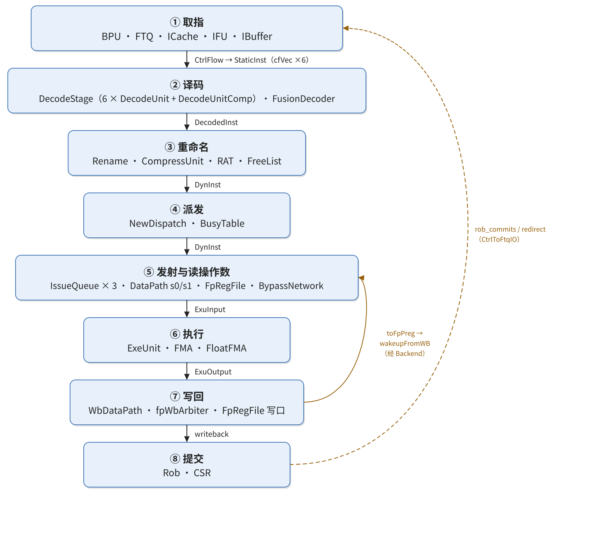

| Stage | Responsible components | Bundle on entry | Bundle on exit |
|---|---|---|---|
| Fetch | `Predictor`, `Ftq`, `ICache`, `NewIFU`, `IBuffer` | predicted address | `CtrlFlow` |
| Decode | `DecodeStage` (`DecodeUnit`×6, `DecodeUnitComp`, `VTypeGen`), `FPDecoder`, `FusionDecoder` | `CtrlFlow` | `DecodedInst` |
| Rename | `Rename`, `CompressUnit`, `RenameTableWrapper` (RAT), `FreeList` | `DecodedInst` | `DynInst` |
| Dispatch | `NewDispatch` | `DynInst` | `DynInst` (enqueued), `RobEnqIO` |
| Issue | `Scheduler`, `IssueQueue`, `WbFuBusyTable` | `DynInst` | `IssueQueueIssueBundle` |
| Operand read | `DataPath` (s0/s1), `FpRegFile`, `BypassNetwork` | `IssueQueueIssueBundle` | `ExuInput` |
| Execute | `ExuBlock`, `ExeUnit`, `FMA` wrapper, `FloatFMA` | `ExuInput` | `ExuOutput` |
| Writeback | `WbDataPath`, `WbArbiter`, `FpRegFile` write ports | `ExuOutput` | write ports, `writeback` |
| Commit | `Rob`, `CSR` | `RobEnqIO`, `writeback` | `RobCommitIO` |

The table lists nine rows, of which "Issue" and "Operand read" are merged into a single section later: queue selection and register-file read are two beats of the same thing, separated only by an s0/s1 pipeline register, and splitting them into two sections would describe one handover as two. The remaining eight sections each correspond to one stage.

---

## 3. Fetch: Turning a PC into an Instruction with Context

### 3.1 The Problem This Stage Solves

Fetch must settle three things at once: where the next instruction should be fetched from (where the address comes from), what the bytes at that place are (where the data comes from), and where this run of bytes is cut into instructions (where the boundaries are). The three things are handled by the predictor, the cache, and predecode respectively; if any one of them goes wrong, decode downstream receives the wrong bit pattern.

RISC-V allows 16-bit compressed instructions and 32-bit instructions to be interleaved, a 32-bit instruction may straddle two cache lines, and a branch target may fall in the middle of a cache line. The fetch stage therefore cannot simply "cut at 4-byte alignment": it must first fetch a run of bytes starting from the entry address given by the prediction, then use predecode to find the end of each instruction one by one, and only then send the cut instructions downstream.

### 3.2 Components and Organization

The frontend consists of the predictor `Predictor`, the fetch target queue `Ftq`, the instruction cache `ICache`, the fetch unit `NewIFU`, the uncached fetch path `InstrUncache`, and the instruction buffer `IBuffer`. These components are not at the same level: `Frontend` is merely a LazyModule shell, the implementation lives in `FrontendInlined`, which in turn wraps another layer `FrontendInlinedImp`; `ICache` and `InstrUncache` are instantiated by `FrontendInlined` (`Frontend.scala:68-69`), and the other four by `FrontendInlinedImp` (`Frontend.scala:106-109`). `FrontendImp` itself performs no logic and only clones the inner IO and connects it (`Frontend.scala:55-63`). The hierarchy is shown in Figure 2, and the data flow of the fetch stage in Figure 3.

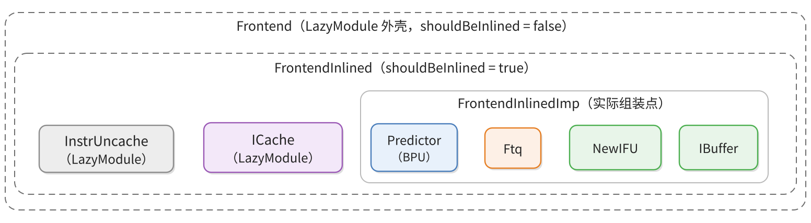

`ICache` and `InstrUncache` remain at the `FrontendInlined` level because they must connect through LazyModule diplomacy nodes to the memory-side `MemBlock` (`XSCore.scala:70-73`), whereas BPU, FTQ, IFU, and IBuffer have only internal connections among themselves and can sit in the inner layer.

### 3.3 Key Signals

The fetch stage has nine connections, four of which converge on `Ftq`. `Ftq` is the only address producer and registry in the fetch stage: the predictor writes prediction results into it, it sends requests to both IFU and ICache, IFU writes predecode results back, and the backend sends redirect and commit information back.

| Component | What it does at this stage | What it provides |
|---|---|---|
| `Predictor` | Queries the fast table, FTB/TAGE, and SC/ITTAGE in parallel by fetch-block PC and global history, giving predictions in three levels | `s1`/`s2`/`s3` of `BpuToFtqIO.resp` |
| `Ftq` | Manages fetch entries and the fetch pointer, issues requests to IFU and ICache, and receives commit records and redirects from the backend | `FtqToIfuIO`, `FtqToICacheIO` |
| `ICache` | Looks up the cache and ITLB by fetch address, fetching data through the miss unit on a miss | line data and hit information of `IFUICacheIO` |
| `NewIFU` | Generates addresses, assembles bytes, performs predecode, and expands RVC in F0–F3 | `FetchToIBuffer`, `IfuToFtqIO.pdWb` |
| `IBuffer` | Buffers fetch results and assembles `CtrlFlow` for output according to the backend's acceptance capacity | `CtrlFlow` (`cfVec`) |
| `CtrlBlock` | Collects commit and redirect feedback to the FTQ and reports whether the decode buffer can accept | `CtrlToFtqIO`, `canAccept` |

| Edge | Bundle | Producer | Consumer | Carries |
|---|---|---|---|---|
| BPU → FTQ | `BpuToFtqIO` (`BPU.scala:243`) | `Predictor` | `Ftq` (`NewFtq.scala:479`) | `resp`: the three prediction results s1/s2/s3, each with `ftq_idx`; the FTQ picks the most mature one to write back |
| FTQ → IFU | `FtqToIfuIO` (`NewFtq.scala:197`) | `Ftq` | `NewIFU` | `req` (`Decoupled(FetchRequestBundle)`), `redirect`, `topdown_redirect`, `flushFromBpu` |
| FTQ → ICache | `FtqToICacheIO` (`NewFtq.scala:204`) | `Ftq` | `ICache` | one `req`, carrying the fetch address and FTQ coordinates |
| ICache → IFU | `IFUICacheIO` (`FrontendBundle.scala:80`) | `ICache` | `NewIFU` (`IFU.scala:72`) | cache line data, hit/miss, exception information |
| IFU → FTQ | `IfuToFtqIO` (`IFU.scala:47`) | `NewIFU` | `Ftq` | `pdWb`, instruction boundaries and branch information written back by predecode |
| IFU → IBuffer | `FetchToIBuffer` (`FrontendBundle.scala:240`) | `NewIFU` (`IFU.scala:957-984`) | `IBuffer` | up to `PredictWidth` instruction bits, PC, `pd`, empty-slot mask |
| IBuffer → backend | `CtrlFlow` (`Bundle.scala:144-168`) | `IBuffer` (`IBuffer.scala:87-112`) | `CtrlBlock` | see Section 4 |
| CtrlBlock → FTQ | `CtrlToFtqIO` (`CtrlBlock.scala:43`) | `CtrlBlock` (`CtrlBlock.scala:342-358`) | `Ftq` (`NewFtq.scala:481`) | `rob_commits`, `redirect`, `ftqIdxAhead` |
| CtrlBlock → IBuffer | `FrontendToCtrlIO.canAccept` (`Bundle.scala:492`) | `CtrlBlock` (`CtrlBlock.scala:504`) | `IBuffer` (`Frontend.scala:431`) | whether the backend decode buffer can still accept new instructions |

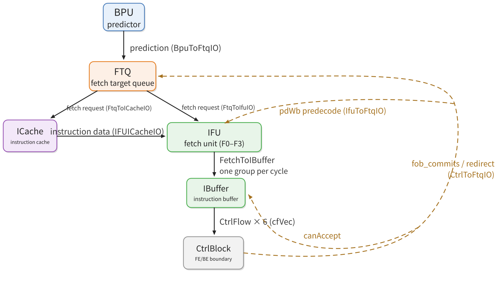

The s1, s2, and s3 results in `resp` are the current results of three different fetch blocks on the BPU's three-stage prediction pipeline, not three snapshots of the same block. What distinguishes the three levels is whose conclusion each waits for: s1 has only the FauFTB fast table, the only component tagged `is_fast_pred`, and the Composer bypasses its output directly to s1 (`Composer.scala:27-32`, `FauFTB.scala:84`); s2 waits for FTB and TAGE (`FTB.scala:787-801`, `Tage.scala:687-696`); s3 waits for SC's statistical correction and ITTAGE (`SC.scala:339-343`). The three results each carry `ftq_idx` (`FrontendBundle.scala:691-697`), and the FTQ picks the most mature one by the rule "if s3 has a redirect, use s3; otherwise look at s2; otherwise use s1" (`FrontendBundle.scala:735-742`); when s1 is chosen it writes the new entry pointed to by `bpuPtr`, and when s2/s3 is chosen it writes the old entry pointed to by the `ftq_idx` carried in the response (`NewFtq.scala:615-618`). A fetch block is thus filled in progressively over three cycles: s1 creates the entry, s2 and s3 correct its direction and target, and the entry also records which level the conclusion came from (`NewFtq.scala:674`).

There is no direct connection between the BPU and the IFU. The predictor registers its result in the FTQ; an entry records the start address of one fetch target, the branch prediction information, and the predicted direction. The FTQ then hands this entry simultaneously to IFU for fetching bytes and to ICache for cache lookup (`Frontend.scala:200-211`). The reason for this arrangement is that IFU's fetching must follow the FTQ's registration order: IFU may only fetch entries for which `ifuPtr` has not yet caught up with `bpuPtr`, a condition written as `entry_is_to_send && ifuPtr =/= bpuPtr` (`NewFtq.scala:916`). A target the predictor has not yet written in cannot be fetched by IFU.

Inside the IFU, execution proceeds through four levels, F0 to F3. F0 takes the start address from the FTQ entry (`IFU.scala:241-263`); F1 generates the PC of each slot according to `PredictWidth` and computes `cut_ptr`, the truncation position of this fetch group within the cache line (`IFU.scala:307-343`); F2 assembles the cache line data, truncates it according to `cut`, and then uses `PreDecode` to find instruction boundaries byte by byte (`IFU.scala:356-540`, with truncation at line 510 and predecode at lines 518-529); F3 expands 16-bit compressed instructions into 32 bits and sends them out together with the various valid bits (`IFU.scala:559-598`, with RVC expansion at lines 572-582).

The instruction boundaries obtained in F2 are not only used for cutting but also written back to the FTQ: "whether it is a branch, whether it is a jump, whether it is a return, the predicted direction" in `pd` are later used by the backend for redirection. The writeback channel is `IfuToFtqIO.pdWb` (`IFU.scala:1175`), and the FTQ writes it into its own pd storage (`NewFtq.scala:981-990`). Only after the writeback is this entry seen by the backend with complete information.

`IBuffer` is the exit buffer of the fetch stage and the only instruction channel between the frontend and the backend. The IFU pushes a group of instructions into `FetchToIBuffer` every cycle, IBuffer stores them as `IBufEntry` (`IBuffer.scala:52`, `IBuffer.scala:66`), and on dequeue `toCtrlFlow` converts them into `CtrlFlow` (`IBuffer.scala:87-112`), which is sent to the backend through `io.backend.cfVec` (`Frontend.scala:439`).

Backpressure does not travel on the `ready` of `cfVec`. `CtrlBlock` uses `io.frontend.canAccept` to tell the frontend "whether the decode buffer can still accept" (`CtrlBlock.scala:504`), and the frontend connects this line to `ibuffer.io.decodeCanAccept` (`Frontend.scala:431`), on which IBuffer decides whether to drain its output register. Although the per-lane `ready` on `cfVec` is also assigned by `CtrlBlock`, IBuffer does not read it.

Feedback from the backend to the frontend travels on `CtrlToFtqIO`. It carries two kinds of information: `rob_commits` are the ROB's commit records, which the FTQ uses to mark the corresponding entries as committed (`NewFtq.scala:1319`); `redirect` is a redirect, on which the FTQ flushes the ICache, IFU, and BPU and moves the fetch pointer to the correct target.

### 3.4 FMUL at This Stage

All frontend actions operate only on the instruction word and the address; the operands are still in the floating-point register file and have not been read out, so special values have no identity at all in this segment. The fetch stage cuts out the instruction block according to the range given by the FTQ, and whether the ICache hits, whether the ITLB/PTW waits, and whether the IBuffer backpressures determine when this instruction enters the backend (`IFU.scala:241-263`, `IFU.scala:292-320`, `IFU.scala:357-420`, `IFU.scala:558-620`).

`FMUL.S` is a 32-bit instruction with the low two bits equal to `11`, so predecode in F2 can determine at a glance that it is 4 bytes and not a compressed instruction, and `pd.isRvc` is false. The RVC expansion in F3 does nothing to it, and the 32-bit encoding is preserved verbatim in `f3_expd_instr`. Predecode looks only at the few bits in the encoding that determine control flow and instruction boundaries; for this 32-bit `fmul` it produces `valid=1, isRVC=0, brType=notCFI, isCall=0, isRet=0` (`PreDecode.scala:72-82`); it does not judge whether this position is a floating-point instruction, still less the operand type, and leaves the operation class to backend decode.

What PredChecker verifies is whether the predictor has treated a non-control-flow position as a jump. Under normal circumstances `fmul` does not trigger `remaskFault` and does not produce `mispredict`; if an earlier branch in the same fetch window is mispredicted, this `fmul` is masked along with the window, which belongs to generic frontend recovery rather than to an exception produced by the multiplication itself.

On entering the IBuffer, the instruction carries the instruction word, PC, FTQ pointer and offset, predecode information, and fetch exceptions (`IFU.scala:953-990`, `IBuffer.scala:228-324`). The enqueue width depends on `PredictWidth`; with the C extension enabled it is 16 halfword candidate positions, which is not the same as being able to enqueue 16 32-bit instructions per cycle; `enqEnable` is also constrained by `fixedRange` and the valid mask, and when the queue is full the instruction waits in the IBuffer.

Three things are left behind for FMUL at this stage: the 32-bit instruction bits, `pc`, and the pair of coordinates `ftqPtr` and `ftqOffset`. The coordinates mean "which FTQ entry this instruction comes from, and which slot within that entry". Whatever the backend later discovers—a misprediction, an exception, or the need to commit—it uses this pair of coordinates to locate the instruction in the FTQ; when the instruction retires, the FTQ also relies on them to mark the entry as committed. At this point the frontend does not know that this is a floating-point multiplication instruction; `pd` records only whether it is a branch and whether it is RVC. The first time special values are seen by hardware is at the execute unit's entry; before that, the pipeline cares only about "whether the instruction is valid" and "when the sources are ready", never about what the bit pattern in a register represents.

### 3.5 How to Confirm in the Source

Open `Frontend.scala`, first look at which four modules `FrontendInlinedImp` instantiates, then look at the statement `io.backend.cfVec <> ibuffer.io.out` to confirm that what the frontend hands out is `CtrlFlow`. Then open `NewFtq.scala`, search for `FtqToIfuIO` and `FtqToICacheIO` to confirm that the two request paths share the same source; search for the write point of `pdWb` to confirm that predecode results really return to the FTQ. Finally read through `IFU.scala` in the order F0 to F3, and see at which level `cut` and `PreDecode` each occur.

---

## 4. Decode: From a 32-Bit Encoding to 15 Columns of Control Signals

### 4.1 The Problem This Stage Solves

The fetch stage deliberately makes no semantic judgment; what it sends down is a pure bit pattern. Decode's job is to translate "what this instruction is" into "how this instruction travels": which execute unit it goes to, what operation it performs, which sources it reads, whether it writes a register, and whether it must be split into multiple uops. The result of the translation is a set of fixed-width control fields; rename, dispatch, and issue downstream only read this set of fields and never look back at the instruction encoding.

Fixed width is the most important design constraint of this stage. The decode table has more than a dozen subtables covering the base integer, floating-point, bit-manipulation, vector, crypto, debug, and compressed extensions, and every row of every table must supply the same number of columns (`DecodeUnit.scala:806-818`). Only then can the table lookup result be expanded directly into a `DecodedInst`.

### 4.2 Components and Organization

The decode stage is inside `CtrlBlock`. `CtrlBlock` is the first major block of the backend, packing together the control logic "after fetch and before issue": it instantiates `NewDispatch`, `DecodeStage`, `FusionDecoder`, `RenameTableWrapper`, `Rename`, `RedirectGenerator`, and `Rob` (`CtrlBlock.scala:90-99`). `DecodeStage` in turn contains a complex decoder `DecodeUnitComp`, six simple decoders `DecodeUnit`, and one `VTypeGen` (`DecodeStage.scala:104-108`). The module hierarchy is shown in Figure 4.

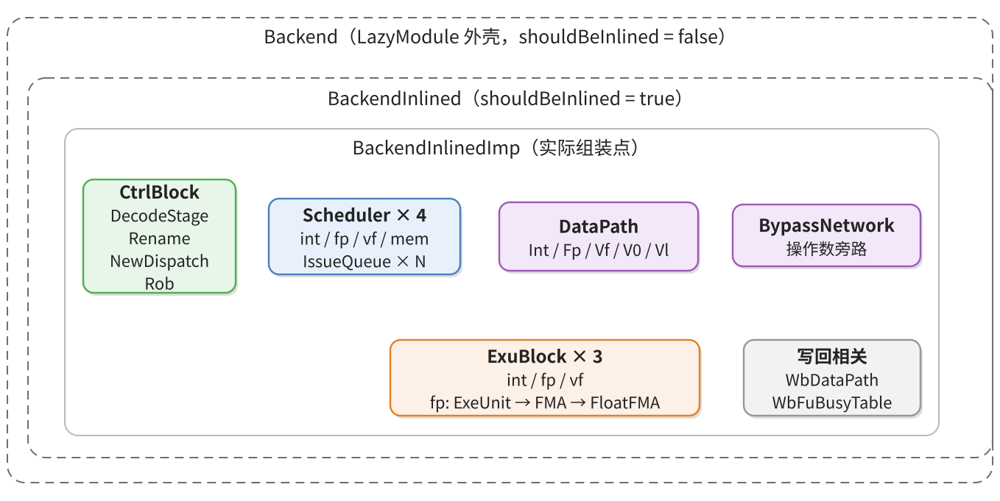

Simple and complex decoders divide the work differently. The six `DecodeUnit`s each look up the main table once and obtain 15 columns of generic control signals; `DecodeUnitComp` does not look up the main table again—it uses the simple decoder's result to decide whether the instruction must be split into multiple uops and generates the subsequent uops according to the splitting rules. `FusionDecoder` sits alongside `DecodeStage` and checks whether two adjacent instructions can be merged into one fused operation.

### 4.3 Key Signals

| Component | What it does at this stage | What it provides |
|---|---|---|
| `CtrlBlock` | Renames the frontend's `CtrlFlow` into `StaticInst`, and holds it temporarily when decode is congested | `StaticInst` |
| `DecodeStage` | Distributes the six input lanes to the six decoders, collects decode results, and issues RAT read addresses early | `DecodedInst`, `RatReadPort` |
| `DecodeUnit` | Looks up the main table for 15 columns of generic control and invokes `FPDecoder` to supply floating-point control | the control columns of `DecodedInst` |
| `FPDecoder` | Derives floating-point precision and rounding mode from the instruction encoding | `fmt` and `rm` of `FPUCtrlSignals` |
| `DecodeUnitComp` | Decides whether a uop must be split and generates subsequent uops by rule | the uop split result |
| `FusionDecoder` | Checks whether two adjacent instructions can be fused | `FusionDecodeReplace`, `FusionDecodeInfo` |
| `VTypeGen` | Derives the vector type from the instruction and the existing configuration | `VType` |

| Edge | Bundle | Producer | Consumer | Carries |
|---|---|---|---|---|
| Frontend → boundary | `CtrlFlow` (`Bundle.scala:144-168`) | `IBuffer` | `CtrlBlock` | instruction bits, PC, `ftqPtr`/`ftqOffset`, predecode result |
| Inside the boundary | `StaticInst` (`Bundles.scala:43-57`) | `CtrlBlock` (`CtrlBlock.scala:481-482`) | `DecodeStage.io.in` (`DecodeStage.scala:46`) | the fields of `CtrlFlow` plus two renames |
| Decoder input | `StaticInst` (`Bundles.scala:43-57`) | `DecodeStage` (`DecodeStage.scala:117-119`) | `DecodeUnit.io.enq.ctrlFlow` | as above |
| Decoder output | `DecodedInst` (`Bundles.scala:78-146`) | `DecodeUnit` (`DecodeUnit.scala:834`) | `DecodeStage.io.out` | 15 columns of control signals, `lsrc`, `fpu` control, `preDecodeInfo`, `pc`, `ftqPtr` |
| Fusion → control block | `FusionDecodeReplace` (`FusionDecoder.scala:512`) | `FusionDecoder` (`FusionDecoder.scala:538`) | `CtrlBlock` (`CtrlBlock.scala:603-605`) | the control fields to be replaced after fusion |
| Fusion → rename | `FusionDecodeInfo` (`FusionDecoder.scala:506`) | `FusionDecoder` | `Rename.io.fusionInfo` (`Rename.scala:56`) | fusion slot and selection of the second source |
| Decode → rename | `DecodedInst` (`Bundles.scala:78-146`) | `DecodeStage` (`DecodeStage.scala:234-236`) | `Rename.io.in` (via `decodePipeRename`, `CtrlBlock.scala:576-579`) | as above |
| Decode → RAT | `RatReadPort` (`RenameTable.scala:37`) | `DecodeStage` (`DecodeStage.scala:271-275`) | `RenameTableWrapper` (`CtrlBlock.scala:507-509`) | `lsrc(0..2)` as read addresses |

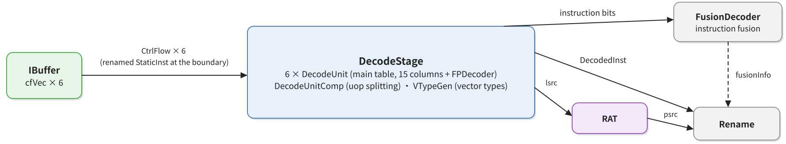

The boundary segment deserves a separate look. The `cfVec` of `FrontendToCtrlIO` is six lanes of `DecoupledIO(new CtrlFlow)` (`Bundle.scala:486`); after receiving them, `CtrlBlock` first performs a rename: it creates `Wire(Vec(DecodeWidth, new StaticInst))` and copies the fields of `CtrlFlow` over one by one with `connectCtrlFlow` (`CtrlBlock.scala:481-482`). The fields of the two types correspond one to one; only `backendException` is renamed `isFetchMalAddr` and `pd` is renamed `preDecodeInfo`.

After the rename there is another level of temporary storage. When `DecodeStage` cannot accept all instructions in a cycle, the rest must stay in `CtrlBlock`; this is `decodeBufBits`—a `Reg(Vec(DecodeWidth, new StaticInst))` (`CtrlBlock.scala:417`). The input of `DecodeStage` is therefore selected among three sources: whether there are instructions in the buffer, whether the instructions sent by the frontend this cycle can go straight in, and which lanes are actually ready; the selection logic is at `CtrlBlock.scala:498-502`.

The consumption inside `DecodeStage` is very direct: each input lane is connected to the `io.enq.ctrlFlow` of the corresponding simple decoder (`DecodeStage.scala:117-119`). The port is called `ctrlFlow` but its type is already `StaticInst`, a trace left by historical naming. `DecodeUnit` looks up the table with `instr` to obtain control signals, then uses `connectStaticInst` to copy all same-named fields of `StaticInst` wholesale into `DecodedInst` (`DecodeUnit.scala:834`).

`connectStaticInst` is implemented as an intersection by field name (`Bundles.scala:146-152`), so fields such as `pc`, `ftqPtr`, `ftqOffset`, `isLastInFtqEntry`, `preDecodeInfo`, and `exceptionVec` are carried down automatically, and the decoder need not assign them one by one. This rule also explains why `DecodedInst` retains a set of fetch fields that look unrelated to decode: they are needed so that the ROB can still locate the FTQ entry at commit.

The decode stage also does one thing early that belongs to the next stage: it sends `lsrc` to the read address ports of the rename table. This happens in the same cycle in which the decode result is sent out (`DecodeStage.scala:271-275`), because the rename table is synchronously read—the data comes back one cycle after the address is given; by issuing the address early, the `psrc` read out is ready exactly when `DecodedInst` reaches the rename stage through `decodePipeRename`.

### 4.4 FMUL at This Stage

`FMUL_S` occupies one row in `VecDecoder.scala`: `FMUL_S -> OPFFF(SrcType.fp, SrcType.fp, SrcType.X, FuType.fmac, VfmaType.vfmul, F, T, F, UopSplitType.SCA_SIM)` (`VecDecoder.scala:548`). This row supplies 9 of the 15 columns, and the rest are filled in by the fixed values of `OPFFF`: it does not write an integer register, does not write a vector register, does not produce an extended exception, does not block later instructions, allows ROB compression, and has no immediate.

`fuType = FuType.fmac` determines that it enters the floating-point issue queue, `fuOpType = VfmaType.vfmul` determines that it performs multiplication in the multiply-add unit, and `fpWen = T` determines that the result is written to a floating-point physical register. The third source is written as `SrcType.X`, whose encoding is all zeros, meaning "there is no such source": rename does not look it up, the datapath does not build a read port for it, and the execute stage receives 0. In the instruction encoding `lsrc(2)` is still assigned `inst.VD` (`DecodeUnit.scala:853-863`), but no stage ever uses it.

Besides the main table there is a dedicated decoder `FPDecoder`, which supplies precision and rounding mode and writes the result into `DecodedInst.fpu` (`DecodeUnit.scala:830-833`). The `FPUCtrlSignals` it produces has five fields: `typeTagOut`, `wflags`, `typ`, `fmt`, `rm` (`Bundle.scala:171-177`). Of these, `typeTagOut`, `wflags`, and `typ` are determined by the decode logic (`FPDecoder.scala:194`, `FPDecoder.scala:229`), while `fmt` and `rm` are carried over verbatim from the instruction encoding. `FMUL_S` is in the `isFP32Instrs` list, so `fmt` takes `VSew.e32` (`FPDecoder.scala:293-299`, `FPDecoder.scala:341`); `rm` preserves the instruction's 3-bit field verbatim, and when the value is `111` it is left to the execute stage to interpret with `fcsr.frm` (`FPDecoder.scala:342`).

`DecodeUnitComp` determines the splitting rule by `uopSplitType`; `SCA_SIM` has no corresponding branch, and FMUL passes through unchanged (`DecodeUnitComp.scala:160`, `DecodeUnitComp.scala:211`). The default values given by `DecodeUnit` are `uopIdx = 0`, `firstUop = true`, `lastUop = true`, `numUops = 1`, `numWB = 1` (`DecodeUnit.scala:836-840`), so exactly one uop emerges from decode.

The value `vfmul` is the fork at which pure multiplication and multiply-add share a single path. When `FloatFMA` receives `vfmul` it zeroes the third source (`FloatFMA.scala:89`), and the wrapper layer `FMA` consequently skips the boxing check on the third source (`FMA.scala:29-30`). The zeroing has an inconspicuous but profound consequence: `fp_c_is_zero_f32` is always 1 (`FloatFMA.scala:643`), and `has_zero_f32_reg2` is always 1 accordingly (`FloatFMA.scala:652`); the "zero" branch of the five-way selection becomes the default path for all finite results, and `otherwise` is unreachable for `fmul`.

The decode item records "this instruction writes `fflags`" in two places, each with its own destination. The `wfflagsInsts` list of `DecodeUnit` contains `FMUL_S/D/H` (`DecodeUnit.scala:989`), and the result is written into `decodedInst.wfflags` (`DecodeUnit.scala:1044`) and, along with dispatch, into the `wflags` of the ROB entry (`RobBundles.scala:140`), where at commit it determines whether this entry should update `fcsr`. The `fpu.wflags` produced by `FPDecoder` is OR-merged with the former at the decoder output (`DecodeUnit.scala:834`), travels with the uop all the way to the execute unit, and at writeback serves as the gate for `ExuOutput.wflags`. If only one place recorded it, either the execute unit would not know whether the flags should be sampled or the ROB would not know whether to send the flags to `fcsr` at commit; recording it in two places means the same information travels separately on two paths and converges at the commit stage.

### 4.5 How to Confirm in the Source

First `grep FMUL_S` to find that row, then open the constructor definition of `OPFFF` to check the parameter order, and finally go to `DecodedInst.allSignals` to confirm the names and order of the 15 columns (`Bundles.scala:129-130`). Only when all three agree is the meaning of this row read correctly. To see the floating-point fields, search for the assignments of `fmt` and `rm` in `FPDecoder`.

---

## 5. Rename: Logical Register Numbers Become Physical Register Numbers

### 5.1 The Problem This Stage Solves

`f1` and `f2` in a program are logical names. If a later instruction writes `f1` while an earlier instruction still needs to read the old `f1`, the hardware must wait; this is a false dependency. Rename's approach is to allocate a new physical register for each write and record the mapping from logical names to physical names in the RAT. Instructions reading the old value still point to the old physical register, instructions writing the new value receive a new physical register, and the two can proceed in parallel.

This stage must simultaneously accomplish three interlocking things: read the RAT to replace `lsrc` with `psrc`, allocate `pdest` from the FreeList, and obtain `robIdx` from the ROB. All three must be settled in the same cycle, because the subsequent dispatch uses `pdest` and `robIdx` to write the busy table and the ROB.

### 5.2 Components and Organization

The `Rename` module internally instantiates the compression unit `CompressUnit` and five groups of FreeLists (integer, floating-point, vector, `v0`, `vl`), and manages the write ports of the RAT (`Rename.scala:105-115`). The RAT table proper is not in `Rename` but is `rat = Module(new RenameTableWrapper)` in `CtrlBlock` (`CtrlBlock.scala:94`): its read ports connect to `DecodeStage` and its write ports connect to `Rename`. This placement is because the read address must be issued at decode and the read data used at rename; putting the table between the two stages is the most natural. The component hierarchy is shown in Figure 6.

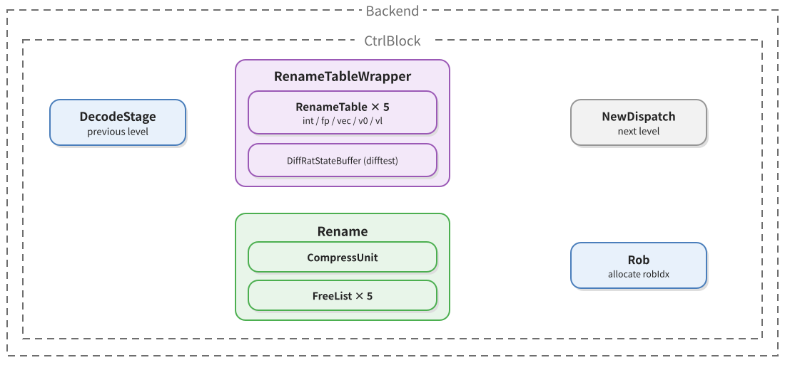

### 5.3 Key Signals

| Component | What it does at this stage | What it provides |
|---|---|---|
| `DecodeStage` | Sends out the decode result and issues `lsrc` as RAT read addresses early | `DecodedInst`, `RatReadPort` |
| `RenameTableWrapper` | Holds the mapping from logical names to physical names and returns `psrc` by read address | `psrc` |
| FreeList (five groups) | Allocates free physical registers by register type | `pdest` |
| `CompressUnit` | Decides whether adjacent instructions can share one ROB entry and computes the compressed package size | `instrSizes`, `masks`, `needRobFlags`, `canCompressVec` |
| `Rename` | Fills in `psrc`, `pdest`, `robIdx`, and compression information, and commits new mappings to the RAT | `DynInst`, `RatWritePort` |

| Edge | Bundle | Producer | Consumer | Carries |
|---|---|---|---|---|
| Decode → rename | `DecodedInst` (`Bundles.scala:78-146`) | `DecodeStage` | `Rename.io.in` (`Rename.scala:55`) | control columns, `lsrc`, `pc`, `ftqPtr` |
| Decode → RAT | `RatReadPort` (`RenameTable.scala:37`) | `DecodeStage` | `RenameTableWrapper` | `lsrc(0..2)` |
| RAT → rename | the return value of `RatReadPort` (`RenameTable.scala:37`) | `RenameTableWrapper` | `Rename.io.intReadPorts` etc. (`Rename.scala:62-66`) | `psrc(0..2)`, split by register type |
| FreeList → rename | `allocatePhyReg` (`BaseFreeList.scala:35`) | each FreeList | `Rename` (`Rename.scala:409-415`) | `pdest` |
| Rename → dispatch | `DynInst` (`Bundles.scala:178-260`) | `Rename.io.out` (`Rename.scala:80`) | `NewDispatch.io.fromRename` (`NewDispatch.scala:100`) | `psrc`, `pdest`, `robIdx`, control columns, `srcState` |
| RAT writeback | `RatWritePort` (`RenameTable.scala:43`) | `Rename` (`Rename.scala:67-71`) | `RenameTableWrapper` | mapping from logical names to new physical names |

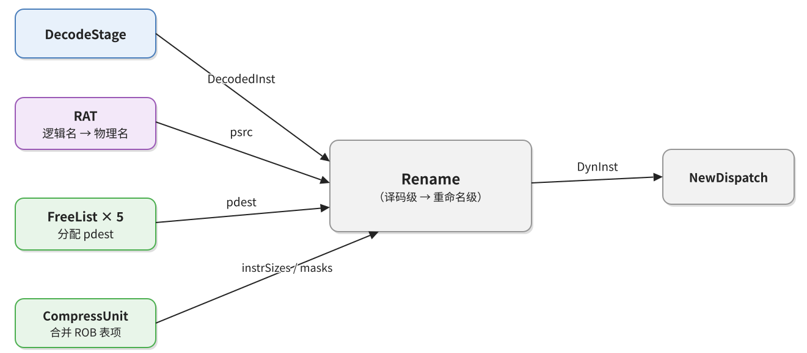

`psrc` is selected according to the one-hot code of `srcType`: for the integer, floating-point, and vector read ports, one lane is selected with `Mux1H` (`Rename.scala:391-393`). `SrcType` is a 4-bit one-hot code—integer `0001`, floating-point `0010`, vector `0100`, `v0` `1000`, with all zeros meaning no register read (`package.scala:31-56`). `Mux1H` outputs 0 when all select bits are zero, so the `psrc` of a lane with no source is naturally 0; this 0 is a placeholder value, not physical register 0.

`pdest` is selected by `MuxCase` from the corresponding FreeList according to the destination type (`Rename.scala:409-415`), and `robIdx` is obtained from the ROB head pointer plus the number of entries occupied by preceding instructions in this package (`Rename.scala:346`). Once `robIdx` is allocated, writeback, exceptions, and commit all rely on it for locating.

`CompressUnit` decides whether the multiple instructions in this cycle can share one ROB entry. The conditions are: the instruction is valid, is not a fused instruction, has `lastUop`, has no exception or trigger, and has `canRobCompress` (`CompressUnit.scala:50-53`). Consecutive instructions satisfying the conditions are packed together, only the last one occupies an entry, and the number in the package is recorded in `numUops`/`numWB` (`Rename.scala:353-368`).

Rename also fills in a batch of fields that decode did not supply. `storeSetHit`, `loadWaitStrict`, and `ssid` are filled here from the read result of the store dependency prediction table (`Rename.scala:310-312`)—as mentioned earlier in Section 3, these three are empty in `CtrlFlow`.

### 5.4 FMUL at This Stage

FMUL's `psrc(0)` and `psrc(1)` come from the floating-point RAT, and `psrc(2)` is 0 because its `srcType` is all zeros. `pdest` goes through `fpFreeList` because `fpWen` is true. `OPFFF` fixes `canRobCompress` to true, so FMUL may be compressed into the same ROB entry as its neighbor; whether the merge actually happens depends on whether the surrounding instructions also satisfy the conditions. One consequence of compression is that `numUops` may be greater than 1. This field is determined at this stage, and the ROB later uses it to decide when the entry may commit: the entry is complete only when all uops in it have written back and the instructions have retired.

The whole process looks only at register numbers. A physical register holding a canonical NaN and a physical register holding 1.0 are indistinguishable in the rename table; it does not read register contents, so it has no way to judge whether a source is a special value (`Rename.scala:392-393`, `Rename.scala:644-646`). After rename, the identity of an instruction is determined by its physical sources, physical destination, and ROB entry, and the types of the values remain unknown.

### 5.5 How to Confirm in the Source

First check that the type of `Rename.io.in` is `DecodedInst` and the type of `io.out` is `DynInst`; the boundary between the two stages is then clear. Then search `uops(i).psrc` to see the three sources of `Mux1H`; search `pdest` to see the branches of `MuxCase`; search `robIdx` to see which pointer it is added from. Finally, in `CtrlBlock`, search `decodePipeRename` and `renamePipeDispatch` to confirm that each of these two stages has one pipeline cycle.

---

## 6. Dispatch: Uops Enter the Issue Queue

### 6.1 The Problem This Stage Solves

After rename, the destination of a uop is determined by `fuType`: the integer, floating-point, vector, and memory execute units each have their own set of issue queues. Dispatch must send it to a free slot in one of these queues and at the same time give the same uop's enqueue request to the ROB, so that the ROB entry is established before the instruction executes.

There is a race that must be resolved: in the same cycle there may be multiple uops of the same type, all satisfying the same set of candidate queues; if each picked independently, they might choose the same free slot. Dispatch's approach is to first find all candidate queues according to the one-hot code of `fuType`, then compare the occupancy counts of the candidates and pick the least loaded, while deducting from the candidates the queues already occupied by preceding uops in the same package.

### 6.2 Components and Organization

Dispatch is performed by `NewDispatch`, a direct submodule of `CtrlBlock` (`CtrlBlock.scala:90`). It has two downstream directions: on one side the issue queues in the four `Scheduler`s, and on the other the `Rob`. `Scheduler` is a LazyModule in `Backend` (`Backend.scala:180-183`); the floating-point group contains three issue queues, each with 18 entries (`Parameters.scala:423-443`). The component organization of the dispatch stage is shown in Figure 8.

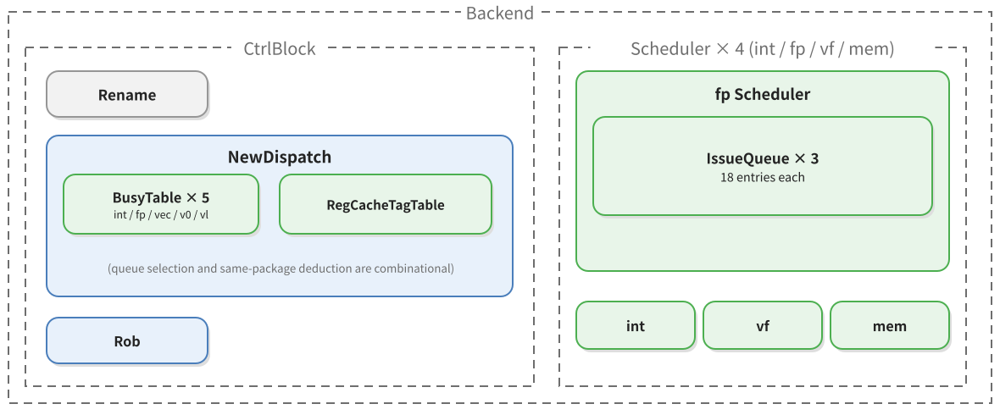

### 6.3 Key Signals

| Component | What it does at this stage | What it provides |
|---|---|---|
| `Rename` | Sends out the uop with backend fields filled in | `DynInst` |
| `BusyTable` | Records by physical register number whether a producer has not yet written back | busy/free bit |
| `NewDispatch` | Selects the queue by `fuType`, compares occupancy, deducts same-package quota, computes `srcState` with the busy table, and requests enqueue from the ROB | the queue's `DynInst`, `RobEnqIO` |
| `IssueQueue` | Receives the uop and establishes a waiting entry | queue entry |
| `Rob` | Registers the entry in dispatch order | ROB entry |

| Edge | Bundle | Producer | Consumer | Carries |
|---|---|---|---|---|
| Rename → dispatch | `DynInst` (`Bundles.scala:178-260`) | `Rename` | `NewDispatch.io.fromRename` (`NewDispatch.scala:100`) | all backend fields |
| Dispatch → issue queue | `DynInst` (`Bundles.scala:178-260`) | `NewDispatch.io.toIssueQueues` (`NewDispatch.scala:106`) | `IssueQueue.io.enq` (`IssueQueue.scala:50`) | the same `DynInst`, including the initial `srcState` |
| Dispatch → ROB | `RobEnqIO` (`RobBundles.scala:272`) | `NewDispatch.io.enqRob` (`NewDispatch.scala:103`) | `Rob.io.enq` (`Rob.scala:67`), with one cycle of register in between at `CtrlBlock` (`CtrlBlock.scala:712-718`) | `robIdx`, `numUops`, `numWB`, `wfflags`, `ftqPtr` |
| Busy table → dispatch | busy table read result | `BusyTable` | `NewDispatch` (`NewDispatch.scala:288-308`) | whether each `psrc` still has a producer that has not written back |

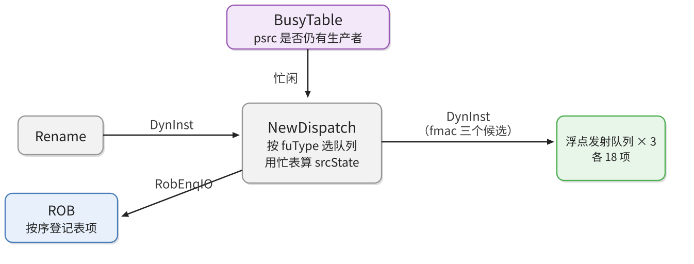

`srcState`'s initial value in `DynInst` is not given by rename but computed by dispatch using the busy table: `allSrcState(i)(j)(k) := readEn && busyTables(k).io.read(readidx).resp || SrcType.isImm(...)` (`NewDispatch.scala:288-308`). The busy table is indexed by physical register number and records whether that register still has a producer that has not written back; a source for which `SrcType.isImm` is true (that is, `srcType` is all zeros) is counted as ready directly, because it does not read a register.

The ROB enqueue request must be registered for one cycle in `CtrlBlock`: `sink.valid := RegNext(source.valid && !rob.io.redirect.valid)`, and the data is registered in step with the valid bit using `RegEnable` (`CtrlBlock.scala:712-718`). This path is not in the same cycle as the path from dispatch to the issue queue; the ROB entry is established one cycle later than the queue entry. Because the ROB only records order and state, one cycle of delay does not affect correctness.

### 6.4 FMUL at This Stage

`FuType.fmac` appears in the execute unit configurations of all three floating-point queues, so FMUL has three candidate queues. Each of the three queues is attached to a different combination of execute units: queue 0 connects FEX0 and FEX1, queue 1 connects FEX2 and FEX3, and queue 2 connects only FEX4. `NewDispatch` first picks one among the candidates by occupancy count (`minIQSel`, `NewDispatch.scala:359-430`), then deducts the occupied queue from the candidates of the subsequent uops in the same package.

The three FMA execute units are a trade-off between area and throughput: one unit can start only one multiplication per cycle, while three copies allow three in parallel; the cost is two extra sets of Booth encoders, compression trees, and read ports. The reason there are only three queues but five execute units is that integer and floating-point units in the same group are meant to share an enqueue port: queue 0 sends to FEX0 and FEX1, queue 1 to FEX2 and FEX3, pairing one FMA channel with one division channel in each case, so that the long latency of division is filled by the multiply-add instructions of the same group. If each execute unit were given its own queue, the issue logic would double, while the dequeue bandwidth of a single queue is already enough for two units.

For FMUL, the readiness of `psrc(0)` and `psrc(1)` is determined by the floating-point busy table; the `srcType` of `psrc(2)` is `X`, `SrcType.isImm` is true, and it is counted as ready directly at dispatch (`NewDispatch.scala:304`). So on enqueue it waits for only two producers. Dispatch itself is also constrained by ROB entries, the dispatch queue, and IQ space, so its latency is variable. The only trace of special values here is this: if a source comes from another instruction that also produces a special value, it becomes ready through the physical register number just like any other result, and there is no path in the queue that distinguishes by value.

### 6.5 How to Confirm in the Source

From the `name` of `FuConfig`, find the corresponding `ExeUnitParams`, then see which `IssueBlockParams` and which `SchdBlockParams` it belongs to; the `fpSchdParams` section in `Parameters.scala` is exactly the master table of "execute unit—issue queue—writeback port". Then return to `NewDispatch`, search `toIssueQueues` and `enqRob`, and see where these two directions each connect.

---

## 7. Issue and Operand Read: Wait Until Ready, Pick the Oldest, Fetch the Operands

### 7.1 The Problem This Stage Solves

A uop entering the queue does not mean it can execute immediately: its sources may not have been computed yet. The issue stage must continuously observe the readiness of each source in the queue, and as soon as all sources of a uop are ready, it picks the oldest one among the candidates and sends it to the execute unit. Picking the oldest ensures fairness and prevents later short instructions from constantly cutting in line.

After selection the operands must also be fetched. `psrc` is a physical register number, the register file is synchronously read, and the data arrives only one cycle after the address is given; during that interval the producer may have just written back, and the register file may still hold the old value. Fetching data therefore cannot rely on the register file alone but must also consult the bypass network. These two things together constitute the "operand read" stage.

### 7.2 Components and Organization

The issue queues are instantiated by `Scheduler`; each `IssueQueue` contains a set of entries `Entries` and age-detection logic. Beside the queues is `WbFuBusyTable`, which records whether each execute unit is already fully occupied in the coming cycles. Operand read is performed by `DataPath`, which is split into s0 and s1 levels with a set of registers in between; the floating-point register file `FpRegFile` is attached to `DataPath`, and the bypass network `BypassNetwork` is an independent module in `Backend` (`Backend.scala:211`). The component organization of issue and operand read is shown in Figure 10.

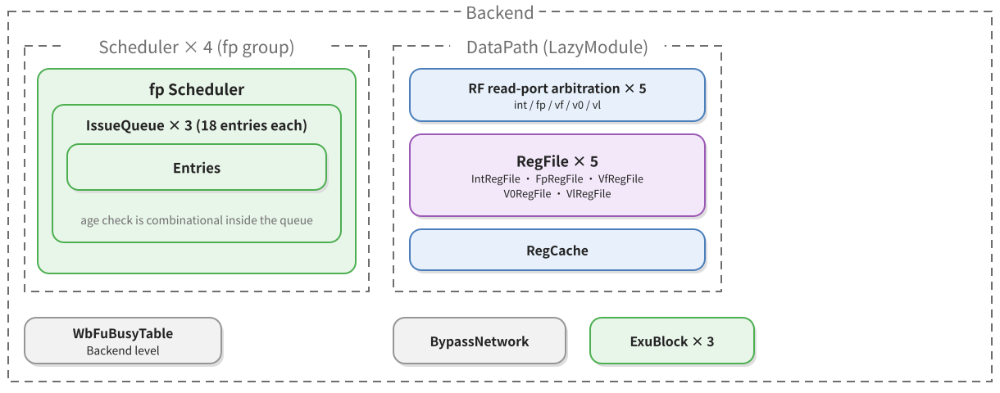

### 7.3 Key Signals

| Component | What it does at this stage | What it provides |
|---|---|---|
| `NewDispatch` | Sends the uop into the target queue | `DynInst` |
| `IssueQueue` | Maintains the source state and age of each entry and selects the oldest issuable entry | `IssueQueueIssueBundle` |
| `WbDataPath` | Broadcasts the `pdest` being written back | `wakeupFromWB` |
| Other execute units | Notifies in advance the `pdest` that will be written back | `wakeupFromIQ` |
| `DataPath` | s0 arbitrates the read ports and reads the register file; s1 selects forwarding or bypass and assembles `ExuInput` | `ExuInput` |
| `FpRegFile` | Provides floating-point register values by `psrc` | read data |
| `BypassNetwork` | Provides the most recent results not yet written into the register file | forwarded data |

| Edge | Bundle | Producer | Consumer | Carries |
|---|---|---|---|---|
| Dispatch → queue | `DynInst` (`Bundles.scala:178-260`) | `NewDispatch` | `IssueQueue.io.enq` | control columns, `psrc`, `pdest`, `robIdx`, `srcState` |
| Inside the queue | `Status` (`EntryBundles.scala:21-64`) and `EntryBundle` (`EntryBundles.scala:100`) | `IssueQueue` | `Entries` | `Status` (source state) and `payload` (fields to be used after issue) |
| Writeback → queue | `wakeupFromWB` (`IssueQueue.scala:59`) | `WbDataPath` | the three floating-point queues | the written-back `pdest` |
| Execute unit → queue | `wakeupFromIQ` (`IssueQueue.scala:60`) | other execute units | the queue | the early-woken `pdest` and latency information |
| Queue → datapath | `IssueQueueIssueBundle` (`Bundles.scala:509-538`) | `IssueQueue.io.deqDelay` | `DataPath.io.fromFpIQ` (`DataPath.scala:894`) | `rf` read ports, `srcType`, `immType`, `common` (`ExuInput` shape), `addrOH` |
| Datapath → execute unit | `ExuInput` (`Bundles.scala:609-680`) | `DataPath.io.toFpExu` (`DataPath.scala:922`) | `ExeUnit.io.in` | `src(0..2)`, `fuType`, `fuOpType`, `pdest`, `robIdx`, `fpu`, `dataSources` |

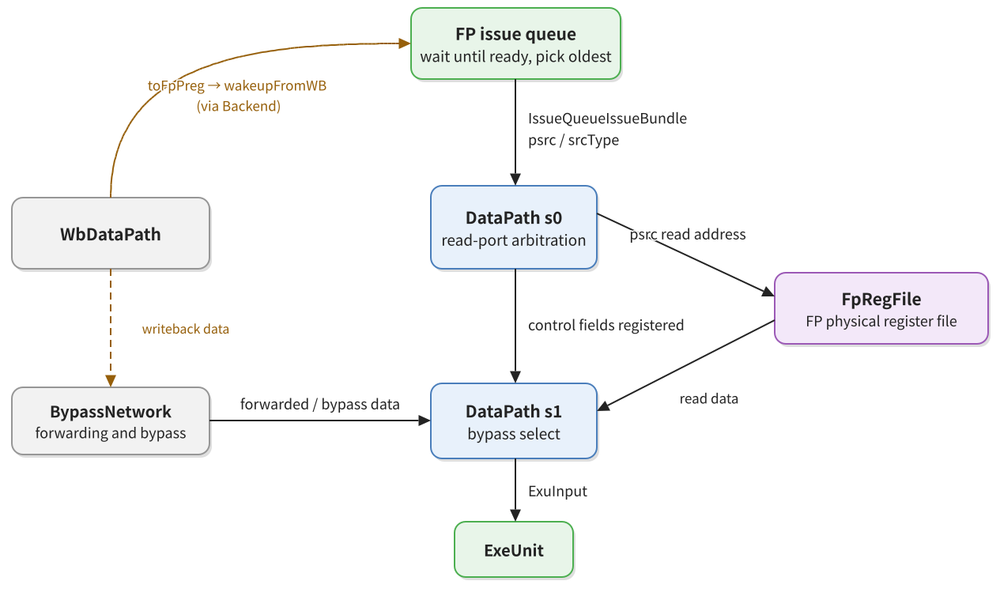

The issue condition consists of three checks on the queue entry itself: all sources have `srcState` ready, the entry has not been issued, and it is not blocked (`EntryBundles.scala:39-45`). Entries satisfying the condition enter age comparison, and the oldest wins. Age is maintained by `AgeDetector`, and queue entries are arranged in a ring in enqueue order.

A source changes from busy to ready along two paths. The first is writeback broadcast: when a producer writes back it broadcasts `pdest` to the three floating-point queues, each queue compares it with the `psrc` of every entry, and on a hit sets the corresponding `srcState` to ready (`EntryBundles.scala:296-337`); there is also a one-cycle-delayed copy `wakeupFromWBDelayed` for consumers that need to be woken later. The second is early wakeup between execute units: some functional units can notify other queues before the result is actually written back, at the cost that if the producer is cancelled, `og0Cancel`/`og1Cancel` must be issued to retract the wakeup.

After selection, the queue sends the contents of this entry into `DataPath`. In the dequeue packet, `rf` is the read port, `addr` connects to `psrc`, and `srcType` indicates which class of register is being read (`IssueQueue.scala:789-792`).

In the s0 level of `DataPath`, `psrc` is sent to read-port arbitration, and the winning address is connected to the register file read port (`DataPath.scala:356-361`); in the s1 level, data is obtained from the register file while the control fields are carried over with `s1_toExuData.fromIssueBundle(s0.bits)` (`DataPath.scala:603-606`). The final operand is selected by `BypassNetwork` in priority order: same-cycle forwarding, previous-cycle bypass, bypass one cycle later still, zero, `v0`, register file, register cache, immediate (`BypassNetwork.scala:139-175`).

### 7.4 FMUL at This Stage

FMUL's third source is already ready at enqueue, so it actually waits for only the two producers `psrc(0)` and `psrc(1)`. The third source is recorded as `DataSource.imm` at `IssueQueue.scala:324` because of `SrcType.isNotReg`, but `FmacCfg` has no `immType` and is not a memory unit, so `readImm` of the bypass network is masked off (`BypassNetwork.scala:159`), and `Mux1H` outputs 0 when all select signals are false. Therefore the `src(2)` sent to the execute unit is 0, even if the s1 register of `DataPath` still holds the old value of the previous instruction.

The first two sources under normal circumstances go through `readRegOH` and are read from the floating-point register file; if the producer wrote back only recently, the register file may still hold the old value, in which case `readForward` or `readBypass` takes over. Which path is taken depends on how many cycles separate the producer's writeback from the consumer's arrival at s1.

The issue stage itself does not read data. Selection is based on readiness and age arbitration, and it does not promise a globally strict oldest-first order; multiple candidates may exist in the same cycle, and who is finally selected depends on the internal priority of the queue. It knows only that the two floating-point sources are ready, not that `0x7F7FFFFF` times `2.0` will overflow; the execute unit also makes no prediction at issue. The only effect of special values on issue is that they may change the latency of a producer: if the producer is a special-value instruction and that instruction takes a path of different length in the functional unit, the consumer's wakeup time changes accordingly. `FmacCfg` has a fixed latency, so this path does not exist for it; this is also where fixed-latency units save trouble on the queue side.

### 7.5 How to Confirm in the Source

First look at which fields `EntryBundles.SrcStatus` has, then at the expression of `canIssue`, and finally at the assignments of `deq.bits.rf` and `deq.bits.common.dataSources` in `IssueQueue`. On the operand-read side, start from the s0 input of `DataPath`, follow it to `s1_toExuData`, and then to the `Mux1H` of `BypassNetwork`; the path of each of the three sources is then clear.

---

## 8. Execute: From `ExeUnit` to the FMA Core

### 8.1 The Problem This Stage Solves

The execute stage turns one `ExuInput` into one `ExuOutput`. For FMUL, the input is three 64-bit NaN-boxed floating-point sources, a 9-bit `fuOpType`, and a 3-bit rounding mode, and the output is a 64-bit result and 5 exception flags. In between it must complete exponent and mantissa unpacking, Booth encoding, partial-product compression, addition alignment, normalization, rounding, special-value handling, and re-boxing.

Functional units are configured by `FuConfig`, which specifies the number of source data groups, the result width, whether `frm` is needed, and the fixed latency. The execute unit shell `ExeUnit` turns these configurations into ports and pipeline stages; the core `FloatFMA` does the actual computation.

### 8.2 Components and Organization

The floating-point scheduling block corresponds to one `ExuBlock`, inside which multiple `ExeUnit`s are instantiated according to `FuConfig`; inside the FMA unit is the wrapper class `FMA`, and inside the wrapper is `FloatFMA` (`FuConfig.scala:715-728`). `ExuBlock` is instantiated in `Backend` by `BackendInlinedImp` (`Backend.scala:186`, `Backend.scala:208`). The component organization of the execute stage is shown in Figure 12.

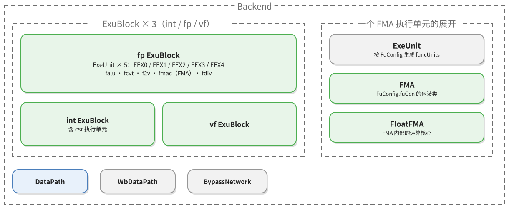

### 8.3 Key Signals

| Component | What it does at this stage | What it provides |
|---|---|---|
| `DataPath` | Fetches operands, selects bypasses, and assembles a uop to be executed | `ExuInput` |
| `ExeUnit` | Converts `ExuInput` into functional-unit input according to the function configuration and packages the result | `FuncUnitInput`, `ExuOutput` |
| `FMA` | Truncates `opcode`, performs the NaN-box check, and connects the three sources and the rounding mode to the floating-point core | the inputs of `FloatFMA` |
| `FloatFMA` | Zeroes the third source for multiplication and computes the result and `fflags` in three pipeline stages | result, `fflags` |
| `CSR` | Provides `fcsr.frm` | `frm` |
| `WbDataPath` | Collects execute results and queues for write ports | writeback data |

| Edge | Bundle | Producer | Consumer | Carries |
|---|---|---|---|---|
| Datapath → execute unit | `ExuInput` (`Bundles.scala:609-680`) | `DataPath` | `ExeUnit.io.in` | three sources, `fuType`, `fuOpType`, `pdest`, `robIdx`, `fpu`, `dataSources` |
| Execute unit → functional unit | `FuncUnitInput` (`FuncUnit.scala:73`) | `ExeUnit` (`ExeUnit.scala:242-243`) | `FMA.io.in` | `src(0..2)`, `fuOpType`, `pdest`, `robIdx`, `fpu` |
| Inside the functional unit | the ports of `FloatFMA` | `FMA` (`FMA.scala:32-38`) | `FloatFMA.io` | `fp_a`, `fp_b`, `fp_c`, `round_mode`, `fp_format`, `op_code` |
| Execute unit → writeback | `ExuOutput` (`Bundles.scala:712-755`) | `ExeUnit.io.out` | `WbDataPath.io.fromFpExu` (`WbArbiter.scala:93`) | `data`, `pdest`, `robIdx`, `fpWen`, `fflags`, `wflags` |

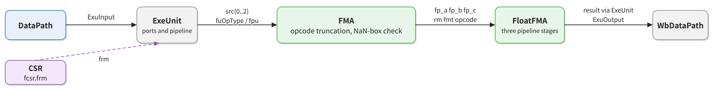

`ExeUnit` connects the `src` delivered by the datapath directly to the functional unit (`ExeUnit.scala:306`), and the control fields are connected at `ExeUnit.scala:453-456`. The rounding mode is selected for the last time here: if the instruction's own `rm` is not `111`, use it; if it is `111`, use `fcsr.frm` (`FpPipedFuncUnit.scala:14-16`). `frm` is sent from the CSR through `Backend` (`Backend.scala:662`) to the execute block, and then registered for one cycle (`ExuBlock.scala:43`).

The configuration of `FmacCfg` is: three `FpData` sources, `writeFpRf` true, `writeFflags` true, `latency = CertainLatency(3)`, `destDataBits = 64`, `needSrcFrm` true (`FuConfig.scala:715-728`). `HasPipelineReg` registers the input control fields for three cycles according to this latency, so that `pdest` and `robIdx` align with the core's result in the same cycle (`FuncUnit.scala:166-238`).

### 8.4 FMUL at This Stage

The execute unit is the wrapper layer `FMA`, which internally instantiates `yunsuan.fpu.FloatFMA` (`FMA.scala:13`, `FMA.scala:23`). The wrapper performs three conversions. First, it truncates the 9-bit `fuOpType` into the 4-bit opcode the core expects (`FMA.scala:13-48`); the low 4 bits of `VfmaType.vfmul` happen to be `FmaOpCode.fmul`. Second, it checks whether the three operands are valid NaN-boxed values: for the 32-bit format it checks whether the upper 32 bits are all 1, and the check on the third source has an additional gate `!(opcode === VfmaType.vfmul)` (`FMA.scala:25-30`)—FMUL has no third operand, and the 0 sent in would make the upper 32 bits not all 1, so without this gate it would be misjudged as an unboxed value. Third, it connects the sources, `rm`, `fp_fmt`, `opcode`, and the three flags to the core, and sends the result and `fflags` out.

Inside `FloatFMA`, the pipeline is divided into three levels by the valid signals `fire`, `fire_reg0`, and `fire_reg1` (`FloatFMA.scala:48-50`). The core performs one zeroing of its own for FMUL: `fp_c_f32 = Mux(is_fmul, 0.U, ...)` (`FloatFMA.scala:84-92`). It does not assume that the upstream necessarily sends 0 but clears it once more. These three layers (the bypass network outputting 0, the wrapper disabling the NaN check on the third source, and the core zeroing it) stack together to guarantee that the third source both has a definite value and is not treated as a special value.

`FloatFMA` is a three-stage pipeline without a transaction state machine. Cycle 0 samples the inputs and combinationally derives the sign, exponent, significand, and the classification signals NaN, sNaN, infinity, and zero; the classification results are registered into the first pipeline register along with `fire`, then registered two more times, and at cycle 3 participate in selection under the name `_reg2`. The two middle cycles go on performing significand multiplication, decimal-point shifting, and rounding as usual, even if the inputs are NaN and the intermediate quantities computed are meaningless.

Classification is not a control flow of "judge first, then compute" but a set of parallel comparisons. The signals `fp_a_is_zero_f32`, `fp_a_is_nan_f32`, `fp_a_is_snan_f32`, `fp_a_is_inf_f32` are produced simultaneously (`FloatFMA.scala:636-644`, `FloatFMA.scala:669-681`, `FloatFMA.scala:683-695`, `FloatFMA.scala:697-709`), and only at cycle 3 does the five-way selector decide which result to use. The boxing-failure information is merged into the same set of signals: that source cannot count as zero (`FloatFMA.scala:637`), it is a NaN (`FloatFMA.scala:670`), and it is not an sNaN (`FloatFMA.scala:684`).

This stage is the only place in the whole path that "knows" about special values, and it is also where the cost lies. The FMA of each FEX must prepare exponent and mantissa comparison circuits for two sources and must register the classification results along three cycles; each of the three FEXes has its own `FloatFMA`, so this area is multiplied by three. What it buys is a fixed latency as seen from outside the execute unit—no matter which branch is taken, a result is guaranteed at cycle 3, and `valid` does not stall because of the data. In engineering terms this is an explicit trade-off: area in exchange for timing determinism, avoiding making floating-point exception judgment a source of variable latency in the pipeline.

### 8.5 How to Confirm in the Source

First find `FmacCfg` in `FuConfig.scala`, see which wrapper `fuGen` points to, how many groups `srcData` has, and what `latency` is; then open the wrapper and confirm the source of `inData.src(0..2)` and how `opcode` is truncated; finally enter the core and find, by port name, the first use of `fp_a`/`fp_b`/`fp_c`.

---

## 9. Writeback: Results Return to the Register File and the ROB

### 9.1 The Problem This Stage Solves

The result output by the execute unit must reach three places at the same time: the write ports of the floating-point register file, all issue queues waiting for this `pdest`, and the ROB's writeback record. The three serve different purposes: the register file is architectural state, queue wakeup exists so consumers can issue as soon as possible, and the ROB record exists to determine whether an entry can commit.

These three cannot each go their own way: the same writeback event must occur simultaneously, otherwise inconsistencies arise such as "the register file has been written but the queue has not been woken" or "the queue has been woken but the ROB does not know".

### 9.2 Components and Organization

`WbDataPath` collects the writeback requests of all execute units and internally splits them into four arbiters by scheduling block, of which the floating-point one is `WbArbiter` (`WbArbiter.scala:84-120`). The output is split into three groups: write ports to the various physical register files (`toFpPreg` etc.), `writeback` to `CtrlBlock`, and wakeup broadcasts to the issue queues. The component organization of the writeback stage is shown in Figure 14.

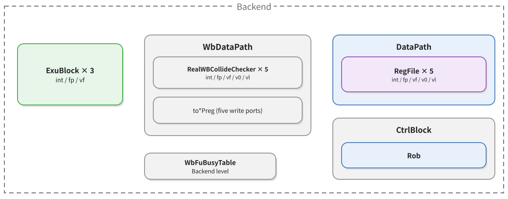

### 9.3 Key Signals

| Component | What it does at this stage | What it provides |
|---|---|---|
| `ExeUnit` | Outputs the result, `pdest`, and `fflags` | `ExuOutput` |
| `WbDataPath` | Collects writebacks from the execute units, selects data for each write port, and sends ROB writeback records | write port data, ROB writeback records |
| `FpRegFile` | Receives write port data and writes it by address | new register file values |
| `Backend` | Broadcasts the writeback to all issue queues | `wakeupFromWB` |
| `Rob` | Records writebacks by `robIdx` and accumulates `fflags` | committable state |

| Edge | Bundle | Producer | Consumer | Carries |
|---|---|---|---|---|
| Execute unit → writeback | `ExuOutput` (`Bundles.scala:712-755`) | `ExeUnit` | `WbDataPath.io.fromFpExu` (`WbArbiter.scala:93`) | `data`, `pdest`, `fpWen`, `robIdx`, `fflags` |
| Writeback → register file | `RfWritePortWithConfig` (`Regfile.scala:48`) | `WbDataPath.io.toFpPreg` (`WbArbiter.scala:106`) | the write ports of `DataPath` (`DataPath.scala:352-354`) | write address, write data, write enable |
| Writeback → queue | `wakeupFromWB` (`IssueQueue.scala:59`) | `Backend` (`Backend.scala:387`) | the three floating-point queues | `pdest` |
| Writeback → ROB | `ExuOutput` (`Bundles.scala:712-755`) | `WbDataPath.io.toCtrlBlock.writeback` (`WbArbiter.scala:118`) | `Rob.io.writeback` (`Rob.scala:71`), through `CtrlBlock` (`Backend.scala:261`) | as above, plus `wflags` |

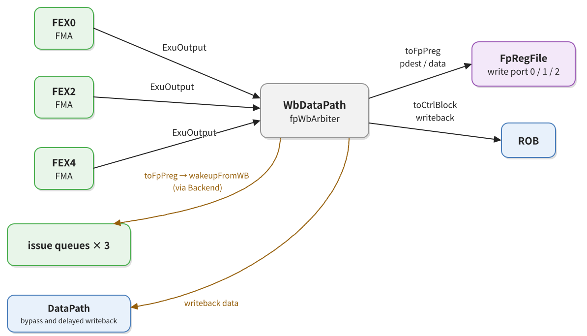

The floating-point register file has five write ports, allocated fixedly by execute unit: FEX0 uses port 0, FEX2 uses 1, FEX4 uses 2, and the two fdiv units use 3 and 4 (`Parameters.scala:425-443`). FMUL goes through FEX0/2/4, so its result can only appear on ports 0, 1, and 2.

The write port itself has another cycle: the write address and data are registered first, and the write enable is registered another cycle (`DataPath.scala:352-354`). This means there is one cycle between broadcast on the writeback bus and the actual write into the register file, and waiting consumers fetch their data through bypass during this cycle. `Backend` keeps another copy of the writeback delayed by one cycle, used exclusively by `wakeupFromWBDelayed` (`Backend.scala:330-336`).

### 9.4 FMUL at This Stage

The execute unit's output is boxed before writeback. A single-precision result fills the upper 32 bits with 1, a half-precision result fills the upper 48 bits with 1, and a double-precision result is output as is (`FloatFMA.scala:854-862`); the flags are selected from `fflags_f64`, `fflags_f32`, and `fflags_f16` according to precision (`FloatFMA.scala:864-868`). The boxed `0xFFFFFFFF7F800000` has no formal difference from an ordinary result in the register file, and the only information left about the special value is the five bits of `ExuOutput.fflags`.

FMUL's result is valid at cycle 3, and `fflags` and `wflags` are presented at the same time. `wflags` comes from the `wflags` field of `FPDecoder` and indicates whether this instruction should write `fcsr.fflags`; for `FMUL.S` it depends on the instruction's `TYP` bit. The result is written into the floating-point physical register pointed to by `pdest`, and at the same time `pdest` is broadcast to wake the consumers waiting for it in the three queues.

Whether writeback actually occurs depends on the handshake between `out.valid` and the writeback port, not merely on a result appearing on the data lines. After writeback and before commit, the instruction is complete in terms of data but not yet in terms of order. Its `pdest` remains occupied until the ROB commits, when it is returned to the FreeList.

### 9.5 How to Confirm in the Source

Start from `FMA.io.out.bits.res.data`, follow `ExuOutput` to `WbDataPath.io.fromFpExu`, then to `toFpPreg` and `toCtrlBlock.writeback`, and finally to the write ports of `DataPath` and to `Rob`. Each module along this chain does only one thing, so searching backward is easier than tracing forward.

---

## 10. Commit: In-Order Retirement

### 10.1 The Problem This Stage Solves

Out-of-order execution allows instructions to complete out of order, but architectural state must be updated in program order. The commit stage retires instructions one by one in ROB order: it checks whether all uops in an entry have written back, whether the instruction has been fetched completely, and whether any exception must be raised at this moment, then merges `fflags` into the CSR, returns old physical registers to the FreeList, and sends commit information back to the FTQ.

### 10.2 Components and Organization

`Rob` is a LazyModule in `CtrlBlock` (`CtrlBlock.scala:53`), and its module instance is taken out in `CtrlBlockImp` (`CtrlBlock.scala:99`). It has the most connections on both sides: the inputs are the dispatch `RobEnqIO` and the writebacks from the various execute units, and the outputs are the commit information `RobCommitIO`, the redirect `Redirect`, and the `fflags` to the CSR. The component organization of the commit stage is shown in Figure 16.

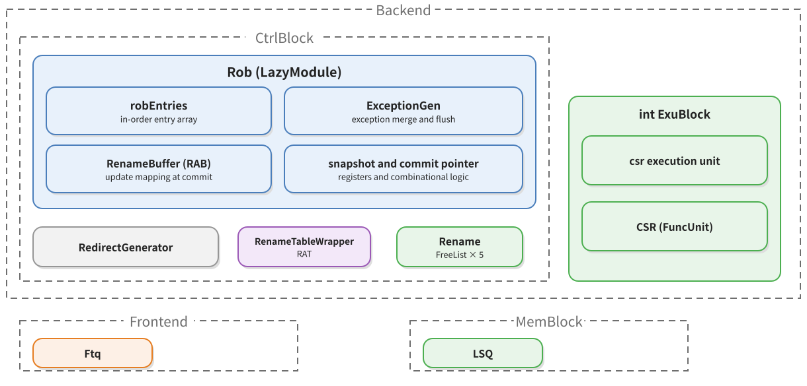

### 10.3 Key Signals

| Component | What it does at this stage | What it provides |
|---|---|---|
| `NewDispatch` | Issues the ROB enqueue request | `RobEnqIO` |
| `WbDataPath` | Sends writeback records | `ExuOutput` to the ROB |
| `Rob` | Maintains the writeback progress of entries and picks committable entries in order | `RobCommitIO` |
| `CtrlBlock` | Forwards commit records and redirects to the FTQ | `CtrlToFtqIO` |
| `CSR` | Receives `fflags` and updates `fcsr` | architectural state |
| `Rename` (including RAT and FreeList) | Commits mappings and reclaims physical registers | RAB |
| `Ftq` | Marks entries as committed and changes fetch according to redirects | fetch state |

| Edge | Bundle | Producer | Consumer | Carries |
|---|---|---|---|---|
| Dispatch → ROB | `RobEnqIO` (`RobBundles.scala:272`) | `NewDispatch` | `Rob.io.enq` (`Rob.scala:67`) | `robIdx`, `numUops`, `numWB`, `wflags`, `ftqPtr`/`ftqOffset` |
| Writeback → ROB | `ExuOutput` (`Bundles.scala:712-755`) | each execute unit via `WbDataPath` | `Rob.io.writeback` (`Rob.scala:71`) | `pdest`, `robIdx`, `fflags`, `wflags` |
| ROB → various backend places | `RobCommitIO` (`Bundle.scala:405`) | `Rob.io.commits` (`Rob.scala:75`) | `CtrlBlock`, `Rename`, CSR | `ftqIdx`/`ftqOffset`, `fflags`, `fpWen`, etc. of each committed instruction |
| ROB → FTQ | `CtrlToFtqIO.rob_commits` (`CtrlBlock.scala:43-44`) | `CtrlBlock` (`CtrlBlock.scala:342-343`) | `Ftq` (`NewFtq.scala:1319`) | FTQ coordinates of committed instructions |
| ROB → FTQ | `Redirect` (`Bundle.scala:303`) | `Rob` and `RedirectGenerator` (`CtrlBlock.scala:345-347`) | `Ftq` | redirect target, cause, level |

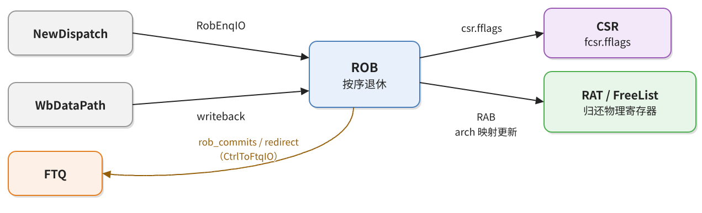

On writeback, the ROB matches the entry by `robIdx` and subtracts from `uopNum` the number of uops written back this time; if a standard writeback hits, `stdWritebacked` is set, and the commit logic uses it to judge whether the entry is finished (`Rob.scala:1035-1067`). `fflags` are merged in with a bitwise OR (`Rob.scala:1062-1067`): an entry may contain multiple uops, and their exception flags are OR-ed bitwise, matching the sticky semantics of IEEE 754.

At commit, `fflags` are taken out of the entry, gated by `wflags`, merged into a single path, and sent to the CSR (`Rob.scala:715-717`), and the CSR then ORs them into `fcsr.fflags` (`CSR.scala:651-659`). At the same moment, `RobCommitIO` sends `ftqPtr`/`ftqOffset` to `CtrlBlock`, which forwards them to the FTQ through `CtrlToFtqIO`; the FTQ then marks the entry as committed and releases it.

Merging inside the entry happens at writeback: a ROB entry may contain multiple uops, and the `fflags` of each uop are OR-ed bitwise into the entry (`Rob.scala:1059-1067`). Thus the flags of a single `fmul` pass through two rounds of OR-ing and two register stages before reaching `fcsr`; software reads the new value later than commit, but this delay has nothing to do with whether the operands are special values.

Commit is also responsible for the floating-point state bits. `dirtyFs = fpWen || wflags` is sent out with commit (`RobBundles.scala:191`), and the CSR accordingly sets `mstatus.FS` to `11` and `SD` to 1 (`CSR.scala:1037`); this rule treats writing a floating-point register and writing `fflags` alike, and a floating-point instruction that writes only `fflags` also marks the floating-point state dirty.

### 10.4 FMUL at This Stage

FMUL's `fflags` are merged into `fcsr` at commit, the physical register corresponding to `pdest` is returned to the FreeList, and the logical mapping is updated. If FMUL and its neighbor are compressed into one package, they retire together as one entry, and their `fflags` are merged into the CSR together as well.

FMUL generally does not trigger a redirect—it is not a branch and does not produce a memory exception. Its only possible cause of a flush is a floating-point exception being reported precisely, which depends on the exception enable bits of `fcsr`; on this path, redirects are generated uniformly by `RedirectGenerator` based on exceptions and branch results.

### 10.5 How to Confirm in the Source

From the `fflags` write port of `Rob`, find the writeback logic, then look at the bitwise-OR statement for `robEntries(i).fflags`, and finally see how `fflagsDataRead` is read out at commit. To see redirects, search for the assignment of `io.frontend.toFtq.redirect` in `CtrlBlock`; the two sources are the ROB flush and `RedirectGenerator`.

---

## 11. The Whole Line: Stringing the Eight Stages Together

Connecting the previous eight sections end to end gives the complete path of an instruction from fetch to commit. In Figure 18 the nodes are components and the edges are the Bundles passed between them; solid lines are normal paths, and dashed lines are feedback and bypasses.

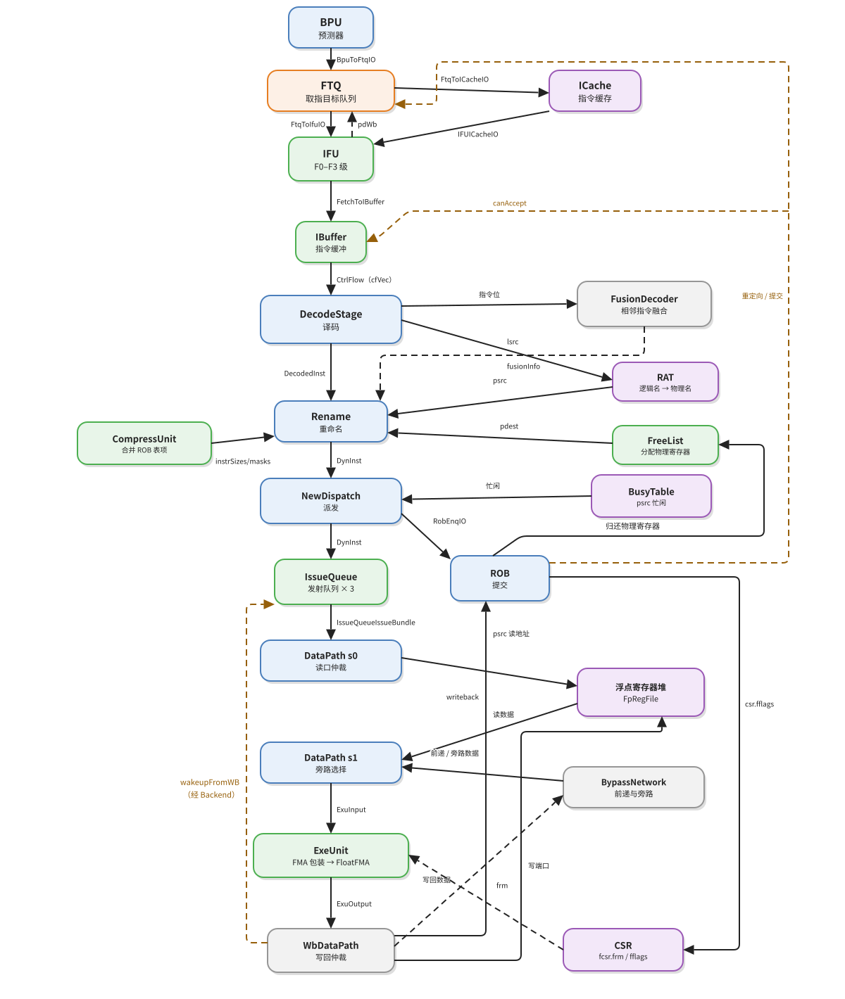

Taking issue queue selection (`deq.fire`) as T0, the relative times of the events are as follows.

| Time | Event | Basis |
|---|---|---|
| T0 | Queue selection, s0 valid, `psrc` sent to the floating-point register file read port | `IssueQueue.io.deq`, s0 of `DataPath` |
| T1 | s1 valid, register file data returned, bypass selection complete, `ExuInput` valid | `s1_toExuValid`, `s1_fpPregRData` |
| T1 + 1 | Fifth level of the compression tree, 3:2 merge, wide adder | `fire` → `fire_reg0` |
| T1 + 2 | Leading-zero detection, normalization shift, GRS extraction | `fire_reg0` → `fire_reg1` |
| T1 + 3 | Rounding, special-value selection, boxing, `ExuOutput` valid | `latency = 3` |
| T1 + 3 | Writeback broadcast, queue wakeup, ROB writeback record | `fpWriteBack` of `Backend`, ROB writeback |
| T1 + 4 | Write address and write data registered, write enable valid | write port registers of `DataPath` |
| Afterwards | In-order commit, `fflags` merged into `fcsr` | ROB commit |

The commit time is not fixed; it depends on how many uncommitted instructions precede this one. FMUL itself can wait for commit as soon as it has written back, but it must wait for all older instructions to retire.

Along the whole path, the type changes only five times: `CtrlFlow` becomes `StaticInst` at the frontend/backend boundary, `DecodedInst` at the decode exit, `DynInst` at the rename exit, `ExuInput` at the datapath exit, and `ExuOutput` at the execute unit exit. Each change consumes a batch of fields and inserts another batch. Remembering these five transformations is more useful than remembering the names of fifteen modules.

---
## Appendix: Source Index

| Topic | File:line |
|---|---|
| Frontend modules | `Frontend.scala:68-69`, `Frontend.scala:106-109` |
| Frontend/backend Bundle | `Bundle.scala:144-168`, `Bundle.scala:484-495` |
| Fetch pipeline | `IFU.scala:241-598` |
| Predecode | `PreDecode.scala:72-84`, `PreDecode.scala:95` |
| FTQ exit | `NewFtq.scala:916` |
| IBuffer | `IBuffer.scala:87-112` |
| CtrlBlock composition | `CtrlBlock.scala:90-99` |
| Decode stage | `DecodeStage.scala:104-108`, `DecodeUnit.scala:806-834` |
| Decode item and floating-point decode | `VecDecoder.scala:548-550`, `FPDecoder.scala:341-342` |
| Two records of wflags | `DecodeUnit.scala:834`, `DecodeUnit.scala:989`, `DecodeUnit.scala:1044`, `RobBundles.scala:140` |
| Rename | `Rename.scala:55`, `Rename.scala:391-415` |
| Dispatch | `NewDispatch.scala:100-106` |
| Issue queue | `IssueQueue.scala:47-79`, `EntryBundles.scala:21-64` |
| Datapath | `DataPath.scala:352-361`, `DataPath.scala:603-606` |
| Bypass network | `BypassNetwork.scala:139-175` |
| Execute unit | `FuConfig.scala:715-728`, `ExeUnit.scala:306` |
| FMA wrapper | `FMA.scala:13-48` |
| Third-source zeroing and significand | `FloatFMA.scala:84-92`, `FloatFMA.scala:134-139` |
| Classification signals | `FloatFMA.scala:636-644`, `FloatFMA.scala:669-709` |
| Exponent overflow and lower bound | `FloatFMA.scala:597-604` |
| Flag computation | `FloatFMA.scala:629-634` |
| Five-way selection | `FloatFMA.scala:788-819` |
| Boxing and output | `FloatFMA.scala:854-868` |
| Writeback | `WbArbiter.scala:84-120` |
| ROB entry merge and commit | `Rob.scala:709-719`, `Rob.scala:833`, `Rob.scala:1035-1067` |
| `fcsr` update | `CSR.scala:651-659`, `CSR.scala:1030`, `CSR.scala:1037` |
| Execute unit distribution | `Parameters.scala:427`, `Parameters.scala:431`, `Parameters.scala:435` |
