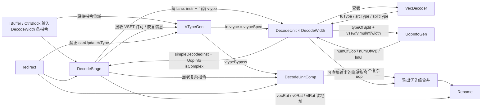

# 向量译码：从 VType 跟踪到复杂微操作展开

本文以香山 `kunminghu-v2` 为源码基准，分析向量指令从 `DecodeStage` 进入、经 `DecodeUnit/VecDecoder` 初步译码、由 `VTypeGen` 跟踪配置、由 `UopInfoGen` 计算微操作数，最后在 `DecodeUnitComp` 中展开为可送往 Rename 的微操作序列。

## 1. 阅读目标

阅读完成后，应能回答以下问题：

1. 一条 `vadd.vv` 为什么即使 LMUL=1 也走复杂译码路径？
2. LMUL=1、2、4 时，`vadd.vv` 为什么分别产生 1、2、4 个微操作，而 `vadd.vx` 分别产生 2、3、5 个微操作？
3. `vs1`、`vs2`、旧 `vd`、`v0` mask 和 `vl` 配置依赖分别放在哪个逻辑源寄存器端口？
4. `DecodeStage` 与 `DecodeUnitComp` 如何用 `valid/ready` 控制吞吐，并在 redirect 时清除尚未展开完的指令？
5. 非法 `vtype`、寄存器组未对齐和寄存器重叠在哪里被拒绝？

## 2. 六个模块如何协作

### 2.1 模块与信号关系图



### 2.2 每个模块的职责

| 模块 | 主要输入 | 主要输出 | 核心职责 |
| --- | --- | --- | --- |
| `DecodeStage` | 多 lane 指令、Rename ready、redirect、恢复信息 | 最多 `RenameWidth` 条已译码 uop | 组织简单/复杂译码、选择最老复杂指令、分配输出槽位、产生 RAT 读地址 |
| `DecodeUnit` | 单条指令、当前推测 `vtype` | `DecodedInst`、`UopInfo`、`isComplex` | 合并标量/浮点/向量表，填写逻辑寄存器、依赖类型和向量属性 |
| `VecDecoder` | 32 位指令模式 | `fuType`、`fuOpType`、`srcType`、`uopSplitType` 等 | 识别 `VADD_VV`、`VADD_VX`、VSET 等向量类别 |
| `VTypeGen` | 本拍 VSET、提交/回滚配置、redirect 许可 | `io.vtype`（推测值）；内部保存架构值 | 在接收 VSET 后更新推测配置，并给复杂译码器提供配置旁路 |
| `UopInfoGen` | 拆分类别、`vsew/vlmul/veew/nf` | `numOfUop`、`numOfWB`、`lmul` | 根据 LMUL、EEW/SEW 和指令类别计算展开规模 |
| `DecodeUnitComp` | 一条复杂指令及 `UopInfo` | 多拍、多 lane 的复杂 uop | 保存输入、生成逐 uop 寄存器编号、处理临时向量寄存器、回压和 redirect |

最重要的生产者—信号—消费者关系如下：

| 生产者 | 信号 | 消费者 | 含义 |
| --- | --- | --- | --- |
| `VecDecoder` | `uopSplitType` | `UopInfoGen`、`DecodeUnitComp` | 选择 VVV、VXV、VSET 等展开模板 |
| `VTypeGen` | `io.vtype`（来自 `vtypeSpec`） | 每个 `DecodeUnit` | 译码当前指令所使用的推测 SEW/LMUL |
| `UopInfoGen` | `numOfUop` | `DecodeUnitComp.uopRes` | 尚待发送的微操作总数/余数 |
| `DecodeUnitComp` | `complexNum` | `DecodeStage` 输出合并 | 本拍可占用的 Rename 输出槽数 |
| Rename | `out.ready` | `DecodeStage/DecodeUnitComp` | 决定本拍是否可发送，以及发送多少条 |
| 后端 redirect | `io.redirect` | `DecodeStage/VTypeGen/DecodeUnitComp` | 阻止错误路径更新配置，并杀掉未完成展开 |

此外，输出整理会在任一前四个向量源读取逻辑 v0 时，把第 3 源标为专用 `SrcType.v0`；目的为 v0 时也转为 `v0Wen`。因此最终进入 Rename 的类型要结合 DecodeStage 的整理，不能只停在 DecodeUnit 的 mask 初值。

源码入口分别见 DecodeStage.scala:82、DecodeUnit.scala:799、VecDecoder.scala:187、VTypeGen.scala:30、UopInfoGen.scala:94 和 DecodeUnitComp.scala:108。

## 3. 初步译码：从指令位域到拆分类别

### 3.1 VecDecoder 决定“是哪一类”

`VecDecoder.table` 被并入 `DecodeUnit` 的统一译码表（DecodeUnit.scala:815），由 `DecodedInst.decode` 生成组合译码逻辑。表项把指令 `BitPat` 匹配条件映射为控制字段，电路运行时由输入编码直接产生这些字段。

`OPIVV`、`OPIVX` 是展开阶段构造译码表项的 Scala 类。前者默认三个数据源类型均为 `SrcType.vp`，后者默认源 0 为 `SrcType.xp`、源 1/2 为 `SrcType.vp`；两者的默认拆分模板分别为 VVV、VXV。对应定义见 VecDecoder.scala:28 和 :45。关键表项为：

| 指令 | 操作大类 | `uopSplitType` | 编码值 |
| --- | --- | --- | --- |
| `vsetvli/vsetivli/vsetvl` | VSET | `VSET` | `0b010001` |
| `vadd.vv` | OPIVV | `VEC_VVV` | `0b010010` |
| `vadd.vx` | OPIVX | `VEC_VXV` | `0b010011` |

这些枚举定义在 package.scala:768，VADD 表项见 VecDecoder.scala:189 与 VecDecoder.scala:253。`vsetvl` 还带有流水线 flush 属性；它不依赖仅能由立即数字段提前得到的新 `vtype`。

### 3.2 DecodeUnit 表达五类依赖

固定版本把向量指令的逻辑寄存器组织为：

```scala
decodedInst.lsrc(0) := inst.RS1
decodedInst.lsrc(1) := inst.RS2
decodedInst.lsrc(2) := Mux(isFMA, inst.FS3, inst.VD)
decodedInst.lsrc(3) := V0_IDX.U
decodedInst.lsrc(4) := Vl_IDX.U
decodedInst.ldest := inst.RD
```

相关逻辑见 DecodeUnit.scala:858。字段名沿用了 RISC-V 通用指令位域名称，但向量格式中的 RS1/RS2/RD 会分别解释成标量源、`vs1`、`vs2` 或 `vd`，最终由 `srcType` 指明寄存器文件类型。

| 依赖 | 逻辑端口 | 何时有效 | 为什么需要 |
| --- | --- | --- | --- |
| `vs1` 或标量 `rs1` | `lsrc(0)` | 由 VV/VX 类别决定 | 第一个显式源操作数 |
| `vs2` | `lsrc(1)` | 普通向量算术 | 第二个向量源操作数 |
| 旧 `vd` | `lsrc(2)` | 由源类型与后续 old-vd 依赖处理共同决定 | tail/mask undisturbed、累加、部分写回或特殊操作需保留旧值 |
| mask `v0` | `lsrc(3)` | `VM==0` 时 `srcType(3)=vp`，否则 DC | 屏蔽元素必须读取 `v0` |
| `vl/vtype` 配置 | `lsrc(4)` | `srcType(4)=vp` | 防止向量指令越过尚未生效的配置更新 |

mask 与配置依赖的源码片段是：

```scala
decodedInst.srcType(3) := Mux(inst.VM === 0.U, SrcType.vp, SrcType.DC)
decodedInst.srcType(4) := SrcType.vp
```

`srcType(2)` 与 `vpu.isDependOldVd` 是两个不同字段，不能用后者单独替代源端口有效性判断。`isDependOldVd` 不只表示“读写同一寄存器”。固定代码还把置换、向量浮点、向量 store、目的为 mask、窄化、indexed load、乘加、fault-only-first，以及非零 `vstart` 等情况纳入旧 `vd` 依赖，见 DecodeUnit.scala:1069。

### 3.3 DecodeStage 生成 RAT 读地址

`DecodeStage` 把五类逻辑依赖拆给不同 Rename Table 读口：

- `vecRat(0) <- lsrc0`：向量 `vs1`；VX 指令的标量源由整数 RAT 路径处理。
- `vecRat(1) <- lsrc1`：`vs2`。
- `vecRat(2) <- lsrc2`：旧 `vd`。
- `v0Rat`：专用 mask `v0` 映射。
- `vlRat`：专用 `vl/vtype` 配置映射。

这样做的关键不是端口数量，而是把数据依赖和配置依赖都变成 Rename 能追踪的显式依赖。后续 Dispatch/Issue 可结合这些显式源、配置与 `isDependOldVd` 决定是否必须等待旧 vd；例如 NewDispatch.scala 的 `ignoreOldVd` 还结合 VL、vta/vma 和部分写入条件，不能在译码阶段就把所有旧目的依赖一概消除。对应接线见 DecodeStage.scala:262。各 RAT 端口同时连接 `hold := !io.out(i).ready`，下游回压时保持映射表读出的时序关系；地址连线本身不等于读取到了寄存器数据。

## 4. VType 配置跟踪

### 4.1 架构态与推测态

`VTypeGen` 保存两份状态：

- `vtypeArch`：已提交、可作为恢复基准的架构配置。
- `vtypeSpec`：前端/译码可立即使用的推测配置。

注意时序：`io.vtype := vtypeSpec` 输出的是寄存器当前值；新配置写入 `vtypeSpecNext`，在接收 VSET 的时钟沿后生效。所有简单译码 lane 共用该输出，并不存在同拍逐 lane 的 VSET → 后续向量指令组合旁路。最老复杂指令被接收后，其后的向量指令留待后续周期译码；复杂译码器中的 VSET uop 则通过 `vtypeBypass` 使用更新后的配置。

它只从指令位域提前计算 `vsetvli` 和 `vsetivli`；`vsetvl` 的新配置来自寄存器值，不能在这里仅靠指令位域预测，并且自身会触发流水线 flush。若同一拍出现多条 VSET，`PriorityEncoderOH` 选择程序序更老的一条。

推测配置更新的优先级为：

1. 已提交的 `vsetvl`；
2. redirect/walk 提供的 `walkVType`；
3. 恢复到 `vtypeArch`；
4. 新译码且真正被复杂译码器接收的 VSET。

`DecodeStage` 对第 4 项使用严格门控：

```scala
decoderComp.io.in.fire &&
decoderComp.io.in.bits.simpleDecodedInst.isVset &&
!io.redirect
```

见 DecodeStage.scala:160 和 VTypeGen.scala:103。这三个条件缺一不可：仅 `valid` 不代表 VSET 被接收；redirect 同拍即使组合握手为真，也不能让错误路径配置进入 `vtypeSpec`。

### 4.2 VSET 为什么也是复杂指令

`UopInfoGen` 对 `VSET` 选择常量 `2.U`，`DecodeUnitComp` 的 VSET 分支分别连接 `csBundle(0)` 和 `csBundle(1)`。常规分支的主要控制为：

```scala
csBundle(0).fuType := FuType.vsetiwi.U
csBundle(0).rfWen := true.B
csBundle(1).ldest := Vl_IDX.U
csBundle(1).vecWen := false.B
csBundle(1).vlWen := true.B
```

这些字段分别描述整数结果写回和配置结果写回。`rd=x0`、`rs1=x0` 与 `vsetvl` 的条件分支进一步覆盖功能单元、源类型、写使能及 flush/blockBackward 控制，例如 `vsetvli` 的 RD、RS1 都为零时，第 0 项关闭写使能，第 1 项保留旧配置依赖。精确连接见 DecodeUnitComp.scala:280。

VSET 分支末尾通过 `connectVType(io.vtypeBypass)` 连接两个展开项的配置字段。该旁路来自 `VTypeGen.io.vtype`：接收立即数配置指令且未被恢复逻辑覆盖时，该时钟沿同时锁存指令并更新 `vtypeSpec`，沿后复杂译码组合网络才获得新配置。

### 4.3 VSET 配置变化实验的预期

`DecodeUnit` 将 `io.enq.vtype` 中的 `vsew/vlmul/vta/vma` 接到 `decodedInst.vpu`，并把其中 `vsew/vlmul` 接到 `UopInfoGen.preInfo`。以 VVV 模板为例：

| 配置输入字段         | 计数网络选择结果     | 随 uop 传递的属性      |
| -------------------- | -------------------- | ---------------------- |
| `vsew=10, vlmul=000` | `lmul=1, numOfUop=1` | e32、m1 及输入 vta/vma |
| `vsew=10, vlmul=001` | `lmul=2, numOfUop=2` | e32、m2 及输入 vta/vma |
| `vsew=10, vlmul=010` | `lmul=4, numOfUop=4` | e32、m4 及输入 vta/vma |
| `vsew=01, vlmul=001` | `lmul=2, numOfUop=2` | e16、m2 及输入 vta/vma |

VVV 的计数选择端只使用 `lmul`，因此表中改变 SEW、保持 LMUL 时，数量保持不变；宽化/窄化与访存计数有各自的宽度通路和合法性约束。vta/vma 则作为控制属性传递给后续硬件。

## 5. 微操作数量计算

### 5.1 LMUL 与有效 EMUL

整数 LMUL 编码映射为：

| `vlmul` | LMUL | `UopInfo.lmul` |
| --- | ---: | ---: |
| `000` | 1 | 1 |
| `001` | 2 | 2 |
| `010` | 4 | 4 |
| `011` | 8 | 8 |

当元素有效宽度 EEW 与当前 SEW 不同时，代码用下式形成有效寄存器组倍率：

```text
vemul = veew + 1 + vlmul + ~vsew
```

这是固定位宽补码运算的硬件写法，本质等价于根据 `EEW/SEW` 缩放 LMUL。这条 vemul 通路主要服务于带显式 EEW 的访存计数。普通 `vadd.vv/vx` 的拆分直接选择 `lmul` 或 `lmul+1`，不使用上述 emul 结果；不能把算术指令的 funct3/WIDTH 当作访存 EEW。宽化/窄化另有模板和合法性检查，indexed memory 则同时考虑数据和索引寄存器组。实现见 UopInfoGen.scala:94。

### 5.2 指令类别决定公式

`numOfUop` 是 `MuxLookup(typeOfSplit, ...)` 的组合输出，`VEC_VXV` 等分支中的 `+&` 保留加法进位。`strdiedLSNumOfUopTable` 与 `indexedLSNumOfUopTable` 中的 Scala 循环在展开阶段生成真值表，再由 `decoder(QMCMinimizer, ..., TruthTable(...))` 构造组合逻辑。运行时配置位选择计数结果，不执行软件循环。

关键选择关系如下：

| `uopSplitType` | `numOfUop` | 直观含义 |
| --- | ---: | --- |
| `VSET` | 2 | 配置类固定两步 |
| `VEC_VVV` | `lmul` | 每个向量寄存器片一条 |
| `VEC_VXV` | `lmul + 1` | 先做 scalar-to-vector 临时 uop，再做 LMUL 条向量 uop |
| `VEC_VFV` | `lmul + 1` | 浮点标量源同理 |
| `VEC_VVW` | 整数 LMUL=1/2/4 时为 `2*lmul` | 宽结果/宽源需要双倍片数 |
| `VEC_VXW` | 整数 LMUL=1/2/4 时为 `2*lmul + 1` | 宽向量片加一条标量复制 |
| `VEC_VRED` | `lmul` | 每个源寄存器片参与归约 |

明确使用 `numOfWB = Mux(isAMOCAS(typeOfSplit), numOfUop >> 1, numOfUop)`。所以本文的 VSET、VVV、VXV 都有 `numOfWB == numOfUop`，临时寄存器写回也参与计数；不能把 `numOfWB` 理解成“只写架构向量寄存器的数量”。宽化模板的 `numOfUopWV/WX` 有适用范围和默认分支，不能把 `2*lmul` 外推到所有分数 LMUL 或非法 m8 宽化配置。见 UopInfoGen.scala:175 和 UopInfoGen.scala:245。

固定版本中，向量算术/访存即使只需 1 个 uop，`isComplex` 仍为真；因此 LMUL=1 的 `vadd.vv` 也进入 `DecodeUnitComp`。不要被旧注释中“多于一个 uop 才复杂”的描述误导，应以实际组合逻辑为准。

## 6. 复杂译码展开与寄存器编号生成

### 6.1 输入锁存与并行地址生成

复杂译码器的指令与数量信息先经过带写使能的寄存器：

```scala
val latchedInst = RegEnable(inDecodedInst, inValid && inReady)
val latchedUopInfo = RegEnable(inUopInfo, inValid && inReady)
```

写使能为输入握手 `fire`。没有新握手时，这两组寄存器保持原值，展开网络持续由同一条锁存指令驱动。`src1/src2/dest` 取自锁存指令的 RS1/RS2/RD，均在高位补零以容纳内部逻辑编号。

VVV 分支的地址生成连接为：

```scala
is(UopSplitType.VEC_VVV) {
  for (i <- 0 until MAX_VLMUL) {
    csBundle(i).lsrc(0) := src1 + i.U
    csBundle(i).lsrc(1) := src2 + i.U
    csBundle(i).lsrc(2) := dest + i.U
    csBundle(i).ldest := dest + i.U
    csBundle(i).uopIdx := i.U
  }
}
```

循环下标 `i` 是展开阶段常量；电路中同时存在各片编号加偏移的逻辑。以输入编码满足 `RS1=16, RS2=24, RD=8`（VADD_VV 表项）为例，各项地址分别为 `16+i`、`24+i`、`8+i`、`8+i`。这些数值是送往 Rename 的逻辑地址，译码器不读取或计算向量加法数据。

展开器会生成 `lsrc2` 的编号；该编号是否成为必须等待的真实源依赖，仍由前级生成的 `srcType(2)` 与 `isDependOldVd` 决定。换言之，“有编号”和“依赖有效”不是同一件事。

源码见 DecodeUnitComp.scala:359。

### 6.2 VVV 模板的有效展开项

| LMUL |  uop | `lsrc0` | `lsrc1` | `lsrc2` | `ldest` | `first/last` |
| ---: | ---: | ------- | ------- | ------- | ------- | ------------ |
|    1 |    0 | v16     | v24     | v8      | v8      | 1 / 1        |
|    2 |    0 | v16     | v24     | v8      | v8      | 1 / 0        |
|    2 |    1 | v17     | v25     | v9      | v9      | 0 / 1        |
|    4 |    0 | v16     | v24     | v8      | v8      | 1 / 0        |
|    4 |    1 | v17     | v25     | v9      | v9      | 0 / 0        |
|    4 |    2 | v18     | v26     | v10     | v10     | 0 / 0        |
|    4 |    3 | v19     | v27     | v11     | v11     | 0 / 1        |

寄存器组合法性也能从表中直接看出：m2 的基址必须为偶数，m4 的基址必须为 4 的倍数；本例 `v8/v16/v24` 在 m1、m2、m4 下都对齐。

### 6.3 VXV 模板与临时逻辑目的

VADD_VX 编码在 `RS1=11, RS2=24, RD=8` 时选择 `VEC_VXV` 模板。该模板使用的临时逻辑寄存器常量为：

```text
VECTOR_TMP_REG_LMUL = 32
```

编号 32 是实现内部的临时逻辑寄存器 ID，超出 ISA 架构向量寄存器 `v0-v31`，不是一只架构可见的“v32”。下文记为 `tmp32`。第 0 项将 `fuType` 接为 `i2v`、`ldest` 接为 32、`vecWen` 接为真，并通过 `fuOpType` 指定复制操作和 SEW；标量复制由后续执行单元完成。其余各项将源 0 的类型接为 `vp`、地址接为 32，从而在 Rename 建立临时结果的生产者与消费者依赖。表中的 a1 表示整数逻辑地址 11：

| LMUL |  uop | 作用                | `lsrc0` | `lsrc1`  | `lsrc2` | `ldest` |
| ---: | ---: | ------------------- | ------- | -------- | ------- | ------- |
|    1 |    0 | scalar → vector tmp | a1      | —        | —       | tmp32   |
|    1 |    1 | 向量加              | tmp32   | v24      | v8      | v8      |
|    2 |    0 | scalar → vector tmp | a1      | —        | —       | tmp32   |
|    2 |    1 | 第 0 片向量加       | tmp32   | v24      | v8      | v8      |
|    2 |    2 | 第 1 片向量加       | tmp32   | v25      | v9      | v9      |
|    4 |    0 | scalar → vector tmp | a1      | —        | —       | tmp32   |
|    4 | 1..4 | 第 0..3 片向量加    | tmp32   | v24..v27 | v8..v11 | v8..v11 |

两种模板的计数选择结果为：

| LMUL | `vadd.vv` | `vadd.vx` |
| ---: | --------: | --------: |
|    1 |         1 |         2 |
|    2 |         2 |         3 |
|    4 |         4 |         5 |

表中的 uop 是展开序号（`csBundle` 下标），并非全部等于 `uopIdx`。VXV 的第 `i+1` 个展开项设置 `uopIdx=i`，因此向量计算部分的 `uopIdx` 从 0 开始；辅助搬运项的 `firstUop` 和最后计算项的 `lastUop` 按展开项位置设置。VXV 的精确展开逻辑见 DecodeUnitComp.scala:462。

## 7. 握手、回压与 redirect

### 7.1 DecodeStage 的输入接收条件

`DecodeStage` 先根据 Rename 输出端是否 ready 形成本拍槽数：

```scala
readyCounter = Mux(outReadys.head, RenameWidth.U, 0.U)
```

复杂译码输出优先占用槽位，剩余槽位才交给同拍简单指令。固定版本的总体许可条件可概括为：

```scala
canAccept = !redirect &&
  (out.head.ready || decoderComp.in.ready) &&
  !isResumeVType
```

随后每个输入 lane 的 `ready` 还要满足程序序前缀：前面的简单指令能装进剩余 Rename 槽，或本 lane 是最老复杂指令且 `DecodeUnitComp.in.ready` 为真。这样不会越过一条尚未接收的复杂指令。见 DecodeStage.scala:195 与 DecodeStage.scala:208。

### 7.2 DecodeUnitComp 的状态机

复杂译码器锁存一条输入，`uopRes` 表示剩余 uop 数，`count` 表示当前输出批次（每批 `RenameWidth` 条）。其关键等价关系为：

```scala
readyCounter = Mux(outReadys.head, RenameWidth.U, 0.U)
thisAllOut   = uopRes <= readyCounter
complexNum   = Mux(uopRes <= readyCounter, uopRes, readyCounter)
inReady      = state === idle || (state === active && thisAllOut)
```

`uopsSeq` 按 `csBundle` 下标对 `RenameWidth` 取模分 lane，因此 lane `i` 在批次 `count` 读取展开项 `count*RenameWidth+i`。发送一整批时 `count` 加 1，回压时保持，并非每个 uop 加 1。若剩余 uop 多于本拍可用槽，状态保持 `active`，`uopRes` 减去已发出的数量；若全部可发完，可以在同一边界接收下一条复杂指令。状态机见 DecodeUnitComp.scala:1989。

redirect 具有清空优先级：

```scala
state  := idle
uopRes := 0.U
count  := 0.U
```

这在 redirect 所在时钟沿清空状态。`complexNum/out.valid` 的组合生成本身没有用 redirect 门控，所以不能声称 redirect 拉高瞬间所有输出就归零；检查时必须区分沿前输出、沿后清空状态以及下游对 redirect 的 kill 处理。

7.3 寄存器下一状态与跨拍输出

状态机的寄存器更新可归纳为下表。`N` 表示新输入的 `inUopInfo.numOfUop`，`R` 表示本拍 `readyCounter`，`C` 表示当前 `count`。表中均为无 redirect 时的选择结果：

| 当前状态 | 组合条件                  | 下一状态 | 下一拍 `uopRes` | 下一拍 `count`       |
| -------- | ------------------------- | -------- | --------------- | -------------------- |
| idle     | `!inValid`                | idle     | 保持            | 保持                 |
| idle     | `inValid`                 | active   | N               | 0                    |
| active   | `uopRes > R`              | active   | `uopRes - R`    | `C + outReadys.head` |
| active   | `uopRes <= R && !inValid` | idle     | 0               | 0                    |
| active   | `uopRes <= R && inValid`  | active   | N               | 0                    |

idle 时 `inReady` 为真，active 且本批可全部输出时 `inReady` 也为真，因此两条接收分支中的 `inValid` 对应实际输入握手。旧指令最后一批输出和新指令输入锁存可发生在同一时钟沿。

以 `RenameWidth=6`、锁存计数 `numOfUop=8` 的配置说明寄存器变化：

| 沿前寄存器 `state/uopRes/count` | 当前输入与下游条件   | 组合输出                  | 沿后寄存器     |
| ------------------------------- | -------------------- | ------------------------- | -------------- |
| idle / 0 / 0                    | `inValid=1, N=8`     | `complexNum=0, inReady=1` | active / 8 / 0 |
| active / 8 / 0                  | `inValid=0, ready=1` | 6 路有效，选择展开项 0..5 | active / 2 / 1 |
| active / 2 / 1                  | `inValid=0, ready=0` | `complexNum=0`            | active / 2 / 1 |
| active / 2 / 1                  | `inValid=0, ready=1` | 2 路有效，选择展开项 6..7 | idle / 0 / 0   |

该表由源码状态转移关系推导。回压行中，计数器减零、批次计数加零，输入锁存寄存器也因 `inReady=0` 保持。该实现把首路 ready 当作整批许可；它的复杂输出 `valid` 由 `complexNum` 生成，因而也受 ready 影响，阅读接口时应结合这一具体实现。

redirect 接在三个状态寄存器 D 端的最高优先级选择器上：

```scala
state := Mux(io.redirect, s_idle, stateNext)
uopRes := Mux(io.redirect, 0.U, uopResNext)
count := Mux(io.redirect, 0.U, countNext)
```

redirect 有效的时钟沿后，剩余数量归零，未发送展开项失去输出有效性。`latchedInst/latchedUopInfo` 没有相同的清零连接，其位值可以保留；状态清空通过有效性控制使旧内容失效。沿前的 `out.valid` 仍由当前 `uopRes` 与 ready 决定，下游对当拍输出的冲刷需要遵守后端 redirect 规则。

## 8. 非法配置与寄存器组

`VecExceptionGen` 在复杂译码器内部实例化，检查锁存的原指令、译码属性、vtype 和 vstart；结果通过 `csBundle.exceptionVec(EX_II)` 传播，并不是简单丢弃指令。汇总式见 VecExceptionGen.scala:294：

```scala
instIllegal || villIllegal || eewIllegal || emulIllegal ||
regNumIllegal || regOverlapIllegal || vstartIllegal
```

### 8.1 配置、对齐与重叠

- `villIllegal` 要求是依赖 vtype 的向量算术/访存；源码有不依赖配置的特例，不能把 vill 对所有向量相关指令一概适用。
- eew/emul 检查覆盖浮点宽度、整数扩展、宽化/窄化、访存分段等约束。
- m2/m4/m8 组基址分别要求 2/4/8 对齐。异常模块把 LMUL 重编码成 `Cat(~vlmul(2),vlmul(1,0))`，因此不能拿 ISA 的原始 vlmul 编码直接解释 `RegNumNotAlign` 内部常量。
- 对齐检查同时考虑源类型和目的写使能；重叠检查还结合源/目的 EEW、寄存器组上下界和具体指令特例。
- masked 写 `vd=v0` 是否允许，取决于 `v0AllowOverlap`。
- 本提交 `vstartIllegal = isVArith && (vstart =/= 0)`；这属于该实现对向量算术的限制，不应外推到所有访存指令或所有 RVV 实现。

8.2 对齐检查器的位级实现

`RegNumNotAlign` 是生成组合布尔表达式的辅助函数，其源码为：

```scala
emul === "b101".U && reg(0) =/= 0.U ||
emul === "b110".U && reg(1, 0) =/= 0.U ||
emul === "b111".U && reg(2, 0) =/= 0.U
```

这里的 `emul` 使用异常模块内部重编码：m2、m4、m8 分别对应 101、110、111。三个编码比较器分别门控寄存器编号低 1/2/3 位的非零检测，输出经或逻辑汇总。源检查再与 `SrcType.isVp(...)` 相与，目的检查与源 2 为向量类型或 `vecWen` 相与，最终由 `isVArithMem` 门控。

以 VADD_VV 控制字段、`vsew=10, vlmul=001, VM=1` 为组合输入，`RS1=16, RS2=24, RD=8` 的低位检查均为零；仅把 RD 接为 9 时，目的编号最低位为 1，`vdNotAlign`、`regNumIllegal` 随之拉高。保持地址对齐而令 `vtype.illegal=1`，则由 `villIllegal` 通路拉高异常；令 `vstart` 非零则命中 `vstartIllegal`。这分别对应地址比较、配置门控和非零检测三条硬件通路。

### 8.3 重叠比较与异常位传播

重叠检查首先用加法器生成源/目的寄存器组的上下界，再通过 `srcHi < dstLo || dstHi < srcLo` 判断区间不相交。相交时，结合 EEW 比较、组边界是否相等以及指令类别，生成 `vs1AllowOverlap/vs2AllowOverlap`；masked 写目的 v0 另有 `v0Overlap` 通路。各通路最终并入 `regOverlapIllegal`。

异常检查位于锁存指令之后，结果组合连接到每个展开项：

```scala
dst.exceptionVec(ExceptionNO.EX_II) :=
  latchedInst.exceptionVec(ExceptionNO.EX_II) || illegalInst
```

这条或逻辑保留前级非法指令异常，并加入向量检查结果。输出项仍由展开计数与握手逻辑选择，异常属性随有效 uop 传往后端异常处理通路。

9. 硬件结构小结

1. VecDecoder 选模板，UopInfoGen 计算规模，DecodeUnitComp 生成具体 uop。
2. 普通整数 LMUL=1/2/4 的 VV 为 1/2/4 条，VX 为 2/3/5 条；分数 LMUL 的普通 VV 最少仍生成 1 条。
3. 本提交 VSET、VVV、VXV 的 `numOfWB` 与 `numOfUop` 相等。
4. vtype 推测值在接收 VSET 的时钟沿后更新；后续向量指令不能凭同拍组合旁路取得新值。
5. `count` 是输出批次；redirect 在时钟沿把 `state/uopRes/count` 清零。
6. VecExceptionGen 检查配置、宽度、对齐、重叠与 vstart，并把非法异常传播到 uop。

以上结论由 `abd0f867` 的 Chisel 连接与寄存器转移关系推导；时序表描述电路关系，不代表仿真实测结果。

## 10. 源码阅读中的常见误区

- **LMUL=1 就绕过复杂译码。** `isComplex` 看的是向量算术/访存类别，不是 `numOfUop>1`。
- **把 vtypeSpecNext 当作当前输出。** `io.vtype` 连的是寄存器 vtypeSpec。
- **把旧 vd 编号、源类型和 isDependOldVd 混为一谈。** 这些分别描述地址、源类型与后续依赖处理。
- **临时值不算 WB。** 本提交普通向量模板的辅助写回也在 numOfWB 中。
- **展开项下标总等于 uopIdx。** VX 的计算项从下标 1 开始，但 uopIdx 从 0 开始。
- **count 每个 uop 加 1。** 它按整批 RenameWidth 个输出推进。
- **redirect 组合拉高就已经归零。** 必须区分沿前与沿后，并检查下游 kill。
- **把 Scala 循环当成逐周期执行。** 模板循环在展开阶段生成并行连接，逐拍推进由状态寄存器控制。

## 11. 固定提交源码索引

以下链接全部锁定到本文基准，可作为本地行号的交叉检查入口。

| 源码入口                                                     | 阅读范围                                                     |
| ------------------------------------------------------------ | ------------------------------------------------------------ |
| [DecodeStage.scala:82](https://github.com/OpenXiangShan/XiangShan/blob/abd0f867a86b66a92d4fc5d3c6d62944725c747f/src/main/scala/xiangshan/backend/decode/DecodeStage.scala#L82) | lane 实例化、最老复杂选择；160 配置门控；195–246 接收/合并与 v0；262–286 RAT |
| [DecodeUnit.scala:799](https://github.com/OpenXiangShan/XiangShan/blob/abd0f867a86b66a92d4fc5d3c6d62944725c747f/src/main/scala/xiangshan/backend/decode/DecodeUnit.scala#L799) | 815 统一表；858–863 逻辑源；1044–1082 配置与依赖；1084–1100 数量生成 |
| [VecDecoder.scala:187](https://github.com/OpenXiangShan/XiangShan/blob/abd0f867a86b66a92d4fc5d3c6d62944725c747f/src/main/scala/xiangshan/backend/decode/VecDecoder.scala#L187) | 189 VADD_VV；253 VADD_VX；744–746 VSET                       |
| [VTypeGen.scala:30](https://github.com/OpenXiangShan/XiangShan/blob/abd0f867a86b66a92d4fc5d3c6d62944725c747f/src/main/scala/xiangshan/backend/decode/VTypeGen.scala#L30) | 推测/架构寄存器；103–115 推测恢复和更新优先级                |
| [UopInfoGen.scala:88](https://github.com/OpenXiangShan/XiangShan/blob/abd0f867a86b66a92d4fc5d3c6d62944725c747f/src/main/scala/xiangshan/backend/decode/UopInfoGen.scala#L88) | 104 LMUL；175–190 宽化计数；198–250 数量/WB/isComplex        |
| [DecodeUnitComp.scala:108](https://github.com/OpenXiangShan/XiangShan/blob/abd0f867a86b66a92d4fc5d3c6d62944725c747f/src/main/scala/xiangshan/backend/decode/DecodeUnitComp.scala#L108) | 131 输入锁存；168–205 异常、初始字段和首尾标记               |
| [DecodeUnitComp.scala:280](https://github.com/OpenXiangShan/XiangShan/blob/abd0f867a86b66a92d4fc5d3c6d62944725c747f/src/main/scala/xiangshan/backend/decode/DecodeUnitComp.scala#L280) | VSET 特例与配置旁路                                          |
| [DecodeUnitComp.scala:359](https://github.com/OpenXiangShan/XiangShan/blob/abd0f867a86b66a92d4fc5d3c6d62944725c747f/src/main/scala/xiangshan/backend/decode/DecodeUnitComp.scala#L359) | VVV 的逐片源/目的                                            |
| [DecodeUnitComp.scala:462](https://github.com/OpenXiangShan/XiangShan/blob/abd0f867a86b66a92d4fc5d3c6d62944725c747f/src/main/scala/xiangshan/backend/decode/DecodeUnitComp.scala#L462) | VXV 的搬运项、计算项与 uopIdx                                |
| [DecodeUnitComp.scala:1989](https://github.com/OpenXiangShan/XiangShan/blob/abd0f867a86b66a92d4fc5d3c6d62944725c747f/src/main/scala/xiangshan/backend/decode/DecodeUnitComp.scala#L1989) | 计数、状态机、2023 redirect 清空、2034–2044 输出批次与 ready |
| [VecExceptionGen.scala:173](https://github.com/OpenXiangShan/XiangShan/blob/abd0f867a86b66a92d4fc5d3c6d62944725c747f/src/main/scala/xiangshan/backend/decode/VecExceptionGen.scala#L173) | 配置、宽度、寄存器组检查；294 异常汇总                       |
| [package.scala:768](https://github.com/OpenXiangShan/XiangShan/blob/abd0f867a86b66a92d4fc5d3c6d62944725c747f/src/main/scala/xiangshan/package.scala#L768) | UopSplitType 枚举                                            |

阅读源码时，可沿“组合输入 → 配置与指令寄存器 → 模板生成网络 → 批次选择器 → Rename 接口”追踪信号，并分别标记组合赋值、寄存器写使能和下一状态选择条件。
