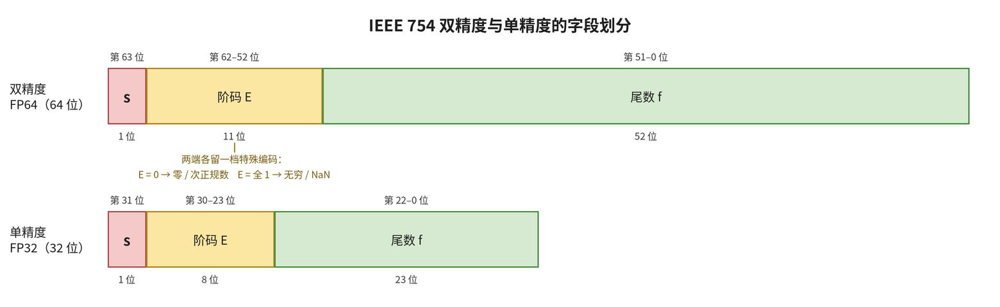

# 标量浮点乘法的算法和代码分析

# 一、算法

　　一条 `fmul` 指令要做的事，就其数值而言只有一句：从两个操作数里各取出符号、阶码、有效数，分头算完，再拼回一个浮点数。拆开算是因为三块互不干涉——符号只需异或，指数做的是加法，只有有效数这一步是真的乘法。三块中也只有它产生宽度：两个 24 位的有效数相乘得到 48 位。这 48 位不是浮点数，只是一个定点整数，要变回浮点数还须若干步骤：规格化把前导 1 移到小数点之前，舍入按舍入模式舍弃多出的低位，指数随之调整，最后判定指数是否越界、操作数是否属于不参与常规通路的特殊值。

　　下面顺着数据流逐节展开：第 1 节看三个字段的划分，第 2 节把乘法拆成三路，第 3 节把有效数补成整数，第 4 节做乘法本身，第 5、6 节把乘积变回浮点数——先规格化、定下哪几位要留，再按舍入模式舍去，第 7 节看指数是否越界，第 8 节处理 NaN、无穷这些不参与常规通路的情形。

　　全节由同一对操作数贯穿：

$$a = 1.10000000000000000000001_2 \times 2^{1}, \qquad b = 1.1110110_2 \times 2^{0}$$

## 1. 浮点数的格式



　　单精度的字段是 1 位符号位、8 位阶码、23 位尾数，阶码偏置 $\mathrm{bias}$ = 127；双精度用同一套划分，只是各字段加宽（11 位阶码、52 位尾数、$\mathrm{bias}$ = 1023）。下面的推导和例子都按单精度来，双精度只是位数不同，规则完全一样。

| 种类 | 符号位 $s$ | 阶码域 $E$ | 尾数域 $f$ | 数值 |
| --- | --- | --- | --- | --- |
| 零 | 0/1 | 全 0 | 全 0 | $\pm 0$ |
| 次正规数 | 0/1 | 全 0 | 非全 0 | $(-1)^s \times 0.f \times 2^{1-\mathrm{bias}}$ |
| 规格化数 | 0/1 | 非全 0 也非全 1 | 任意 | $(-1)^s \times 1.f \times 2^{E-\mathrm{bias}}$ |
| 无穷 | 0/1 | 全 1 | 全 0 | $\pm \infty$ |
| 静默 NaN（qNaN） | 任意 | 全 1 | 非全 0，最高位是 1 | 非数，参与运算不置标志 |
| 信号 NaN（sNaN） | 任意 | 全 1 | 非全 0，最高位是 0 | 非数，参与运算置无效操作 |

　　这张表里有几件事后面每一节都会用到。阶码域只有中间一段（1 到 254）是普通的有限数，两端各空出一档：全 0 留给次正规数和零，全 1 留给无穷和 NaN。所以看阶码域是不是全 0 或全 1，就能把这几类分开，第 8 节的特殊值判定用的就是这个判据。**次正规数的阶码域是全 0，指数按 $1-\mathrm{bias}(-126)$ 算，不是 $0-\mathrm{bias}(-127)$**，这样最大的次正规数与最小的规格化数正好首尾相接，数轴上没有空隙，我们称之为渐进下溢（gradual underflow）。

　　符号位和尾数也各有一处后面要用到的细节。零有 $+0$ 和 $-0$ 两个，符号位照常参与区分，乘法的结果为零时符号仍取乘积符号（两个符号位的异或），依据即此。NaN 只要求尾数非全 0，靠尾数最高位区分静默与信号：为 1 是静默 NaN，为 0 是信号 NaN，前者参与运算不置标志，后者要置无效操作。

　　静默与信号的区别不止那一位，三类 NaN 的位型是

$$\begin{aligned}
\text{静默 NaN}:\quad & 0\ \underbrace{1111\,1111}_{E\ \text{全 1}}\ 1xx\ldots x\\
\text{信号 NaN}:\quad & 0\ \underbrace{1111\,1111}_{E\ \text{全 1}}\ 0xx\ldots x\quad(\text{尾数非全 0})\\
\text{规范 NaN}:\quad & 0\ \underbrace{1111\,1111}_{E\ \text{全 1}}\ 100\ 0000\,0000\,0000\,0000\,0000_2
\end{aligned}$$

　　前两行里的 $x$ 表示任意值，两者只差尾数域的最高位。静默 NaN 参与运算时原样传递、不置任何标志；信号 NaN 被取用时置起无效操作标志。尾数的其余位是载荷（payload），标准只建议原样传递、并不强制，香山一律归成规范 NaN，即第三行那个位型 0x7FC00000（第 8 节）：静默 NaN 与信号 NaN 都只以操作数的身份出现，运算给出的结果一律是规范 NaN，信号 NaN 因此只存在一代——它是留给未初始化数据的记号，一旦参与运算，标志随即置起，不会静默地继续传播。

　　用这张表读一遍开头那对操作数。$a$ = 0x40400001：符号位 0，阶码域 $10000000_2$ 即 128，尾数域 $10000000000000000000001_2$，最高位与最低位为 1。$b$ = 0x3FF60000：符号位 0，阶码域 $01111111_2$ 即 127，尾数域为 $1110110_2$ 后接 16 个 0。两者的阶码域都落在 1 到 254 之间，因此都是规格化数。

## 2. 乘法在数学上拆成三块

　　上一节的表里，规格化数的值是

$$v = (-1)^s \times 1.f \times 2^{E-\mathrm{bias}}$$

　　两个这样的数相乘：

$$a \times b = (-1)^{s_a \oplus s_b} \times (1.f_a \times 1.f_b) \times 2^{(E_a-\mathrm{bias}) + (E_b-\mathrm{bias})}$$

　　三块互不相干：符号取乘积符号，有效数单独相乘，指数相加后再减一次 $\mathrm{bias}$。硬件因此分三路并行。

　　例子的三路在这里分开：两个符号位都是 0，异或得 0，结果为正；指数为 1 与 0，相加得 1；有效数这一路留下 $1.10000000000000000000001_2 \times 1.1110110_2$ 这个乘积，由下面两节计算。三路的重新汇合在第 5 节之后。

## 3. 有效数的隐含位，与次正规数的处理

　　规格化数的有效数是 $1.f$，那一位整数部分的 1 并不在尾数域里，是隐含的；次正规数的阶码域为 0，有效数却是 $0.f$，隐含位是 0。隐含位取 1 还是取 0，取决于这个数是规格化还是次正规——而判据恰好就是“阶码域是不是全零”。实现上无须为此分支：直接把“阶码域非零”当作隐含位与尾数拼在一起，一个操作就同时覆盖两种情形。

　　指数同理。把次正规数阶码域里的 0 统一改写成 1，它的指数就和格式规定的 $1-\mathrm{bias}$ 对上，往后整条数据通路都不必再区分二者——规格化与次正规的差别，全由隐含位承担。

　　例子里两个数都是规格化数，隐含位均为 1，有效数分别是 $1.10000000000000000000001_2$ 和 $1.1110110_2$。送进乘法器之前要先把它们写成整数，即小数点右移 23 位：

$$A = 110000000000000000000001_2 = \texttt{0xC00001}, \qquad B = 111101100000000000000000_2 = \texttt{0xF60000}$$

　　小数点的位置留给第 5 节的指数处理，这里只做整数乘法。$b$ 的尾数只有 7 位，写成 24 位后低 16 位全为 0；这些 0 并非无意义的填充，第 4 节会看到它们使 13 组中的 8 组不产生部分积。

## 4. 有效数相乘：Booth 编码与进位保留加法

　　两个 24 位有效数相乘，积可达 48 位。逐位求部分积要产生 24 个部分积，再用加法树归约；部分积越多，归约树越深、面积越大，这样的朴素计算实现往往难以被接受。对此使用基 4 Booth 编码，从乘数的表示入手减少部分积的个数：

　　它省的不是乘法本身，而是乘数的写法。一个数的二进制表示并不唯一，只要允许数位取负，同一串位就能写出好几种样子，依据的是最基本的一条等式：$2^k$ 也可以记成 $2^{k+1}-2^k$，于是乘数里一段连续的 1 可以整段换掉。[布斯乘法算法](https://zh.wikipedia.org/wiki/布斯乘法算法)

$$01110_2 = 10000_2 - 00010_2 = 16-2 = 14$$

　　原本三个 1 要三个部分积，现在只剩一加一减，数值不变。被乘数始终只是 $A$ 的若干次移位，乘法的结构没有改变，改变的只是乘数中非零数位的个数。部分积的个数等于非零数位的个数，种类等于数位能取到的值，改变乘数的表示，两者即可同时降低。

　　把这套自由度用到 24 位乘数上，就是 Booth 的做法。乘数两位一组切开，每组本来取 0 到 3，对应 $0$、$A$、$2A$、$3A$。前三样都不必生成，0 不产生部分积，$A$ 是被乘数本身，$2A$ 是 A 左移一位，**硬件上都便于实现**；只有 $3A$ 不能由移位得到，须先做一次 $A+2A$。这项加法代价不小：每一组都可能需要 $3A$，相当于在归约树之前增设一排加法器，原想省下的面积又抵消回去。既然数位允许取负，就不必让一组达到 $3$：这组两位中的高位若是 1，就将其减 4、同时向高一组进 1。减 4 之后 $3$ 成为 $-1$、$2$ 成为 $-2$，每组都落在 $\{-2,-1,0,1,2\}$ 内，倍数只剩 $A$ 与 $2A$，取反即得负的两个。

　　向高位进的那个 1 无须单独计算，它就是本组两位中的高位；反之，本组要接收的进位即低一组两位中的高位。每组因此只需看三个位——自己的两位，外加低一组的高位。把「本组原值减 4、再加接收到的进位」写成式子：

$$2b_{2i+1}+b_{2i}-4b_{2i+1}+b_{2i-1}$$

　　合并同类项，就是这一组的数位：

$$d_i = -2b_{2i+1} + b_{2i} + b_{2i-1}$$

　　这里没有进位链：每组向高位进的 1 取自乘数中已有的那一位，不是由更低处逐级传递而来，13 组因此可以**同时进行**。三个位八种组合，只落到五种取值上：

| $(b_{2i+1},b_{2i},b_{2i-1})$ | $d_i$ | 部分积 |
| --- | --- | --- |
| 001、010 | $+1$ | $+A$ |
| 011 | $+2$ | $+2A$ |
| 100 | $-2$ | $-2A$ |
| 101、110 | $-1$ | $-A$ |
| 000、111 | $0$ | $0$ |

　　以 $B = 01110110_2$（十进制 118）为例演算一遍。最低位下面补一个 0 当作 $b_{-1}$，从低位往高位每两位切一组：

| $i$ | 两位组 $(b_{2i+1}b_{2i})$ | 高位是 1？ | 收低组的 1（$b_{2i-1}$） | $d_i$ | 权重 $4^i$ |
| --- | --- | --- | --- | --- | --- |
| 0 | 10 | 是，减 4 | 0 | $2-4+0=-2$ | $1$ |
| 1 | 01 | 否 | 1 | $1+1=+2$ | $4$ |
| 2 | 11 | 是，减 4 | 0 | $3-4+0=-1$ | $16$ |
| 3 | 01 | 否 | 1 | $1+1=+2$ | $64$ |

　　四个数位按权重加回去，$-2\times 1+2\times 4-1\times 16+2\times 64=118$，与 $B$ 完全相同；再乘上 $A$，就是四个部分积相加：

$$A\times 118 = -2A+8A-16A+128A = 118A$$

　　24 位乘数也是这样切的：$b_{23}\cdots b_0$ 低位补一个 0、高位补两个 0，共 27 位，每两位一组、相邻两组共用一位，正好切成 13 组。上面要补两个而不是一个，是因为 $b_{23}$ 只能充当最高一组的进位输入，那一组自己的两位得由补上的 0 充数。负倍数在硬件里不必真做减法，把 A 取反加一即可，那个“加一”可以并入归约树一并补上。至此乘法已经拆成 13 个形如 $\pm A\cdot 2^{2i}$ 或 $\pm 2A\cdot 2^{2i}$ 的数。

　　为什么不接着往基 8 走？基数再提高一倍，数位要取到 $\pm 4$，须预生成 $3A$，又回到额外的一次加法。基 4 恰好落在“数位个数减半”与“倍数种类最少”的交点上。

　　例子的乘数 $B = 111101100000000000000000_2$ 是 24 位，低位补一个 0、高位补两个 0，共 27 位，行首两个 0 与行末一个 0 都是补上的，行末那个就是 $b_{-1}$。按每两位一组切开，每组再向右多取一位纳入窗口，划分的结果如下：

```text
      (0 0)1 1 1 1 0 1 1 0 0 0 0 0 0 0 0 0 0 0 0 0 0 0 0 0(0)
i=12   0 0 1                     d12 = +1
i=11       1 1 1                 d11 =  0
i=10           1 1 0             d10 = -1
i=9                0 1 1         d9  = +2
i=8                    1 0 0     d8  = -2
i=7~0                      0 0 0 d7~d0 =  0
```

　　六个窗口取自同一串 27 位，每降低一组就右移两个字符，所以相邻两行总重叠一位：窗口左边两位是本组自己的 $b_{2i+1}b_{2i}$，最右边那一位来自低位那一组。$B$ 的低 16 位全为 0，因此 $i = 0$ 到 $7$ 这八组的数位都是 0；有数位的只剩 $i = 8$ 到 $12$ 五组，就是上面最后五个窗口，数位依次为 $d_8 = -2$、$d_9 = +2$、$d_{10} = -1$、$d_{11} = 0$、$d_{12} = +1$，非零数位四个。数位是否还原了乘数，可以先核验一遍：

$$-2\cdot 4^{8} + 2\cdot 4^{9} - 4^{10} + 4^{12} = 16121856 = \texttt{0xF60000}$$

　　与 $B$ 相符。再乘上被乘数 $A$，四个部分积相加：

$$A \times B = -2A\cdot 4^{8} + 2A\cdot 4^{9} - A\cdot 4^{10} + A\cdot 4^{12} = 101110001000000000000000111101100000000000000000_2$$

　　所得是 48 位的乘积，仍是不带小数点的整数，它的小数点位置留到第 5 节确定。

> **注**　纸面上略去数位为零的那一项，与电路里省去那一组，含义不同。数位为零时，该组生成的部分积是一个全 0 的向量，加进求和式并不改变结果，所以写式子时可以整项不写；硬件里 13 组一路都不能不少，每一组照旧各出一个部分积，在归约树里各占一个输入，归约树也不因某一组为零而少收一路。面积上的收益来自组数本身：同样算两个 24 位数相乘，逐位生成部分积要压 24 条，改用基 4 Booth 编码后减到 13 条，归约树随之收窄，这与某几组是否为零无关。本节例子中 $B$ 的低 16 位恰好全零，只是这对操作数偶然如此，换一个乘数，那八组照样有非零数位。对应的实现见第二节第 4 小节。

## 5. 规格化与指数

　　两个 $[1,2)$ 的数相乘，积落在 $[1,4)$：前导 1 要么在小数点前一位（$1.xxx$），要么多进一位（$10.xxx$）。规格化的目标是把前导 1 置于小数点左侧紧邻的位置，小数点随之移动：左移一位，指数加一；右移一位，指数减一。积落在 $[1,2)$ 时已经合式，小数点不动，指数为两个真实指数之和；落进 $[2,4)$ 时多进了一位，小数点左移一位、指数加一。加减法要靠小数点右移补回相消掉的前导零，乘法不存在这一情形——相消要求两数接近，两个 $[1,2)$ 的数相乘只会更大，前导 1 不会退到小数点右侧。小数点右移在乘法里另有一个来由：操作数含次正规数时隐含位为 0，有效数不到 1，积的前导 1 落在小数点右侧，小数点右移的位数即前导零的个数，指数减少相同的量。三条都以指数仍在格式范围内为前提；真实指数低于 $-126$ 时小数点移不到位，结果只能按次正规数交付，留到第 7 节。

　　指数侧要先分清两个数。格式里存的是阶码域 $E$，它已经偏置过，$E = e + \mathrm{bias}$，$e$ 才是真实指数。乘积的真实指数是 $e_a + e_b$，写成阶码域就是 $E_a + E_b - \mathrm{bias}$（两个阶码域各带了一份 $\mathrm{bias}$，相加时多算了一次，这里正好减掉）。规格化时小数点左移一位，真实指数加一，阶码域跟着加一；小数点右移时方向相反。舍入进位若使有效数多出一位，还要再规格化一次：$1.111\ldots1$ 加一得 $10.000\ldots0$，小数点左移一位、指数加一，移出去的是 0，有效数落回 $1.000\ldots0$，前导 1 不会再被移出去，规格化至多两次。

　　例子的 $E_a$ = 128、$E_b$ = 127，各减去 $\mathrm{bias}$ 后相加，指数为 1；两个有效数相乘所得的积是 $10.1110001\ldots_2$，小数点前有两位，比标准形式多出一位。小数点左移一位将其消去，有效数成为 $1.01110001\ldots_2$，指数加一得 2，阶码域为 $10000001_2$。

## 6. 舍入

　　两个 24 位有效数相乘得 48 位，目标格式只保留 24 位，其余低位必须舍弃。舍弃不能随意：同一条指令、同一对操作数，在任何实现与任何时刻都必须给出同一个数，误差也须有界。这条规则即舍入——先截断，再决定保留部分的末位是否加一；作此决定的依据，是被舍弃的部分相对半个最低位的高低，以及结果的符号。

　　被舍弃的部分最多 24 位，但逐位保留没有必要，三位即可覆盖所需的全部信息：截断点之下紧邻的一位是 guard bit，再下一位是 round bit，更低位中只要还有 1，即可归约为一位 sticky bit。

　　截断部分与 $\frac12$ 比较只有三种结果：guard 为 0 表示低于中点；guard 为 1 而 round 与 sticky 全为 0 表示恰好居中；guard 为 1 且 round、sticky 有任一为 1，表示高于中点。

　　五种模式据此给出各自的判据，均由 IEEE 754 定义，RISC-V 全部实现。以下各条中，“进位”指给保留部分的末位加一；被舍弃的部分为零时真值本身即可表示，五种模式都不进位，故只按非零的情形分说。

- **RNE（Round to Nearest, ties to Even，就近取偶）**，默认模式：取离真值较近的那个可表示数，两个候选等距时取其中为偶数的那个。高于中点即 guard bit 为 1 且 round bit 或 sticky bit 非零，进位；低于中点即 guard bit 为 0，截断；恰好居中即 guard bit 为 1 而 round bit、sticky bit 全为 0，此时才用上取偶，故保留位末位为奇才进位。
- **RMM（Round to Nearest, ties to Max Magnitude，就近取最大幅度）**：同样取较近的那个，只是居中时不看奇偶，一律取幅度较大者，判据因此只剩 guard bit：为 1 进位，为 0 截断。它与 RNE 的分歧只出现在“居中且保留位末位为偶”这一种情形。
- **RTZ（Round towards Zero，向零）**：取两个候选中离零较近的那个，即一律截断，任何情形都不进位。
- **RDN（Round Down，向 $-\infty$）**：取两个候选中较小的那个。结果为正时直接截断；结果为负时，guard bit、round bit、sticky bit 中只要有一个为 1 就进位。
- **RUP（Round Up，向 $+\infty$）**：取两个候选中较大的那个。结果为正时，guard bit、round bit、sticky bit 中只要有一个为 1 就进位；结果为负时直接截断。

> **注**　单精度下，就近舍入的两种（RNE、RMM）一次运算的误差不超过半个最低位，相对误差不超过 $2^{-24}$；定向舍入的三种（RTZ、RDN、RUP）误差不到一个最低位，相对误差不到 $2^{-23}$。RNE 与 RMM 两者都取最近的可表示数，不同的是居中时 RNE 取末位为偶的那个候选，可能进位也可能截断，大量运算中进位与截断的误差彼此抵消，统计上没有偏向；RMM 居中时一律进位，取幅度大的一侧，误差只朝一个方向累积，多步算下来偏差比 RNE 大。实现上 RNE 要 round bit 与 sticky bit 才分辨得出居中，较为复杂；RMM 只看 guard bit 就行，相对简单。

　　例子的 48 位积为

$$A \times B = 10.111000\,10000000\,00000000\,11110110\,00000000\,00000000_2$$

　　小数点左移一位，落到最高位之后，有效数与三位的分界是

$$1.\underbrace{01110001\,000000000000000}_{23\ \text{位，保留}}\;\underbrace{1}_{\text{guard}}\;\underbrace{1}_{\text{round}}\;\underbrace{1101100000000000000000}_{\text{sticky}=1}$$

　　小数点后前 23 位是格式能容纳的部分，全部保留；其后紧邻的两位依次是 guard bit 与 round bit，再往下的 22 位不再逐位保留，或起来得到 sticky bit。本例 guard 与 round 都是 1，末尾又有非零位，被舍弃的部分高于中点，五种模式据此分别给出结果：

- **RNE**：高于中点，进位，末位加一后有效数为 $1.01110001\,000000000000001_2$，拼成 32 位得 0x40B88001。
- **RMM**：同样高于中点，进位，得 0x40B88001。
- **RTZ**：一律截断，得 0x40B88000。
- **RDN**：结果为正，截断，得 0x40B88000。
- **RUP**：结果为正，进位，得 0x40B88001。

　　与直接计算核对：两个操作数的值为 3.00000024 和 1.921875，乘积 5.76562546 比截断值 5.765625 高 0.96 个最低位（该量级的最低位数是 $2^{-21}$），过半，故向上进位，结果为 5.7656255。

> **注**　本例结果为正，RDN 与 RUP 的差别要换到负结果上才看得见：把这对操作数取负，两者的选择对调，RDN 得 0xC0B88001，RUP 得 0xC0B88000。RNE 与 RMM 的差别只在恰好居中时显现，本例高于中点，两者同得 0x40B88001；取 $a$ = 1.5、$b = 1 + 3 \times 2^{-23}$，乘积比截断值高半个最低位，而截断值末位为 0，RNE 取偶，仍得 0x3FC00004，RMM 进位，得 0x3FC00005。

　　前面那条 $2^{-24}$ 的相对误差界以结果为规格化数为前提，次正规数区间没有这样一条固定的界。阶码域固定为 0，最低位的权重恒为 $2^{-149}$，不随量级收缩，舍入误差却仍以半个最低位 $2^{-150}$ 为界，折成相对误差就是 $2^{-150}/|v|$，有效数位越少相对误差越大。

## 7. 上溢与下溢

　　有效数相乘只是位数变长，指数相加却可能越界，而阶码域给有限数留下的只有 1 到 254：全 1 是无穷与 NaN 的位置，0 是零与次正规数的位置。指数越过上界就落到上溢，掉出下界就落到下溢，两者都伴随不精确。

　　**什么算上溢。**判据只涉及一个量：把指数范围不加限制算出的舍入后指数。单精度下记最大有限数为

$$MaxFinite = (2 - 2^{-23}) \times 2^{127}$$

　　舍入后的指数一旦大于 127，阶码域即为全 1，而全 1 是无穷与 NaN 的编码，有限数没有可用的阶码域。判据落在舍入之后，真值是否超过 $MaxFinite$ 因此不参与判决：舍入把指数拉回 127 及以下时，结果仍是有限数，只是不精确。

　　**上溢时给出什么数。**由舍入方向决定，五种模式在两侧的结果列在下表：

| 舍入模式 | 正上溢结果 | 负上溢结果 |
| --- | --- | --- |
| RNE（就近取偶） | $+\infty$ | $-\infty$ |
| RMM（就近取最大幅度） | $+\infty$ | $-\infty$ |
| RTZ（朝零舍入） | $+MaxFinite$ | $-MaxFinite$ |
| RDN（朝 $-\infty$ 舍入） | $+MaxFinite$ | $-\infty$ |
| RUP（朝 $+\infty$ 舍入） | $+\infty$ | $-MaxFinite$ |

　　就近的两种一律给 $\pm \infty$；定向的三种里，舍入方向的无穷端与结果同号就给无穷，异号就给同号的最大有限数，也就是只有 RUP 遇正、RDN 遇负这两种组合给出无穷，其余组合都落在最大有限数上。标志却不分模式，恒为上溢（OF）加不精确（NX）：给无穷还是给最大有限数，都与真值不同，真值恰好等于 $2^{128}$ 这样整齐的数也一样。双精度的规则相同，界限换成 $2^{1024}$ 与 $2^{-1022}$，位数不同而已。

　　**什么算下溢。**条件是“很小”与“不精确”同时成立。所谓很小，指把真值按 24 位精度舍入、而指数范围不加限制之后，量级仍小于最小规格化数 $2^{-126}$；所谓不精确，指被舍弃的部分非零，即 guard、round、sticky 三位里有 1。

　　四种情形据此得出：

| 舍入之后的结果 | 很小 | 不精确 | 下溢 |
| --- | --- | --- | --- |
| 次正规数，被舍弃的部分为零 | 是 | 否 | 不置 |
| 次正规数，被舍弃的部分非零 | 是 | 是 | 置 |
| 零，被舍弃的部分非零 | 是 | 是 | 置 |
| 规格化数 | 否 | 不确定 | 不置 |

　　**下溢时给出什么数。**有效数不再规格化：隐含位为 0，阶码域固定为 0，尾数域 $m$ 直接承载位权从 $2^{-127}$ 往下的各位，$|v| = m \times 2^{-149}$，最低一位的权重就是 $2^{-149}$，舍入照常进行；真值小到不足半个最低位 $2^{-150}$ 时，两个候选只剩零与最低的次正规数，五种模式的结果是

| 舍入模式 | 正结果 | 负结果 |
| --- | --- | --- |
| RNE（就近取偶） | $+0$ | $-0$ |
| RMM（就近取最大幅度） | $+0$ | $-0$ |
| RTZ（朝零舍入） | $+0$ | $-0$ |
| RDN（朝 $-\infty$ 舍入） | $+0$ | $-2^{-149}$ |
| RUP（朝 $+\infty$ 舍入） | $+2^{-149}$ | $-0$ |

　　只有 RDN 遇负、RUP 遇正给出 $2^{-149}$，其余都是带符号的零。$m$ 越小，能留在尾数域的有效位越少，最小只剩 $2^{-149}$ 这一位。代价是精度：次正规数区间里半个最低位相对真值已经大于 $2^{-24}$。换来的是结果不必直接归零，$x - y$ 在 $x \neq y$ 时不为零这类性质得以保持。双精度规则相同，最小规格化数是 $2^{-1022}$，最低位权重是 $2^{-1074}$。

　　**置哪些标志。**不精确标志（NX）只认被舍弃的部分，非零就置，与结果大小无关；下溢标志（UF）要求上面两条同时成立。上溢与下溢不会同现：指数要么越过上界，要么落进次正规数区间。

　　**“小”按舍入前判还是舍入后判。**两种判法只在一种情形上分道扬镳：真值落在 $2^{-126}$ 之下、距离不到半个最低位 $2^{-150}$，而舍入方向朝上。舍入前判比的是真值，认定它小，下溢照置；舍入后判比的是舍入之后的量级，此时已经达到 $2^{-126}$，认定它不小，不置下溢。前者多报一次虚警，后者正是为少报而设。IEEE 754 两种都允许，实现自行选定，RISC-V 明确取后者，手册里的说法是 tininess is detected after rounding。

| 判法 | 比的是哪个量 | 真值不足 $2^{-126}$、舍入却达到 $2^{-126}$ | 真值小到舍入给出零 |
| --- | --- | --- | --- |
| 舍入前判 | 舍入之前的真值 | 算小，置下溢 | 算小，置下溢 |
| 舍入后判（RISC-V） | 舍入之后的量级 | 不算小，不置下溢 | 算小，置下溢 |

　　表中归零的那一列两种判法都置下溢：交付的数虽然是零，舍入之后得到的量级并不为零，仍算小。

　　前面例子的结果指数是 2，离格式两端都远，本节的两个标志都不会置起，这里另换操作数。上溢这一侧只看指数：取 $a = 2^{64}$（0x5F800000）、$b = 1.5 \times 2^{64}$（0x5FC00000），指数相加得 128，有效数 1.0 与 1.5 相乘仍落在 $[1,2)$，小数点不必移动，阶码域是 $128 + 127 = 255$，全 1，正好落入无穷的阶码编码。RNE、RMM 与 RUP 取正无穷 0x7F800000，RTZ 与 RDN 取最大有限数 0x7F7FFFFF，标志同为上溢加不精确；负数一侧把这两组对调，RDN 取 0xFF7FFFFF，RUP 取 0xFF800000。

　　下溢要同时满足“小”与“不精确”两条，取两个指数之和已经越界的操作数即可。取 $a = 1.5 \times 2^{-64}$（0x1FC00000）、$b = (1 + 2^{-23}) \times 2^{-64}$（0x1F800001），指数相加得 $-128$，比最小规格化数的 $-126$ 还低；有效数相乘得

$$A \times B = 1.100\,0000\,0000\,0000\,0000\,0000_2 \times 1.000\,0000\,0000\,0000\,0000\,0001_2 = 01.10\,0000\,0000\,0000\,0000\,0000\,1100\,0000\,0000\,0000\,0000\,0000_2$$

　　有效数相乘所得积在第 23 位之后仍有非零位，48 位积压到 24 位必不精确。指数 $-128$ 比最小规格化数的 $-126$ 还低两档，小数点须跟着左移两位才落到次正规数的位置，指数补回 $-126$，隐含位随之取 0，最低位的权重因此是 $2^{-149}$：

$$0.\underbrace{01100000000000000000000}_{23\ \text{位，保留}}\;\underbrace{0}_{\text{guard}}\;\underbrace{1}_{\text{round}}\;\underbrace{1000000000000000000000}_{\text{sticky}=1}$$

　　保留的 23 位就是尾数域 0x300000。本例 guard 为 0，低于中点，RNE、RMM、RTZ 与 RDN 都截断，结果 0x00300000；RUP 进位，得 0x00300001。被舍弃的 0.375 个最低位不为零，不精确置起；结果仍是次正规数，下溢同时置起。

> **注**　下溢是否置起与最终给出哪个数无关，只看舍入前后的“小”与“不精确”。取 $a = (2 - 2^{-23}) \times 2^{-63}$（0x207FFFFF）、$b = 2^{-64}$（0x1F800000），真值 $(1 - 2^{-24}) \times 2^{-126}$ 恰好落在 0x007FFFFF 与 0x00800000 的正中：RNE 取偶、RMM 与 RUP 取大，三者都进位到 0x00800000，舍入之后结果不再小，只置不精确；RTZ 与 RDN 截断到 0x007FFFFF，仍小且不精确，下溢照置。同一对操作数只换舍入模式，标志就从“只不精确”变成“下溢加不精确”，把“小”定在舍入之后判，免掉的正是按舍入前判时多出来的下溢。

## 8. 特殊值

　　有几种值不必也不能参与上面的数值通路：0、NaN 与无穷的结果由操作数直接判出，有限数才走那条通路。上溢不同，它的操作数都是正常的有限数，通路照常计算，只是结果的指数超出了格式能表示的范围，须以无穷或最大有限数交付。规范按情形逐条规定这些结果，把这些情形合并为一组判定、按优先级取舍：

1. **NaN**：任一操作数是 NaN，结果为规范 NaN；

2. **无穷**：有操作数是无穷时为无穷，符号取乘积符号。但 $\infty \times 0$ 特例按无效操作给出规范 NaN；

3. **上溢**：有限操作数相乘而舍入后的指数超出 127，结果取无穷或最大有限数；

4. **零**：任一操作数是零，结果为零，符号取乘积符号；

5. **常规结果**：以上都不成立时，交回前几节的数值通路。

　　这组判定里，前两项的次序不能与其余各项互换。NaN 的范围最大：只要有一个操作数是 NaN，结果就是 NaN。零这一类因此要把无穷排除在外：$\infty \times 0$ 由第 2 项接住，结果与第 1 项同为规范 NaN。无穷排在上溢之前，依据是规范对无穷算术的规定——无穷参与的算术是精确的，除无效操作外不置任何标志；上溢问的却是舍入后的结果有没有超出格式能表示的最大有限数，$\infty \times 2^{64}$ 不属于这种情况，若以上溢处理就会多置一条上溢与不精确。

### NaN

　　三类之中 NaN 的范围最大，规则也最多：

- **静默 NaN**：只沿运算传播，不置标志；
- **信号 NaN**：除给出 NaN 外，还须置无效操作标志；
- **结果位型**：不保留操作数 NaN 的尾数，一律给符号 0、阶码域全 1、尾数域只有最高位为 1 的位型，单精度即 0x7FC00000，这就是规范 NaN；
- **有效载荷**：IEEE 754 希望把输入 NaN 的有效载荷原样传播下去，同时也明说输入不止一个 NaN 时不规定由哪一个提供；RISC-V 不作此实现——传播需要额外携带一份尾数与一套选择逻辑，而依赖它的代码本来就不可移植，权衡之下只保证规范 NaN，运算给出的 NaN 不携带任何输入操作数的信息。

### 无穷

　　无穷这一类的符号照旧取乘积符号，结果分两种情形：

- **无穷乘有限非零数、无穷乘无穷**：结果为无穷；
- **无穷乘零**：不属于无穷算术，按无效操作处理，给出规范 NaN 并置无效操作标志；RISC-V 在这里比 IEEE 754 要求更严，乘加中 $\infty \times 0$ 的加数即使是静默 NaN，也须置起无效操作标志；
- **标志**：一律不置，只有 $\infty \times 0$ 那一条例外——规范对无穷算术的规定是“精确的，除无效操作外不置任何标志”，不精确与下溢无从谈起，上溢的判据也不适用。

### 零

　　零这一类最简单，规范里并没有“零”这样一条判定，它的结果由普通算术直接给出：

- **零乘有限数**：结果为零，符号取乘积符号，而且精确，既不置不精确，也不置下溢——下溢只对非零且很小的结果置起，不精确要求交付的结果与精确值有出入，两条对零都不成立。

# 二、FloatFMA 中的实现

　　纯乘法没有独立硬件。`fmul.s` / `fmul.d` / `fmul.h` 在 `VecDecoder.scala:548-550` 译码成 `FuType.fmac` 加 `VfmaType.vfmul`，和浮点乘加共用 `FMA` 单元：外层 `FMA.scala:13-48` 只做连线和 NaN 装箱检查，算术全在 `yunsuan/src/main/scala/yunsuan/fpu/FloatFMA.scala` 的 `FloatFMA` 里。单元是定延迟的，没有握手；指令进单元后走几拍、每拍做什么，由第 1 节交代。

　　正因为共用，下面的编号与《一》对齐，每一节对应同一号小节。《一》的第 1 节讲格式，落到代码上只是按位段取用，这一节顺带交代单元的位置、端口与三拍流水；从第 2 节起进入算法。这套算法与乘加共用，差别集中在一处：**纯乘法把加数 c 置成 0**，整条加数通路被旁置。

## 1. 单元、端口与三拍流水

　　先看全貌。`FloatFMA` 是一条定延迟的三拍流水线：一条指令从发射到结果经过三道寄存器，每拍只推进一级，不握手也不反压。整条数据通路从操作数到结果要经过四段组合逻辑——取数并编码、归约并相加、规格化移位、舍入与选择——三道寄存器正好把它们分开：

| 拍 | 这一段做什么 | 拍末打拍的寄存器 |
| --- | --- | --- |
| 第 0 拍（发射） | 取符号、阶码、尾数，拼出有效数；加数 c 按指数差右移；Booth 编码；归约树前四层 | 使能为 `fire` 的一批 |
| 第 1 拍 | 归约树最后一层；3:2 压缩；最终加法器，乘积与对齐后的 c 相加 | 使能为 `fire_reg0` 的一批 |
| 第 2 拍 | 前导零计数；规格化左移；取出 guard、round、sticky | 使能为 `fire_reg1` 的一批 |
| 第 3 拍 | 舍入；上溢与下溢判定；结果选择与打包 | 无，组合逻辑直接送出 `fp_result` |

　　表中的拍次以发射那一拍为第 0 拍计，一条指令发射后第三拍末拿到结果。

　　接口定义在 `FloatFMA.scala:14-25`：

    val io = IO(new Bundle() {
      val fire                 = Input (Bool())               // 这一拍有一位有效指令
      val fp_a, fp_b, fp_c     = Input (UInt(floatWidth.W))   // 三个源操作数，一律 64 位
      val round_mode           = Input (UInt(3.W))            // 舍入模式
      val fp_format            = Input (UInt(2.W))            // b01 半精度、b10 单精度、b11 双精度
      val op_code              = Input (UInt(4.W))            // 乘法与四种乘加变体
      val fp_result            = Output(UInt(floatWidth.W))   // 64 位结果
      val fflags               = Output(UInt(5.W))            // NV、DZ、OF、UF、NX
      val fp_aIsFpCanonicalNAN = Input(Bool())                // 窄值未按 NaN 装箱时置位，按规范 NaN 处理
      val fp_bIsFpCanonicalNAN = Input(Bool())
      val fp_cIsFpCanonicalNAN = Input(Bool())
    })

　　三种精度共用同一组源操作数端口，这一点留到第 9 节再说。

　　单元没有握手，与调用方的约定写在功能单元的配置里（`FuConfig.scala:715-728`）：

    val FmacCfg = FuConfig(
      name = "fmac",
      fuType = FuType.fmac,
      fuGen = (p: Parameters, cfg: FuConfig) => Module(new FMA(cfg)(p).suggestName("Fmac")),  // 生成 FMA 单元
      srcData = Seq(
        Seq(FpData(), FpData(), FpData()),   // 三个浮点源操作数
      ),
      piped = true,                          // 流水线单元，每拍可接一条新指令
      writeFpRf = true,                      // 写浮点寄存器堆
      writeFflags = true,                    // 写不精确、上溢、下溢、无效操作等标志
      latency = CertainLatency(3),           // 定延迟三拍
      destDataBits = 64,                     // 结果数据 64 位
      needSrcFrm = true,                     // 需要舍入模式
    )

　　其中 `latency` 把延迟固定成三拍，调用方按固定拍数来取结果；`piped` 说明它按流水线工作；`writeFflags` 打开，是因为乘法要写不精确、上溢、下溢与无效操作这几位；`needSrcFrm` 把舍入模式一路接进单元。流水线因此只由一位 valid 推动（`FloatFMA.scala:48-50`）：

    val fire      = io.fire
    val fire_reg0 = GatedValidRegNext(fire)       // 打进第一级
    val fire_reg1 = GatedValidRegNext(fire_reg0)  // 打进第二级

　　`GatedValidRegNext` 的定义在 `yunsuan/src/main/scala/yunsuan/util/ClockGatedReg.scala:6-12`：

    def apply(next: Bool, init: Bool = false.B): Bool = {
      val last = Wire(next.cloneType)
      last := RegEnable(next, init, next || last)   // 输入或输出为 1 才写入
      last
    }

　　使能条件是 `next || last`：输入为 1 或者本级已经是 1，寄存器这一拍就照常写入；两者都为 0 时寄存器保持 0，不翻转。就功能而言它仍是把有效位延迟一拍，区别只在连续的空拍里寄存器停住，文件名里的 clock gated 说的就是这一点。

　　数据寄存器不跟着 valid 链走，而是各自以所在级的 valid 为使能：第 0 拍算出的中间量在 `fire` 为 1 时写入下一级，第 1 拍算出的在 `fire_reg0` 为 1 时写入下一级。加法结果的寄存就是后一种（`FloatFMA.scala:450`）：

    val adder_f64_reg1 = RegEnable(adder_f64, fire_reg0)   // 第 1 拍有指令才把加法结果打进下一级

　　加法结果、归约树的两条向量、对齐后的加数、舍入位这些宽寄存器都照这个写法（如 `FloatFMA.scala:192`、`FloatFMA.scala:237`、`FloatFMA.scala:448`）。空拍时它们保持原值，不跟着无效操作数翻转，也不把未初始化的 X 采进状态。流水线的对齐由 valid 链保证，使能管的是这一拍有没有东西要推进。

　　三刀切在哪里，依据是数据依赖与关键路径。取数、拼有效数与 Booth 编码是一串直接依赖，编码之后归约树的前四层还能塞进同一拍；乘积与加数相加之后只剩规格化，左移量又依赖加法结果的前导零计数，这两步串行，合起来占一拍；舍入与结果选择要看舍入模式和几个标志，单独放一拍。每拍的关键路径因此只压着一段归约或一次移位，不会把树的深度与移位串在一起。

　　归约树被切成两段不是巧合。`FloatFMA.scala:264` 给归约树传了 `pipeLevel = 5`，树在第 5 层的输入处插入寄存器（`FloatFMA.scala:1041-1052`）；27 路压到 2 路一共只有五层，打拍的位置就在最后一层之前。前四层与 Booth 编码同拍，最后一层与最终加法器同拍，树的深度因此不落在任何一段的关键路径上。

　　结果的打包在 `FloatFMA.scala:854-868`：

    io.fp_result := Mux(is_fp64_reg2, fp_result_f64,
      Mux(is_fp32_reg2, Cat(Fill(32, 1.U), fp_result_f32),    // 单精度占低 32 位，高位补 1
                        Cat(Fill(48, 1.U), fp_result_f16)))   // 半精度占低 16 位，高位补 1
    io.fflags := Mux(is_fp64_reg2, fflags_f64,
      Mux(is_fp32_reg2, fflags_f32, fflags_f16))              // NV、DZ、OF、UF、NX

　　补 1 是 RISC-V 的 NaN 装箱约定：64 位浮点寄存器里存一个较窄的值时，高位必须全为 1。外层 `FMA.scala:25-30` 检查的正是这件事，高位不全 1 的窄值按规范 NaN 处理。

## 2. 三条通路在哪里分开

　　一个浮点乘加在实现上并不沿一条线算到底，而是拆成三条互不依赖的通路：符号是一位，指数是一个小整数，有效数是一条宽位向量。三者各自从操作数的字段里取料，算到结果选择那一拍才重新会合。入口各是一行（`FloatFMA.scala:97`、`FloatFMA.scala:153`、`FloatFMA.scala:137`）：

    val sign_a_b_f64 = (fp_a_f64(63) ^ fp_b_f64(63)).asBool    // 符号：两个符号位异或
    val Eab_f64 = Cat(0.U, Ea_fix_f64 +& Eb_fix_f64).asSInt - biasF64.S + rshiftBasicF64.S  // 指数：相加、去偏置、留摆放偏移
    val fp_a_significand_f64 = Cat(Ea_f64_is_not_zero, fp_a_f64.tail(exponentWidth+1))      // 有效数：补上隐含位

　　三者同一拍算完。指数另外取出了 `Ea`、`Eb`、`Ec` 三个域（`FloatFMA.scala:109-111`）；符号另有一路挑最终符号，`FloatFMA.scala:488-490` 按结果是否落在负区从两个候选里挑，纯乘法只用得到异或这一路。

## 3. 隐含位与次正规数：一次拼接、一次或

　　有效数这一路要解决两个问题：规格化数的隐含位从哪里来，次正规数又怎么表示。实现没有分支，两处都只依赖“阶码域是否为零”这一个判据。先看隐含位（`FloatFMA.scala:137`）：

    fp_a_significand_f64 = Cat(Ea_f64_is_not_zero, fp_a_f64.tail(exponentWidth+1))  // 隐含位 = 阶码域非零

　　隐含位直接取"阶码域非零"这个布尔值，规格化得 1、次正规得 0，不需要分支。

　　指数修正在 `FloatFMA.scala:142`：

    Ea_fix_f64 = Cat(Ea_f64.head(exponentWidth-1), !Ea_f64_is_not_zero | Ea_f64(0))  // 次正规时最低位或成 1

　　阶码域非零时 `!Ea_f64_is_not_zero` 为 0，最低位保持 `Ea_f64(0)`，整个值等于 Ea 本身；阶码域为 0 时高 10 位本来就是 0，最低位被或成 1，结果恰好是 1——次正规数真正的指数。一个或门同时给出"次正规 0 改 1"和"规格化原样不动"。

　　无穷和 NaN 的阶码域是全 1，`Ea_fix` 原样保留，后面的定点运算会得到无意义的值，但结果会被第 8 节的特殊值判定整体覆盖，不必在这里排除。

## 4. 部分积的生成与归约

　　两个有效数相乘不是一次算完的：Booth 编码先生成一组部分积，归约树把它们压成和、进位两条向量，最后一次进位传播才得到乘积。乘数先两侧各补一个 0 拼成 55 位（`FloatFMA.scala:885-893`），再从最低位起每 2 位切一组、相邻组共用一位，共 27 组；每组连同同位的那一位取 3 位查表（`FloatFMA.scala:898`），编码表在 `FloatFMA.scala:900-907`：

| 3 位组 | 001 / 010 | 011 | 100 | 101 / 110 | 000 / 111 |
| --- | --- | --- | --- | --- | --- |
| 倍数 | +1 | +2 | −2 | −1 | 0 |

　　查表结果恰好只有一位为 1，可以直接拿去挑部分积（`FloatFMA.scala:917-920`）：

    pp_seq_f64(i) := Fill(width+1, booth_4bit_onehot(i)(3)) & Cat(0.U, io.in_a)     // +1
                  | Fill(width+1, booth_4bit_onehot(i)(2)) & Cat(io.in_a, 0.U)      // +2
                  | Fill(width+1, booth_4bit_onehot(i)(1)) & Cat(1.U, ~io.in_a)     // −1
                  | Fill(width+1, booth_4bit_onehot(i)(0)) & Cat(~io.in_a, 1.U)     // −2

　　负倍数是"把被乘数取反、在高位补 1"，这样写出来的数比真正的负倍数小 1；差的那 1 不另外做一次加法，而是交给下文的 `sign_seq` 在打包时补回——`sign_seq` 正是在负倍数时才置位。

　　27 个部分积按各自权重排成一条等宽的向量（`FloatFMA.scala:954-972`）：第 $i$ 组从第 $2i$ 位起，最高几位是符号扩展；第 $i$ 组要补的那个 1 落在权重 $2i$ 上，位置正好和第 $i$ 组部分积的最低位重合，于是它被排进了下一条向量的低位。之所以能这样排，是因为下一级的 CSA 树只是把 27 个数不分次序地相加，各数摆放的位置并不影响它接收到的那一组数。

　　部分积的条数在实现里是固定的 27 条，与精度无关：`FloatFMA.scala:876` 的 `outNum = width/2 + 1`，而 `width` 取的是 `FloatFMA.scala:12` 的 53。单精度用不到这么多条，下标 13 到 26 这 14 条被直接接成常数 0（`FloatFMA.scala:986-989`），归约树照旧按 27 路搭（`FloatFMA.scala:264`）。数位为 0 的那一组同样如此：它生成一个全 0 的部分积占据该位置，而不是把这一路从树里去掉。所以《一》第 4 节里"数位为零就不写这一项"，只是纸面上的省略。

　　归约树是 `FloatFMA.scala:1014-1075` 的 `CSA_Nto2With3to2MainPipeline`，规模 27 → 18 → 12 → 8 → 4 → 2。每层用 `CSA3to2`（`FloatFMA.scala:1076-1090`，和 = 三数异或，进位 = 三数多数）或 `CSA4to2`（`FloatFMA.scala:1091-1138`）压缩，层与层位宽不变、没有跨层进位链。`pipeLevel = 5` 表示从第 5 层起把输入打拍，压缩深度不落在关键路径上。

　　最后 `FloatFMA.scala:307` 的 `adder_lowbit_f64 = out_sum + out_car` 才做一次真正的进位传播，把两条向量还原成乘积。

## 5. 规格化与指数

　　这套算术是为乘加写的，纯乘法只是它的一个特例，先看清框架。乘加算的是 $a \times b + c$，乘积与加数要落到同一条加法器上，指数就得先对齐：`FloatFMA.scala:158` 的 `rshift_value_f64 = Eab_f64 - Ec_fix_f64` 取两者指数之差，`FloatFMA.scala:170` 用它把 $c$ 的有效数右移，移出的位连同更低位一起归约成 guard bit／round bit／sticky bit（`FloatFMA.scala:188-204`），乘积一侧不动，整段进加法器。$c$ 的指数更大时移位量为负，`FloatFMA.scala:175` 的 `Ec_is_too_big` 就不移它；小到移位量越过上限，$c$ 整段移出，sticky 直接取它的有效数是否非零（`FloatFMA.scala:200`）。

　　纯乘法对第三操作数的处理只有一行（`FloatFMA.scala:86`）：

    fp_c_f64 = Mux(is_fmul, 0.U(64.W), sign_inv(io.fp_c(63,0), fp_c_is_sign_inv))  // 纯乘法下第三操作数被丢弃

　　`is_fmul` 来自 `FloatFMA.scala:51`（`io.op_code === FmaOpCode.fmul`，op 码 `0000`）。纯乘法下外层送进来的第三个源操作数被直接丢弃，c 恒为 0，整条加数通路随之旁置：c 的有效数全 0，右移对齐后仍全 0，由它带来的 guard／round／sticky 全为 0，本节要看的移位量和舍入位都只由乘积一侧给出。

　　c 为 0 还有一个连带的后果：`FloatFMA.scala:642` 的 `fp_c_is_zero_f64` 因此恒为 1（装箱失败标志 `fp_cIsFpCanonicalNAN` 已在 `FMA.scala:29` 对 vfmul 关掉），`FloatFMA.scala:651` 的 `has_zero_f64_reg2` 于是恒为 1。结果选择链 `FloatFMA.scala:769-786` 里的 `has_zero` 那一支会命中所有普通乘法，乘积正是由此输出——这一支名义上叫“零特例”，实际承担的是“加数为零的常规路径”。

　　左移量取加法结果的前导零个数，但要受一条掩码限制。`FloatFMA.scala:415-423` 把结果与掩码相或之后求前导零：掩码的上界是 `E_greater − 1`，作用是让规格化的左移不至于把指数移到 0 以下（`FloatFMA.scala:388` 的注释写的就是 guard the exponent not be zero after lshift）。当有效数的位数全都落在掩码之内时，或出来的结果就等于掩码本身，`FloatFMA.scala:433-437` 的 `lshift_mask_valid` 报的就是这件事——此时左移量被截在上限，指数只剩下 1，也就是第 7 节下溢判据要看的情形。`FloatFMA.scala:403-412` 另有一路把结果按位反转后用 `LZD` 求尾随零个数 `tzd`，结果是舍去的那几位由它给出。

　　指数的最终结果在这一行（`FloatFMA.scala:584`）：

    exponent_result_add_value_f64 = Mux(exponent_add_1_f64 | is_fix_reg2,
      E_greater_f64_reg2 - lshift_value_reg2 + 1.U,   // 舍入进位：指数加一
      E_greater_f64_reg2 - lshift_value_reg2)         // 否则只减去左移的位数

　　`E_greater`（`FloatFMA.scala:363`）取乘积指数 `Eab` 与加数指数的较大者；纯乘法下加数指数是 0 经修正后的 1，正常范围内 `Eab` 更大，取 `Eab`。`Eab` 里多出来的 `rshiftBasicF64 = 56`（`FloatFMA.scala:66`）补的是摆放位置的固定偏移。以 $1.0 \times 1.0$ 为例：两个有效数相乘得 $2^{104}$，这个 1 落进加法器后在第 106 位，前面正好有 56 个前导零；于是 `Eab` $= 1023 + 1023 - 1023 + 56$，规格化时再减掉移走的 56，指数刚好回到 $\mathrm{bias}$。

　　`+1` 那一项来自 `FloatFMA.scala:573` 的 `exponent_add_1`：有效数全为 1 时舍入进位会波及隐含位，指数要跟着加一。

## 6. 舍入

　　舍入这一级只回答一个问题：保留位要不要加一。判断依据是规格化时取出的 guard、round、sticky 三位和当前舍入模式，它们一路保留到了这一级。`FloatFMA.scala:513-519` 在左移后的结果里按固定位置取 round 和 guard 两位，`FloatFMA.scala:504-510` 的 sticky 是"c 右移丢掉的位"或"左移后仍在 round 之下的位"。另有一组 `_uf_` 的 sticky 与 round（`FloatFMA.scala:508-510`、`FloatFMA.scala:534-539`），位置各低一位，专供下溢判定使用。

　　这段通路还为负结果留了一套修正：负结果在通路中以反码保存，反码比真值小 1，低位的取值与真值相反，于是 `FloatFMA.scala:521-527` 先按结果符号把这些位异或回原码语义，进位判据的最后一项 `adder_is_negative & !guard & !round & !sticky`（`FloatFMA.scala:546`）再把差的那 1 补回来。纯乘法用不上这一套——两个有效数都是无符号的幅值，乘出来恒为正，加法器的最高位只会是 0（`FloatFMA.scala:341`）。

　　五个模式的判据在 `FloatFMA.scala:541-546`：

    round_add1_f64 :=
      RNE_reg2 & (guard_f64 & (fraction_result_no_round_f64_reg2(0) | round_f64 | sticky_f64_reg2)) |  // 就近舍入：中点看保留位奇偶
      RDN_reg2 & sign_result_temp_f64_reg2 & (guard_f64 | round_f64 | sticky_f64_reg2) |              // 向下：负结果进位
      RUP_reg2 & !sign_result_temp_f64_reg2 & (guard_f64 | round_f64 | sticky_f64_reg2) |             // 向上：正结果进位
      RMM_reg2 & guard_f64 |                                                                          // 就近远离：中点即进位
      adder_is_negative_f64_reg2 & !guard_f64 & !round_f64 & !sticky_f64_reg2                          // 反码修正：补回差的那 1

　　与《一》逐条对应：RTZ 不出现，因为截断永远不进位；RNE 在 guard 为 1、且保留位、round、sticky 有任一为 1 时进位，三者全 0 说明正好落在中点，保留位已是偶数，不进位；RDN 与 RUP 看结果符号，只朝有数的一侧进；RMM 只看 guard，落在中点也进位。

　　有效数在 `FloatFMA.scala:618-620` 二选一：进位则取加一后的低位，否则原样。

## 7. 上溢与下溢

　　指数越界分两头：结果太大是上溢，太小是下溢。两者在这一拍各自算出一个布尔值，由结果选择链挑出对应的常量。上溢的判据在 `FloatFMA.scala:597`：

    exponent_overflow_f64 = exponent_result_add_value_f64.head(1).asBool | exponent_result_add_value_f64.tail(1).andR  // 第 12 位为 1，或低 11 位全 1

　　两种命中方式：结果指数超出 11 位能表示的范围（第 12 位为 1），或者低 11 位本身就是全 1——后者是无穷的阶码编码，已经不能再表示有限数。

　　上溢给出哪个结果看舍入方向（`FloatFMA.scala:764`）：RTZ，或 RDN 遇上正结果，或 RUP 遇上负结果，取最大有限数 `FloatFMA.scala:665`；其余取 $\pm \infty$ `FloatFMA.scala:662`。标志固定成 `00101`，即上溢加不精确（`FloatFMA.scala:777`）。

　　下溢在 `FloatFMA.scala:632`：

    UF_f64 = NX_f64 & exponent_is_min_f64 & (!exponent_add_1_f64 | !(guard_f64 & round_add1_uf_f64))  // 不精确、指数压到最小、且没被舍入顶回规格化数

　　先要不精确，再要求指数已经压到最小，最后还要排除"舍入刚好把次正规顶回规格化数"这一种。`exponent_is_min_f64`（`FloatFMA.scala:602`）看的是左移后最高位仍为 0、且掩码已达上界——有效数无论怎样左移都无法触及隐含位，结果只能是次正规数或零。

## 8. 特殊值

　　常规通路的算术算完，最后一步是让特殊值覆盖它。NaN、无穷、上溢、零四种情况在这一拍并行判定，结果选择链按固定优先级挑出一个，四者都不命中的才采用算出来的常规结果。操作数归属于哪一类，判据只差几个条件（`FloatFMA.scala:669-705`，以 a 为例）：

    val fp_a_is_nan_f64  = io.fp_aIsFpCanonicalNAN | Ea_f64.andR & fp_a_significand_f64.tail(1).orR  // 阶码全 1、尾数非 0
    val fp_a_is_snan_f64 = !io.fp_aIsFpCanonicalNAN & Ea_f64.andR &
                           !fp_a_significand_f64.tail(1).head(1) & fp_a_significand_f64.tail(2).orR  // 尾数最高位 0、更低处有 1
    val fp_a_is_inf_f64  = !io.fp_aIsFpCanonicalNAN & Ea_f64.andR & !fp_a_significand_f64.tail(1).orR  // 阶码全 1、尾数全 0

　　三者都与对应操作数的 `IsFpCanonicalNAN` 或在一起，装箱检查因此不只是"取哪 32 位"，它直接参与特殊值分类。

　　结果常量在 `FloatFMA.scala:711-717`：`result_nan` 是符号 0、指数全 1、尾数最高位 1，正是规范 NaN；`result_inf` 是指数全 1、尾数全 0。

　　无效操作在 `FloatFMA.scala:754-760`：SNaN，或者 $\infty \times 0$，或者 c 与乘积异号时无穷相加——纯乘法下 c 恒为 0，最后一项不会触发。

　　结果优先级在 `FloatFMA.scala:769-786` 是一串 `when`：

    when(has_nan_f64_reg2){                       // 1. NaN
      fp_result_f64 := result_nan_f64
    }.elsewhen(has_inf_f64_reg2){                 // 2. 无穷
      fp_result_f64 := Mux(has_inf_f64_is_NV_reg2, result_nan_f64, Cat(has_inf_f64_result_inf_sign_reg2, result_inf_f64))
    }.elsewhen(is_overflow_f64_reg2){             // 3. 上溢
      fp_result_f64 := Mux(is_overflow_f64_down_reg2, result_overflow_down_f64, result_overflow_up_f64)
    }.elsewhen(has_zero_f64_reg2){                // 4. 零
      fp_result_f64 := Mux(fp_a_or_b_is_zero_f64_reg2, fp_result_f64_fp_a_or_b_is_zero_reg2,
        Mux(normal_result_is_zero_f64_reg2, Cat(RDN_reg2, 0.U((64-1).W)), normal_result_f64))
    }.otherwise{                                  // 5. 常规结果
      fp_result_f64 := normal_result_f64
    }

　　先命中者优先覆盖其后，顺序与《一》给出的判定次序一致。

　　`DZ` 位在 `FloatFMA.scala:622-624` 声明之后再没被赋值，恒为 0——《一》里说的“乘法不存在除零”，在代码中即为此。

## 9. 三种精度共用一条通路

　　前面各节按双精度的位宽引用，单精度与半精度并不是另接一套电路，它们走的是同一条 53 位通路。窄格式的有效数先零扩展成 53 位（`FloatFMA.scala:241-258`）：

    val booth_in_a = Mux(is_fp64, fp_a_significand_f64,
      Mux(is_fp32, Cat(0.U(29.W), fp_a_significand_f32),   // 24 位有效数补 29 个 0
                   Cat(0.U(42.W), fp_a_significand_f16)))   // 11 位有效数补 42 个 0

　　编码器内部再按格式取位（`FloatFMA.scala:885-893`）：

    val in_b_cat = Mux(io.is_fp64, Cat(Fill(2-(width%2), 0.U), io.in_b, 0.U),  // 两侧补 0，凑成 55 位
      Mux(io.is_fp32, Cat(0.U(30.W), io.in_b.tail(29), 0.U),                   // 只用低 24 位
                      Cat(0.U(43.W), io.in_b(10,0), 0.U)))                     // 只用低 11 位

　　生成部分积时也只对低位那几组做（`FloatFMA.scala:923-944`），算出来的部分积再左补零拉齐到双精度的宽度（`FloatFMA.scala:984-989`、`FloatFMA.scala:1002-1007`），由一级三选一送到归约树（`FloatFMA.scala:1008-1012`）。

　　代价是面积。Booth 编码的条数由 `width = 53` 定死（`FloatFMA.scala:12`、`FloatFMA.scala:876`），27 条部分积与 107 位宽的归约树对单精度、半精度一条也不能少，多出来的部分积恒为 0 却照样占着位宽与连线；加法器与移位器也按最大格式留位。换来的是译码端只认 `FuType.fmac` 一个单元，三种精度共用一套控制逻辑，乘法与乘加之间只差一个加数。

　　真正按格式分叉的地方不多：指数修正各用各的 bias 与偏置（`FloatFMA.scala:142-155`），加数对齐的移位上限按格式取值（`FloatFMA.scala:66-71`），最终加法器的低位结果按格式截取（`FloatFMA.scala:307-309`），收尾时再按格式拼回 16、32、64 位并补上装箱用的全 1（`FloatFMA.scala:854-862`）。第 2 节到第 8 节讲的通路，三种精度走的是同一套。
