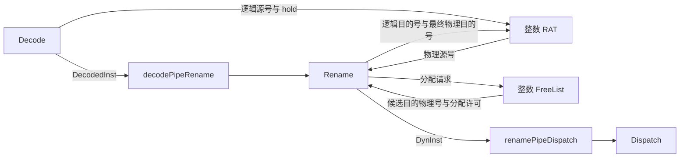
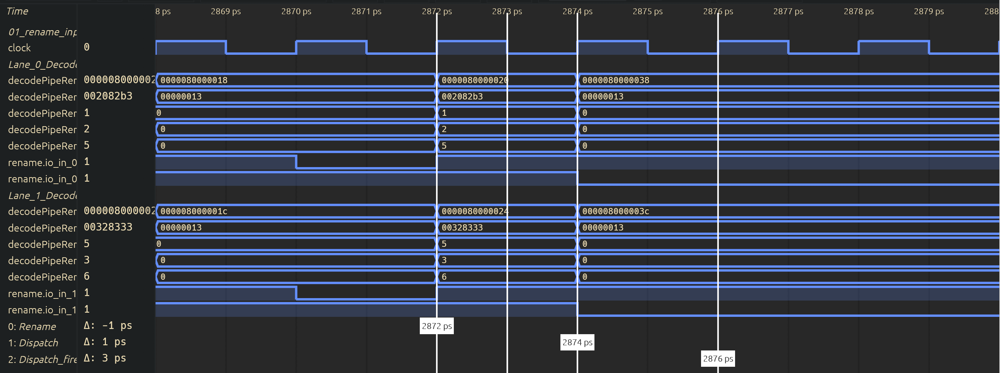
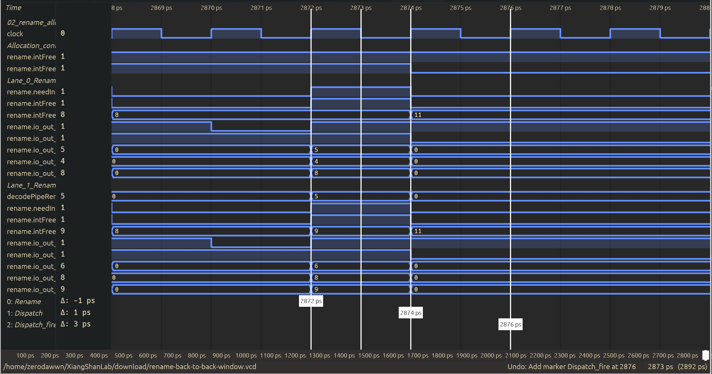
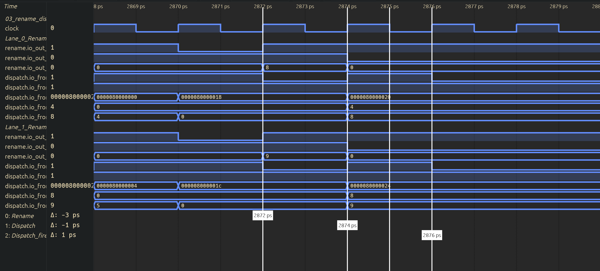

# 3. 寄存器重命名源码与波形分析

> **版本基线**：本文源码与运行波形对应昆明湖 V2，XiangShan commit `fe2288cb09361b65afa26be3f403520c4b496dbf`。下文源码路径均相对于该版本的 `src/main/scala/xiangshan/`，行号也以此版本为准。

寄存器重命名把指令中的逻辑寄存器号转换为物理寄存器号。对一条普通整数 `add`，它要回答三个问题：两个源寄存器当前对应哪些物理寄存器，结果应该写入哪个新物理寄存器，以及后续指令如何找到这个新结果。

本文以实际波形中的 `add x5, x1, x2` 为主线，再用紧随其后的 `add x6, x5, x3` 解释同周期依赖。重点是 Rename、整数映射表和 FreeList 之间的数据流，不展开快照恢复、复杂回收算法和测试工具的操作流程。

## 3.1 源码定位

`backend/rename/Rename.scala:40` 定义了 `class Rename`。它的输入是 `DecodedInst`，输出是补充了物理寄存器号等信息的 `DynInst`：

```scala
// Rename.scala:55, 80
val in = Vec(RenameWidth, Flipped(DecoupledIO(new DecodedInst)))
val out = Vec(RenameWidth, DecoupledIO(new DynInst))
```

`backend/CtrlBlock.scala:90–95` 实例化了 Decode、Rename、RAT wrapper 和 Dispatch。其中，**RAT wrapper 与 Rename 是同级模块，整数 FreeList 则位于 Rename 内部**。

```scala
val dispatch = Module(new NewDispatch)
// ...
val decode = Module(new DecodeStage)
val fusionDecoder = Module(new FusionDecoder)
val rat = Module(new RenameTableWrapper)
val rename = Module(new Rename)
```

沿着指令和寄存器号的流向，可以把连接关系画成：



上游连接位于 `CtrlBlock.scala:576–583`：`decode.io.out(i)` 经过 `PipelineConnect` 形成 `decodePipeRename(i)`，再接入 `rename.io.in(i)`。其中 `valid` 还会受到融合清除信号 `fusionDecoder.io.clear(i)` 的控制，不能只看流水寄存器中残留的指令字段就认定该指令有效。

下游连接位于 `CtrlBlock.scala:694–704`：`rename.io.out` 接到 `renameOut`，随后经名为 `renamePipeDispatch` 的流水连接送到 `dispatch.io.fromRename`。因此，重命名输出的物理寄存器号会随指令进入 Dispatch，供后续调度与执行使用。

每个 `i` 表示一个重命名通道，下文称为 lane。同一批指令按程序顺序排列，较小的 lane 编号对应较早的指令。

## 3.2 关键字段

`backend/Bundles.scala:78` 定义 `DecodedInst`，第 178 行定义 `DynInst`。本例需要关注以下字段：

| 字段 | 含义 | 定义或赋值位置 |
| --- | --- | --- |
| `lsrc(k)` | 第 k 个源的逻辑寄存器号；是否按寄存器解释、属于哪类寄存器，由 `srcType(k)` 决定。 | `DecodedInst`，`Bundles.scala:94–96`。 |
| `ldest` | 逻辑目的寄存器号；是否写整数寄存器需结合 `rfWen` 判断。 | 输入 `DecodedInst` 的第 96 行、输出 `DynInst` 的第 196 行。 |
| `psrc(k)` | 第 k 个源的物理寄存器号，初值来自 RAT，最终值可能被同周期旁路覆盖。 | `DynInst`，`Bundles.scala:227`；`Rename.scala:391–395, 569–583`。 |
| `pdest` | 指令结果所绑定的物理目的寄存器号；普通整数 add 使用整数 FreeList 分配的号。 | `DynInst`，`Bundles.scala:228`；`Rename.scala:409–415, 539, 584`。 |
| `srcType(k)`、`rfWen` | 分别描述源类型和整数目的写使能，参与 RAT 选择、分配请求和依赖判断。 | `Bundles.scala:94, 99`；`Rename.scala:126–127, 323, 555–563`。 |

对于 `add x5, x1, x2`，译码已给出 `lsrc(0)=1`、`lsrc(1)=2`、`ldest=5`，前两个源是整数寄存器源，且 `rfWen=1`。Rename 不需要重新从机器码中提取这三个寄存器号。

这里 `lsrc(0)` 的下标 0 表示**第一个源操作数**，并不是逻辑寄存器 x0。同样，`psrc(0)=4` 表示第一个源绑定 p4，并不是已经读出了数值 4。**重命名阶段处理的是寄存器编号和依赖关系，不是加法操作数的数据。**


## 3.3 整数 RAT：查询源映射，记录新目的映射

### 3.3.1 映射表保存信息

`backend/rename/RenameTable.scala:49` 定义通用的 `RenameTable`，`RenameTableWrapper` 在第 231 行实例化整数表：

```scala
val intRat = Module(new RenameTable(Reg_I))
```

表项的索引是逻辑寄存器号，内容是物理寄存器号。例如 `spec_table(5)=8` 表示当前投机执行路径上的 x5 对应 p8，并不表示 x5 的数据值是 8。

第 97–109 行定义了两套状态：

| 表 | 保存的信息 | 本例中的作用 |
| --- | --- | --- |
| `spec_table` | 包含尚未提交指令更新的投机映射。 | 后续指令的源寄存器查询使用它。 |
| `arch_table` | 已提交指令对应的体系结构映射。 | 在提交时更新，也是恢复逻辑使用的状态之一。 |

本版本整数表的复位初值全部为 p0，并非 xN 默认对应 pN。运行中的映射必须结合此前的重命名历史确定。

### 3.3.2 由逻辑源号获得物理源号

查询从 Decode 阶段开始。`backend/decode/DecodeStage.scala:266–268` 将两个逻辑源号送到整数 RAT 读口，并在 Decode 输出不能前进时保持读地址：

```scala
io.intRat(i)(0).addr := io.out(i).bits.lsrc(0)
io.intRat(i)(1).addr := io.out(i).bits.lsrc(1)
io.intRat(i).foreach(_.hold := !io.out(i).ready)
```

`CtrlBlock.scala:507` 将这些端口接到 `rat.io.intReadPorts`；`RenameTable.scala:255` 再将 wrapper 读口接到 `intRat.io.readPorts`。表内的关键查询逻辑是：

```scala
// RenameTable.scala:120–121
val t1_raddr = io.readPorts.map(p => RegEnable(p.addr, !p.hold))
val t1_rdata_use_t1_raddr = VecInit(t1_raddr.map(spec_table(_)))
```

也就是说，读地址被寄存后，用它索引投机映射表。由于表的写入也经过寄存器，读结果还要考虑尚未落入表项的新映射。第 143–148 行比较读写地址，生成 `t0_bypass/t1_bypass`，在命中时转发写数据：

```scala
val bypass_data = ParallelPriorityMux(t1_bypass.reverse, t1_wSpec.map(_.data).reverse)
r.data := Mux(t1_bypass.asUInt.orR, bypass_data, t1_rdata_use_t1_raddr(i))
```

这是 **RAT 内部的读写旁路**，用于保证读端口不会因表项延迟更新而返回过期映射。`CtrlBlock.scala:668` 将最终读数据交给 Rename：

```scala
rename.io.intReadPorts := VecInit(rat.io.intReadPorts.map(x => VecInit(x.map(_.data))))
```

Rename 根据源类型选取对应寄存器类别的查询结果。以下为第一个源的赋值，第二个源在下一行采用相同方式：

```scala
// Rename.scala:391
uops(i).psrc(0) := Mux1H(uops(i).srcType(0)(2, 0),
  Seq(io.intReadPorts(i)(0), io.fpReadPorts(i)(0), io.vecReadPorts(i)(0)))
```

对于普通整数 add，这里选中 `io.intReadPorts`。此时得到的是 `uops(i).psrc` 的初值；同周期较早 lane 对相同逻辑寄存器的写入，还需要第 3.6 节的旁路逻辑修正。

### 3.3.3 更新目的映射

假设 `add x5, x1, x2` 分配到 p8，就必须让后续指令看到 `x5→p8`。Rename 使用逻辑目的号作为地址，使用**最终输出的目的物理号**作为写数据：

```scala
// Rename.scala:639–641
io.intRenamePorts(i).wen  := intSpecWen(i)
io.intRenamePorts(i).addr := uops(i).ldest(log2Ceil(IntLogicRegs) - 1, 0)
io.intRenamePorts(i).data := io.out(i).bits.pdest
```

写使能并不是仅由 `rfWen` 决定。第 453 行还要求分配能够执行，并排除 walk 和 redirect：

```scala
intSpecWen(i) := needIntDest(i) && intFreeList.io.canAllocate &&
  intFreeList.io.doAllocate && !io.rabCommits.isWalk && !io.redirect.valid
```

更新路径为：

```text
Rename.io.intRenamePorts
  -> CtrlBlock 中 rat.io.intRenamePorts             (CtrlBlock.scala:651)
  -> intRat.io.specWritePorts                      (RenameTable.scala:273–278)
  -> t1_wSpec                                     (RenameTable.scala:122)
  -> spec_table_next -> spec_table                 (RenameTable.scala:130–141)
```

在正常重命名路径中，`t1_wSpec` 寄存写请求，随后按地址匹配修改 `spec_table_next`，再更新表寄存器。**提出更新请求与表项实际更新之间存在时序间隔**，上述 RAT 读写旁路正是为此服务。同一批多个写口更新相同逻辑号时，`matchVec.reverse` 的优先选择使较后指令的映射生效。

这次更新的是投机映射；指令提交后，wrapper 才通过 `archWritePorts` 更新提交映射（`RenameTable.scala:259–264, 151–154`）。不能把重命名时写 RAT 理解成指令已经执行完毕或已经提交。

## 3.4 空闲寄存器管理Freelist

RAT 回答“逻辑寄存器现在映射到哪里”，FreeList 回答“哪些物理寄存器可以分配给新结果”。`Rename.scala:107` 在 Rename 内实例化整数 FreeList：

```scala
val intFreeList = Module(new MEFreeList(IntPhyRegs))
```

它的接口定义在 `backend/rename/freelist/BaseFreeList.scala:28–43`。只看分配路径，需要认识四个信号：

| 接口 | 相对于 FreeList 的方向 | 含义与连接 |
| --- | --- | --- |
| `allocateReq(i)` | 输入 | lane i 是否需要新的整数物理寄存器，由 Rename 给出。 |
| `allocatePhyReg(i)` | 输出 | 为 lane i 选出的候选物理寄存器号，供 Rename 形成 `pdest`。 |
| `canAllocate` | 输出 | 当前空闲资源是否满足分配条件，参与 Rename 的前进控制。 |
| `doAllocate` | 输入 | Rename 是否允许本批分配执行；正常路径考虑其他 FreeList 的许可和下游接收能力。 |

### 3.4.1 从目的写使能产生请求

`needDestReg(Reg_I, ...)` 返回 `rfWen`（`Rename.scala:126–127`），请求逻辑位于第 323、340 行：

```scala
needIntDest(i) := io.in(i).valid && needDestReg(Reg_I, io.in(i).bits)
intFreeList.io.allocateReq(i) := needIntDest(i) && !isMove(i)
```

本例 add 输入有效、写整数目的且不属于 move 消除，因此需要分配。这里区分了“写逻辑目的”和“申请新物理号”：被消除的 move 可以复用源物理号，不走普通 add 的新号分配路径。

### 3.4.2 从候选号形成 `pdest`

`backend/rename/freelist/MEFreeList.scala:42–45` 按前面 lane 的请求数选择候选号：

```scala
val phyRegCandidates = VecInit(headPtrOHVec.map(sel => Mux1H(sel, freeList)))
for (i <- 0 until RenameWidth) {
  io.allocatePhyReg(i) := phyRegCandidates(PopCount(io.allocateReq.take(i)))
}
```

若 lane 0 和 lane 1 都申请，lane 0 取第 0 个候选，lane 1 取第 1 个候选；前面不申请的 lane 不占候选位置。物理编号来自空闲表内容，不要求数值连续，本例实际返回的是 8 和 9。

`Rename.scala:409–415` 的 `MuxCase` 根据目的寄存器类别选择 `uops(i).pdest`，其中整数分支为：

```scala
needIntDest(i) -> intFreeList.io.allocatePhyReg(i)
```

随后，第 539、584 行在普通分配结果与 move 复用结果之间选择。普通 add 的 `isMove=false`，因此最终 `io.out(i).bits.pdest` 就是该 FreeList 候选号。这个最终目的号同时用于输出指令、RAT 更新以及同周期后序指令的依赖旁路。

### 3.4.3 消耗空闲寄存器

候选号出现在端口上，并不意味着分配已经发生。`Rename.scala:159` 在正常路径中用其他 FreeList 的 `canAllocate` 和 `dispatchCanAcc` 产生整数 FreeList 的 `doAllocate`；`dispatchCanAcc` 来自 `io.out.head.ready`。

`MEFreeList.scala:34–36, 56–63` 进一步用 `canAllocate && doAllocate && !redirect` 控制正常重命名时的队首推进，推进数量取本批有效分配请求数。因此，下游阻塞时即便还能看到候选号，也不能认定又消耗了一批物理寄存器。本文只追踪这个分配接口，不展开提交后的回收算法。

## 3.5 波形追踪

本节使用 `rename-back-to-back-window.vcd`，沿着“Decode→Rename 输入、Rename 分配与旁路、Dispatch 接收”三个观察点追踪下面两条指令。数值已通过本地 `wavepeek` 查询 VCD 核对，图 3.5-1 至图 3.5-3 展示对应的实际波形。

| Lane | PC | 机器码 | 指令 |
| --- | --- | --- | --- |
| 0 | `0x80000020` | `0x002082b3` | `add x5, x1, x2` |
| 1 | `0x80000024` | `0x00328333` | `add x6, x5, x3` |

VCD 的时间单位为 **1 ps**，`TOP.clock` 的周期为 **2 ps**。以下将 `[2872, 2874) ps` 称为 cycle 1436，`[2874, 2876) ps` 称为 cycle 1437；这是按本文件时间除以时钟周期得到的局部编号。截图统一显示 **2868–2880 ps**，以便对比相邻周期。为避开上升沿同一时间戳内的更新，前两张图的游标位于 **2873 ps**，第三张位于 **2875 ps**。

波形中模块的共同前缀为：

```text
TOP.SimTop.cpu.l_soc.core_with_l2.core.backend.inner_ctrlBlock
```

下文信号名均省略这个前缀；时钟单独使用 `TOP.clock`。PC 和机器码按十六进制显示，逻辑与物理寄存器编号按无符号十进制显示。

### 3.5.1 在输入端确认两条指令

先观察 `decodePipeRenameModule` 和 `decodePipeRenameModule_1`，它们分别对应 lane 0、lane 1 的 Decode→Rename 流水寄存器。将各自的 `io_out_bits_pc`、`io_out_bits_instr` 与上表对应，再读取逻辑寄存器字段。输入连接见 `CtrlBlock.scala:576`，字段定义见 `Bundles.scala:78`，行号以本文开头注明的版本基线为准。

| 2873 ps 的信号 | Lane 0 | Lane 1 |
| --- | --- | --- |
| `decodePipeRenameModule[_1].io_out_bits_pc` | `0x80000020` | `0x80000024` |
| `decodePipeRenameModule[_1].io_out_bits_instr` | `0x002082b3` | `0x00328333` |
| `decodePipeRenameModule[_1].io_out_bits_lsrc_0` | 1（x1） | 5（x5） |
| `decodePipeRenameModule[_1].io_out_bits_lsrc_1` | 2（x2） | 3（x3） |
| `decodePipeRenameModule[_1].io_out_bits_ldest` | 5（x5） | 6（x6） |
| `rename.io_in_0/1_valid` | 1 | 1 |
| `rename.io_in_0/1_ready` | 1 | 1 |

表中 `[_1]` 表示 lane 0 使用无后缀模块名、lane 1 使用 `_1` 后缀；`0/1` 表示对应 lane 的信号，并非波形中的字面名称。



图 3.5-1：Decode→Rename 输入。游标位于 2873 ps，两路输入均满足 `valid=ready=1`，且 `lane 0.ldest = lane 1.lsrc(0) = 5`。每个 lane 组内从上到下依次为 PC、机器码、`lsrc_0`、`lsrc_1`、`ldest`、Rename 输入的 `valid`、`ready`。

2872 ps 上升沿后，目标 PC 和机器码出现在输入端，并在这一周期保持有效。此时两路 `valid && ready = 1`，表示输入可以在**随后的 2874 ps 上升沿**推进。仅看到 PC 或机器码不足以认定指令有效，必须同时检查 Rename 输入的 `valid`。

### 3.5.2 对照分配请求与重命名结果

保持游标在 2873 ps，接着观察 `rename` 及其内部 `intFreeList`：

| 2873 ps 的信号 | Lane 0 | Lane 1 |
| --- | --- | --- |
| `rename.needIntDest_0/1` | 1 | 1 |
| `rename.intFreeList.io_allocateReq_0/1` | 1 | 1 |
| `rename.intFreeList.io_allocatePhyReg_0/1` | 8（p8） | 9（p9） |
| `rename.io_out_0/1_valid` | 1 | 1 |
| `rename.io_out_0/1_ready` | 1 | 1 |
| `rename.io_out_0/1_bits_ldest` | 5（x5） | 6（x6） |
| `rename.io_out_0/1_bits_psrc_0` | 4（p4） | 8（p8） |
| `rename.io_out_0/1_bits_pdest` | 8（p8） | 9（p9） |

两路共享的 `rename.intFreeList.io_canAllocate=1`、`io_doAllocate=1`。请求来自 `Rename.scala:323` 的整数目的需求与第 340 行的非 move 条件；候选号来自 `MEFreeList.scala:42` 按前序请求数量选择的空闲表项。普通 add 将候选号作为最终 `pdest`，相关选择见 `Rename.scala:409`。



图 3.5-2：FreeList 分配与同周期源旁路。游标位于 2873 ps，共享控制组从上到下为 `canAllocate`、`doAllocate`，均为 1。lane 0 组内依次为 `needIntDest`、`allocateReq`、`allocatePhyReg`、输出 `valid`、`ready`、`ldest`、`psrc_0`、`pdest`；lane 1 组在相同顺序之前增加了输入 `lsrc_0`。图中 `lane 0.allocatePhyReg = lane 0.pdest = lane 1.psrc_0 = 8`，lane 1 的目的号为 9。

对第一条 `add x5, x1, x2`，波形直接给出的变化是：

```text
逻辑输入：lsrc(0)=x1，lsrc(1)=x2，ldest=x5
物理输出：psrc(0)=p4，pdest=p8
分配接口：needIntDest=1，allocateReq=1，allocatePhyReg=p8
```

第一个物理源来自整数 RAT 查询，lane 0 的选择逻辑见 `Rename.scala:391` 和第 424 行。p4 是源寄存器**编号**，这里没有读出加法操作数的数据。

对第二条 `add x6, x5, x3`，输入 `lsrc(0)=5` 与 lane 0 的 `ldest=5` 相同，输出恰好满足 `lane 1.psrc(0) = lane 0.pdest = 8`。这与 `Rename.scala:569` 的同周期旁路选择一致：把前序指令的新目的物理号绑定为后序指令的源。第 3.6 节继续解释匹配条件与优先级。当前 VCD 未记录 `bypassCond`，因此图中展示的是输入依赖和最终输出的对应关系，旁路内部选择由源码解释。

候选号出现在端口上不等于已经分配；本周期还要结合请求、分配许可和输出握手，才能判断推进。当前 VCD 仅保留 lane 0/1 的请求，不能据此认定整批只分配了两个寄存器，也不能用后续候选号的变化反推未记录 lane 的具体行为。

### 3.5.3 在 Dispatch 确认同一批结果

把游标移到 **2875 ps**。目标指令已经经过 2874 ps 上升沿，进入 `dispatch.io_fromRename`。连接关系见 `CtrlBlock.scala:694`：

```scala
val renameOut = Wire(chiselTypeOf(rename.io.out))
renameOut <> rename.io.out
// ...
PipeGroupConnect(renameOut, dispatch.io.fromRename, s1_s3_redirect.valid,
  dispatch.io.toRenameAllFire, "renamePipeDispatch")
```

| 2875 ps 的信号 | Lane 0 | Lane 1 |
| --- | --- | --- |
| `dispatch.io_fromRename_0/1_valid` | 1 | 1 |
| `dispatch.io_fromRename_0/1_ready` | 1 | 1 |
| `dispatch.io_fromRename_0/1_bits_pc` | `0x80000020` | `0x80000024` |
| `dispatch.io_fromRename_0/1_bits_psrc_0` | 4（p4） | 8（p8） |
| `dispatch.io_fromRename_0/1_bits_pdest` | 8（p8） | 9（p9） |



图 3.5-3：Rename 结果进入 Dispatch。游标位于 2875 ps，每个 lane 组内从上到下依次为 Rename 输出的 `valid`、`ready`、`pdest`，以及 Dispatch 输入的 `valid`、`ready`、PC、`psrc_0`、`pdest`。2874 ps 边沿后，目标 PC 和物理寄存器号在 Dispatch 出现；2876 ps 边沿后，其 `valid` 拉低，数据字段仍可保持原值。

三个时间段可以对应为：

| 时间区间 | Rename 中的内容 | Dispatch 中的内容 | 对目标两条 add 的含义 |
| --- | --- | --- | --- |
| `[2872, 2874) ps` | 目标两条 add；输入、输出握手均为 1 | lane 0/1 的 `valid=0`，字段仍是此前的内容 | 本周期完成重命名组合计算，在 2874 ps 边沿送入下一流水寄存器。 |
| `[2874, 2876) ps` | 输入已换成 PC `0x80000038/3c`；`ready=0` | 目标两条 add，`valid=ready=1`，物理号与前一周期 Rename 一致 | 目标指令已到达 Dispatch 输入，在 2876 ps 边沿握手。 |
| `2876 ps` 边沿后 | 仍是后一批指令 | lane 0/1 的 `valid=0`，目标 PC 和物理号仍可残留 | 不应把残留字段当作目标指令仍然有效。 |

因此，2874 ps 后 Rename 的 `ready=0` 对应**后一批指令**；目标两条 add 在 Rename 的有效周期内没有 `valid && !ready` 停顿。这个窗口只证明目标指令完成了 Rename 并推进到 Dispatch 输入，不据此推断后续发射、执行、写回或提交。

### 3.5.4 对照源码说明映射更新的边界

第一条 add 的重命名结果还会用于提出 `x5→p8` 的投机映射写请求。对应的源码见 `Rename.scala:639`：

```scala
io.intRenamePorts(i).wen  := intSpecWen(i)
io.intRenamePorts(i).addr := uops(i).ldest(log2Ceil(IntLogicRegs) - 1, 0)
io.intRenamePorts(i).data := io.out(i).bits.pdest
```

写使能还受正常分配、walk、redirect 等条件控制（`Rename.scala:453`），表项更新则经过 RAT 的寄存路径（`RenameTable.scala:122`）。这些逻辑解释了重命名结果如何供后续批次查询。

**当前 VCD 没有记录第二个物理源、RAT 读写端口、`spec_table`、walk/redirect 或 `bypassCond`。** 因此，截图只能直接证明已列出的逻辑号、p4/p8/p9、分配接口及流水握手；RAT 写请求和表项更新是源码解释，不能给第二个物理源编造编号，也不能指定 `spec_table(5)` 实际更新的周期。源号查询、目的号分配和同周期旁路在 Rename 的组合逻辑中协同完成，上述观察步骤不代表多个串行时钟阶段。

## 3.6 同周期依赖：第二条 add 为什么读 p8？

现在加入同周期 lane 1 的 `add x6, x5, x3`。它读取 x5，而 lane 0 的 `add x5, x1, x2` 正在为 x5 建立新映射。两条指令的 RAT 查询是在 Decode 阶段准备的，lane 1 不能等待 lane 0 的新映射实际写入表项后再读表，否则就无法在同周期完成重命名。

Rename 的解决办法是：**直接比较同批前序指令的逻辑目的号和后序指令的逻辑源号，命中后将前序指令的最终 `pdest` 转发为后序指令的 `psrc`。**

### 3.6.1 判断是否依赖前序 lane

`Rename.scala:542–566` 构造 `bypassCond`。对后序 lane `i` 的每个源，只检查 `io.in.take(i)`，即本批中比它更早的指令。核心判断为：

```scala
// Rename.scala:561–564
val indexMatch = in.bits.ldest === t
val writeMatch = cond3 && needIntDest(j) || cond2 && needFpDest(j) || cond1 && needVecDest(j)
val v0vlMatch = condV0 && needV0Dest(j) || condVl && needVlDest(j)
indexMatch && writeMatch || v0vlMatch
```

这里 `t` 是当前源的逻辑号，`cond3` 表示当前源为整数寄存器源，`j` 是被检查的前序 lane。对本例，判断可以收敛为：

```text
lane 1 的第一个源是整数源
且 lane 0 输入有效、写整数目的（needIntDest(0)=1）
且 lane 0.ldest == lane 1.lsrc(0)，即 5 == 5
=> bypassCond(0)(0) 命中
```

类型和写使能检查不可省略：逻辑号相同，但寄存器类别不同，或者前序指令并不写该目的，都不应建立这条整数依赖。

### 3.6.2 选择前序指令的新目的号

`Rename.scala:569–571` 给出第一个源的最终选择：

```scala
io.out(i).bits.psrc(0) := Mux(io.out(i).bits.isLUI, 0.U,
  io.out.take(i).map(_.bits.pdest).zip(bypassCond(0)(i-1).asBools)
    .foldLeft(uops(i).psrc(0)) {
      (z, next) => Mux(next._2, next._1, z)
    })
```

`foldLeft` 以 RAT 给出的 `uops(i).psrc(0)` 为默认值，依次检查更早的 lane。命中时，选择该 lane 的**最终输出 `pdest`**；不命中则保留已有选择。如果多条前序指令都写同一逻辑寄存器，后检查的 lane 覆盖先前选择，因此最终取程序顺序上最近的一次写入。第二个源等其他源也有对应选择逻辑（第 572–583 行）。

对 lane 1，唯一的前序 lane 0 命中，于是默认 RAT 读值被 lane 0 的 `pdest=8` 覆盖。lane 1 同时从 FreeList 获得自己的目的号 p9，用于写 x6：

```text
lane 0: ldest=x5 -> allocatePhyReg=p8 -> 最终 pdest=p8
                                               |
                                               v
lane 1: lsrc(0)=x5 -> 逻辑号与类型匹配 -> 最终 psrc(0)=p8
        ldest=x6  -> allocatePhyReg=p9 -> 最终 pdest=p9
```

波形中 `lane 1.psrc(0) == lane 0.pdest == 8`，与上述选择规则一致。当前窗口没有记录 `bypassCond` 内部位，命中条件由已观测的逻辑号、目的需求和源码推导。

需要区分两个旁路：`RenameTable.scala` 中的 RAT 读写旁路解决**表项延迟更新时，查询如何得到新映射**；`Rename.scala` 中的 lane 间旁路解决**同一批指令尚在重命名时，后序源如何绑定前序新目的**。本例 lane 0 到 lane 1 的 p8 转发属于后者。

最后，旁路的是物理寄存器**编号**。第二条 add 绑定 p8，只是建立了对第一条结果的真实依赖；p8 中的数据是否已经就绪，仍由后续调度、执行与唤醒逻辑处理。
