# 一条 CSR 写指令的执行过程

　　本章分析一条 CSR 写指令 `csrw mtvec, t0` 从取指到提交的完整过程。与乘法、加法这些"算出结果写回物理寄存器"的指令相比，它走的是同一条前端/后端流水线，但在几个关键节点上完全不同：**它不分配目的物理寄存器**，**它不写寄存器堆**，**它在执行单元里就把架构 CSR 改掉了**。

　　这里的关键不是"CSR 指令有多慢"，而是：**一条 CSR 写指令靠串行化保证自己执行时，任何可能被它影响、或者可能影响它的指令都不在流水线里。正因为有这层保证，硬件才敢不等到提交，就在执行阶段直接改写 mtvec。**

　　测试程序在写完之后还紧跟了一条 `csrr t1, mtvec` 回读和一条 `bne` 自检。这两条指令恰好构成对照：**同样是 CSR 指令，写必须串行化，读却允许乱序**。第四节会专门看这段。

　程序：

```c
#define MT_VEC_VAL 0x80001234UL

int main(const char *args) {
    (void)args;
    asm volatile(
        "li    t0, 0x80001234\n"
        "csrw  mtvec, t0\n"
        "csrr  t1, mtvec\n"
        "li    t2, 0x80001234\n"
        "bne   t1,t2,  1f\n"
        "j     2f\n"
        "1:    j 1b\n"
        "2:    j 2b\n"
    );
    return 0;
}
```

## 一、测试程序与观察目标


### （1）反汇编


　　`li` 是伪指令，在不同取值下展开不同。`0x80001234` 的最高位是 1，标准的 `lui+addi` 两指令写法会出错（原因见下），因此 GCC 把它展开成四条：

```asm
8000012c: 000802b7    lui     t0,0x80
80000130: 2285        addiw   t0,t0,1          # 2 字节压缩编码
80000132: 02b2        slli    t0,t0,0xc        # 2 字节压缩编码
80000134: 23428293    addi    t0,t0,564        # t0 = 0x80001234
80000138: 30529073    csrw    mtvec,t0         # = csrrw x0,mtvec,t0，<-本文跟踪的指令
8000013c: 30502373    csrr    t1,mtvec         # = csrrs t1,mtvec,x0，读回校验
80000140: 000803b7    lui     t2,0x80
80000144: 2385        addiw   t2,t2,1
80000146: 03b2        slli    t2,t2,0xc
80000148: 23438393    addi    t2,t2,564        # t2 = 0x80001234
8000014c: 00731363    bne     t1,t2,0x80000152
80000150: a011        j       0x80000154
80000152: a001   1:   j       1b               # 不等：停在这里（校验失败）
80000154: a001   2:   j       2b               # 相等：停在这里（校验通过）
```

### （2）为什么 `li` 要展开成四条

　　`0x80001234` 的第 31 位是 1。如果照搬 32 位的写法：

```asm
lui  t0, 0x80001      # t0 = 0xFFFF_FFFF_8000_1000  ← 注意高 32 位被符号扩展了
addi t0, t0, 0x234    # t0 = 0xFFFF_FFFF_8000_1234  ✗
```

　　`lui` 会把立即数的第 31 位符号扩展到 63:32，写进 `mtvec` 的就变成了一个"高位全 1"的值，回读校验必然失败。

　　正确的构造方式是先造一个高位为 0 的数，再左移：

| 指令 | t0 的值 |
|---|---|
| `lui t0,0x80` | `0x0000_0000_0008_0000` |
| `addiw t0,t0,1` | `0x0000_0000_0008_0001` |
| `slli t0,t0,0xc` | `0x0000_0000_8000_1000` |
| `addi t0,t0,564` | `0x0000_0000_8000_1234` ✓ |

　　这里 `slli 12` 把 `0x80001` 变成 `0x8000_1000`，正好绕开了符号扩展。**这一点在波形上也要核对**：`csrw` 执行时 `wdata` 必须是 `0x0000_0000_8000_1234`，高 32 位全 0。如果看到 `0xFFFF_FFFF_8000_1234`，说明 `li` 的展开方式不对。

### （3）被分析的指令

　　`csrw mtvec, t0` 是伪指令，机器编码对应 `csrrw x0, mtvec, t0`，**编码 `0x30529073`**：

| 字段 | 位域 | 值 | 含义 |
|---|---|---|---|
| `csr` | `[31:20]` | `0x305` | mtvec |
| `rs1` | `[19:15]` | `0b00101` = x5 | t0，要写入的值 |
| `funct3` | `[14:12]` | `0b001` | CSRRW |
| `rd` | `[11:7]` | `0b00000` = x0 | 不回读旧值，纯写 |
| `opcode` | `[6:0]` | `0b1110011` | SYSTEM |

　　拼起来：`0x305 << 20 | 5 << 15 | 1 << 12 | 0 << 7 | 0x73 = 0x30529073`。


　　**要观察的是三件事**：这条指令在译码阶段被译成什么（`FuType`、`FuOpType`、源操作数、目的寄存器）；它在重命名阶段有没有分配物理寄存器；以及它怎样"独占流水线"地走到执行单元，并在执行单元里把 `mtvec` 改掉。

## 二、`csrw mtvec, t0` 的执行过程

　　这条指令从译码到提交一共经过七个阶段。前四个阶段决定它怎样走到执行单元，后三个阶段决定它凭什么在那里改写状态。下面按这七段依次看。

| 阶段 | 这一阶段做的事 | 对 `csrw mtvec, t0` 的结果 |
|---|---|---|
| 译码 | 查译码表、打包立即数 | `fuType=csr`、`fuOpType=wrt`、`imm=0x05305`；`rfWen` 被 `ldest=0` 清零 |
| 重命名 | 读 RAT、决定是否申请物理寄存器 | 不申请 `pdest`、不写 RAT；`waitForward`/`blockBackward` 保持 1 |
| 分发 | 等 ROB 排空、选择 IQ | 被 `blockedByWaitForward` 卡住，放行后发往 BJU3 |
| IQ | 等源操作数、发射 | 源早已就绪，入队后下一拍发射 |
| 执行 | 算读写使能、改写 CSR | `wen=1, ren=0`，`mtvec` 写成 `0x80001234` |
| 回写 | 产生写回事件 | 不写寄存器堆，但 ROB 的 `uopNum` 减到 0 |
| 提交 | ROB 队头提交 | 改动被追认为架构状态，`hasBlockBackward` 清零 |

### （1）译码

　　首先拉出译码阶段的波形。

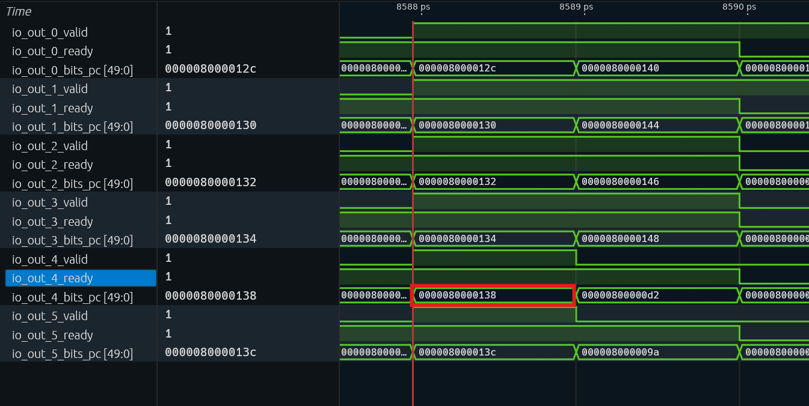

　　找到 PC 为 `0x80000138` 的指令：它位于下标 `i=4` 的通道（`io_out_4_*`），波形游标 8588 处该通道的 `pc` 正好是 `0x80000138`。把这一拍该通道的译码字段拉出来：

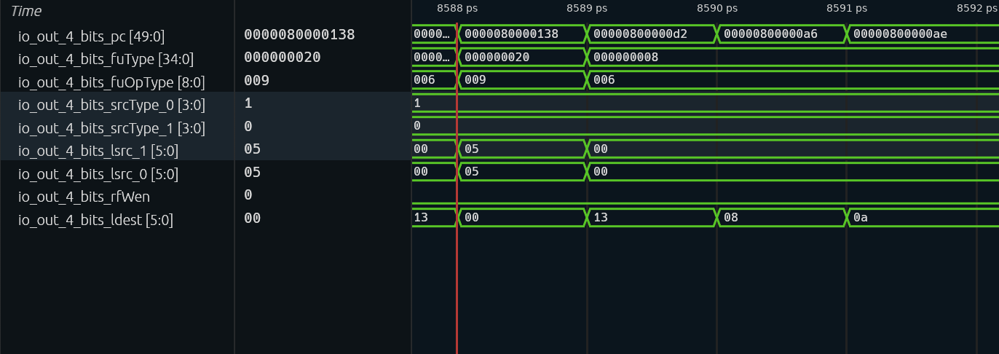
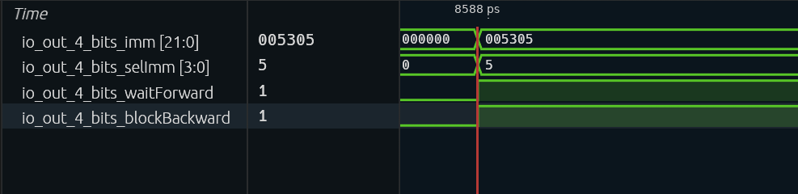

| 信号 | 波形实测（i=4，8588 拍） | 期望值 | 说明 |
|---|---|---|---|
| `pc` | `0x80000138` | `0x80000138` | 确认通道里就是本文跟踪的 `csrw` |
| `fuType` | `0x20` | `FuType.csr` | one-hot，bit5（从 0 数起）；交给 CSR 执行单元 |
| `fuOpType` | `0x9` | `CSROpType.wrt` | `b001_001`，CSRRW → 写 |
| `srcType(0)` | `1` | `reg` | 源 0 读整数寄存器 |
| `srcType(1)` | `0` | `imm` | 源 1 是立即数，不读寄存器 |
| `lsrc(0)` | `5` | `5`（t0） | 唯一的真实源操作数 |
| `lsrc(1)` | `5` | 不使用 | `[24:20]` 是 CSR 地址的低 5 位，不是 rs2 |
| `ldest` | `0` | `0` | `rd=x0` |
| `rfWen` | `0` | `0` | **译码表写的是 1，被 `ldest=0` 门掉了** |
| `imm` | `0x05305` | `0x05305` | 打包后的 `Imm_Z` |
| `selImm` | `5` | `IMM_Z` | 选择 `Imm_Z` 打包器 |
| `waitForward` | `1` | `1` | 默认串行化标记 |
| `blockBackward` | `1` | `1` | 默认串行化标记 |

　　同一拍该通道的 `instr` 是 `0x30529073`。把表中的字段连起来读，就是一句话：**读 x5（t0），不写任何整数寄存器，给 CSR 单元做一次 CSRRW 写。**

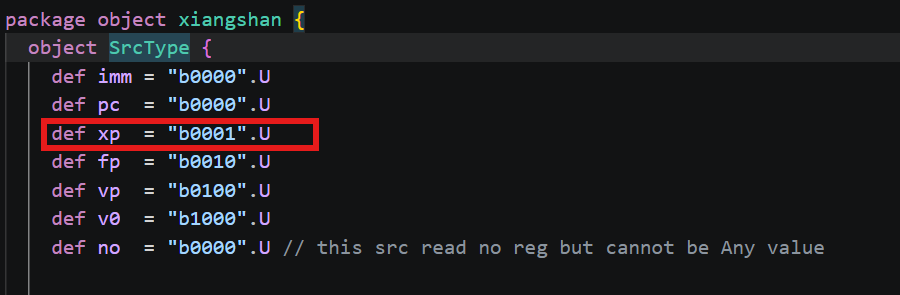

　　先看源操作数。`srcType(0)=1`（`reg`）说明源 0 要读整数寄存器，`lsrc(0)=5` 就是 x5/t0；它的值是前面 `addi t0,t0,564` 算出来的 `0x80001234`（译码阶段只给出逻辑号 5，真正的值要到重命名后从物理寄存器里读）。`srcType(1)=0`（`imm`）说明源 1 不是寄存器，而是立即数，来自 `imm` 字段。因此译码结果里**真正需要读寄存器的源只有 x5 一个**。

　　波形里 `lsrc(1)` 也显示 5，容易误以为读了第二个寄存器。其实译码器只是把指令的 RS1、RS2 字段分别抄进 `lsrc(0)`、`lsrc(1)`；CSR 指令的 `[24:20]` 并不是 rs2，而是 12 位 CSR 地址的一部分——`0x305` 的低 5 位正好是 `0b00101`，所以 `lsrc(1)` 也读出 5。因为 `srcType(1)=imm`，重命名阶段不会拿 `lsrc(1)` 去查 RAT，这个 5 不会变成第二个源寄存器。再看目的寄存器和运算。`ldest=0` 对应 `rd=x0`，`rfWen` 因此在译码输出口被清成 0：这条指令不写任何整数寄存器。

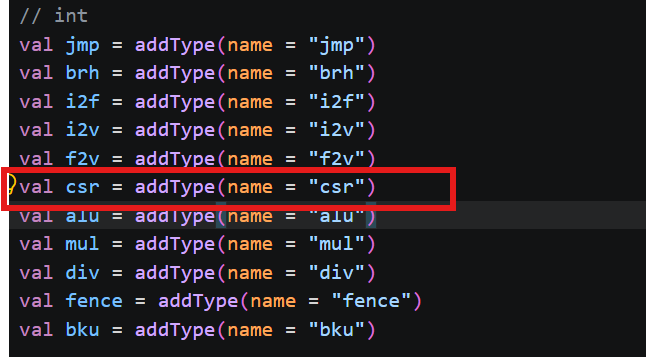

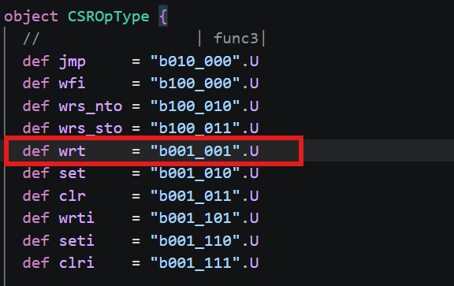

　`fuType=0x20`（one-hot 的 bit5）选中 CSR 执行单元，`fuOpType=0x9`（`b001_001`）是 `CSROpType.wrt`。所以它在执行阶段做的不是 ALU 加减，而是一次 CSR 读改写：CSR 单元从 `imm` 里拆出 `addr=0x305`，把 `src1`（t0 的值 `0x80001234`）作为写数据，`wen=1` 写进 mtvec；旧值虽然会被读出来，但 `rd=x0` 把它丢掉了。

　　译码表里 CSRRW 这一项把三个源位置定成“寄存器、立即数、不用”：第一个源按整数寄存器读，第二个源按立即数处理，第三个源不参与；执行单元选 CSR，操作码是 `wrt`，立即数格式选 `IMM_Z`。这一项还带了 `noSpec` 和 `blockBack` 两个标记，分别对应 `DynInst.waitForward` 和 `blockBackward`（字段顺序见 `Bundles.scala:132-133`），也就是前面表格里那两个串行化标记的来源。它同时还把写使能 `xWen` 置为真。

　　这个 `xWen` 只表示“这条指令在语义上要不要写整数寄存器”：`csrrw` 在 `rd≠x0` 时确实要把旧值回读到 `rd`。但本例 `rd=x0`，译码单元在 `DecodeUnit.scala:1152` 处又把表项给出的写使能和一个“目的寄存器不为 0”的条件相与，真正送给后端的 `rfWen` 于是变成 0。这一步决定了后面的所有行为：重命名不分配物理寄存器、不写 RAT，分发不为它占用 BusyTable（`NewDispatch.scala:240` 的 `allocPregsValid` 直接取 `rfWen`），执行单元的输出也不写寄存器堆。波形里如果看到表项给出的写使能为 1、而输出口 `rfWen` 为 0，并不是矛盾，而是这个相与的结果。

　　另一个细节是 `imm`。CSR 指令把 `rd`、`rs1`、`csr` 三样东西一起塞进 22 位的 `Imm_Z` 立即数域：高 5 位放 `rd`，中间 5 位放 `rs1`，低 12 位放 CSR 地址。本例 `rd=0`、`rs1=5`、`csr=0x305`，拼出来是 `0x05305`。执行单元后面就是靠它反解出地址和数据来源的。

　　`csrw` 是 4 字节指令（CSRRW 没有压缩形式），它前面三条里有两条被压缩成 2 字节，所以这一拍 IBuffer 送出的是一串"4/2/2/4"混合宽度的指令，`csrw` 落在 `0x80000138` 这个 4 字节对齐的地址上。

### （2）重命名

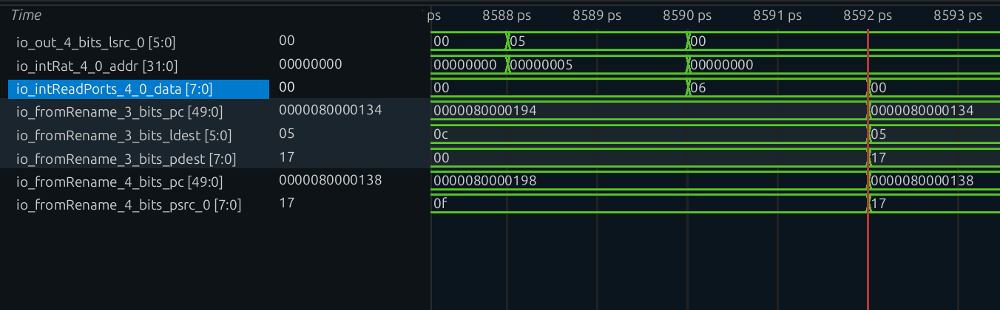

　　译码阶段就已经开始读 RAT：译码级直接把本通道的 `lsrc(0)` 接到整型重命名表的读地址上，也就是拿逻辑号 `x5` 去查表。波形上 8588 拍 `lsrc(0)` 和 `intRat` 的读地址同时为 `5`，下一拍 RAT 读口返回 `io_intReadPorts_4_0_data=0x06`——这是 `x5` 在这次重命名之前的映射。

　　但最终写进 uop 的 `psrc(0)` 不是 `0x06`，而是 `0x17`。原因是产生 `x5` 的 `addi t0,t0,564`（`0x80000134`）就在同一个重命名组的下标 3 通道里，这一拍它刚分配到 `pdest=0x17`。重命名的同组旁路逻辑逐条比较更老通道的 `ldest` 与本通道的 `lsrc`，发现 lane 3 写 `x5`，就把它的 `pdest` 旁路给 lane 4。波形上 8592 拍 lane 3 的 `pdest` 与 lane 4 的 `psrc(0)` 同时变成 `0x17`，就是这次旁路的结果。换句话说，**`csrw` 读到的物理寄存器确实是前面那条 `addi` 分到的那个，只是本例里它由同组旁路给出，而不是从 RAT 读口直接读回**。

| 信号 | 波形实测 | 说明 |
|---|---|---|
| `lsrc(0)`（8588 拍） | `5` | 逻辑源 `x5` |
| `intRat` 读地址（8588 拍） | `5` | 译码级直连 RAT 的读地址 |
| RAT 读数据（8590 拍） | `0x06` | `x5` 在这次重命名前的映射 |
| lane 3 `ldest` / `pdest`（8592 拍） | `5` / `0x17` | 同组更老的 `addi` 写 `x5` |
| lane 4 `psrc(0)`（8592 拍） | `0x17` | 同组旁路拿到 `addi` 的新物理寄存器 |

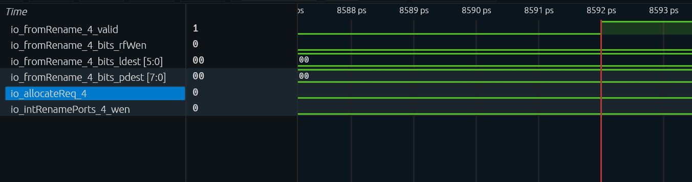

　　接下来是这条指令与普通指令最不一样的地方。重命名里那个判断"要不要给一条指令分配目的寄存器"的函数叫 `needDestReg`，它按寄存器类型分支：整型那一支不做任何额外判断，直接返回译码阶段算出来的 `rfWen`；浮点、向量等类型才各有各的附加条件。换句话说，对整型指令而言，译码说"不写"，重命名就认这个结论。

　　`rfWen` 已经在译码阶段被 `ldest=0` 清零，于是 FreeList 的申请条件——"需要整型目的寄存器，且不是省略目的寄存器的 move"——第一个因子就是 0，整个条件为假。

　　于是这条指令既不向 FreeList 申请物理寄存器，也不生成 `pdest`，`intRat` 的写口自然没有它的份额；ROB 表项的 `realDestSize` 也因此少计一项。

| 信号（i=4，8592 拍） | 波形实测 | 说明 |
|---|---|---|
| `rfWen` | `0` | 译码阶段已被 `ldest=0` 门掉 |
| `ldest` | `0` | `rd=x0` |
| `pdest` | `0` | 没有申请，也就没有分配 |
| `intFreeList.io.allocateReq(4)` | `0` | FreeList 申请条件不成立 |
| `io_intRenamePorts_4_wen` | `0` | RAT 写使能为假 |

　　再看串行化标记。 只对"纯 CSR 读"放宽，判断分两步。先认"这是不是一条 CSR 指令"（`isCsr`）：opcode 是 SYSTEM，同时 `funct3` 的低两位不全是 0——后半个条件把 `ecall`、`ebreak`、`mret` 那几种 `funct3=000` 的系统指令排除在外。再认"这是不是纯 CSR 读"（`isCsrr`）：在 `isCsr` 的基础上，`funct3` 形如 `?1?`（即 CSRRS/CSRRC 那一类，第 1 位必须是 1），并且 `rs1=0`——源操作数不是 `x0` 的 CSRRS/CSRRC 会在读的同时写 CSR，不算纯读。接着给 uop 赋 `waitForward` 和 `blockBackward` 两个标记时，各与"不是放松名单里的 csrr"相与：命中名单的把标记摘掉，其余的原样保留。

　　`csrrw` 的 `funct3=001`，第 1 位是 0，`isCsrr` 不成立。因此**即便是 `rd=x0`、不写寄存器的 `csrw`，`waitForward` 和 `blockBackward` 也原封不动保留为 1**。这是本文后面一切结论的根基。

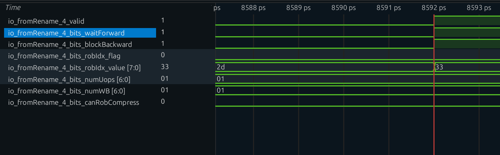

　　同一拍里，`robIdx` 正常分配，这条指令独占一个 ROB 表项，`numUops=1`、`numWB=1`。ROB 压缩没有发生：压缩要求相邻指令能合并进同一个表项，而 `csrw` 之后的指令要等它提交才进得来，根本凑不到一起。快照也没有生成，快照只在 CFI 上做，`csrw` 不是控制流指令。

| 信号（i=4，8592 拍） | 波形实测 | 说明 |
|---|---|---|
| `waitForward` | `1` | `csrrw` 不在 `isCsrr` 放宽名单里 |
| `blockBackward` | `1` | `csrrw` 不在 `isCsrr` 放宽名单里 |
| `robIdx_flag` / `robIdx_value` | `0` / `0x33` | 分配到 ROB 表项 `0x33` |
| `numUops` / `numWB` | `1` / `1` | 单 uop、产生一次写回事件 |
| `canRobCompress` | `0` | 不与相邻指令压缩进同一表项 |

### （3）分发阶段

　　进入 Dispatch 后这条指令会被卡住。分发器给同一拍进来的每个槽位各算一个 `blockedByWaitForward`。第 0 个槽位的条件最直白：ROB 里还有指令（`!io.enqRob.isEmpty`）、且本槽位的 uop 带 `waitForward`，两个条件同时成立就被挡住。往后每个槽位在这个基础上再递推一层：要么前一个槽位已经被挡住（整组必须按序走），要么“ROB 非空，或者前面同组还有有效 uop”且自己也带 `waitForward`。后一项里“前面还有有效 uop”这一半，是为了让同一组内的顺序也成立——即使 ROB 恰好空了，只要前面还有 uop 没走，带 `waitForward` 的年轻指令也不能先走。

　　另一个判据 `notBlockedByPrevious` 方向相反，它管的是“前面的指令允不允许自己越过”。分发器先为每个槽位算出 `nextCanOut`：本槽位要么无效、要么不是 `blockBackward` 指令；然后第 i 槽的 `notBlockedByPrevious` 取它前面所有槽位 `nextCanOut` 的与。前面只要有一条有效的 `blockBackward` 指令，这个与就为 0。两个判据一个看“自己要不要等”，一个看“前面让不让过”，再与上 ROB 的入队许可，才是这一拍真正能不能派发。

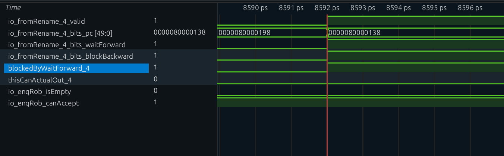

　　光标停在 8592 拍，`io_fromRename_4_valid=1`、`pc=0x80000138`、`waitForward` 与 `blockBackward` 同时为 1；上方 `blockedByWaitForward_4` 为 1，所以 `thisCanActualOut_4` 为 0。同一拍 `io_enqRob_isEmpty=0`、`io_enqRob_canAccept=1`——挡住它的不是 ROB 空间，而是“ROB 里还有老指令”。

　　两个标记作用的对象不同：

| 标记 | 作用对象 | 效果 |
|---|---|---|
| `waitForward=1` → `blockedByWaitForward` | **本条指令自己** | ROB 非空时不派发，必须等更老指令全部提交、ROB 排空才放行 |
| `blockBackward=1` | **它后面的指令** | 年轻指令不许越过它派发 |

　　所以波形上会看到一段明显的等待：`csrw` 停在 rename/dispatch 之间，`enqRob.isEmpty` 一直为 0，直到前面 `lui/c.addiw/c.slli/addi` 四条陆续提交、ROB 排空，`blockedByWaitForward` 才落下。

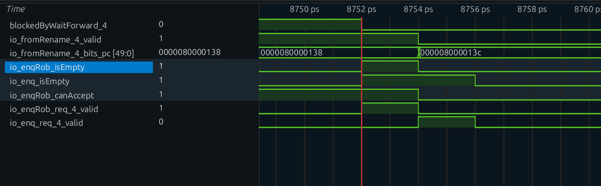

　　8752 拍 `blockedByWaitForward_4` 落下、`thisCanActualOut_4` 拉起，`io_enqRob_isEmpty` 从 0 变 1；8754 拍 `io_fromRename_4_valid` 归零、`pc` 换成 `0x8000013c`，同时 `io_enq_req_4_valid` 才出现。两个 `isEmpty` 错开一拍：分发口侧的 `io_enqRob_isEmpty` 8752 拍为 1、8754 拍又因在途请求变回 0，ROB 内部的 `io_enq_isEmpty` 则到 8756 拍才见 0。

　　ROB 排空后，`csrw` 成为 ROB 里**唯一**的指令。ROB 在接收入队请求时会检查请求里的 `blockBackward` 标记：只要有一条带这个标记的指令成功入队，就把内部的 `hasBlockBackward` 寄存器置起。这个寄存器随后被并进 ROB 的入队许可，于是 `io.enq.canAccept` 一直为假，后面的 `csrr t1, mtvec`、`li t2`、`bne` 一条都进不来。这就是“独占窗口”：它不是靠某条指令执行到某个阶段才打开，而是从 `csrw` 进入 ROB 的那一刻就关上，直到它离开 ROB 才松开。

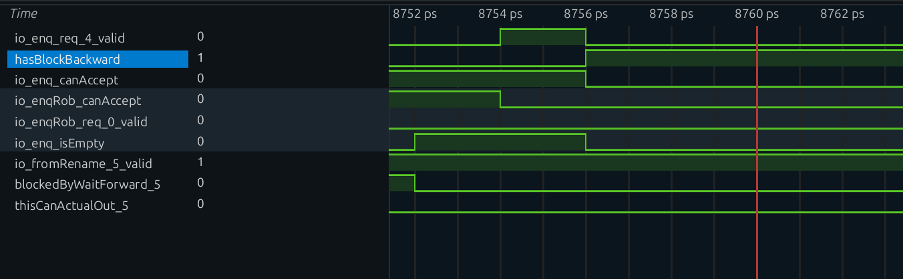

　　`io_enq_req_4_valid` 是 8754–8756 的窄脉冲；8756 拍 `hasBlockBackward` 拉起，`io_enq_canAccept` 从 1 落 0（分发口的 `io_enqRob_canAccept` 早一拍、8754 拍就已经落下）。整个窗口内 `fromRename_5_valid=1` 而 `thisCanActualOut_5=0`，`csrr` 一直停在 5 号槽；直到 8770 拍 `thisCanActualOut_5` 才拉起，8772 拍 `io_enq_req_0_valid` 出现——窗口关闭后后续指令恢复入 ROB。

　　接下来看它被派发到哪个 IQ。CSR 执行单元在配置上位于第 4 个 IssueBlock 的 BJU3。这个执行单元的配置把三个功能单元挂在一起：`CsrCfg`、`FenceCfg`、`DivCfg`，写回口是 `IntWB(port = 4, 1)`。换句话说，CSR 并没有独立的调度队列，而是和 Fence、Div 共用 BJU3 这一路发射与写回资源。

　　`CsrCfg` 在整个后端只此一份，“只有这一个 IQ 能发 `CsrCfg`”这条约束把选择端口唯一确定了——波形上该路 `issueBlockReq` 只会对整数第 3 个 IssueBlock（BJU3）有效。这也解释了后面看 IQ 波形时，队列名里为什么同时出现 `Alu`、`Csr`、`Fence`、`Div`：它们本来就属于同一个 IssueBlock。

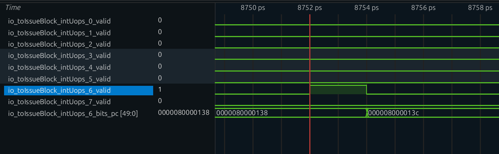

　　8 路 `intUops_*_valid` 里只有 `intUops_6_valid` 在 8752 拍为 1，其余全为 0；它的 `pc` 在 8752 拍是 `0x80000138`，8754 拍换成 `0x8000013c`（`csrr`）。`csrw` 走的就是第 4 个 IssueBlock 的 6 号入队口，7 号口在这一拍是空的。

### （4）IQ 内部

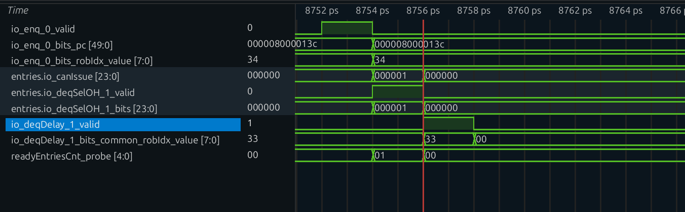

　　`io_enq_0_valid` 在 8752 拍为 1、`pc=0x80000138`；到 8754 拍表项才“可发射”——`entries.io_canIssue=0x000001`、`deqSelOH_1_valid=1`、`deqSelOH_1_bits=0x000001` 同时出现，`readyEntriesCnt_probe` 也从 0 变 1。再下一拍（8756）`io_deqDelay_1_valid=1`、`robIdx=0x33`，而 8754 拍那三个表项信号已经归零。8752、8754、8756 三拍正好对应“入队—选中—进发射寄存器”。

　　`csrw` 的源操作数 `x5` 在很久以前就被 `addi` 写好了，BusyTable 对应位早已清零，所以进 IQ 时 `srcState` 全是 ready，不需要等唤醒。

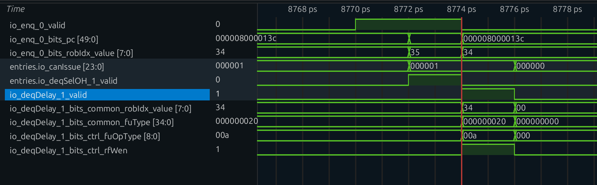

　　`io_enq_0_valid` 从 8770 连续高到 8774，`pc` 在 8772 拍从 `0x8000013c` 切到 `0x80000140`、`robIdx` 从 `0x34` 切到 `0x35`——同一个入队口背靠背收了 `csrr` 和 `lui`。8772 拍 `entries.io_canIssue=0x000001`、`deqSelOH_1_valid=1`；8774 拍 `io_deqDelay_1_valid=1`，其 `fuOpType=0x00a`（`set`）、`rfWen=1`，与 `csrw` 的 `wrt`/`rfWen=0` 形成对照。

　　它通常是**入队后下一拍就发射**，原因有三条：源操作数早已就绪；CSR 执行单元不流水（`piped=false`），一次只吃一条；再加上前面的串行化，此时 IQ 里基本只有它一条有效指令，不存在需要仲裁的竞争者。

　　这份 `FuConfig` 里还有几个字段值得说明。`fuType` 是 `FuType.csr`，决定它只能进挂有 `CsrCfg` 的那条队列；`piped=false` 表示执行单元内部没有流水线，同一时刻只受理一条指令，后来的请求必须等前一条离开；`writeIntRf=true` 只说明这条执行通道“具备”写整型寄存器堆的能力，某条指令到底写不写仍由它自己的 `rfWen` 决定；`flushPipe=true` 表示遇到重定向时执行流水线要被冲刷；`latency` 给的则是 `UncertainLatency()`。

　　`UncertainLatency()` 在这里不代表要等多久——普通 `csrw mtvec` 不走 AIA 异步路径，执行单元内部的 `s_idle → s_finish` 一拍完成。它只是告诉唤醒逻辑“这条指令的完成时间不固定，别按固定拍数去猜”，避免后续指令按错误的延迟被提前唤醒。

### （5）执行

　　CSR 执行单元由两层组成：`wrapper.CSR` 负责接口适配和读写使能，`NewCSR` 负责真正的 CSR 逻辑。这一节只回答两个问题：地址和数据从哪里来，写又凭什么发生在提交之前。

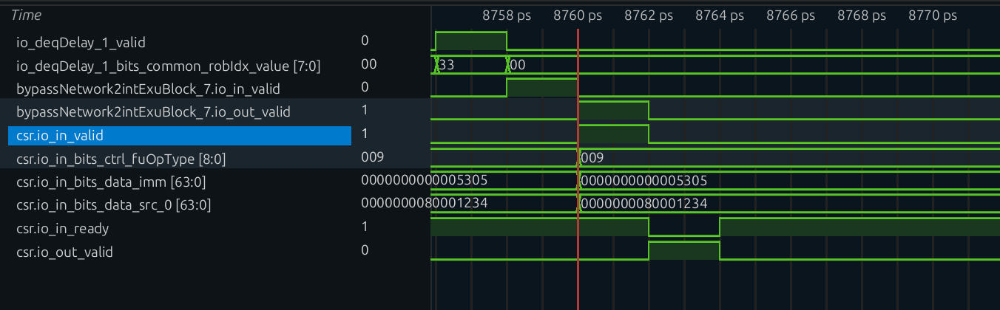

　　`io_deqDelay_1_valid` 在 8756 拍为 1；8758 拍它进入 `bypassNetwork2intExuBlock_7.io_in`，8760 拍 `io_out_valid` 与 `csr.io_in_valid` 同时为 1——这是执行单元真正接收请求的拍。此时 `csr.io_in_bits_data_imm=0x5305`、`src_0=0x80001234`、`fuOpType=0x009`（`wrt`），`csr.io_in_ready` 也为 1；8762 拍 `csr.io_out_valid` 拉起，请求完成。

　　**第一层：wrapper 算地址与使能**。译码送来的 `imm` 是一个 22 位的 `Imm_Z` 立即数，wrapper 把它拆成三段：低 12 位是 CSR 地址，接着 5 位是源寄存器号 `rs1`，高 5 位是目的寄存器号 `rd`。对本例，拆出来就是地址 `0x305`、`rs1=5`、`rd=0`。

　　写数据由操作码 `func` 查一张树状选择表得到：`wrt`（CSRRW）直接取源操作数原值；`set`（CSRRS）取 CSR 当前值与源操作数的或；`clr`（CSRRC）取 CSR 当前值与源操作数取反后的与；带 `i` 后缀的 `wrti`/`seti`/`clri` 则把源操作数换成立即数，运算方式相同。本例是 `wrt`，所以写进去的就是 `t0` 里的 `0x80001234`。

　　两个使能各由几个条件或起来。写使能 `csrWen` 要求指令有效，并且满足“是 CSRRW（无条件写）”或“是 CSRRS/CSRRC 且 `rs1≠0`（源操作数不是 `x0` 才真的有东西要写）”。读使能 `csrRen` 要求指令有效，并且满足“是 CSRRW 且 `rd≠0`（有目的寄存器才需要回读旧值）”或“是 CSRRS/CSRRC（这两类无论 `rd` 如何都要读）”。本例 `func=wrt`、`rd=0`，于是写使能为 1、读使能为 0——只改不读，连旧值都不必取出来。

　　对本例：

| 信号 | 值 | 原因 |
|---|---|---|
| `wen` | **1** | CSRRW 无条件写 |
| `ren` | **0** | `rd=x0`，不需要回读 |
| `addr` | **`0x305`** | mtvec |
| `wdata` | **`0x0000_0000_8000_1234`** | 来自 `src(0)`，即 t0 |

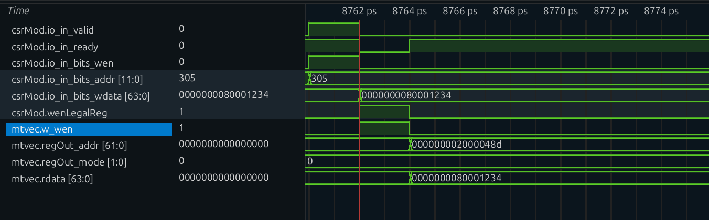

　　`csrMod.io_in_valid` 在 8760 拍为 1，`wen=1`、`addr=0x305`；但 `csrMod.io_in_bits_wdata` 到 8762 拍才变成 `0x80001234`，与 `wenLegalReg` 拉起、`mtvec.w_wen` 为 1 是同一拍。8764 拍 `mtvec.regOut_addr=0x2000048d`、`rdata=0x80001234`，`mode` 保持 0。只看 8760 拍时 `wdata` 仍是 0，这正是前面说的“写数据晚一拍”。

　　**第二层：NewCSR 真正改写 mtvec**。关键是写入发生在什么时候。`NewCSR` 先从权限检查模块拿到 `wenLegal`，它回答“这次写是否合法”；再用 `GatedValidRegNext` 把它打一拍，得到 `wenLegalReg`。随后代码遍历整张 `csrRwMap`——机器级、监督级、虚拟化各级 CSR 的读写描述表——给每个 CSR 模块的写口接上“`wenLegalReg` 为真且地址命中自己”这个条件，写数据口则统一接 `wdata`。对 `mtvec` 来说，命中的就是地址 `0x305` 那一路。

　　`GatedValidRegNext` 作用在单个 `Bool` 上就是 `RegNext`，所以 `wenLegalReg` 是 `wenLegal` 的下一拍：**CSR 寄存器在请求被接收后的下一拍就被写入，与状态机进入 `s_finish` 同一拍，而不是等到提交**。对 `mtvec` 这个 `CSRModule` 而言，`addr === 0x305` 那一路 `wBundle.wen` 拉高，`addr[63:2]`（BASE）与 `mode[1:0]`（MODE，WARL，本例 `00` 为 Direct）被更新为 `0x80001234`。

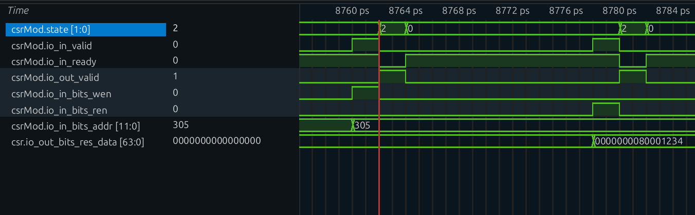

　　`csrMod.state` 在空闲态与 `s_finish`（编码 2）之间切换。8760 拍 `io_in_valid=1`、`ready=1`，8762 拍进入 `s_finish` 并拉高 `io_out_valid`，8764 拍 `ready` 恢复；8778 拍第二条 `csrr` 到来时 `io_in_bits_ren=1`、`addr=0x305`，8780 拍再次进入 `s_finish`，`csr.io_out_bits_res_data=0x80001234`。同一条状态机、同一条数据通路，`wen` 与 `ren` 分时出现。

　　辨认这一拍的方法是：`Mtvec` 模块内部寄存器（或 `mtvec.regOut`）从复位值跳到 `0x80001234` 的时刻，**早于** ROB 表项提交的时刻。

　　`wenLegal` 由 `CSRPermitModule` 给出"这次写是否合法"，非法写（权限不足、写只读 CSR）根本不会产生 `wenLegalReg`——"报异常就不改状态"这层保护与串行化相互独立。

　　执行单元的状态机只有 `s_idle`、`s_waitIMSIC`、`s_finish` 三个状态。输入口的 `ready` 只在 `s_idle` 时拉高，所以同一时刻只接一条 CSR 指令；输出口的 `valid` 则在状态机进入 `s_finish`（或 AIA 异步路径就绪）、且当前没有被重定向冲刷时成立。普通 CSR 访问不会进入 `s_waitIMSIC`——那是 AIA 异步路径，`csrw mtvec` 与它无关。

　　请求被接收的下一拍进入 `s_finish`，与上一段说的寄存器写入同一拍；`redirectFlush` 只影响输出，不影响已经发生的寄存器写入。这从侧面说明：CSR 写的正确性不是靠"提交时才生效"来保证的，而是靠前面那层串行化。

### （6）回写

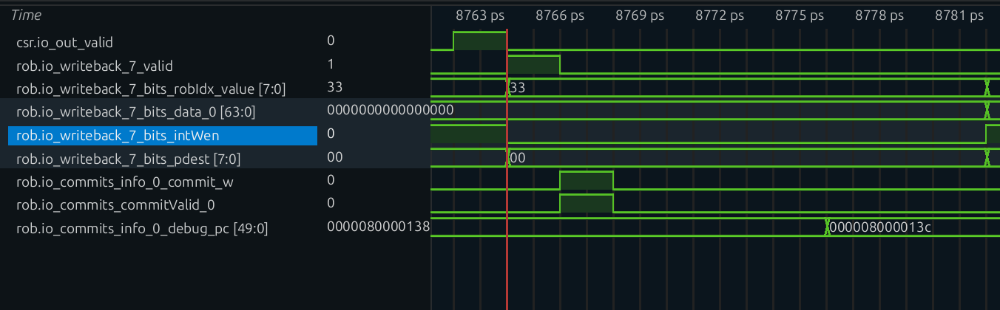

　　`csr.io_out_valid` 在 8762 拍为 1，`rob.io_writeback_7_valid` 到 8764 拍才为 1、`robIdx=0x33`——中间那一级就是 CtrlBlock 的寄存。这一拍 `data_0=0`、`intWen=0`、`pdest=0`，三个“空”信号说明它不写寄存器堆；但 `rob.io_commits_info_0_commit_w` 与 `commitValid_0` 在 8766 拍拉起，证明这次写回事件被 ROB 记了账。

　　写回接口走 `IntWB(port = 4, 1)`，即 BJU3 那个写回端口。这一拍有两条线，方向不同。一条不发往寄存器堆：`rfWen=0`，物理寄存器堆不会被写，输出口上的 `res.data` 是 `csrRen=0` 情况下的读数据，被直接丢弃。另一条发往 ROB：完成事件照常产生，因为 ROB 的记账并不看 `rfWen`。

　　ROB 表项入队时 `numWB` 记的是“这条指令会产生几次写回事件”，由 `instrSizes - 被消掉的 move 数` 决定，与 `rfWen` 无关；单 uop 的 `csrw` 这个值就是 1。另一个入队时就算好的字段是“需不需要 std 写回”：ROB 会逐个检查入队请求，判据只有一条——功能单元类型是不是 store。

　　只有 store 才需要"std 写回"，`csrw` 不是 store，所以它的 `stdWritebacked` 在入队时就置真，剩下 `uopNum` 靠 BJU3 这一路 `exuWriteback` 减到 0。因此**即使不写寄存器堆，这条指令依然必须产生一次写回事件，否则它在 ROB 里永远做不完**。

　　写回之后该表项 `uopNum=0`、`stdWritebacked=1`，`isWritebacked` 成立，可以提交。

### （7）提交

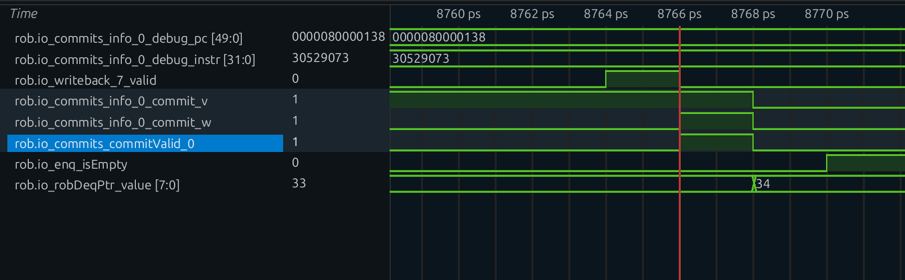

　　`debug_pc=0x80000138`、`debug_instr=0x30529073`，正是 `csrw`；`commit_v` 从 8758 拍起就为 1，而 `commit_w` 与 `commitValid_0` 到 8766 拍才为 1——写回（8764）之后一拍才满足提交条件，8768 拍一起归零。

　　`csrw` 是 ROB 里唯一的指令，也是队头，下一拍就提交：

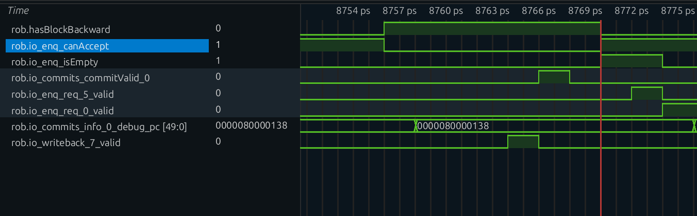

　　8770 拍 `rob.hasBlockBackward` 从 1 落 0、`io_enq_canAccept` 回到 1、`io_enq_isEmpty=1`；8772 拍 `io_enq_req_5_valid=1`（`csrr` 到达 ROB），8774 拍 `io_enq_req_0_valid` 也拉起，后续指令恢复。`robDeqPtr_value` 在 8768 拍已从 `0x33` 变成 `0x34`，比 ROB 变空早两拍——指针在提交那一拍就推进了。

　　提交这一拍有两件事值得看。`mtvec` 的值不会因为提交再变一次——它早就写好了，提交只是把这层改动"追认"为架构状态，本例中没有什么能让它回滚。随后 ROB 变空，`hasBlockBackward` 随之清零，后面的 `csrr t1, mtvec` 等指令这才开始被接纳。

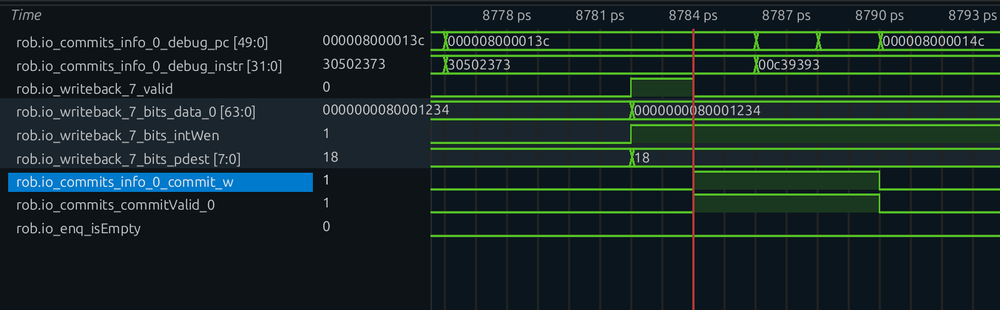

　　`rob.io_writeback_7_valid` 在 8782 拍为 1，`data_0=0x80001234`、`intWen=1`、`pdest=0x18`，这次是 `csrr` 的写回；8784 拍 `commit_w`、`commitValid_0` 为 1，`debug_pc=0x8000013c`、`debug_instr=0x30502373`。`csrr` 的写回与提交走的是同一套信号，只是数据与目的寄存器不再为 0。

　　可以在波形上验证：`hasBlockBackward` 从拉高到落下的这段时间，恰好等于"`csrw` 在 ROB 中独处"的时间。

## 三、串行化：为什么 CSR 可以在执行期就改写架构状态

　　前面看到的现象可以收成一个问题：物理寄存器写错了还有第二份映射可以顶上，`mtvec` 写错了没有，为什么硬件还敢在执行期就改？答案不在 CSR 单元内部，而在它进入执行单元之前的三道关卡。

　　普通指令"结果先写物理寄存器、提交时才成为架构状态"之所以成立，是因为物理寄存器本身是投机资源：错了换个映射，值不重要。**但 `mtvec` 不是投机资源**——它是全局唯一的、被 trap 硬件直接读取的架构寄存器，没有第二份可以回滚。所以 CSR 写必须换一种保证方式。

　　香山用三根支柱：

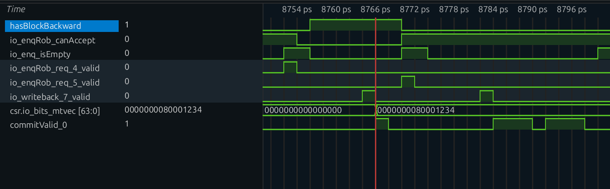

　　**第一根：派发前 ROB 必须排空（`waitForward`）。**
　　`blockedByWaitForward` 保证 `csrw` 派发时所有更老的指令都已提交完毕。也就是说 `csrw` 执行时它自己就是最老的指令，不存在"更老的指令还没提交、却已经被它的写操作影响到"的可能。

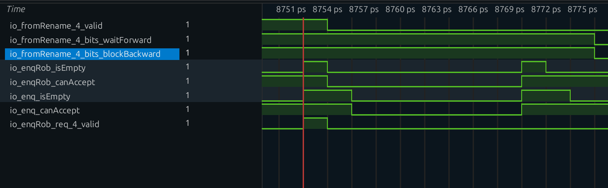

　　**第二根：年轻指令不许进来（`blockBackward`）。**
　　`hasBlockBackward` 让 `io.enq.canAccept` 在 ROB 排空之前一直为假。`csrw` 之后的指令连 ROB 都进不去，更不可能被 `mtvec` 的提前修改影响。于是 `csrw` 处于一个"前后都空"的窗口里：老的都走了，新的还没来。

　　**第三根：这个窗口里不会有中断插进来（`hasWaitForward`）。**

　　中断使能由四个条件相与而成：CSR 送来的中断位置位（`intrBitSet` 打一拍后的 `intrBitSetReg`）、ROB 中不存在 `hasWaitForward`、队头表项本身是中断安全的（`interrupt_safe`）、以及那次处理重定向的冲刷状态 `deqHasFlushed` 尚未置位。

　　只要 ROB 里有带 `waitForward` 的指令，第二个条件就把中断挡在门外，中断不允许被取走。所以不会出现"`csrw` 写到一半，中断进来，handler 读了一个半旧的 `mtvec`"。

　　三者合起来，得到这样一个窗口：

| 时间点 | ROB 状态 | `mtvec` | 谁可能受影响 |
|---|---|---|---|
| `csrw` 派发前 | 有更老指令 | 旧值 | 无 |
| `csrw` 执行（写 mtvec） | **只有它自己** | **新值** | 无人（老的全提交完，新的进不来） |
| `csrw` 提交后 | 空 | 新值 | 后续指令按顺序进来，看到的就是新值 |

　　在这样一个窗口里，"执行期写"和"提交期写"对软件完全等价。硬件选前者，是因为 `mtvec` 这类寄存器被 trap 逻辑实时读取，拖到提交反而增加时序耦合。

　　反过来说也成立：**如果哪天有人去掉了 `waitForward`/`blockBackward`，执行期写立刻变成 bug**。这正是 `Rename.scala` 里"只对纯 CSR 读放宽"那段判断的关键——它守的就是这条边界。下一节就看被"放宽"的那类指令。

## 四、读回校验：`csrr t1, mtvec` 为什么仍然排在写之后

　　程序在 `csrw` 之后紧跟一条 `csrr t1, mtvec`，再拿它和 `0x80001234` 比较。

### （1）它是"纯 CSR 读"，两个标记都被摘掉

　　`csrr t1, mtvec` 展开为 `csrrs t1, mtvec, x0`（编码 `0x30502373`）：`funct3=010` 满足 `b?1?`，`rs1=x0`，所以 `isCsrr=1`。再看 `CSROoORead` 的两张例外表，`mtvec` 都不在里面。于是：

| 标记 | `csrw mtvec, t0` | `csrr t1, mtvec` |
|---|---|---|
| `waitForward` | **1**（保留） | **0**（清除） |
| `blockBackward` | **1**（保留） | **0**（清除） |
| 结果 | 完全串行化 | 允许乱序读 |

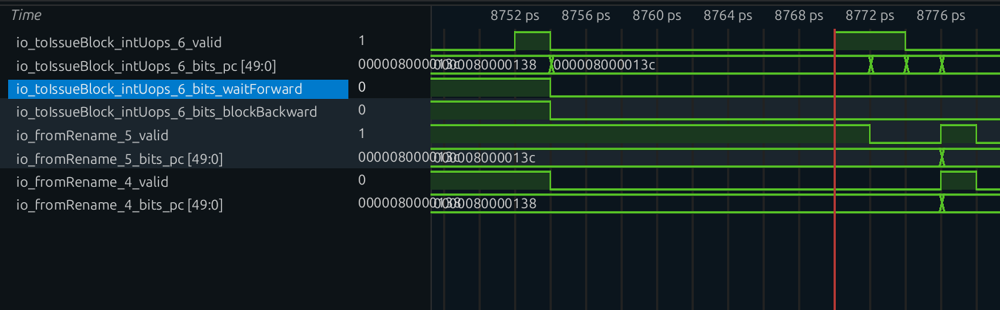

　　在波形上并排看这两条的 `waitForward`/`blockBackward`，对比非常直观——这也是 [`csr-out-of-order-read-write.md`](csr-out-of-order-read-write.md) 那篇里"乱序读 / 顺序读 / 写"三类行为的现场版。

### （2）但它的顺序仍由前一条写指令保证

　　`csrr` 自己能乱序，可它前面那条 `csrw` 的 `blockBackward=1` 还在生效：ROB 没排空之前，`csrr` 连派发都进不去。所以实际时序是

```text
csrw 执行(改 mtvec) → csrw 提交 → ROB 空 → csrr 派发 → csrr 执行(读 mtvec)
```

　　等 `csrr` 真正去读的时候，`mtvec` 早就是新值了。**这不是因为读被特殊保护了，而是因为写把整条流水线清空了。**

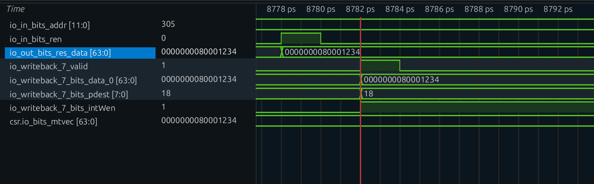

　　反过来想：如果 `csrw` 也像 `csrr` 一样摘掉 `blockBackward`，`csrr` 就可能跑在写之前或写的中间，读到旧值——这正是 CSR 写不能放宽的原因。

### （3）用 PC 判断自检结果

　　`bne t1,t2,1f` 的走向决定了程序最终死在哪：

| 情况 | 走向 | 最终 PC |
|---|---|---|
| `t1 == 0x80001234`（校验通过） | `bne` 不跳 → `j 2f` | 停在 `2:` 的 `j 2b` |
| `t1 != 0x80001234`（校验失败） | `bne` 跳转 | 停在 `1:` 的 `j 1b` |

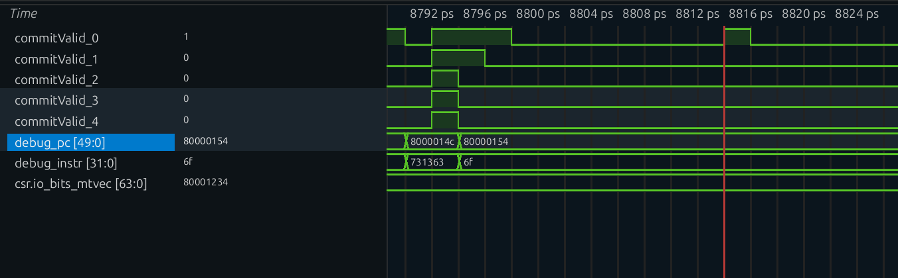

　　在波形末尾看 IFU 一直取的是哪个 PC，就能判断自检有没有通过。也可以直接看 ROB 提交记录里 `bne` 是否 taken。

## 五、把整条链路串起来

| 观察位置 | `csrw mtvec, t0` 在做什么 | 对其他部分的意义 |
|---|---|---|
| 译码 | `fuType=csr`、`fuOpType=wrt`、`imm=0x05305`；`rfWen` 被 `ldest=0` 门掉 | 后端从这一刻起就知道"这条不写寄存器堆" |
| 重命名 | 读 RAT 拿 `x5` 的 `psrc`；不分配 `pdest`、不写 RAT | 少一次物理寄存器分配，FreeList 不动 |
| 重命名 | `isCsrr=0`，`waitForward`/`blockBackward` 保持 1 | 决定它后面的一切都要串行化 |
| 分发 | `blockedByWaitForward` 拉高，停在 ROB 排空前 | 保证执行时它自己最老 |
| 分发 | 发往 BJU3（唯一含 `CsrCfg` 的 IQ）；`hasBlockBackward` 挡住后续入队 | 保证执行时后面没人 |
| IQ | 源已就绪，入队即发射；`piped=false` | CSR 单元一次只处理一条 |
| 执行 | `wen=1, ren=0, addr=0x305, wdata=0x80001234`；`wenLegalReg` 打一拍后**写入 mtvec** | 架构状态在执行期就改变 |
| 回写 | 走 `IntWB(4)`，不写寄存器堆，但产生一次 ROB 写回事件 | `uopNum` 减到 0，指令可提交 |
| 提交 | ROB 队头提交，`hasBlockBackward` 随之清掉 | `csrr t1, mtvec` 等指令开始进入 ROB |
| 后续 | `csrr` 虽允许乱序，但被 `csrw` 的 `blockBackward` 排在后面，读到新值 | `bne` 自检通过，程序停在 `2:` |

　　CSR 写与乘法走的是两条换取并行的路线：乘法靠"**可预测的延迟**"，CSR 写靠"**不可投机的串行窗口**"——前者追求快，后者追求对。两者跑在同一套流水线上，靠的分别是唤醒队列和 `waitForward`/`blockBackward` 这两组控制位。

## 六、源码与延伸阅读

　　本地核对位置以 `/nfs/home/yaoliping/XiangShan`（`kunminghu-v2`，`e7bab53e6`）为准，路径相对于源码根目录 `src/main/scala/xiangshan/`：

| 文件 | 本文用到的位置 |
|---|---|
| `backend/decode/DecodeUnit.scala` | `CSRRW` 译码表项（212 行）、`rfWen` 的 `ldest≠0` 门控（1152 行）、`Imm_Z` 打包与拆包（615–644 行） |
| `backend/decode/DecodeStage.scala` | RAT 读地址生成（263–288 行） |
| `backend/rename/Rename.scala` | `needDestReg`（126–132 行）、`isCsr/isCsrr` 与 `waitForward/blockBackward` 的保留（290–307 行）、FreeList 申请（340 行）、`numWB` 记账（346–366 行） |
| `backend/dispatch/NewDispatch.scala` | `blockedByWaitForward` / `nextCanOut`（795–819 行）、BusyTable 的 `allocPregsValid`（240 行） |
| `backend/rob/Rob.scala` | `hasBlockBackward`/`hasWaitForward`（186–187 行）、入队门控（192、458–460 行）、`isEmpty` 清零（395–397 行）、中断使能（575 行）、写回记账（1009–1059 行） |
| `backend/rob/RobBundles.scala` | `isWritebacked`（99 行）、`commit_w`（173 行） |
| `backend/fu/FuConfig.scala` | `CsrCfg`（299–311 行） |
| `backend/fu/wrapper/CSR.scala` | `Imm_Z` 拆包、`wdata`、`csrWen`/`csrRen`（50–52、74–91 行） |
| `backend/fu/NewCSR/NewCSR.scala` | `wenLegalReg` 与 CSR 寄存器写入（322、329、466–479 行）、状态机（1039–1106 行） |
| `backend/fu/NewCSR/MachineLevel.scala` | `Mtvec` 模块与 `mode` 的 WARL 处理（122–136 行） |
| `backend/fu/NewCSR/CSROoORead.scala` | 乱序读例外清单（10–55 行，`csrr` 为什么能摘掉标记） |
| `Parameters.scala` | BJU3 执行单元配置（413 行） |

　　延伸阅读方面，第四节的理论版见 [CSR 乱序读写场景分析](csr-out-of-order-read-write.md)，那篇把三类 CSR 访问（乱序读 / 顺序读 / 写）完整对照了一遍；同目录 `csr_lifecycle_analysis .md` 是同一指令的另一种组织方式，偏"信号与配置清单"；`csr_format.md` 则负责 CSR 指令编码与地址映射的速查。
