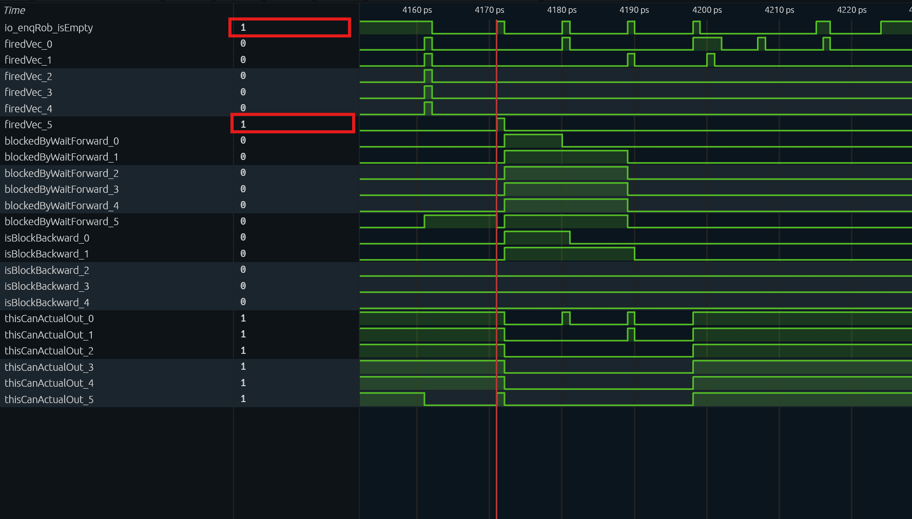

# CSR 乱序读写场景分析

> 本文分析香山（昆明湖V2）对 CSR 指令乱序读/写的支持：为什么大多数 CSR 的「纯读」可以乱序，而一部分 CSR 读必须顺序，以及为什么所有 CSR 写都串行化。
>

## 1. 背景与问题

RISC-V CSR 指令（`csrrw/csrrs/csrrc/csrrwi/csrrsi/csrrci`）既有读语义（回读旧值），也有写语义（按 `funct3` 执行 write/set/clear）。CSR 写具有全局副作用（如修改 `mstatus.FS`、`satp`、`vstart`、触发 trap），因此**天然需要顺序化**； 纯读的判定与 rd 无关：CSRRS/CSRRC 的 rs1=x0，或 CSRRSI/CSRRCI 的 uimm=0，才是不写 CSR 的纯读。csrrs x0, mscratch, x0 也是纯读，只是结果丢弃。

香山的处理方法是：**默认给所有 CSR 指令打上顺序化标记（`noSpecExec`/`blockBackward`），再在重命名阶段对「纯 CSR 读」有条件地摘掉这两个标记**；被列入例外清单的 CSR 读保持顺序化。CSR 写则**始终**保留标记，即永远串行化。

## 2. 实现机制

### 2.1 译码：所有 CSR 指令默认顺序化

[DecodeUnit.scala][D]  212行中六种 CSR 指令全部译码为 `noSpec = T, blockBack = T`：

```scala
CSRRW  -> XSDecode(SrcType.reg, SrcType.imm, SrcType.X, FuType.csr, CSROpType.wrt,  SelImm.IMM_Z, xWen = T, noSpec = T, blockBack = T)
CSRRS  -> XSDecode(..., CSROpType.set, ...)   // 同上 noSpec=T, blockBack=T
CSRRC  -> XSDecode(..., CSROpType.clr, ...)   // 同上 noSpec=T, blockBack=T
CSRRWI -> XSDecode(..., CSROpType.wrti, ...)  // 同上 noSpec=T, blockBack=T
CSRRSI -> XSDecode(..., CSROpType.seti, ...)  // 同上 noSpec=T, blockBack=T
CSRRCI -> XSDecode(..., CSROpType.clri, ...)  // 同上 noSpec=T, blockBack=T
```

`noSpec`/`blockBack` 随后成为 uop 的 `waitForward`/`blockBackward` 控制位。

### 2.2 重命名：对「纯 CSR 读」条件清除

[Rename.scala][R] 290–307 行：

```scala
// read only CSRR instruction support: remove blockBackward and waitForward
inst(i) := uops(i).instr.asTypeOf(new XSInstBitFields)
isCsr(i)  := inst(i).OPCODE5Bit === OPCODE5Bit.SYSTEM && inst(i).FUNCT3(1, 0) =/= 0.U
isCsrr(i) := isCsr(i) && inst(i).FUNCT3 === BitPat("b?1?") && inst(i).RS1 === 0.U
isNotWaitForwardCsrr(i) := isCsrr(i) && LookupTreeDefault(
  inst(i).CSRIDX, true.B, CSROoORead.waitForwardInOrderCsrReadList.map(_.U -> false.B))
isNotBlockBackwardCsrr(i) := isCsrr(i) && LookupTreeDefault(
  inst(i).CSRIDX, true.B, CSROoORead.blockBackwardInOrderCsrReadList.map(_.U -> false.B))
 /*
     * For most CSRs, CSRR instructions do not need to wait forward instructions.
     *
     * For most CSRs, CSRR instructions do not need to block backward instructions.
     *
     * Signal "isCsrr" contains not only "CSRR", but also other CSR instructions that do not require writing to CSR.
     */
uops(i).waitForward   := io.in(i).bits.waitForward && !isNotWaitForwardCsrr(i)
uops(i).blockBackward := io.in(i).bits.blockBackward && !isNotBlockBackwardCsrr(i)
```

判定逻辑分析：

| 信号 | 判定条件 | 含义 |
|---|---|---|
| `isCsr` | `OPCODE=SYSTEM` 且 `FUNCT3[1:0]≠0` | 六种 CSR 访问指令之一 |
| `isCsrr` | isCsr 且 FUNCT3 ∈ {010, 011, 110, 111} 且 RS1 域 == 0； | 纯 CSR 读：寄存器形式 rs1=x0，立即数形式  uimm=0。rd 不影响判定；CSRRW/CSRRWI 及 rs1≠0 的 set/clr 都不算。 |
| `isNotWaitForwardCsrr` | `isCsrr` 且 CSRIDX **不在** `waitForwardInOrderCsrReadList` | 该读可以摘掉 `waitForward` |
| `isNotBlockBackwardCsrr` | `isCsrr` 且 CSRIDX **不在** `blockBackwardInOrderCsrReadList` | 该读可以摘掉 `blockBackward` |

关键点：

- `isCsrr` 只覆盖纯读。`CSRRW`（`FUNCT3=001`）永远不匹配，`CSRRS/CSRRC` 的 `rs1≠0`（读写修改）也不匹配。因此**任何 包含CSR 写（含 RMW）都保留 `waitForward`/`blockBackward`，始终串行化**。
- 对纯读，只有 CSR 地址落在例外清单里才保留对应标记；其余 CSR 读被设置为乱序。
- 两条标记的清除是**独立**的：某 CSR 可能只摘 `waitForward` 但保留 `blockBackward`（见 3.2）。

### 2.3 派发：waitForward/blockBackward 的硬件语义

[NewDispatch.scala][DIS] 796–819 行：

```scala
blockedByWaitForward(0) := !io.enqRob.isEmpty && isWaitForward(0)
// 后续项顺序传播：blockedByWaitForward(i) := blockedByWaitForward(i-1) || (…) && isWaitForward(i)
val nextCanOut = VecInit((0 until RenameWidth).map(i => !isBlockBackward(i)))
```

| 标记 | 置 1 时的派发行为 |
|---|---|
| `waitForward` | uop 被 `blockedByWaitForward` 挡住，直到 ROB 排空（所有更老指令提交）才派发 |
| `blockBackward` | uop 阻断其后更年轻的指令越过它派发 |

因此：

- `waitForward=1` 的 CSR 读/写：必须等 ROB 排空，读到的才是确定（正确）状态。
- `blockBackward=1`：年轻指令不能越过它，保证顺序。
- 两者被清除的 CSR 读：**既不等 ROB 排空、也不挡年轻指令**，可像普通整数指令一样乱序派发/执行。

### 2.4 例外清单

例外清单定义在 [CSROoORead.scala][OOO]：

```scala
object CSROoORead {
    /**
   * "Read only" CSRs that can be fully pipelined when read in CSRR instruction.
   * Only read by csr instructions.
   */
  val waitForwardInOrderCsrReadList = List(
    CSRs.fflags, CSRs.fcsr, CSRs.vxsat, CSRs.vcsr, CSRs.vstart,
    CSRs.sstatus, CSRs.vsstatus, CSRs.mstatus, CSRs.hstatus, CSRs.mnstatus, CSRs.dcsr,
    CSRs.vtype,
    CSRs.mireg, CSRs.sireg, CSRs.vsireg,
    CSRs.mtopi, CSRs.stopi, CSRs.vstopi,
    CSRs.mtopei, CSRs.stopei, CSRs.vstopei,
    CSRs.mip, CSRs.sip, CSRs.vsip, CSRs.hip, CSRs.hvip, CSRs.mvip,
  )
  val blockBackwardInOrderCsrReadList = List(
    CSRs.mireg, CSRs.sireg, CSRs.vsireg,
    CSRs.mtopi, CSRs.stopi, CSRs.vstopi,
    CSRs.mtopei, CSRs.stopei, CSRs.vstopei,
    CSRs.mip, CSRs.sip, CSRs.vsip, CSRs.hip, CSRs.hvip, CSRs.mvip,
  )
}
```

清单内容与含义见第 3 节。

## 3. 哪些 CSR 支持乱序读

> **纯读（`isCsrr`）且 CSR 地址不在例外清单** → 乱序读；在 `waitForwardInOrderCsrReadList` → 顺序读（保留 `waitForward`）；在 `blockBackwardInOrderCsrReadList` → 保留 `blockBackward`。
>
> 除清单列出的之外，其余 CSR（如 `mscratch=0x340`、`mtvec=0x305`、`mepc=0x341`、`mcause=0x342`、`mtval=0x343` 等）均支持乱序读。

### 3.1 需保留 waitForward 的顺序读清单（27 个）

| CSR | 地址 | 为何顺序读 |
|---|---|---|
| `fflags` | 0x001 | 由 FPU 指令（异常/舍入）更新，非仅 CSR 单元 |
| `fcsr` | 0x003 | 同上 |
| `vxsat` | 0x009 | 由向量单元更新 |
| `vcsr` | 0x00F | 由向量单元更新 |
| `vstart` | 0x008 | 由向量单元更新 |
| `sstatus` | 0x100 | 全局状态，多种指令/trap 修改 |
| `vsstatus` | 0x200 | 同上（向量） |
| `mstatus` | 0x300 | 全局状态，多种指令/trap 修改 |
| `hstatus` | 0x600 | Hypervisor 状态 |
| `mnstatus` | 0x744 | M-mode 嵌套状态 |
| `dcsr` | 0x7B0 | 由 Debug 模块修改 |
| `vtype` | 0xC21 | 向量配置 |
| `mireg` / `sireg` / `vsireg` | 0x351 / 0x151 / 0x251 | AIA 中断文件（异步） |
| `mtopi` / `stopi` / `vstopi` | 0xFB0 / 0xDB0 / 0xEB0 | AIA 中断优先级 |
| `mtopei` / `stopei` / `vstopei` | 0x35C / 0x15C / 0x25C | AIA 异步访问（读本身无副作用，写才 claim / 清 pending，见 3.2） |
| `mip` / `sip` / `vsip` | 0x344 / 0x144 / 0x244 | 中断 pending，异步更新 |
| `hip` / `hvip` / `mvip` | 0x644 / 0x645 / 0x309 | 中断注入/pending |

顺序读的原因分三类：

1.fflags/fcsr/vxsat/vcsr/vstart/mstatus/sstatus/hstatus/vsstatus/mnstatus/dcsr：会被用户态指令在没有 fence 的情况下修改；CSRR 若乱序到更老指令之前，会读到旧值。waitForward 保证读之前所有更老指令已提交。

2.vtype：vtype 没有被重命名（VL 被重命名），所以 CSRR vtype 不能乱序。

3.mireg/sireg/vsireg、xtopi/xtopei、xip：AIA/中断状态异步访问，NewCSR 需要等待响应。

  注意：waitForward 保证的是对更老指令的顺序，不是让异步源“稳定”。

### 3.2 需保留 blockBackward 的顺序读清单（15 个）

这些 CSR 属于 AIA 异步访问路径：mireg/sireg/vsireg 由 NewCSR 等待响应，xtopi/xtopei 同理。AIA 的 CSR 读没有副作用：读 `mtopei` 不会 claim，写 `mtopei` 才清除 pending；mtopi 只读，写会 trap。因此保留 blockBackward 是微架构上的串行化策略，而不是因为读会改状态。

### 3.3 小结

| 类别 | 例子 | waitForward | blockBackward | 效果 |
|---|---|---|---|---|
| 普通 CSR 纯读（不在清单） | `csrr t3, mscratch` | 清除 | 清除 | 乱序读：不等 ROB 排空、不挡年轻指令 |
| 状态/FP/向量/调试 CSR 纯读 | `csrr t5, mstatus` | **保留** | 清除 | 顺序读：等 ROB 排空，但不挡年轻指令 |
| 中断相关 CSR 纯读 | `csrr rd, mtopi` | **保留** | **保留** | 顺序读：等 ROB 排空，且挡年轻指令 |
| 任意 CSR 写 / RMW | `csrw mscratch, t0` | **保留** | **保留** | 串行化：始终顺序 |

## 4. 代码设计

程序 `csr_ooo_read_write.c` 在同一段波形中构造三类访问，便于对比重命名后的 `waitForward`/`blockBackward`：

```asm
addi t0, x0, 0x111          # 填充流水线
addi t1, x0, 0x222          # 填充流水线
addi t2, x0, 0x333          # 填充流水线
csrr t3, mscratch           # (A) 乱序读：mscratch=0x340 不在清单
addi t4, x0, 0x444          # (B) 年轻整数指令，可越过 (A) 执行
csrr t5, mstatus            # (C) 顺序读：mstatus=0x300 在 waitForward 清单
csrw mscratch, t0           # (D) CSR 写：始终串行化
csrw mscratch, t1           # (E) CSR 写：始终串行化
1: j 1b                     # 停机

0000000080000000 <_start>:
    80000000:	11100293          	li	t0,273
    80000004:	22200313          	li	t1,546
    80000008:	33300393          	li	t2,819
    8000000c:	34002e73          	csrr	t3,mscratch
    80000010:	44400e93          	li	t4,1092
    80000014:	30002f73          	csrr	t5,mstatus
    80000018:	34029073          	csrw	mscratch,t0
    8000001c:	34031073          	csrw	mscratch,t1
    80000020:	a001                	j	80000020 <_start+0x20>
    80000022:	0001                	nop

```

| 指令 | 类型 | 期望行为（重命名后） |
|---|---|---|
| (A) `csrr t3, mscratch` | 乱序读 | `waitForward=0`、`blockBackward=0`：可不等 ROB 排空派发，且不挡 (B) |
| (B) `addi t4, 0x444` | 年轻整数 | 可越过 (A) 派发/执行，证明 (A) 的 `blockBackward` 已被清除 |
| (C) `csrr t5, mstatus` | 顺序读 | `waitForward=1`、`blockBackward=0`：须等 ROB 排空 |
| (D)(E) `csrw mscratch` | 写 | `waitForward=1`、`blockBackward=1`：串行化 |

## 5. 波形分析

### 5.1 译码阶段


在程序执行的 **4159 拍**，流水线前端从 IBuffer 中同时出队了 6 条连续的指令进入译码器（`decoders_0` 到 `decoders_5`）。结合波形抓取的关键信号，我们可以清晰地看到译码单元对所有 CSR 指令采取的“一刀切”保守策略：

**关键信号观测：**

1. **指令类型识别（`fuType` 与 `fuOpType`）**：
   - Slot 0/1/2/4（PC: `...00` 到 `...10`）：`fuType = 0x40`（整数 ALU），`fuOpType = 0x21`，对应测试程序中的 `addi` 指令。
   - **Slot 3（A 指令）** 与 **Slot 5（C 指令）**：`fuType = 0x20`（CSR），`fuOpType = 0x0a`（低 3 位为 2，代表 CSRRS 纯读操作）。
2. **串行化标记（`waitForward` 与 `blockBackward`）**：
   - 普通 ALU 指令（Slot 0/1/2/4）：这两个控制位均为 `0`。
   - **两条 CSR 指令（Slot 3 和 Slot 5）：这两个控制位全部为 `1`。**
3. **ROB 压缩属性（`canRobCompress`）**：
   - 普通 `addi` 指令为 `1`，允许在提交阶段进行 ROB 压缩
   - CSR 指令为 `0`，不参与压缩

### 5.2 重命名阶段

指令经过译码后进入重命名阶段。这里是“验明正身”的地方：硬件会检查指令的机器码，如果是纯读指令，且地址不在例外清单里，就把译码阶段打上的 `waitForward` 和 `blockBackward` 标记摘掉。

针对指令 `csrr t3, mscratch` (`34002e73`)，观察对应的 `io_enq_req_3` 端口。由于该指令属于 CSR 纯读且不在例外清单中，因此其 `waitForward` 和 `blockBackward` 标记均被清除为 0。经波形验证，结果正确。


分析指令 `csrr t5, mstatus` (`30002f73`)，重点观察 `io_enq_req_5` 端口。该指令同为 CSR 纯读，但 `mstatus` 位于 `waitForwardInOrderCsrReadList` 中。因此，其 `waitForward` 标记保留为 1，而 `blockBackward` 标记被清零为 0。

**这里有一个关键现象需要结合派发逻辑（Dispatch）来看：** 在 4161 拍，6 条指令同时到达派发；lane 0~4 正常派发，lane 5 的 (C) 被挡住。此时  io_enqRob_isEmpty=1，所以直接原因不是 ROB 非空，而是同组 lane 0~4 
 是更老的指令。这 5 条进入 ROB 后，!io.enqRob.isEmpty 继续挡住 (C)；直到它们在 4171 拍全部提交、ROB 再次为空，(C) 才派发。


分析指令 `csrw mscratch, t0` (`34029073`)，观察 `io_enq_req_0` 端口。该指令属于 CSR 写操作，不满足 `isCsrr` 纯读条件，需无条件保留串行化标记。因此，其 `waitForward` 和 `blockBackward` 均保持为 1。经波形验证，结果正确。

同理，`csrw mscratch, t1` (`34031073`) 作为连续的 CSR 写操作，其串行化标记同样不被清除，波形中两者均保持为 1。


### 5.3 派发阶段

在派发（Dispatch）阶段，重命名阶段生成的 `waitForward` 与 `blockBackward` 标记将直接参与组合逻辑判断，决定指令能否出队。

（注：为保持版面整洁，下文信号路径省略公共前缀 `TOP.SimTop.cpu.l_soc.core_with_l2.core.backend.inner_ctrlBlock.dispatch.`）

#### 5.3.1 4161 拍：(A) 指令正常派发与 (C) 指令的阻塞

> **实测信号（红线游标处）：**
>
> - `io_enqRob_isEmpty = 1`
> - `firedVec_0` 至 `firedVec_4` = **1**，`firedVec_5` = **0**
> - `isBlockBackward_3` = **0**（(A) 指令所在 lane）
> - `thisCanActualOut_4` = **1**（(B) 指令所在 lane）
> - `blockedByWaitForward_5` = **1**


**逻辑分析：**

1. **(A) 与 (B) 同拍派发**：(A) 指令（`mscratch`）的 `blockBackward` 在重命名阶段被清零，因此 `isBlockBackward_3` 信号未拉高。受此影响，后续年轻指令 (B) 的 `thisCanActualOut_4` 保持为 1，且在同一拍成功派发（`firedVec_4 = 1`）。这证明了 (A) 的乱序属性生效，未阻塞后续流水。
2. **(C) 指令被阻塞**：尽管此时 ROB 为空（`io_enqRob_isEmpty = 1`），但 (C) 指令受 `waitForward` 标记约束，且同组 lane 0 至 lane 4 均存在有效指令。触发源码中的阻塞条件（`!io.enqRob.isEmpty || Cat(fromRename.take(i).valid).orR`），`blockedByWaitForward_5` 拉高，导致 (C) 无法在此时派发。

#### 5.3.2 4162–4171 拍：等待 ROB 排空的过程

> **实测信号：**
>
> - 4162–4170 拍：`blockedByWaitForward_5 = 1`，`io_enqRob_isEmpty = 0`
> - **4171 拍**：`io_enqRob_isEmpty = 1`，`firedVec_5 = 1`




**逻辑分析：**
`waitForward` 的硬件语义是“等待前方指令全部提交（即 ROB 排空）”。波形显示，一旦 `io_enqRob_isEmpty` 拉高，硬件即在同一拍解除对 (C) 指令的阻塞，令其成功派发（`firedVec_5 = 1`），体现了无固定周期延迟的条件触发机制。

#### 5.3.3 4180–4189 拍：CSR 写指令的双重串行化约束

> **实测信号：**
>
> - **4180 拍**：`firedVec_0 = 1`（(D) 指令派发），`blockedByWaitForward_1 = 1`（(E) 指令被阻塞），`isBlockBackward_0 = 1`，`thisCanActualOut_1 = 0`。
> - **4189 拍**：`firedVec_1 = 1`（(E) 指令成功派发）。


**逻辑分析：**
在 4180 拍，(E) 指令面临双重阻塞约束：

1. **自身标记阻塞**：受 `waitForward=1` 影响，且同组 lane 0 存在有效指令 (D)，导致 `blockedByWaitForward_1 = 1`。
2. **前序指令阻塞**：尽管 (D) 指令即将派发，但其 `blockBackward=1` 的属性生效，使得 `isBlockBackward_0 = 1`。该信号拉低了下游的 `thisCanActualOut_1`，进一步抑制了 (E) 的出队。

直至 4189 拍，(D) 指令提交完毕、ROB 再次为空，`blockedByWaitForward_1` 随之清零，(E) 指令的 `firedVec_1` 才成功拉高。该过程验证了派发级的 isBlockBackward = valid && blockBackward 逻辑；此外 ROB 级的 hasBlockBackward 会把年轻指令挡在 ROB 外，直到 (D) 离开 ROB。两者共同保证 CSR  写之间的严格串行化。

### 5.4 执行与提交

(A)(B) 在 4161 拍同拍派发后，分别进入 CSR FU 和整数 ALU。(A) 从派发到真正进入 CSR FU 有几拍调度延迟：4165 拍 `exus_7.in1ToN.io_in_valid = 1`、`exus_7.csr.csrMod.io_in_bits_op = 2`；4166 拍 CSR FU 输出 `mscratch` 的旧值 `0xc4a64dd286bb263f`。与此同时，(B) 走整数 ALU 路径。

写回顺序：表项 8（较年轻的 (B)）在 4167 拍写回，`debugInfo_writebackTime = 0x1048`；表项 7（较老的 (A)）在 4168 拍才写回，`writebackTime = 0x1049`。更年轻的 (B) 先完成，说明清除 `waitForward`/`blockBackward` 后，(A) 确实参与了乱序执行。

不过 (B) 写回后仍要等 (A) 提交才能提交，这就是「乱序执行、顺序提交」。另外，CSR FU 是 `piped = false`，所以这里的乱序是**相对不同 FU** 的；多条 CSR 指令之间仍会在 CSR FU 上串行，且可能等待 AIA 响应。因此本节只作为辅助证据，核心证明仍在 5.2/5.3 的派发行为。

| 拍数 | 事件                     | 关键信号                                                     |
| ---- | ------------------------ | ------------------------------------------------------------ |
| 4161 | (A)(B) 同拍派发          | `dispatch.firedVec_3 = 1`（(A)）、`dispatch.firedVec_4 = 1`（(B)） |
| 4165 | (A) 进入 CSR FU          | `exus_7.in1ToN.io_in_valid = 1`、`exus_7.csr.csrMod.io_in_bits_op = 2` |
| 4166 | (A) 输出 `mscratch` 旧值 | `exus_7.csr.csrMod.io_out_valid = 1`、`io_out_bits_rData = 0xc4a64dd286bb263f` |
| 4167 | (B) 完成写回             | `debugReg_8_debugInfo_writebackTime = 0x1048`                |
| 4168 | (A) 完成写回             | `debugReg_7_debugInfo_writebackTime = 0x1049`                |

## 6. 结论

1. 香山**默认**把所有 CSR 指令标记为顺序化（译码 `noSpec=T, blockBack=T`）。
2. 重命名阶段对「纯 CSR 读」（`isCsrr`）有条件摘除 `waitForward`/`blockBackward`，实现多数 CSR 的乱序读；CSR 写与 RMW 不在此列，始终串行化。
3. 例外清单 [`CSROoORead.scala`][OOO] 精确划定了必须顺序读的 CSR：状态/FP/向量/调试相关 CSR 保留 `waitForward`，中断相关 CSR 额外保留 `blockBackward`。
4. 复现场景可在一段波形中同时对比「乱序读（mscratch）」「顺序读（mstatus）」「写（csrw mscratch）」三类行为。

## 附录：关键代码索引

| 模块 | 文件路径 | 关键行号 |
|---|---|---|
| 乱序读例外清单 | `src/main/scala/xiangshan/backend/fu/NewCSR/CSROoORead.scala` | 10–55 |
| CSR 译码（默认顺序化） | `src/main/scala/xiangshan/backend/decode/DecodeUnit.scala` | 212–218 |
| 重命名条件清除 | `src/main/scala/xiangshan/backend/rename/Rename.scala` | 290–307 |
| 派发顺序化 | `src/main/scala/xiangshan/backend/dispatch/NewDispatch.scala` | 795–819 |
| CSR 写/RMW 使能 | `src/main/scala/xiangshan/backend/fu/wrapper/CSR.scala` | 74–94 |
| CSR FuConfig（不流水） | `src/main/scala/xiangshan/backend/fu/FuConfig.scala` | 299–311 |
