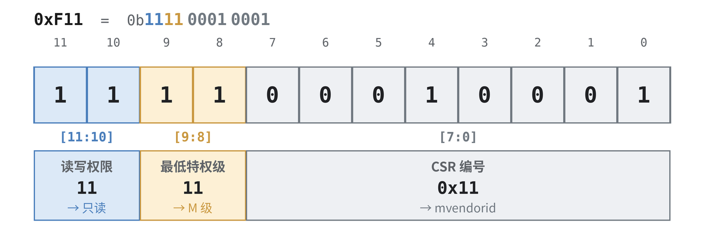
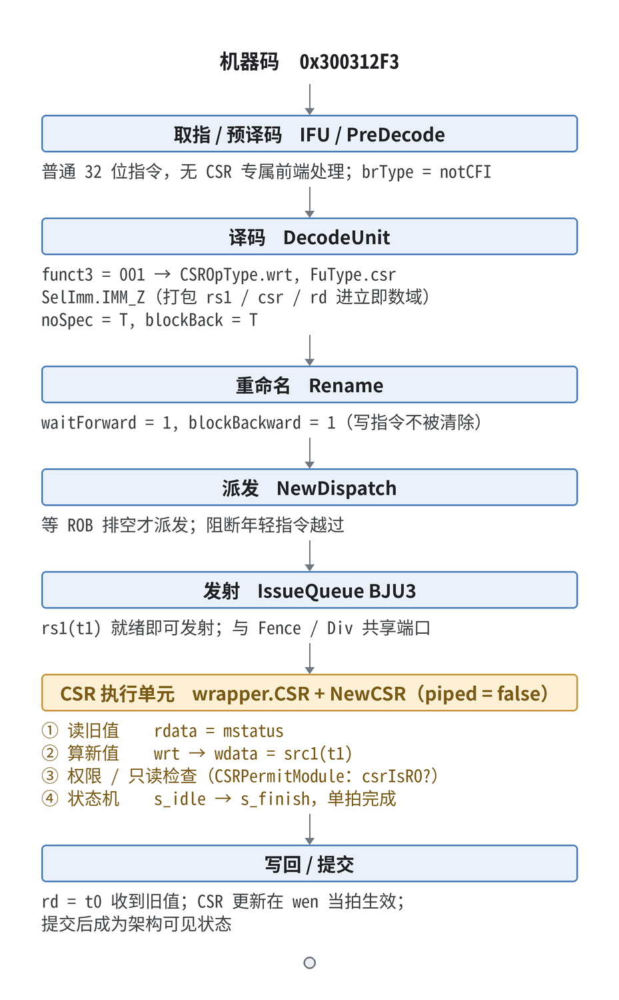

# CSR 格式与相关指令

> 本文系统梳理 RISC-V 的 CSR（Control and Status Register）：从"CSR 是什么"的定位出发，逐位拆解 12 位地址编码（权限写进地址）、六条 CSR 指令的编码与语义、伪指令、特权/系统指令，再到香山昆明湖 V2 的源码级硬件落地，最后串起一条指令的完整旅程。
>

---

## 1. CSR 是什么：一块独立的"地址空间"

RISC-V 处理器内部有三类"能存东西"的地方，先摆清楚它们的定位，CSR 就自然了：

| 类型 | 地址/编号 | 数量 | 访问方式 | 特点 |
|---|---|---|---|---|
| 通用寄存器 x0–x31 | 5 位编号 | 32 个 | 普通整数指令（`add`、`ld`…） | 只存数据，无副作用，可被流水线自由重命名 |
| 内存 | 64 位地址 | 巨大 | `load/store` | 有地址、有缓存、有访存流水 |
| **CSR** | **12 位地址** | **最多 4096（2¹²）** | **只能靠 CSR 指令（或陷阱时硬件自动更新）** | **改的是处理器自身的状态/控制** |

关键在最后一行：**CSR 改的不是"数据"，而是"处理器正在怎样运行"**——比如 `mtvec` 决定陷阱跳到哪里、`mstatus` 决定中断是否使能、`satp` 决定地址翻译开关。所以它不能像通用寄存器那样被乱序、投机、重命名，硬件必须单独为它设计一条受控路径。

### 1.1 为什么"独立编址"

把 CSR 编成独立的 12 位空间，而不是塞进通用寄存器或内存，带来三个好处：

1. **安全隔离**：低特权级不能碰高特权级的控制状态，这个检查用地址高 4 位就能做（见第 2 节），不需要额外查表。
2. **原子性**：CSR 的"读-改-写"在一条指令里完成，不会被中断切开（比如 `mstatus.MIE` 的开关必须是原子的）。
3. **语义明确**：CSR 指令从编码上就区别于普通 ALU/访存指令（`opcode=SYSTEM`），流水线一眼就能识别出"这是一条要特殊处理的状态操作"。

档案柜的比喻：

| 比喻 | 含义 |
|---|---|
| 档案柜（CSR 地址空间） | 一块 4096 格的独立编址空间，与通用寄存器、内存互不相干 |
| 档案编号（CSR 地址） | 12 位地址，如 `0x180`（satp）、`0x300`（mstatus）、`0x305`（mtvec） |
| 编号的"前缀"（地址高 4 位） | 直接编码出"谁能读、能不能写"（权限自携带） |
| 借阅/归还（CSR 指令） | 唯一能翻动档案的方式；陷阱发生时硬件也会自动更新 |

---

## 2. CSR 地址编码：权限写进地址里

RISC-V 的巧妙之处：**不单独维护一张"哪个 CSR 谁能访问"的权限表，而是把权限直接编码进地址的高 4 位**。于是地址本身就是权限声明，硬件解地址的同时就解出了权限。

### 2.1 位域划分


| 位域 | 取值 | 含义 |
|---|---|---|
| `CSR[11:10]` | `00` / `01` / `10` | 可读可写（Read/Write），`01/10` 为规范预留编码 |
| | `11` | **只读**（Read-Only） |
| `CSR[9:8]` | `00` | 最低访问特权级 = U（用户） |
| | `01` | 最低访问特权级 = S（监督） |
| | `10` | 最低访问特权级 = H / HS（Hypervisor） |
| | `11` | 最低访问特权级 = M（机器） |
| `CSR[7:0]` | 任意 | 具体是哪一个 CSR（编号） |

**结论**：低特权级试图访问高特权级 CSR → 非法指令异常；写只读 CSR → 非法指令异常。这两条规则全部从地址高位直接推出。

### 2.2 拆几个地址练手

把地址写成 12 位二进制，高 4 位一眼读出权限与特权级：

| CSR | 地址（hex） | 地址（12-bit 二进制） | `[11:10]` | `[9:8]` | 结论 |
|---|---|---|---|---|---|
| `fflags` | `0x001` | `0000_0000_0001` | `00` | `00` | 可写，U 级即可访问 |
| `satp` | `0x180` | `0001_1000_0000` | `00` | `01` | 可写，需 S 级 |
| `mstatus` | `0x300` | `0011_0000_0000` | `00` | `11` | 可写，需 M 级 |
| `mtvec` | `0x305` | `0011_0000_0101` | `00` | `11` | 可写，需 M 级 |
| `mscratch` | `0x340` | `0011_0100_0000` | `00` | `11` | 可写，需 M 级 |
| `mvendorid` | `0xF11` | `1111_0001_0001` | `11` | `11` | **只读**，需 M 级 |

以 `mvendorid = 0xF11` 为例：



所以"写 `mvendorid`"和"U 模式下读 `mvendorid`"都会触发非法指令异常——这就是地址自携带权限的直观体现。

### 2.3 香山落地：CSRPermitModule

香山在 `CSRPermitModule.scala` 里用**一行**复刻了规范里的只读编码：

```scala
// CSRPermitModule.scala —— 地址高 2 位直接判只读
private val csrIsRO = addr(11, 10) === "b11".U     // [11:10] == 11 → 只读
private val rwIllegal = csrIsRO && wen             // 对只读 CSR 发起写 → 非法
```

`addr(11,10) === "b11".U` 对应"权限位 = 只读"，`rwIllegal` 把"写只读 CSR"变成非法指令异常，与 2.2 的表格完全一致。权限判定不再需要一张 4096 项的读写表，硬件成本极低。

---

## 3. CSR 指令格式：编码到每一个 bit

所有 CSR 指令共用同一条 **SYSTEM 操作码**（opcode = `1110011`，即 `0x73`），靠 `funct3` 区分具体是哪一条。

### 3.1 完整 32 位布局


| 字段 | 位 | 说明 |
|---|---|---|
| `csr` | `[31:20]` | 目标 CSR 的 12 位地址 |
| `rs1` / `uimm` | `[19:15]` | 源寄存器（寄存器版本），或 5 位零扩展立即数（立即数版本） |
| `funct3` | `[14:12]` | 区分六条指令 + 特权指令 |
| `rd` | `[11:7]` | 目的寄存器，接收"读出的旧值" |
| `opcode` | `[6:0]` | `1110011`（SYSTEM / 0x73） |

### 3.2 funct3 的位级含义

`funct3` 3 个 bit 各自有职责，不是一张无规律的编号表：

```
funct3[2]   = 1 → 立即数版本（[19:15] 是 zimm，不是 rs1）
funct3[1:0] = 01 → 写（CSRRW，直接覆盖）
            = 10 → 置位（CSRRS，OR）
            = 11 → 清位（CSRRC，AND NOT）
funct3      = 000 → 不是 CSR 访问，是特权/系统指令
```

即：**`funct3[2]` 选"源"（寄存器 / 立即数），`funct3[1:0]` 选"动作"（写 / 置位 / 清位）**。`001`（写）与 `101`（写立即数）差的就是最高位。

### 3.3 funct3 → CSROpType 映射

译码时 `funct3` 被编码进香山的 `CSROpType`。依据 [`package.scala`][OP] 232–259 行：`FuOpType` 的 **bit3 为 `isCsrAccess`，低 3 位即 funct3**。例如 `CSROpType.wrt = b001_001`（bit3=1 表示这是 CSR 访问，低 3 位 `001` 是 CSRRW 的 funct3）：

| funct3 | CSROpType | 对应指令 |
|---|---|---|
| `001` | `wrt` | CSRRW |
| `010` | `set` | CSRRS |
| `011` | `clr` | CSRRC |
| `101` | `wrti` | CSRRWI |
| `110` | `seti` | CSRRSI |
| `111` | `clri` | CSRRCI |
| `000` | `jmp` / `wfi` | 特权指令（ECALL/EBREAK/SRET/MRET… / WFI，见第 6 节） |

### 3.4 机器码实例

以 `csrrw t0, mstatus, t1`（读 mstatus 旧值到 t0，同时把 t1 写入 mstatus）为例：

- `csr = mstatus = 0x300`（12 位）
- `rs1 = t1 = x6`（5 位）
- `funct3 = 001`（CSRRW）
- `rd = t0 = x5`（5 位）
- `opcode = 1110011`

```
  [31:20]   [19:15] [14:12] [11:7]  [6:0]
  0x300      00110    001     00101  1110011
  0011 0000 0000 | 00110 | 001 | 00101 | 1110011
= 0011 0000 0000 0011 0001 0010 1111 0011
= 0x300312F3
```

立即数版本 `csrrwi t0, mstatus, 5`（funct3=101，源换成 5 位零扩展立即数 5）：

```
  [31:20]   [19:15] [14:12] [11:7]  [6:0]
  0x300      00101    101     00101  1110011
= 0x3002D2F3
```

> 对比可见：`[14:12]`（funct3 的 bit2）由 `001` 变成 `101`；`[19:15]` 也从 `rs1`（t1 = x6，`00110`）换成 5 位零扩展立即数 `5`（`00101`）。这两处正是"寄存器源 / 立即数源"的差别。

### 3.5 香山如何拆这些字段：SelImm.IMM_Z

CSR 指令把 `rs1`、CSR 地址、`rd`、立即数**一起打包**进统一的立即数域，执行单元再拆出来。译码用的是 `SelImm.IMM_Z`：

```scala
// DecodeUnit.scala —— CSRRW 译码
CSRRW -> XSDecode(SrcType.reg, SrcType.imm, SrcType.X,
  FuType.csr, CSROpType.wrt, SelImm.IMM_Z, xWen = T, noSpec = T, blockBack = T)
```

执行单元侧用 `Imm_Z()` 的四个 getter 拆字段（[`wrapper/CSR.scala`][WCSR] 49–55 行）：

```scala
Imm_Z().getCSRAddr   // [31:20] → CSR 地址
Imm_Z().getRD        // [11:7]  → rd
Imm_Z().getRS1       // [19:15] → rs1
Imm_Z().getImm5      // [19:15] → 5 位零扩展立即数（立即数版本）
```

---

## 4. 六条指令语义：先读旧值，再改-写

### 4.1 语义总表（`t = CSR 旧值`）

| 指令 | `funct3` | 语义 | 读改写动作 | 比喻 |
|---|---|---|---|---|
| **CSRRW** | `001` | `rd = t; CSR = rs1` | 写（直接覆盖） | 换表——取下旧表给 rd，挂上新表 |
| **CSRRS** | `010` | `rd = t; CSR = t \| rs1` | 置位（OR） | 打勾——旧表 OR 掩码 |
| **CSRRC** | `011` | `rd = t; CSR = t & ~rs1` | 清位（AND NOT） | 擦勾——旧表 AND 反掩码 |
| **CSRRWI** | `101` | `rd = t; CSR = zimm` | 写立即数 | 同上，新值写在指令里 |
| **CSRRSI** | `110` | `rd = t; CSR = t \| zimm` | 置位立即数 | 同上（立即数版打勾） |
| **CSRRCI** | `111` | `rd = t; CSR = t & ~zimm` | 清位立即数 | 同上（立即数版擦勾） |

### 4.2 两条贯穿始终的规则

1. **先读后写**：`rd` 总是拿到 CSR 的**旧值**，无论后面会不会写入新值。这是"读-改-写"里"读"的部分，也是硬件把 `rData`（旧值）作为写回数据的原因（见 `csr_lifecycle_analysis.md` 2.6）。
2. **`rs1 = x0` 不写**：CSRRS/CSRRC 里若源是 x0，`t|x0 = t`、`t&~x0 = t`，等于"只读不写"。这正是伪指令 `csrr` 的实现原理（见第 5 节）。

### 4.3 香山 wrapper 层的写使能判定

写使能 `csrWen` 严格按"是不是真的写"来定（[`wrapper/CSR.scala`][WCSR] 74–94 行）：

```scala
csrWen := valid && (isCSRRW || (isCSRRSorRC && rs1 =/= 0))
```

- `CSRRW` 一定写（即使 `rd=x0` 的 `csrw` 也是写）。
- `CSRRS/CSRRC` 只有当 `rs1 ≠ 0` 才写；`rs1=0` 时退化成纯读，`csrWen=0`。

这正好与第 4.2 节规则 2 对应：硬件在写使能这一层就把 `rs1=x0` 的"假写"挡掉了。

---

## 5. 伪指令：让汇编更好写

六条指令里很多场景只想"读"或只想"写"，不关心返回值。RISC-V 汇编器提供伪指令，展开成六条指令的某个特例：

| 伪指令 | 展开为 | 效果 |
|---|---|---|
| `csrr rd, csr` | `csrrs rd, csr, x0` | 只读（`rs1=x0`，OR 不改变值） |
| `csrw csr, rs` | `csrrw x0, csr, rs` | 只写（`rd=x0`，丢弃旧值） |
| `csrs csr, rs` | `csrrs x0, csr, rs` | 只置位 |
| `csrc csr, rs` | `csrrc x0, csr, rs` | 只清位 |
| `csrwi csr, zimm` | `csrrwi x0, csr, zimm` | 只写立即数 |
| `csrsi csr, zimm` | `csrrsi x0, csr, zimm` | 只置位（立即数） |
| `csrci csr, zimm` | `csrrci x0, csr, zimm` | 只清位（立即数） |

两个"神器寄存器"扮演关键角色：

- **`x0` 当源（rs1）** → 让 CSRRS/CSRRC 退化成"只读"，即 `csrr`。
- **`x0` 当目的（rd）** → 丢弃读出的旧值，即 `csrw` 系列"只写"。

对应到硬件：`rd=x0` 时 `rfWen=0`（不写整数寄存器）；只有 `csrw`（CSRRW）这类"纯写"指令才会同时有 `csrRen=0`（不回读旧值），见 [`wrapper/CSR.scala`][WCSR] 311–318 行。注意 `csrRen=0` 只对 CSRRW 成立——`csrs`/`csrc` 虽然 `rd=x0`，仍要读旧值做 OR / AND-NOT，`csrRen` 保持为 1（见 7.4 节信号表）。任务 #104 的配置程序 `csr-scenario.c` 里 `csr_read`/`csr_write` 就是用的 `csrr` 与 `csrw`。

---

## 6. 相关的特权指令：同一条 SYSTEM 操作码

CSR 指令不是 SYSTEM 操作码（`1110011`）的全部。`funct3 = 000` 这一格留给一组**特权/系统指令**，它们同样走 CSR 执行单元，但靠 `csr` 字段（指令的 `[31:20]`）来区分。

### 6.1 特权指令一览（含完整机器码）

| 指令 | `funct3` | `[31:20]` | 完整机器码 | 作用 |
|---|---|---|---|---|
| **ECALL** | `000` | `0x000` | `0x00000073` | 环境调用——陷入，产生异常 |
| **EBREAK** | `000` | `0x001` | `0x00100073` | 断点——触发断点异常 |
| **WFI** | `000` | `0x105` | `0x10500073` | 等待中断——进入低功耗等待 |
| **SRET** | `000` | `0x102` | `0x10200073` | 从 S 模式陷阱返回 |
| **MRET** | `000` | `0x302` | `0x30200073` | 从 M 模式陷阱返回 |
| **MNRET** | `000` | `0x702` | `0x70200073` | 从机器级 NMI 陷阱返回 |
| **DRET** | `000` | `0x7B2` | `0x7B200073` | 从调试模式返回 |

> 复用技巧：`funct3=000` 的指令把 `[31:20]` 当成**指令编号**（`0x000`=ecall、`0x302`=mret…），而不是真正的 CSR 地址。同一个字段，在不同 funct3 下含义不同。对 xRET 类，`[31:20]` 实际是 `funct7(imm[11:5]) + rs2(imm[4:0])` 拼成的 12 位立即数。

> 注意 `SFENCE.VMA`（`0x12000073`）虽然也是 `funct3=000`，但它**不走 CSR 执行单元**，香山里走的是 `FuType.fence`——它是地址翻译刷新指令，语义与"读改 CSR 状态"不同。

### 6.2 香山：译码层映射

这些特权指令在译码阶段也映射到 `FuType.csr`，但内部操作类型是 `jmp`（跳转型）或 `wfi`：

```scala
// DecodeUnit.scala —— 特权指令同样走 FuType.csr
EBREAK -> XSDecode(..., FuType.csr, CSROpType.jmp, ..., noSpec = T, blockBack = T),
ECALL  -> XSDecode(..., FuType.csr, CSROpType.jmp, ..., noSpec = T, blockBack = T),
SRET   -> XSDecode(..., FuType.csr, CSROpType.jmp, ..., noSpec = T, blockBack = T),
MRET   -> XSDecode(..., FuType.csr, CSROpType.jmp, ..., noSpec = T, blockBack = T),
DRET   -> XSDecode(..., FuType.csr, CSROpType.jmp, ..., noSpec = T, blockBack = T),
WFI    -> XSDecode(..., FuType.csr, CSROpType.wfi, ..., noSpec = T, blockBack = T),
```

两个控制位值得记牢：

- **`noSpec = T`**：不允许推测执行。ecall/mret 会改变特权级、改变控制流，推测执行容易出错，干脆不推测。
- **`blockBack = T`**：阻塞回退。执行它的时候，后面的指令不能被错误回滚。

### 6.3 香山：CSR 执行单元二次判别

到了 CSR 执行单元，`jmp` 类型再结合 `csr` 字段（即 `addr` 信号）做二次判别，区分到底是一次调用、断点还是返回：

```scala
// CSR.scala —— jmp 类型 + csr 字段 → 具体是哪条特权指令
val isEbreak = addr === privEbreak && func === CSROpType.jmp
val isEcall  = addr === privEcall  && func === CSROpType.jmp
val isMret   = addr === privMret   && func === CSROpType.jmp
val isSret   = addr === privSret   && func === CSROpType.jmp
val isWFI    = func === CSROpType.wfi
```

这里的 `addr` 就是指令 `[31:20]` 那个字段——译码时被塞进 CSR 单元的 `addr` 信号，执行时拿来和 `privEbreak / privEcall / privMret / privSret …` 这些常量比对。

---

## 7. 香山硬件落地：源码级全景

把前几节分散的代码串成一条"从译码到执行"的完整链路。

### 7.1 译码：DecodeUnit.scala

六条 CSR 指令 + 特权指令在 [`DecodeUnit.scala`][D]（212–218 行附近）统一译码。以 CSRRW 为代表：

```scala
CSRRW  -> XSDecode(SrcType.reg, SrcType.imm, SrcType.X, FuType.csr, CSROpType.wrt,  SelImm.IMM_Z, xWen = T, noSpec = T, blockBack = T)
CSRRS  -> XSDecode(..., CSROpType.set,  ...)   // 同上 noSpec=T, blockBack=T
CSRRC  -> XSDecode(..., CSROpType.clr,  ...)
CSRRWI -> XSDecode(..., CSROpType.wrti, ...)
CSRRSI -> XSDecode(..., CSROpType.seti, ...)
CSRRCI -> XSDecode(..., CSROpType.clri, ...)
```

要点：所有 CSR 指令 `noSpec = T, blockBack = T`——这是"CSR 默认串行化"的来源；后续重命名阶段才对"纯 CSR 读"有条件摘除。

### 7.2 权限：CSRPermitModule.scala

只读判定（见 2.3）：

```scala
private val csrIsRO = addr(11, 10) === "b11".U
private val rwIllegal = csrIsRO && wen
```

### 7.3 执行单元配置：FuConfig.scala

```scala
FuConfig(name = "csr", fuType = FuType.csr, piped = false, writeIntRf = true,
  latency = UncertainLatency(), flushPipe = true, ...)
```

- `piped = false`：CSR 执行单元一次只处理一条 uop，内部不流水。
- `latency = UncertainLatency()`：与 AIA（IMSIC）异步访问、trap 处理有关。
- 执行端口：`ExeUnitParams("BJU3", Seq(CsrCfg, FenceCfg, DivCfg), ...)`，CSR 与 Fence、Div 共享 `BJU3`（[`Parameters.scala`][PORT] 411–414 行）。

### 7.4 数据通路：wrapper/CSR.scala + NewCSR

`wrapper.CSR` 做 FuncUnit 接口适配（读写使能、数据准备），`NewCSR` 做真正的 CSR 逻辑（分发、Mux1H 选择、状态机）：

| 信号 | 表达式/含义 | 位置 |
|---|---|---|
| `csrAccess` | `valid && isCsrAccess(func)` | [WCSR][WCSR] 74–94 |
| `csrWen` | `CSRRW` 一定写；`CSRRS/RC` 且 `rs1≠0` 才写 | [WCSR][WCSR] 74–94 |
| `csrRen` | `(CSRRW && rd≠0) || CSRRS/RC` | [WCSR][WCSR] 74–94 |
| `wdata` | `wrt → src1`（CSRRW 把 rs1 当写数据） | [WCSR][WCSR] 74–94 |
| `rdata` | 对 `csrRwMap` 做 `Mux1H` 按 `raddr` 选读值 | [NCSR][NCSR] 1009–1017 |
| `regOut` | 对 `csrOutMapFilter` 做 `Mux1H` 取原值（无读掩码，用于 RMW） | [NCSR][NCSR] 1019–1030 |

`NewCSR` 状态机（[NCSR][NCSR] 1039–1106 行）：

```scala
switch(state) {
  is(s_idle)    { when(valid && !redirectFlush) { stateNext := s_finish } }
  is(s_finish)  { when(redirectFlush || io.out.ready) { stateNext := s_idle } }
}
io.in.ready := (state === s_idle)   // 一次只接受一条 CSR 请求
```

普通 CSR 单拍完成（`s_idle → s_finish`）；AIA 寄存器走 `s_waitIMSIC` 异步路径。

---

## 8. 一条指令的完整旅程：从机器码到执行单元

以 `csrrw t0, mstatus, t1`（= `0x300312F3`）为例，串起整条流水线：



**核心原则**：CSR 地址自己就"携带"了权限信息（`[11:10]` 读写、`[9:8]` 特权级），指令则靠 `funct3` 区分"写/置位/清位"三种读改写动作。两者合起来，构成处理器管理自身状态的完整窗口。

---

## 9. 关键信号表

| 信号名 | 位置 | 位宽 | 语义 |
|---|---|---|---|
| `csr` / `addr` | 指令 `[31:20]` | 12 | CSR 地址（或特权指令编号） |
| `funct3` | 指令 `[14:12]` | 3 | 区分六条指令 + 特权指令 |
| `rs1` / `zimm` | 指令 `[19:15]` | 5 | 源寄存器 / 5 位零扩展立即数 |
| `rd` | 指令 `[11:7]` | 5 | 目的寄存器（收旧值） |
| `csrIsRO` | CSRPermitModule | 1 | `addr(11,10)===11`，只读判定 |
| `rwIllegal` | CSRPermitModule | 1 | 写只读 CSR → 非法指令异常 |
| `csrWen` | wrapper.CSR | 1 | CSR 写使能 |
| `csrRen` | wrapper.CSR | 1 | CSR 读使能 |
| `wdata` | wrapper.CSR | 64 | 写数据（CSRRW 时 = rs1） |
| `rdata` | NewCSR | 64 | 读旧值（带读掩码） |
| `regOut` | NewCSR | 64 | 寄存器原值（无读掩码，用于 RMW） |
| `noSpec` / `blockBack` | DecodeUnit | 各 1 | 不推测 / 阻塞回退（顺序化） |
| `waitForward` / `blockBackward` | Rename→Dispatch | 各 1 | 顺序化控制位（由前两者而来） |

---

## 10. 总结

### ✅ 核心要点

- **CSR 格式**：12 位独立地址空间（最多 4096 个寄存器）；地址高 4 位直接编码权限——`csr[11:10]` = 读写权限（`11` = 只读）、`csr[9:8]` = 最低特权级（`00/01/10/11` = U/S/H/M）。
- **CSR 指令**：六条指令共用 SYSTEM 操作码（`0x73`），靠 `funct3` 区分——CSRRW(`001`)/CSRRS(`010`)/CSRRC(`011`)/CSRRWI(`101`)/CSRRSI(`110`)/CSRRCI(`111`)；`funct3[2]` 选源（寄存器/立即数）、`funct3[1:0]` 选动作（写/置位/清位）。全是"先读旧值给 rd，再按 RW/RS/RC 写回"的原子读改写。
- **伪指令**：`csrr`/`csrw`/`csrs`/`csrc`/`csrwi`/`csrsi`/`csrci` 展开成六条指令的特例，靠 `x0` 当源（只读）或当目的（只写）。
- **特权指令**：`funct3=000` 这一格留给 ecall/ebreak/wfi/sret/mret/mnret/dret，靠 `[31:20]` 字段区分；同样走 CSR 执行单元（`CSROpType.jmp`/`wfi`），但 SFENCE.VMA 走 `FuType.fence`。
- **香山落地**：只读判定 `addr(11,10)==="b11".U`（CSRPermitModule）；读改写使能 `csrWen/csrRen`（wrapper/CSR）；数据选择 `Mux1H`（NewCSR）；`noSpec=T, blockBack=T`（译码层顺序性约束）。

**一句话总结**：CSR 的"格式"把权限写进了地址，"指令"把动作写进了 funct3——地址告诉你"谁能不能写"，funct3 告诉你"怎么读改写"，两者合起来就是处理器自我管理的那扇窗口。

---

## 附录：关键代码索引

| 模块 | 文件路径 | 关键行号 |
|---|---|---|
| CSR 译码 | `src/main/scala/xiangshan/backend/decode/DecodeUnit.scala` | 212–218 |
| CSROpType 定义 | `src/main/scala/xiangshan/package.scala` | 232–259 |
| 权限判定（只读） | `src/main/scala/xiangshan/backend/fu/NewCSR/CSRPermitModule.scala` | — |
| CSR wrapper（读写使能/字段拆解） | `src/main/scala/xiangshan/backend/fu/wrapper/CSR.scala` | 49–119、309–318 |
| NewCSR 主模块（数据通路/状态机） | `src/main/scala/xiangshan/backend/fu/NewCSR/NewCSR.scala` | 1009–1140 |
| CSR FuConfig（不流水） | `src/main/scala/xiangshan/backend/fu/FuConfig.scala` | 299–311 |
| 执行端口配置 | `src/main/scala/xiangshan/Parameters.scala` | 411–414 |

[D]: src/main/scala/xiangshan/backend/decode/DecodeUnit.scala
[R]: src/main/scala/xiangshan/backend/rename/Rename.scala
[DIS]: src/main/scala/xiangshan/backend/dispatch/NewDispatch.scala
[PORT]: src/main/scala/xiangshan/Parameters.scala
[CFG]: src/main/scala/xiangshan/backend/fu/FuConfig.scala
[WCSR]: src/main/scala/xiangshan/backend/fu/wrapper/CSR.scala
[NCSR]: src/main/scala/xiangshan/backend/fu/NewCSR/NewCSR.scala
[OP]: src/main/scala/xiangshan/package.scala

> 更新: 2026-10-14
