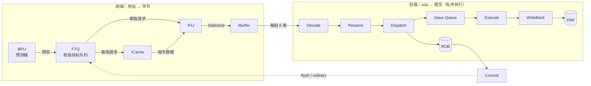
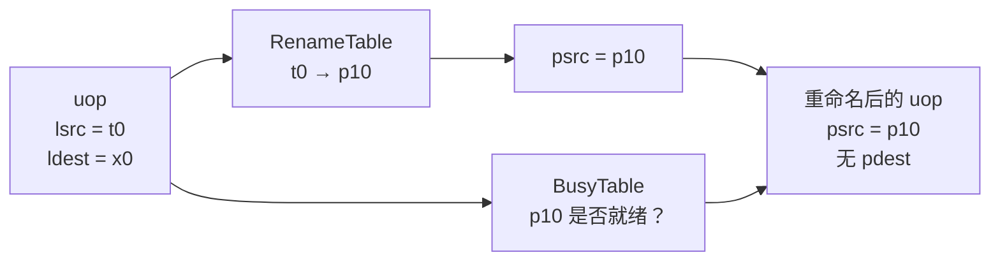
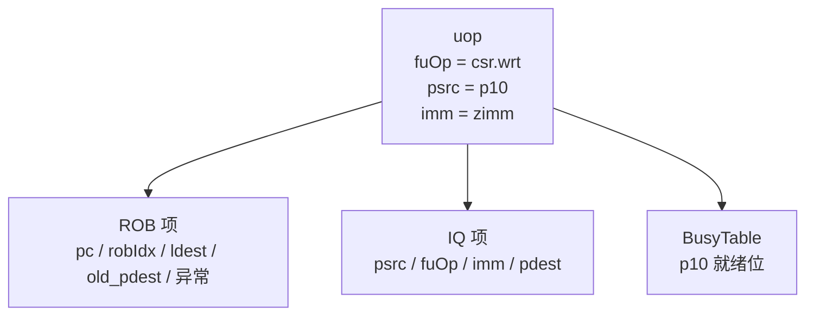
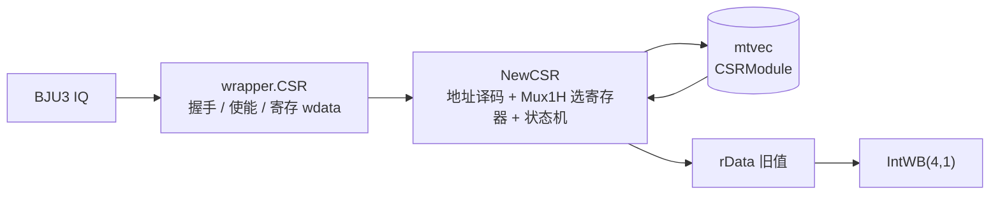
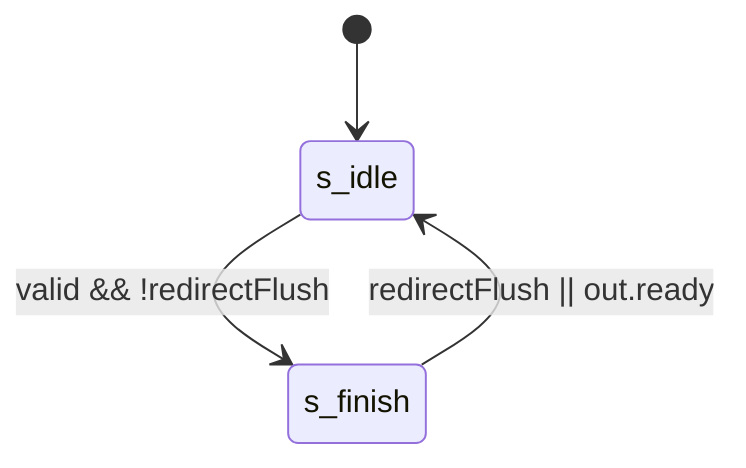
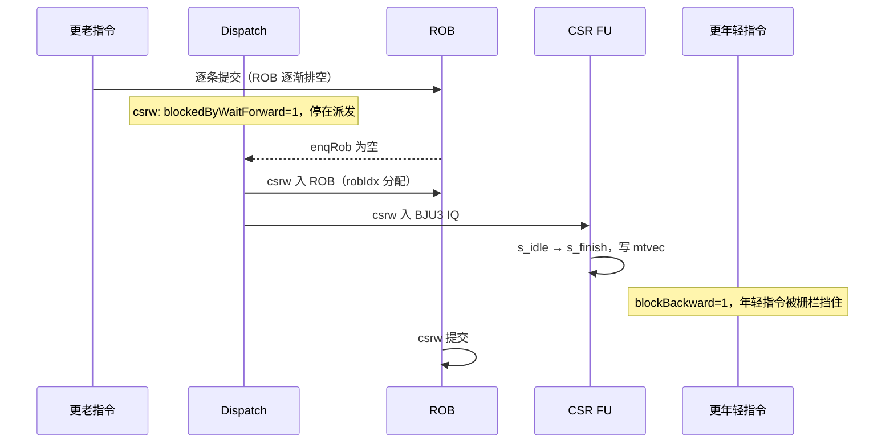
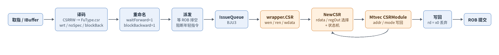

# CSR Write 指令执行生命周期（以 `csrw mtvec, t0` 为例）

> 本文以一条 M 模式 CSR Write 指令 `csrw mtvec, t0` 为线索，走完香山昆明湖 V2（`KunminghuV2Config`）的一条完整生命周期：取指 → 译码 → 重命名 → 派发 → 发射 → 执行 → 写回 → 提交。
>
> 与单纯罗列信号的写法不同，本文在每一站都回答两个问题：**这一步在微架构上做了什么？为什么必须这样做？** 只想看结论的读者可以读 §0（机器模型）和 §3（串行化机制）。

---

## 0. 先把这台机器讲清楚

### 0.1 一条指令经过的流水线



读懂这张图只需要记住三点：

- **前端是"无类型"的**：BPU、FTQ、ICache、IFU 只认地址和字节。`csrw` 在这里和 `addi`、`lw` 没有任何区别，前端也不认识 `is_csr`。
- **后端才做分类**：Decode 根据 opcode 决定这条指令去哪个功能单元、读几个源、写不写回。
- **乱序只发生在中间**：取指可以乱、执行可以乱，但**提交严格按序**，这是精确异常的前提。

### 0.2 后端六个关键结构

| 结构 | 存什么 | 解决什么问题 | 本文相关度 |
|---|---|---|---|
| **ROB** | 按程序顺序排列的 uop 元数据：`pc`、`pdest`、`old_pdest`、异常/分支信息 | 按序提交、精确异常、寄存器释放 | ★★★ 派发/提交 |
| **RenameTable** | 逻辑寄存器 → 物理寄存器（推测态 + 提交态两份） | 消除 WAW/WAR 假依赖 | ★★ |
| **BusyTable** | 每个 `psrc` 的值是否就绪 | 发射前的源操作数判断 | ★★ |
| **FreeList** | 空闲物理寄存器号 | 给 `ldest` 分配 `pdest` | ★ |
| **IQ（发射队列）** | 已派发、未发射的 uop 及其 `psrc/fuOp/imm` | 乱序发射 | ★★★ 等待与发射 |
| **PRF** | 真正的寄存器值 | 数据存放（ROB 里没有值） | ★★ 读源 |

**关键认知：ROB 里流动的不是数据，是"号"和"状态"。** 真正的值在 PRF、结果总线和存储层次里。

### 0.3 乱序执行的三条规则

1. **按序提交**：任何指令的体系结构效果，必须等它成为 ROB 中最老的指令才能生效。
2. **重命名消依赖**：把"逻辑寄存器依赖"翻译成"物理寄存器依赖"，让不相关的指令可以并行。
3. **推测必须有退路**：所有乱序/推测的结果都要能被一次 flush 撤销。寄存器有重命名可以丢弃，分支有 ROB 可以回滚——**但有副作用、又不能回滚的操作就是麻烦制造者**。

### 0.4 `csrw` 在微架构上的特殊性

`csrw` 恰好踩在第 3 条规则的痛点上：

| 特性 | `addi` | `csrw mtvec, t0` |
|---|---|---|
| 写哪里 | 整数 PRF | **CSR 文件**（核内状态） |
| 有重命名保护吗 | 有（写新 `pdest`，旧值不动） | **没有**（CSR 全局只有一份） |
| 能回滚吗 | 能（丢弃 `pdest` 即可） | **不能**（没有 CSR 检查点/快照） |
| 副作用 | 无 | 改变 trap 入口等体系结构行为 |

CSR 文件既没有重命名，也没有历史版本。一旦写进去，就没有"撤销"的硬件机制。所以香山没有选择"把写缓冲到提交"，而是用了两条更朴素的办法：

- **`waitForward`**：派发前必须等到 ROB 排空——保证它执行时，流水线里不存在比它更老的指令；
- **`blockBackward`**：它之后（更年轻）的指令不能越过它派发——保证 CSR 访问在程序顺序上是一个"栅栏"。

这两条就是 §3 的主题，也是本文最重要的一段微架构内容。

### 0.5 基本信息

| 字段 | 内容 |
|---|---|
| **指令名称** | `csrw mtvec, rs1`（汇编助记符，机器编码为 `csrrw x0, mtvec, rs1`） |
| **编码格式** | `csr[11:0]_rs1[4:0]_funct3=001_rd=00000_opcode=1110011`；本文示例 `csrrw x0, mtvec, t0` = `0x30529073` |
| **RISC-V 扩展** | RV64I + `Zicsr` |
| **是否有压缩格式** | 无（SYSTEM 类 32 位指令，C 扩展不覆盖 CSR 访问，只有 32 位） |
| **指令分类** | CSR write；`rd=x0` 时不回读旧值，为纯写 |
| **FuType** | `FuType.csr` |
| **FuOpType** | `CSROpType.wrt` |
| **目标 FU** | `wrapper.CSR` → `NewCSR` → `Mtvec` CSRModule |
| **源码 commit** |  |

`csrw mtvec, t0` 的语义是把通用寄存器 `t0` 的值写入机器模式 CSR `mtvec`（地址 `0x305`）。写入值 `0x80001234` 时，按 `mtvec` 的字段划分（见第 4 节），`MODE=Direct`、`BASE=0x80001234`。

---

## 1. 前端路径：把字节送到后端

### 1.1 取指

CSR 指令自身只是普通 32 位指令，前端无任何 CSR 特定处理。它与普通整数指令一样经过 FTQ → ICache/IFU → IBuffer。

微架构上这一步只做"数据整形"，不做"语义理解"：

- **FTQ** 把 BPU 的预测结果排成队，同时向 ICache 和 IFU 发出取指请求；
- **ICache** 负责地址翻译与取数据，返回的是**字节块 + 有效掩码**；
- **IFU** 把字节块按 `isRVC` 切成 16/32 位指令，打上预译码标签，产出 `StaticInst`；
- **IBuffer** 把指令攒成每拍 6 条，供后端消费。

| 阶段 | 延迟 | 关键行为 | 代码位置 |
|---|---|---|---|
| ICache/MainPipe | 可变 | 获取 `csrw` 所在代码块 | [IFU][IF] |
| IFU F0 | 请求握手 | FTQ 请求进入 IFU | [IFU][IF] 241–263 行 |
| IFU F1 | 无停顿时一阶段 | 保存请求并推进 | [IFU][IF] 291–304 行 |
| IFU F2 | 可等待 | 接收 ICache 响应、整理预译码输入 | [IFU][IF] 357–385 行 |
| IFU F3 | 可背压 | 按有效指令范围入队 IBuffer | [IFU 入队][IFO] 953–986 行 |

> 微架构看点：前端对 `csrw` 的处理**没有任何特殊分支**，所以它的取指延迟和一条 `addi` 完全一样。CSR 的所有特殊性都从 Decode 开始。

### 1.2 预译码

| 项目 | 内容 |
|---|---|
| **brTable 匹配** | 不匹配控制流条目，得 `BrType.notCFI` |
| **PreDecodeInfo 字段** | 有效 32 位 CSR 指令：`valid=1, isRVC=0, brType=notCFI, isCall=0, isRet=0` |
| **是否有专用检测逻辑** | 无 CSR 专用前端控制流检测；CSR 的类别由后端译码确定 |

依据：[PreDecode][PD] 35–82 行。

预译码只回答"这条指令是不是控制流、是不是压缩指令"，它**不解析 opcode**。这是前端能保持低延迟的原因：预译码的逻辑深度远小于完整译码。

### 1.3 PredChecker 校验

| 项目 | 内容 |
|---|---|
| **是否触发 remaskFault** | 本条不是 JAL/JALR/RET，不主动触发 |
| **是否触发 mispredict** | 正常不触发；非 CFI 位置若被误预测 taken 可由 `notCFITaken` 检出 |
| **是否产生 wbRedirect** | 本条不产生前端跳转；`xret` 类才由 CSR 产生 redirect |

依据：[PredChecker][CHECK] 361–445 行。

### 1.4 IBuffer 入队

| 项目 | 内容 |
|---|---|
| **入队宽度** | `PredictWidth = FetchWidth * (HasCExtension ? 2 : 1)` |
| **是否可能被挡** | IBuffer 容量、ready、有效范围与 flush 共同影响 |
| **携带的关键信息** | 指令字、PC、FTQ 指针/偏移、预译码、取指异常及 trigger |
| **代码位置** | [IFU 入队][IFO]、[IBuffer][IB] 227–305 行 |

IBuffer 是前后端的**解耦点**：前端取指抖动（ICache miss、跨块拼接）在这里被吸收，不会直接反压到后端；反过来后端停顿也不会立刻卡住前端。

---

## 2. 后端路径：从 uop 到提交

### 2.1 译码：位串 → uop

Decode 每拍处理 6 条指令，把 32 位位串拆成 uop。对 `csrw`：

| 项目 | 内容 |
|---|---|
| **简单/复杂译码** | 直接表译码，不需要复杂指令拆分（单 uop） |
| **关键译码结果** | `SrcType.reg`（源=rs1）、`SrcType.X`（第三源）、`FuType.csr`、`CSROpType.wrt`、`SelImm.IMM_Z`、`xWen=T`、`noSpec=T`、`blockBack=T` |
| **代码位置** | [DecodeUnit][D] 212 行 |

```scala
CSRRW -> XSDecode(SrcType.reg, SrcType.imm, SrcType.X,
  FuType.csr, CSROpType.wrt, SelImm.IMM_Z, xWen = T, noSpec = T, blockBack = T)
```

**uop 里到底装了什么**（这是理解后端的钥匙）：

| 字段 | `csrw` 的取值 | 微架构作用 |
|---|---|---|
| `fuOp` | `FuType.csr` + `CSROpType.wrt` | 决定去 BJU3、做什么操作 |
| `lsrc[0]` | `rs1`（t0） | 要写入 CSR 的值 |
| `lsrc[1]` | `SrcType.imm` → 打包字段 | 承载 CSR 地址 / funct3 / rd |
| `ldest` | `x0` | 无有效写回目的 |
| `imm` | 指令 `[31:7]`（`IMM_Z`） | CSR 地址等字段的"运输载体" |
| `waitForward` | 1 | 派发前等 ROB 排空 |
| `blockBackward` | 1 | 挡住年轻指令 |

要点：

- **`SelImm.IMM_Z` 是一个"复用数据通路"的设计**：CSR 指令需要把 CSR 地址（12 位）、`rs1`/5 位立即数、`funct3`、`rd` 一起送到执行单元。香山没有为它新开一条 payload 通路，而是把整条指令的 `[31:7]` 塞进统一的立即数域；执行单元再用 `Imm_Z().getCSRAddr / getRD / getRS1 / getImm5` 拆出来，见 [wrapper/CSR][WCSR] 49–55 行。这也是为什么译码结果里第二个源是 `SrcType.imm` 而不是寄存器。
- `noSpec = T` 与 `blockBack = T`：这两项最终成为 uop 的 `waitForward` 与 `blockBackward`，是 CSR 指令**默认串行化**的来源（详见 2.2、2.3、§3）。对 `csrw` 这类写指令，二者不会被清除。
- `xWen = T` 但 `rd=x0`：`rd=x0` 会在写回阶段由 `rfWen` 门控关闭，不产生虚假的整数写回。
- `FuOpType.wrt = b001_001`：编码约定中 bit3 为 `isCsrAccess`，`func3` 位于低 3 位（`wrt` 对应 `func3=001`），见 [package.scala][OP] 232–259 行。

### 2.2 重命名：逻辑号 → 物理号

重命名阶段不搬值，只改号：

1. 查 **RenameTable**：`lsrc`（t0）→ `psrc`；
2. 查 **BusyTable**：这个 `psrc` 算好没有；
3. 给 `ldest` 从 **FreeList** 分配 `pdest`——本例 `rd=x0`，不分配；
4. 记下 `old_pdest` 供提交时释放——本例没有。



| 项目 | 内容 |
|---|---|
| **源操作数** | 一个整数逻辑源 `rs1`（要写入 CSR 的值），映射到物理源 |
| **目标操作数** | `rd=x0` 无有效整数目的；不分配用于写回旧值的物理寄存器 |
| **waitForward/blockBackward** | 写指令不被清除，保留 `waitForward=1`、`blockBackward=1` |
| **代码位置** | [Rename][R] 290–307 行 |

重命名阶段对 CSR 指令的判断逻辑：

```scala
isCsr  := OPCODE5Bit === SYSTEM && FUNCT3(1,0) =/= 0
isCsrr := isCsr && FUNCT3 === "b?1?" && RS1 === 0
uops(i).waitForward   := io.in(i).bits.waitForward && !isNotWaitForwardCsrr(i)
uops(i).blockBackward := io.in(i).bits.blockBackward && !isNotBlockBackwardCsrr(i)
```

`isCsrr` 只匹配「纯 CSR 读」（`FUNCT3` 第 1 位为 1 且 `rs1=0`，即 `CSRRS/CSRRC` 且 `rs1=x0`，或 `CSRRSI/CSRRCI` 且立即数为 0）。`csrw`（`CSRRW`，`FUNCT3=001`）不属于 `isCsrr`，因此 `waitForward/blockBackward` 保持为 1。这意味着 CSR 写指令**始终串行化**——这也是「乱序读写」分析里写路径与读路径的关键差异（见 [`csr-out-of-order-read-write.md`](csr-out-of-order-read-write.md)）。

> 微架构看点：重命名的意义本是把假依赖消掉，但 CSR **无法重命名**（CSR 文件没有物理号副本）。所以它只能退回到最保守的顺序化手段。

### 2.3 派发：一条 uop，两处登记

派发是"乱序"真正开始的地方：uop 同时进入 ROB（保序）和 IQ（乱序），并把源操作数的就绪状态写进 BusyTable。



| 项目 | 内容 |
|---|---|
| **blockedByWaitForward** | `waitForward=1` 的 uop 在 ROB 非空时被阻止派发，须等 ROB 排空（更老指令全部提交）才派发 |
| **blockBackward** | `blockBackward=1` 的 uop 阻止其后（更年轻）的指令越过它派发 |
| **代码位置** | [NewDispatch][DIS] 795–819 行 |

```scala
blockedByWaitForward(0) := !io.enqRob.isEmpty && isWaitForward(0)
// 后续项：blockedByWaitForward(i) := blockedByWaitForward(i-1) || (...) && isWaitForward(i)
val nextCanOut = VecInit((0 until RenameWidth).map(i => !isBlockBackward(i)))
```

因此一条 `csrw` 到达派发后，会等 ROB 内所有更老指令提交后才被派发；同时它之后的年轻指令也不能越过它。这是 CSR 写指令「顺序化」的硬件实现。

**这两条约束合起来，等于在 CSR 上造了一个"全局有序点"：**

- 往前看：ROB 排空 ⇒ 没有更老的指令还能产生 redirect；
- 往后看：`blockBackward` ⇒ 没有更年轻的指令能抢在它前面访问 CSR。

### 2.4 发射

| 项目 | 内容 |
|---|---|
| **Issue Queue** | CSR 位于执行单元 `BJU3`（与 `Fence`、`Div` 共享），属于整数调度块第 4 个 IssueBlock |
| **执行单元配置** | `ExeUnitParams("BJU3", Seq(CsrCfg, FenceCfg, DivCfg), Seq(IntWB(port = 4, 1)), ...)` |
| **唤醒条件** | `rs1` 数据就绪；`waitForward=1` 意味着该 uop 派发时 ROB 已排空，通常到达 IQ 即可发射 |
| **代码位置** | [Parameters][PORT] 411–414 行、[FuConfig][CFG] 299–311 行 |

CSR 的 FuConfig 为：

```scala
FuConfig(name = "csr", fuType = FuType.csr, piped = false, writeIntRf = true,
  latency = UncertainLatency(), flushPipe = true, ...)
```

**为什么和 Fence、Div 挤在一个单元？** 这三类操作的共同点是：低频、非流水、延迟不固定或很长，不值得各占一个发射口。合并后共享一个端口，代价是它们之间会互相排队（例如一条长除法会推迟后面的 `csrw`）。

`piped=false` 说明 CSR 执行单元一次只处理一条 uop，内部不流水；`latency=UncertainLatency` 与 AIA（IMSIC）异步访问、trap 处理有关。对普通 `csrw mtvec` 这条路径不触发异步访问，执行单元单拍内完成（见 2.5）。

### 2.5 执行

执行单元由两层组成：`wrapper.CSR`（FuncUnit 接口适配）+ `NewCSR`（真正的 CSR 逻辑）。`mtvec` 寄存器由 `NewCSR` 里 `MachineLevel` trait 实例化的 `Mtvec` CSRModule 实现。



#### 2.5.1 wrapper 层：读写使能与数据准备

| 信号 | 表达式 | 说明 |
|---|---|---|
| `csrAccess` | `valid && isCsrAccess(func)` | 本次是 CSR 访问 |
| `csrWen` | `valid && (isCSRRW \|\| (isCSRRSorRC && rs1 ≠ 0))` | `CSRRW` 一定写 |
| `csrRen` | `valid && ((isCSRRW && rd ≠ 0) \|\| isCSRRSorRC)` | `rd=x0` 时 `csrRen=0`，纯写 |
| `wdata` | `wrt → src1` | `CSRRW` 把 `rs1` 作为写数据 |

代码位置：[wrapper/CSR][WCSR] 74–94 行。`wdata` 经 `RegEnable(..., io.in.fire)` 寄存为 `wdataReg` 后送入 `NewCSR`，见 [wrapper/CSR][WCSR] 93–113 行。

> 微架构看点：**wrapper 把"指令语义"翻译成"存储器接口"**——`csrWen/csrRen/addr/wdata`，和 SRAM 的读写口几乎一样。这就是 CSR 文件在硬件上的本质：一张按地址索引的寄存器表。

#### 2.5.2 NewCSR 层：读/写数据通路与状态机

`NewCSR` 内部把 `wen/ren/addr/wdata` 分发给各 CSRModule：

- 读数据 `rdata`：对 `csrRwMap` 做 `Mux1H`，按 `raddr` 选择对应 CSR 的读值（带读掩码），见 [NewCSR][NCSR] 1009–1017 行。
- 寄存器原值 `regOut`：对 `csrOutMapFilter` 做 `Mux1H`，按 `raddr` 选择对应 CSR 的原始寄存器值（无读掩码，用于 RMW），见 [NewCSR][NCSR] 1019–1030 行。
- 状态机：`s_idle → s_finish`（普通 CSR 单拍完成）；AIA 寄存器走 `s_waitIMSIC` 异步路径。`io.in.ready := (state === s_idle)`，即一次只接受一条 CSR 请求，见 [NewCSR][NCSR] 1039–1106 行。



```scala
switch(state) {
  is(s_idle)      { when(valid && !redirectFlush) { stateNext := s_finish } }
  is(s_finish)    { when(redirectFlush || io.out.ready) { stateNext := s_idle } }
}
io.in.ready := (state === s_idle)
```

**为什么要有 `s_finish` 这个状态？** CSR 的读和写都在 `s_idle` 那一拍由组合逻辑完成（`Mux1H` 选出目标寄存器、`wfn` 生成新值）；`s_finish` 不增加计算，只负责把结果交出去，并保证 `out.ready` 握手完成之前不接收下一条请求。这就是 `piped=false` 的具体实现：**一次一条，送走再收下一条**。所以 §6 里 FU 内部仍按 1 拍算。

#### 2.5.3 mtvec 的写入

`mtvec` 是一个 `CSRModule("Mtvec", new XtvecBundle)`，见 [MachineLevel][ML] 122–136 行：

```scala
val mtvec = Module(new CSRModule("Mtvec", new XtvecBundle){
  // 无 enableResetMtvec 时走默认逻辑：由 CSRModule 的 wfn 完成写回
}).setAddr(CSRs.mtvec)
```

在 `XtvecBundle` 中字段为 `mode[1:0]`（WARL）与 `addr[63:2]`（WARL），见 [CSRBundles][BNDL] 16–21 行。`CSRModule` 基类的 `reconnectReg` 会按字段读写类型（`RW/WARL/WLRL/RO`）生成写逻辑：`WARL` 字段仅在写入值「合法」时才更新，否则保持原值，见 [CSRModule][CMOD] 29–63 行。因此：

- `addr` 字段：直接写入 `wdata[63:2]`（基地址，隐含 4 字节对齐）。
- `mode` 字段：`Mux(XtvecMode.isLegal(wdata.mode), wdata.mode, reg.mode)`，仅当写入 `0`（Direct）或 `1`（Vectored）时更新，否则保留旧值，见 [MachineLevel][ML] 130 行。

`csrw mtvec, t0` 写入 `0x80001234`：低 2 位为 `00`（Direct），`addr` 字段 = `wdata[63:2]` = `0x2000048D`（对应基地址 `0x80001234`），最终 `mtvec = 0x80001234`。

> 微架构看点：WARL 是**在写入口做合法性过滤**，而不是写完后纠正。非法值根本进不了寄存器，所以不需要异常，也不会产生"写了但没生效"的中间态。

### 2.6 写回

| 项目 | 内容 |
|---|---|
| **写回端口** | `IntWB(port = 4, 1)`（BJU3 所属写回端口） |
| **是否写回** | `rd=x0` 时 `rfWen=0`，不写整数寄存器；`csrRen=0`，不产生读结果 |
| **写回数据** | `rData`（读旧值），本指令 `rd=x0` 故被丢弃 |
| **代码位置** | [Parameters][PORT] 413 行、[wrapper/CSR][WCSR] 311–318 行 |

对 `csrw`（`rd=x0`），执行单元输出的 `res.data`（旧 CSR 值）不会被写回整数寄存器；指令的「副作用」只体现在 CSR 寄存器本身被更新。

**注意这里有一个容易混淆的点**：CSR 的更新发生在执行单元（2.5），**不经过写回级**；写回级处理的是"要不要把旧值写到 rd"（本例不写）。两条路径是分开的。

### 2.7 提交

| 项目 | 内容 |
|---|---|
| **提交条件** | uop 执行完成且进入 ROB 程序顺序前缀，无更老异常/阻塞 |
| **是否触发 flush** | 普通 `csrw mtvec` 不设置 `flushPipe`；只有改变 `satp`、`frm`、FS/VS、`vstart` 或 trigger 等才触发 `flushPipe`，见 [wrapper/CSR][WCSR] 268 行、[NewCSR][NCSR] 996–998 行 |
| **是否触发 redirect** | 否（`xret` 类才产生 redirect） |
| **代码位置** | [Rob][ROB] 提交逻辑 |

**提交对这条指令意味着什么？** 它不搬运数据，只做三件事：确认状态、更新体系结构映射、释放资源。对 `csrw`（`rd=x0`，没有 `pdest`）而言，提交主要是"确认"——CSR 的值在第 2.5 节已经写进去了。

> 为什么可以在执行阶段就写 CSR、而不等提交？因为派发前 ROB 已排空：这条指令执行时，流水线里**不存在比它更老的指令**，也就不存在一条更老的 redirect 把它冲掉。它自己若因非法访问产生异常，写使能会被权限检查挡住，不会先写后回滚。CSR 文件没有快照/回滚机制，这条路径的精确性完全依赖"先排空、再执行"这个前提。

---

## 3. 串行化：`csrw` 的微架构核心

### 3.1 为什么不能推测执行

设想不加限制会发生什么：

1. `csrw mtvec, t0` 在一条**预测错误**的分支之后执行，把 `mtvec` 改了；
2. 分支发现预测错误，flush 掉这条 `csrw`；
3. 但它已经改掉的 `mtvec` 没有地方恢复——CSR 文件没有检查点，ROB 里也只有号没有旧值。

结果就是体系结构状态被一条本不该执行的指令污染。**寄存器可以靠重命名丢弃，CSR 不行**，所以只能在源头避免：等所有更老指令都提交（不可能再产生 redirect），再执行。

### 3.2 两条约束的电路含义



| 约束 | 在电路里是什么 | 语义 |
|---|---|---|
| `waitForward` | `blockedByWaitForward := !io.enqRob.isEmpty && isWaitForward` | **往前看**：ROB 非空就不派发 |
| `blockBackward` | `nextCanOut(i) := !isBlockBackward(i)`，逐项传递 | **往后看**：年轻指令不能越过它 |

两条合起来，CSR 访问在时间轴上形成一个**全序点**：之前的所有指令都已完成，之后的所有指令都还没开始。这就是"顺序一致性"在一条 CSR 指令上的具体实现。

### 3.3 为什么 `csrr`（纯读）可以乱序

Rename 只对**纯读**清除这两个标志（`isCsrr`）。原因很直接：

- 读没有副作用，读错了可以重读（或至少可以安全丢弃）；
- 更关键的是，**更老的写指令自带栅栏**：如果前面有一条 `csrw`，它的 `blockBackward=1` 会阻止后面的 `csrr` 越过它派发，而同一个 IQ 内又按年龄优先发射，所以读一定发生在写之后；
- 如果 `csrr` 比写更老，它读到的就是旧值——本来就该读旧值。

所以"读可以乱序、写必须串行"不是偷懒，而是**由写指令的栅栏间接保证读的顺序**。

### 3.4 代价

| 方面 | 代价 |
|---|---|
| 吞吐 | CSR 单元 `piped=false`，一次一条；写指令还要等 ROB 排空 |
| 流水线 | ROB 排空期间后端几乎没有可派发的指令，IPC 明显下降 |
| 年轻指令 | 被 `blockBackward` 挡住，无法提前执行 |
| 共享端口 | 与 Fence、Div 共用 BJU3，长除法会推迟后续 CSR |

这也是为什么操作系统里频繁写 CSR（如切换页表时的 `satp`）会被视为"重操作"。

---

## 4. mtvec 寄存器与写入语义

| 字段 | 位宽/位域 | 读写类型 | 说明 |
|---|---|---|---|
| `BASE`（`addr`） | `[63:2]` | WARL | 陷阱处理基地址，隐含 4 字节对齐 |
| `MODE`（`mode`） | `[1:0]` | WARL | `0=Direct`，`1=Vectored`；非法值保持旧值 |

`mtvec` 地址为 `0x305`（M 模式）。定义于 [MachineLevel][ML] 122–136 行、[CSRBundles][BNDL] 16–21 行、[CSRDefines][CDEF] 158–163 行。

`mtvec` 同时被 `TrapHandleModule` 用于异常/中断入口地址选择：`trapHandleMod.io.in.mtvec := mtvec.regOut`，见 [NewCSR][NCSR] 439 行。所以写入 `mtvec` 会立即影响后续 trap 的目标地址——这也是它属于"有副作用、必须精确"的操作的原因。

---

## 5. 信号前递（数据通路）



| 信号名 | 方向 | 位宽 | 语义 |
|---|---|---|---|
| `io.in.valid/ready` | 上游 ↔ CSR FU | 各 1 | CSR 请求握手；`ready=(state==s_idle)` |
| `io.in.bits.wen/ren` | 后端 → NewCSR | 各 1 | 写/读使能 |
| `io.in.bits.addr` | 后端 → NewCSR | 12 | CSR 地址（`0x305`） |
| `io.in.bits.wdata` | 后端 → NewCSR | 64 | 写数据（`rs1`） |
| `io.out.bits.rData` | NewCSR → 写回 | 64 | 读旧值（`csrw` 时丢弃） |
| `mtvec.regOut` | Mtvec → 内部 | 64 | mtvec 当前值（供 trap/读使用） |
| `waitForward/blockBackward` | Rename → Dispatch | 各 1 | 顺序化控制（写指令为 1） |

---

## 6. 周期计算

| 阶段 | 固定/可变 | 周期数 | 说明 |
|---|---|---|---|
| 取指→IBuffer | 可变 | `T_f` | ICache miss、IBuffer 停顿 |
| Decode/Rename/Dispatch | 可变 | `T_r+T_d` | 写指令须等 ROB 排空 |
| Issue | 可变 | `T_i` | `rs1` 就绪 + 端口仲裁 |
| CSR FU 内部 | 源码固定 | 1 拍（`s_idle→s_finish`） | `piped=false`，一次一条 |
| 写回→提交 | 可变 | `T_c` | 按序提交 |

其中「写指令须等 ROB 排空」是 `csrw` 与普通 ALU 指令最大的时序差异来源：只要 ROB 里有更老指令未提交，`csrw` 就停在派发阶段。

---

## 7. 异常与特殊处理

| 异常类型 | 检测位置 | 说明 |
|---|---|---|
| 非法指令（`EX_II`） | CSR 权限模块 `CSRPermitModule` | 权限不足、**写**只读 CSR、非法地址等 |
| 虚拟指令（`EX_VI`） | `CSRPermitModule` | 虚拟化相关非法访问 |
| `mtvec` 非法 MODE | `XtvecMode.isLegal` | WARL，非法值保持旧值，**不**产生异常 |
| 断点/ecall | wrapper 例外向量 | `EX_BP`/`EX_MCALL` 等由 `DataHoldBypass` 生成 |

CSR 执行单元的例外输出为 `illegalInstr, virtualInstr, breakPoint, ecallU/S/VS/M`，见 [FuConfig][CFG] 309 行；`EX_II/EX_VI` 的具体判定在 [CSRPermitModule][PERMIT]，`noCSRIllegal`（地址不存在）见 [NewCSR][NCSR] 1035 行。

`csrw mtvec` 在 M 模式下对 `mtvec` 是合法写，不产生异常。

---

## 8. 性能特征

| 指标 | 值 | 说明 |
|---|---|---|
| **执行吞吐** | 1 条/次（`piped=false`），且写指令串行化 | CSR 全局只有一套 |
| **执行延迟** | FU 内部 1 拍 | 派发前等待 ROB 排空另计 |
| **端口占用** | `BJU3`（与 Fence、Div 共享）、`IntWB(4,1)` | 共享执行单元 |
| **对流水线影响** | 写指令 `waitForward=1` 迫使 ROB 排空；`blockBackward=1` 阻断年轻指令 | 顺序化代价 |

---

## 9. 配置依赖

| 参数 | 值 | 影响 | 位置 |
|---|---|---|---|
| `CsrCfg.piped` | `false` | CSR FU 不流水 | [FuConfig][CFG] 299–311 行 |
| `CsrCfg.latency` | `UncertainLatency()` | 普通 CSR 1 拍，AIA 异步另计 | [FuConfig][CFG] |
| `ExeUnitParams("BJU3", Seq(CsrCfg,FenceCfg,DivCfg))` | — | CSR 与 Fence/Div 共享执行单元 | [Parameters][PORT] 413 行 |
| `enableResetMtvec` | 默认关闭 | 关闭时 mtvec 复位值走默认逻辑 | [MachineLevel][ML] 122 行 |

---

## 10. 微架构小结

1. **前端无类型**：`csrw` 与 `addi` 在 FTQ/ICache/IFU 里走完全相同的路，CSR 语义从 Decode 才开始存在。
2. **后端靠结构取胜**：6 宽译码/重命名/派发、ROB 保序、IQ 乱序、PRF 存值。理解任何一条指令，先问它在这些结构里留下了什么。
3. **`csrw` 的难点不在数据通路**：它的数据只有"rs1 → CSR 文件"一条，真正复杂的是它**无法被重命名、无法被回滚**，因而必须顺序化。
4. **顺序化 = 两条约束**：`waitForward` 往前看（ROB 排空），`blockBackward` 往后看（年轻指令不许越过）。二者合起来把 CSR 访问变成一个全序点。
5. **写在执行、确认在提交**：CSR 值在执行拍就写进寄存器，之所以安全，是因为派发前 ROB 已空，不存在更老的 redirect；CSR 文件没有快照，精确性靠"先排空、再执行"保证。
6. **代价明确**：`piped=false` + 共享 BJU3 ⇒ 吞吐 1 条/次，且会被 Fence/Div 排队；ROB 排空期间流水线利用率下降。

---

## 附录：关键代码索引

| 模块 | 文件路径 | 关键行号 |
|---|---|---|
| CSR 译码 | `src/main/scala/xiangshan/backend/decode/DecodeUnit.scala` | 212 |
| CSR 重命名/乱序判断 | `src/main/scala/xiangshan/backend/rename/Rename.scala` | 290–307 |
| 派发顺序化 | `src/main/scala/xiangshan/backend/dispatch/NewDispatch.scala` | 795–819 |
| CSR FuConfig | `src/main/scala/xiangshan/backend/fu/FuConfig.scala` | 299–311 |
| 执行端口配置 | `src/main/scala/xiangshan/Parameters.scala` | 411–414 |
| CSR wrapper | `src/main/scala/xiangshan/backend/fu/wrapper/CSR.scala` | 49–119、309–318 |
| NewCSR 主模块 | `src/main/scala/xiangshan/backend/fu/NewCSR/NewCSR.scala` | 1009–1140 |
| mtvec 定义 | `src/main/scala/xiangshan/backend/fu/NewCSR/MachineLevel.scala` | 122–136 |
| XtvecBundle | `src/main/scala/xiangshan/backend/fu/NewCSR/CSRBundles.scala` | 16–21 |
| XtvecMode | `src/main/scala/xiangshan/backend/fu/NewCSR/CSRDefines.scala` | 158–163 |
| CSRModule 基类 | `src/main/scala/xiangshan/backend/fu/NewCSR/CSRModule.scala` | 10–87 |
| CSROpType | `src/main/scala/xiangshan/package.scala` | 232–259 |
| 权限判定 | `src/main/scala/xiangshan/backend/fu/NewCSR/CSRPermitModule.scala` | — |
| ROB 提交 | `src/main/scala/xiangshan/backend/rob/Rob.scala` | 405、442 |
