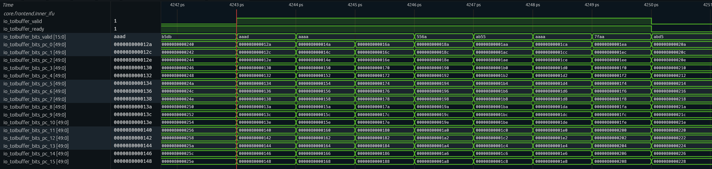
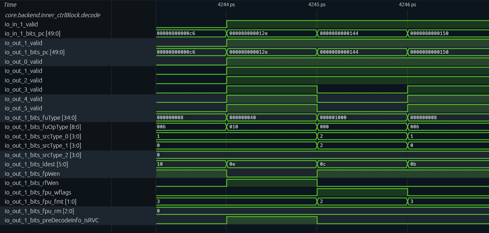
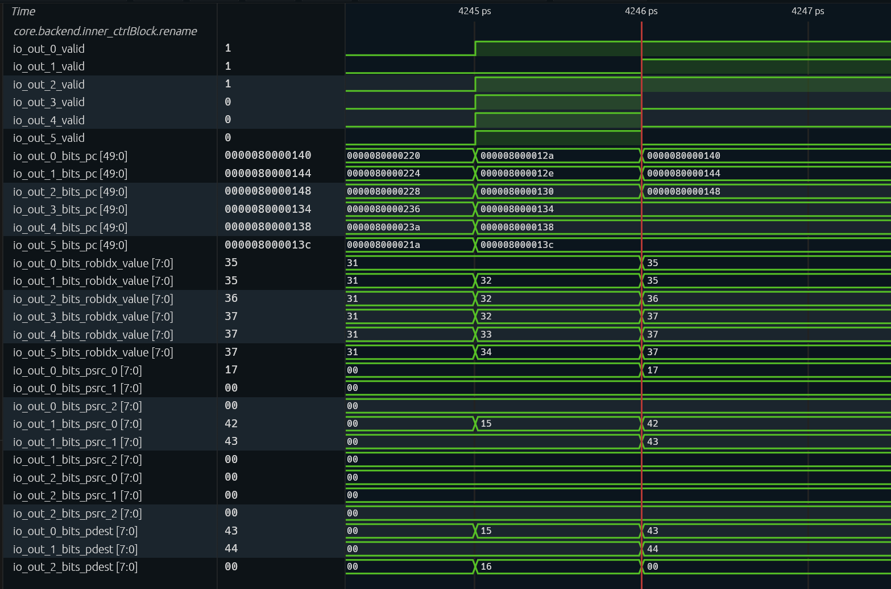
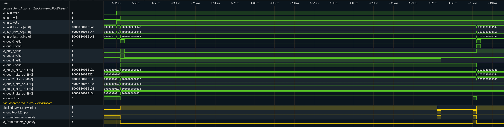
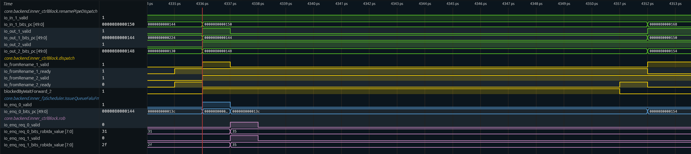
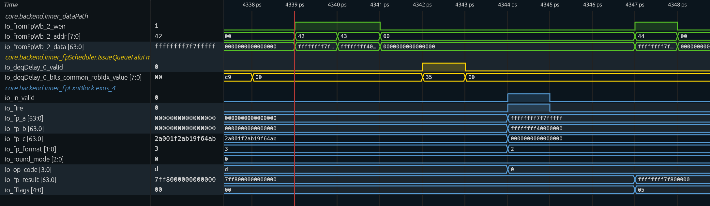
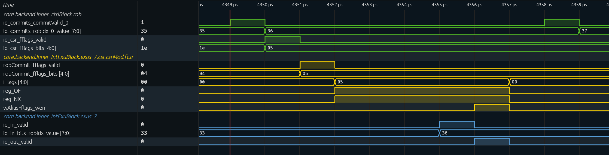
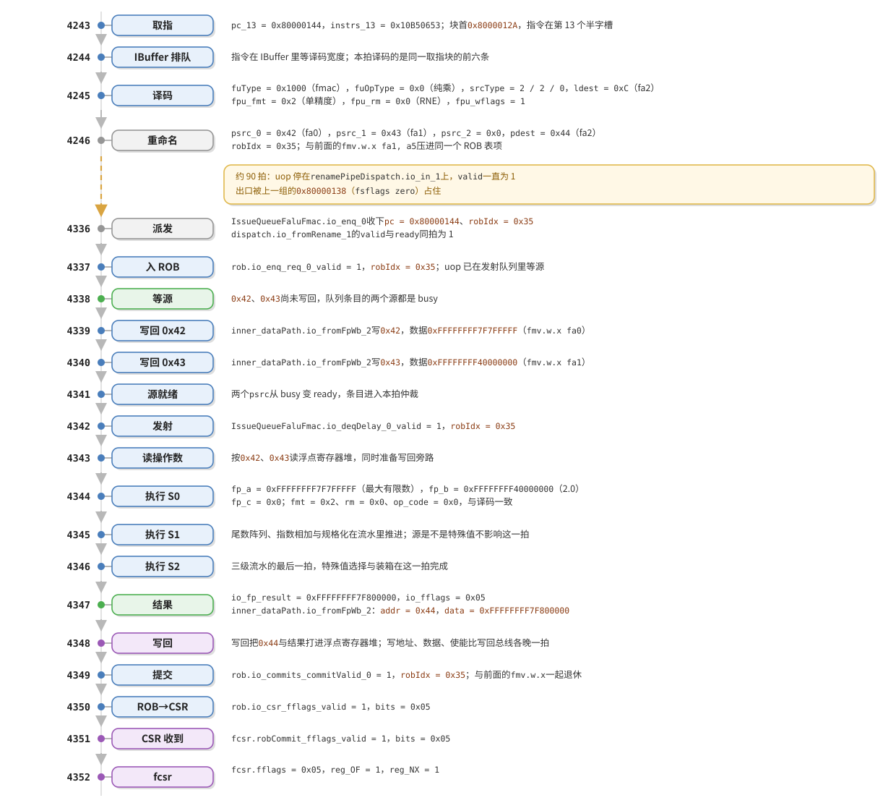

# 一条上溢乘法的执行过程：特殊操作数在流水线上的位置

　　前一篇把上溢、NaN、无穷与零的处理拆到了电路一级，结论是它们共用同一条三拍流水，差别只在末级选择器。这个结论可以用波形直接检验：把十条覆盖各类特殊操作数的乘法送入香山的 RTL 仿真，录下波形，看每一条从取指到提交各占几拍。本文先让一条必然上溢的乘法经历整条路径，再让其余九条在同一次仿真中与它对照。

　　仿真用的是香山昆明湖 V2 配置（KunminghuV2Config，kmh-v2） 提交编号`e7bab53e66` ；文中每个拍数、每个信号取值都取自这一次构建生成的波形。

　　主用例是 `0x7F7FFFFF × 2.0`，舍入取 RNE，即 `main` 里的第一条 `fmul.s`，PC 为 `0x80000144`。选它是因为结果与标志都唯一：最大有限数乘二越过单精度能表示的上界，硬件应当给出 `+∞`，并把 `OF` 与 `NX` 置进 `fflags`。

　　程序、镜像与反汇编：[【附件: fmul-inst.zip】](source-code/fmul-inst.zip)

## 一、测试程序

　　波形要看的只有两处：执行单元的输入端口和输出端口。程序因此不需要任何输出——打印会引入大量与浮点无关的指令，回读结果还要多写几条 `fmv.x.w`。十条用例顺序展开，每条四条指令，执行完毕后触发 trap。下面列出镜像中 `main` 的开头，包含前两条用例：

```asm
8000012a:  7f800737   lui     a4,0x7f800
8000012e:  377d       addiw   a4,a4,-1        # a4 = 0x7F7FFFFF
80000130:  7f8006b7   lui     a3,0x7f800      # a3 = 0x7F800000，留给后面几条用
80000134:  400007b7   lui     a5,0x40000      # a5 = 2.0
80000138:  00101073   fsflags zero
8000013c:  f0070553   fmv.w.x fa0,a4
80000140:  f00785d3   fmv.w.x fa1,a5
80000144:  10b50653   fmul.s  fa2,fa0,fa1,rne
80000148:  00101073   fsflags zero
8000014c:  f0070553   fmv.w.x fa0,a4
80000150:  f00785d3   fmv.w.x fa1,a5
80000154:  10b52653   fmul.s  fa2,fa0,fa1,rdn
```

　　开头四条 `lui`／`addiw` 是在构造操作数：`0x7F7FFFFF` 是 `0x7F800000` 减一，`2.0` 是 `0x40000000`，`0x130` 那条把 `0x7F800000` 写入 `a3`，供后面几条用例使用。位模式由整数指令直接算出，写下的位模式与送进执行单元的完全相同，中间不经过任何浮点运算。后面九条用例只在需要更换操作数时，才在 `fsflags` 前插入一条 `lui`、`li` 或 `addiw` 构造新值，其余都复用 `a3`、`a4`、`a5` 中已有的值。

　　每条用例的四条指令各承担一项职责。`fsflags zero` 汇编成 `00101073`，是 `csrw fflags, zero` 的伪指令：`fflags` 的五位是粘性的，硬件只会按位或置位，若不清零，就无法从波形判断这些位由哪条用例置起。两条 `fmv.w.x` 把整数寄存器里的位模式原样写入 `fa0`、`fa1`，经由的是整数到浮点的搬运通路，不做任何数值转换。`fmul.s` 的第四个操作数是舍入模式，汇编器把它直接编进 `funct3`：第一条是 `10b50653`，`funct3` 为 `000`，即 RNE；第二条是 `10b52653`，`funct3` 为 `010`，即 RDN。两条指令只差这一个字段，`fcsr.frm` 中的动态舍入模式完全不参与。

| 次序 | A | B | 舍入 | 类型 |
|---|---|---|---|---|
| 0 | `0x7F7FFFFF` | `0x40000000` | RNE | 上溢，取 `+∞` |
| 1 | `0x7F7FFFFF` | `0x40000000` | RDN | 上溢，取最大有限数 |
| 2 | `0x7FC00000` | `0x40000000` | RNE | 静默 NaN |
| 3 | `0x7F800001` | `0x40000000` | RNE | 信号 NaN |
| 4 | `0x7F800000` | `0xC0000000` | RNE | 无穷乘负有限数 |
| 5 | `0x7F800000` | `0x00000000` | RNE | 无穷乘零 |
| 6 | `0x80000000` | `0x40000000` | RNE | 负零乘正数 |
| 7 | `0x00000001` | `0x3F000000` | RNE | 最小次正规数乘 0.5 |
| 8 | `0x00000001` | `0x40000000` | RNE | 最小次正规数乘 2 |
| 9 | `0x3F800000` | `0x40400000` | RNE | 常规值 |

　　十条用例全部顺序展开在 `main` 里，没有循环、没有函数调用、没有回读，因此每条 `fmul.s` 都落在固定 PC 上，波形中按 PC 即可找到它，无须推测循环执行到第几轮。十条 `fmul.s` 依次落在 `0x80000144`、`0x80000154`、`0x80000168`、`0x8000017C`、`0x80000190`、`0x800001A2`、`0x800001B6`、`0x800001CC`、`0x800001DC`、`0x800001F4`。代价是 `main` 会变长，但对整个镜像来说这点代码量可以忽略。编译与运行各一条命令：

```sh
make ARCH=riscv64-xs CROSS_COMPILE=riscv64-unknown-elf-
```

　　运行时要加 `--dump-wave --wave-path=wave.fst` 录波。整个程序只有 151 条指令、4580 拍，执行结束时在 `0x80000206` 打印 `HIT GOOD TRAP`，说明 RTL 与参考模型逐条一致。录制窗口须覆盖全程，因为十条乘法散布在四千多拍上，窗口过短则只能覆盖前几条。

## 二、先学会读这张波形

　　信号按模块层次组织在 `TOP.SimTop.cpu.l_soc.core_with_l2.core` 之下，前端在 `frontend.inner_ifu`，译码到提交在 `backend.inner_ctrlBlock`，发射队列在 `backend.inner_fpScheduler`，执行单元在 `backend.inner_fpExuBlock`，写回汇集在 `backend.inner_dataPath`。要观察哪一级，就把这一级的 IO 信号加入波形窗口；本文用到的路径都可以由这几个前缀拼接得到。

```
TOP.SimTop.cpu.l_soc.core_with_l2.core
├── frontend.inner_ifu                    取指，出口是 toIbuffer
└── backend
    ├── inner_ctrlBlock                   decode / rename / renamePipeDispatch / dispatch / rob
    ├── inner_fpScheduler                 IssueQueueFaluFmac 等浮点发射队列
    ├── inner_fpExuBlock                  exus / exus_2 / exus_4 上的 Fmac.fma
    └── inner_dataPath                    写回汇集，物理寄存器堆的写口
```

　　横轴每格是一拍。这一版仿真由 Verilator 生成 FST，每个仿真步记一个时间单位，横轴标签上的 4242 就是第 4242 拍，标成 ps 只是时间单位的名称，不是真实时间。

　　纵向每一行是一个信号在该拍末尾的值，而不是它在这一拍中间的某个瞬间。同一列里两个信号谁先变化没有意义：组合逻辑的稳定顺序不进波形，一列就是一个整体状态。

　　握手类信号有两行：`valid` 表示上游有数据要送，`ready` 表示下游能够接收。`fire` 本身不是一个存储的状态，它是两者在同一拍的与，看到 `valid` 与 `ready` 同时为 1，就等于看到一次 fire。少数模块把这一项直接引出来做端口，执行单元就有 `Fmac.fma.io_fire`；FMA 每拍都收，`io_in_ready` 恒为 1，所以那一行的波形与 `io_in_valid` 完全重合。由此可以读出三种典型图形：`valid` 与 `ready` 都高，一拍即通过；`valid` 高而 `ready` 低，上游受阻，数据在总线上保持不变，波形上表现为一条长直线；`valid` 低，说明这一拍本级没有待处理的数据。

　　找一条指令有两种办法。译码之前只能用 PC，因为前端还没有分配 ROB 表项；从重命名开始改用 `robIdx`，它是这条指令在 ROB 里的编号，直到提交都由它标识，而 PC 在派发之后分散在各条总线的低位，不易检索。本文报拍数时默认写“第几拍”，与波形横轴一致。

　　有一处容易引起误判：相邻两个通道带有同一个 `robIdx`，并不表示同一条指令。香山把若干条可压缩的相邻指令压进一个 ROB 表项，表项一起提交，通道上的 `robIdx` 就重复了。本文的 `fmul.s` 正好与它前面那条 `fmv.w.x` 压在一起，波形上会连续出现两个 0x35。

## 三、取指：4243，指令字第一次出现在总线上

| 信号 | 位宽 | 含义 |
|---|---|---|
| `inner_ifu.io_toIbuffer_valid` | 1 | 取指块本拍向 IBuffer 送出数据 |
| `inner_ifu.io_toIbuffer_ready` | 1 | IBuffer 本拍可以接收 |
| `inner_ifu.io_toIbuffer_bits_valid` | 16 | 半字槽的指令起始掩码，第 $i$ 位对应第 $i$ 个半字槽 |
| `inner_ifu.io_toIbuffer_bits_pc_0` … `pc_15` | 各 50 | 16 个半字槽的地址，相邻两槽差 2，合起来覆盖 32 字节 |



　　4243 这一拍 `valid` 与 `ready` 同时为 1，取指块被 IBuffer 收下。此前 4235 到 4242 的八拍 `valid` 为 0，是 `jal` 跳入 `main` 造成的取指空洞；再往前 4234 那一拍取的是另一段代码，块首为 `0x80000220`。从 4243 起取指流恢复，每拍送出一个 32 字节窗口，4244 的窗口从 `0x8000014A` 开始，前一个窗口到 `0x148` 为止。

　　块首是 `0x8000012A`，不是 32 字节对齐，原因在程序自身：`main` 由 `jal` 从 `_trm_init` 调用进入，入口只保证半字对齐，取指窗口的边界随之偏移。`valid` 为 0 的那几拍，地址线上保留的是旧数据，不代表取指事件。

　　`bits_valid` 的 `0xAAAD` 从低位读，置 1 的是第 0、2、3、5、7、9、11、13、15 槽，共九个起点：`0x12A` 的 `lui` 占第 0、1 槽，第 2 槽的 `0x12E` 是 16 位压缩形式的 `addiw`（编码 `377d`），从 `0x130` 起又都是 32 位指令，每隔一个槽置一位，`0x144` 恰好落在第 13 槽。这条指令字在 `io_toIbuffer_bits_instrs_13` 上，值为 `0x10B50653`。掩码描述的是指令边界，不是指令数：同一个 32 字节窗口里既有 32 位指令也有压缩指令，槽的疏密因此不同。

　　取指级没有任何字段与操作数的值有关。总线上的内容是指令字、PC、FTQ 指针和预译码信息，`0x7F7FFFFF` 仍存放在浮点寄存器中尚未读出，这一级无从知道它与一条普通乘法有何区别。

## 四、译码：4245，编码变成一条 fmac 微操作

| 信号 | 位宽 | 含义 |
|---|---|---|
| `decode.io_in_1_valid` | 1 | 第 1 通道的译码输入有效 |
| `decode.io_in_1_bits_pc` | 50 | 第 1 通道输入的 PC |
| `decode.io_out_1_valid` | 1 | 第 1 通道的译码输出有效 |
| `decode.io_out_1_bits_pc` | 50 | 第 1 通道输出的 PC |
| `decode.io_out_0_valid` … `io_out_5_valid` | 各 1 | 六个通道各自的输出有效 |
| `decode.io_out_1_bits_fuType` | 35 | 功能单元类型，独热编码 |
| `decode.io_out_1_bits_fuOpType` | 9 | 功能单元内的运算类型 |
| `decode.io_out_1_bits_srcType_0` … `srcType_2` | 各 4 | 三个源的操作数类别 |
| `decode.io_out_1_bits_ldest` | 6 | 逻辑目的寄存器号 |
| `decode.io_out_1_bits_fpWen` | 1 | 写浮点寄存器 |
| `decode.io_out_1_bits_rfWen` | 1 | 写整数寄存器 |
| `decode.io_out_1_bits_fpu_wflags` | 1 | 本条指令需要写 `fflags` |
| `decode.io_out_1_bits_fpu_fmt` | 2 | 精度 |
| `decode.io_out_1_bits_fpu_rm` | 3 | 舍入模式 |
| `decode.io_out_1_bits_preDecodeInfo_isRVC` | 1 | 是否 16 位压缩指令 |



　　图取 4244 到 4247 四列。译码是组合查表，输入与输出在同一拍，`io_in_1_bits_pc` 与 `io_out_1_bits_pc` 逐拍重合。4244 的六个通道是 4243 那个取指块的前六条，4245 只剩第 0 到第 2 通道，是同一个块的最后三条：`0x80000140`、`0x80000144`、`0x80000148`。要找的 `fmul.s` 在 4245 这一列的第 1 通道上。

　　把它那一行上的字段逐个读出来，就得到了一条微操作的全部身份：`fuType` 为 `0x1000`，这是独热编码的第 12 位，对应 `fmac`，说明它将被送往带乘法能力的浮点执行单元；`fuOpType` 为 `0x0`，对应纯乘，告诉执行单元第三源不参与运算；两个源的 `srcType` 都是 `0x2`（浮点），第三源是 `0x0`（不读寄存器），所以这条指令只需要两个浮点寄存器；`ldest` 为 `0xC`，即 `fa2` 的架构号；`fpWen` 为 1、`rfWen` 为 0，写浮点不写整数。

　　4246 起六个通道又全部有效，总线上换成下一组，第 1 通道的 `pc` 为 `0x80000150`，六个通道的 `pc` 是 `0x8000014C` 到 `0x80000160`。这一组一直压在总线上，直到 4336 重命名腾出位置才变为 `0x80000168`。因此 `fmul.s` 的译码结果只存在于 4245 这一列，它的 `fuType`、`srcType`、`fpu_fmt`、`fpu_rm` 也只在这一列属于它；4246 之后的常量属于下一组指令，读错一列就会把它当作这条乘法的译码结果。

　　三个控制字段的取值同样在这一拍定下来。`fpu_wflags` 为 1，表示这条指令会写 `fflags`，这一位随微操作一直传递到执行单元，写回时用它决定标志是否需要采集。`fpu_fmt` 为 `0x2`，这是 `VSew` 编码里的 32 位，也就是单精度；它在执行单元里被译成“按 32 位解释源与结果”。`fpu_rm` 为 `0x0`，对应 RNE，因为这个程序用的是静态舍入，`fcsr.frm` 不参与。最后一列 `preDecodeInfo_isRVC` 为 0，确认这是一条 32 位指令。

　　这些字段的取值在编译期就定了，此后整条指令的生命周期里不再改变。波形上从这一拍起，“它是一条会写标志的单精度乘法”这件事就成了常量，后面各级只是把这份描述往下传。

## 五、重命名：4246，只剩寄存器号

| 信号 | 位宽 | 含义 |
|---|---|---|
| `rename.io_out_0_valid` … `io_out_5_valid` | 各 1 | 六个通道各自的输出有效 |
| `rename.io_out_0_bits_pc` … `io_out_5_bits_pc` | 各 50 | 各通道的 PC |
| `rename.io_out_0_bits_robIdx_value` … `io_out_5_bits_robIdx_value` | 各 8 | 各通道分配的 ROB 表项号 |
| `rename.io_out_0_bits_psrc_0` … `io_out_2_bits_psrc_2` | 各 8 | 第 0 到第 2 通道三个逻辑源映射到的物理寄存器号 |
| `rename.io_out_0_bits_pdest` … `io_out_2_bits_pdest` | 各 8 | 第 0 到第 2 通道新分配的物理目的寄存器号 |



　　图取 4244 到 4247 四列。4244 全通道无效，`pc` 与 `robIdx` 上保留的是被 `jal` 重定向作废的旧值。4245 是 4243 那个取指块的前六条，第 1 通道为空，其余五个通道的 `pc` 是 `0x8000012A`、`0x80000130`、`0x80000134`、`0x80000138`、`0x8000013C`。4246 换成本组，前三个通道是 `0x80000140`、`0x80000144`、`0x80000148`，`robIdx` 为 `0x35`、`0x35`、`0x36`，第 3 到第 5 通道无效。

　　这条 `fmul.s` 在 4246 这一列的第 1 通道上。这一级给出的全部新信息是寄存器号：`psrc_0` 为 `0x42`、`psrc_1` 为 `0x43`，是两个浮点源当前映射到的物理寄存器；`psrc_2` 为 `0x0`，因为第三源不占重命名资源；`pdest` 为 `0x44`，是给 `fa2` 新分配的那个物理寄存器；`robIdx` 为 `0x35`，从这一拍起它就是这条指令的身份证。

　　特殊值在这一级完全不可见。一个装着规范 NaN 的物理寄存器和一个装着 1.0 的物理寄存器，在重命名表里只差一个编号，映射过程完全不涉及内容。所以从 4246 往后，波形上任何一级都不会因为操作数是特殊值而出现不同的图形，能读出差异的只有数据线上的位模式和标志线上的五位。

　　4246 这一列上还有两处与指令条数对不上的地方。第 0 通道的 `pc` 是 `0x80000140`，`robIdx` 也是 `0x35`：它前面那条 `fmv.w.x fa1, a5` 与这条 `fmul.s` 被压进了同一个 ROB 表项。压缩的判据是相邻几条都可以压缩——香山把只写一个寄存器、不产生异常的指令标成可压缩，连续的一段合起来只占一个表项，由最后一条持有。所以 `0x35` 号表项同时覆盖这两条，提交级看到的 `0x35` 是这一对指令的整体退休。

　　同一张图上还能看到另一种合并：`0x8000012A` 那条 `lui` 与 `0x8000012E` 那条 16 位的 `addiw` 被合成一条微操作，`0x12E` 的通道在重命名出口上是空的，只剩 `lui` 一条占着一个表项。两种机制的名字不同——一个是 uop 融合，一个是 ROB 压缩——结果都是“通道数不等于指令数”。读这张波形时不能靠数通道推断指令条数。

## 六、派发：4246 到 4336，被上一组堵住的九十拍

| 信号 | 位宽 | 含义 |
|---|---|---|
| `renamePipeDispatch.io_in_0_valid` … `io_in_2_valid` | 各 1 | 三个输入通道各自的 valid |
| `renamePipeDispatch.io_in_0_bits_pc` … `io_in_2_bits_pc` | 各 50 | 输入通道的 PC |
| `renamePipeDispatch.io_out_0_valid` … `io_out_5_valid` | 各 1 | 六个输出通道各自的 valid |
| `renamePipeDispatch.io_out_0_bits_pc` … `io_out_5_bits_pc` | 各 50 | 输出通道的 PC |
| `dispatch.blockedByWaitForward_4` | 1 | 第 4 通道被 `waitForward` 挡住 |
| `dispatch.io_enqRob_isEmpty` | 1 | ROB 入队口为空 |
| `dispatch.io_fromRename_4_ready` | 1 | 第 4 通道可以从重命名接收 |
| `dispatch.io_fromRename_5_ready` | 1 | 第 5 通道可以从重命名接收 |
| `renamePipeDispatch.io_outAllFire` | 1 | 所有输出通道本拍一起离开 |



　　重命名给出的三个通道先落在 `renamePipeDispatch` 的输入侧，再从输出侧进派发。这条 fmul 从 4246 起停在 `io_in_1` 上，`valid` 始终为 1，`pc` 一直是 `0x80000144`，同组另两个通道是 `0x80000140` 与 `0x80000148`。输出侧在这九十拍里停着前一组，第 4、5 通道上是 `0x80000138` 与 `0x8000013C`。堵住出口的是 `0x80000138`：它是程序第一条 `fsflags zero`，`blockedByWaitForward_4` 从 4246 起一直为 1，身后的 `0x8000013C` 跟着 `fromRename_5_ready` 为 0。`waitForward` 要求这条指令等 ROB 排空，对应的信号是 `dispatch.io_enqRob_isEmpty`：4326 它第一次拉高，`0x80000138` 的 `fromRename_4_ready` 同拍拉高、当拍离开，4327 第 4 通道的输出清空；`0x8000013C` 还要再等一次入队口为空，到 4335 才 fire，同拍 `io_outAllFire` 拉高，寄存器清空。这九十拍与乘法本身无关，阻塞来自前一组里那条清标志的 CSR 指令。

| 信号 | 位宽 | 含义 |
|---|---|---|
| `renamePipeDispatch.io_in_1_valid` | 1 | 第 1 输入通道有效 |
| `renamePipeDispatch.io_in_1_bits_pc` | 50 | 第 1 输入通道的 PC |
| `renamePipeDispatch.io_out_1_valid` | 1 | 第 1 输出通道有效 |
| `renamePipeDispatch.io_out_1_bits_pc` | 50 | 第 1 输出通道的 PC |
| `renamePipeDispatch.io_out_2_valid` | 1 | 第 2 输出通道有效 |
| `renamePipeDispatch.io_out_2_bits_pc` | 50 | 第 2 输出通道的 PC |
| `dispatch.io_fromRename_1_valid` | 1 | 派发第 1 通道的输入有效 |
| `dispatch.io_fromRename_1_ready` | 1 | 派发可以接收第 1 通道 |
| `dispatch.io_fromRename_2_valid` | 1 | 派发第 2 通道的输入有效 |
| `dispatch.io_fromRename_2_ready` | 1 | 派发可以接收第 2 通道 |
| `dispatch.blockedByWaitForward_2` | 1 | 第 2 通道被 `waitForward` 挡住 |
| `IssueQueueFaluFmac.io_enq_0_valid` | 1 | 浮点发射队列入队有效 |
| `IssueQueueFaluFmac.io_enq_0_bits_pc` | 50 | 入队 uop 的 PC |
| `rob.io_enq_req_0_valid` | 1 | ROB 入队请求 0 有效 |
| `rob.io_enq_req_0_bits_robIdx_value` | 8 | 请求 0 的 ROB 表项号 |
| `rob.io_enq_req_1_valid` | 1 | ROB 入队请求 1 有效 |
| `rob.io_enq_req_1_bits_robIdx_value` | 8 | 请求 1 的 ROB 表项号 |



　　4336 这一拍，等着的三个通道进到输出侧，`0x80000144` 出现在 `io_out_1` 上，输入侧的 `io_in_1` 同时换为下一组的 `0x80000150`。同拍 `dispatch.io_fromRename_1` 的 `valid` 与 `ready` 同时为 1，fmul 派发出去，`IssueQueueFaluFmac.io_enq_0_valid` 也在这一拍拉高、`bits_pc` 为 `0x80000144`；ROB 晚一拍，4337 才是 `rob.io_enq_req_0_valid` 与 `req_1_valid` 同时为 1、两条 `robIdx` 都是 `0x35` 的一拍，因为派发到入队口之间有一级寄存器。同组的 `0x80000148` 不随同派发，`fromRename_2_valid` 从 4336 起为 1、`ready` 为 0，`blockedByWaitForward_2` 同时为 1，直到 4351 才与 `ready` 同时为 1；它不影响前面这条乘法，但正是两条用例之间那二十多拍间隔的来源。

## 七、发射与执行：4344 起的三拍

| 信号 | 位宽 | 含义 |
|---|---|---|
| `inner_dataPath.io_fromFpWb_2_wen` | 1 | 第 2 写回口的写使能 |
| `inner_dataPath.io_fromFpWb_2_addr` | 8 | 写回的物理寄存器号 |
| `inner_dataPath.io_fromFpWb_2_data` | 64 | 写回数据，已装箱 |
| `IssueQueueFaluFmac.io_deqDelay_0_valid` | 1 | 发射队列本拍送出 uop |
| `IssueQueueFaluFmac.io_deqDelay_0_bits_common_robIdx_value` | 8 | 送出 uop 的 ROB 表项号 |
| `exus_4.io_in_valid` | 1 | 执行单元入口有效 |
| `exus_4.Fmac.fma.io_fire` | 1 | FMA 本拍接收输入 |
| `exus_4.Fmac.fma.io_fp_a` … `io_fp_b`、`io_fp_c` | 各 64 | FMA 的三个源 |
| `exus_4.Fmac.fma.io_fp_format` | 2 | 精度 |
| `exus_4.Fmac.fma.io_round_mode` | 3 | 舍入模式 |
| `exus_4.Fmac.fma.io_op_code` | 4 | 运算码 |
| `exus_4.Fmac.fma.io_fp_result` | 64 | 已装箱的结果 |
| `exus_4.Fmac.fma.io_fflags` | 5 | 本条指令产生的标志 |



　　进入队列之后要等待两个源。两个浮点源的生产者是前面那两条 `fmv.w.x`，它们的写回在波形上是 `inner_dataPath.io_fromFpWb_2_wen` 拉高的那两拍：4339 写物理寄存器 `0x42`，值为 `0xFFFFFFFF7F7FFFFF`；4340 写 `0x43`，值为 `0xFFFFFFFF40000000`。高 32 位的全 1 是装箱，低位才是单精度数据，所以 `fa0` 装的是 `0x7F7FFFFF`，`fa1` 装的是 `0x40000000`。

　　4342 发射队列把它送出去：`IssueQueueFaluFmac.io_deqDelay_0_valid` 拉高，`robIdx` 为 `0x35`。从队列出口到执行单元入口还要经过读物理寄存器与旁路选择，4344 这一拍 `exus_4.io_in_valid` 才拉高，同一拍 `exus_4.Fmac.fma.io_fire` 为 1。这一刻硬件首次获得操作数的值。`fp_a` 是 `0xFFFFFFFF7F7FFFFF`，`fp_b` 是 `0xFFFFFFFF40000000`，`fp_c` 是 `0x0`——纯乘的第三源在执行单元内部被清零，波形上可直接读出。`fp_format` 为 `0x2`、`round_mode` 为 `0x0`、`op_code` 为 `0x0`，三个字段与译码级给出的一致，均未改变。

　　三拍之后，4347 这一拍：`io_fp_result` 为 `0xFFFFFFFF7F800000`，`io_fflags` 为 `0x05`。这三拍是定值：从 `io_fire` 到 `io_fp_result` 恰好三拍，输入是最大的有限数、是 NaN、还是无穷，间隔都一样。第九节把十条用例的读数排在一起，可以直接对照。

## 八、提交与 fcsr：4349 到 4352

| 信号 | 位宽 | 含义 |
|---|---|---|
| `rob.io_commits_commitValid_0` | 1 | 第 0 提交口的提交有效 |
| `rob.io_commits_robIdx_0_value` | 8 | 本拍提交表项的 `robIdx` |
| `rob.io_csr_fflags_valid` | 1 | 本拍向 CSR 送出标志 |
| `rob.io_csr_fflags_bits` | 5 | 送出的五位标志 |
| `fcsr.robCommit_fflags_valid` | 1 | CSR 收到提交标志 |
| `fcsr.robCommit_fflags_bits` | 5 | 收到的五位标志 |
| `fcsr.fflags` | 5 | 累积异常标志 |
| `fcsr.reg_OF` | 1 | 上溢标志 |
| `fcsr.reg_NX` | 1 | 不精确标志 |
| `fcsr.wAliasFflags_wen` | 1 | CSR 指令写 `fflags` 的使能 |
| `exus_7.io_in_valid` | 1 | 第 7 执行单元入口有效 |
| `exus_7.io_in_bits_robIdx_value` | 8 | 该 uop 的 `robIdx` |
| `exus_7.io_out_valid` | 1 | 第 7 执行单元输出有效 |



　　4349 这一拍 `rob.io_commits_commitValid_0` 拉高，`io_commits_robIdx_0_value` 为 `0x35`，这条乘法所在的两个 uop 一起提交。下一拍 4350，`rob.io_csr_fflags_valid` 拉高，`io_csr_fflags_bits` 为 `0x05`，标志从 ROB 送往 CSR；4351 CSR 内部的 `fcsr.robCommit_fflags_valid` 拉高，`bits` 同为 `0x05`。`fcsr.fflags` 到 4352 才变成 `0x05`，同拍 `fcsr.reg_OF` 与 `fcsr.reg_NX` 都变成 1。想在波形上确认一条浮点指令置了哪些标志，看 `fcsr.fflags` 变化的那一拍最直接；只看提交拍则会相差三拍。图的后半段是下一条指令的提交：4358 `rob.io_commits_commitValid_0` 再次拉高，`robIdx` 已换成 `0x36`。

　　标志是粘性的。硬件在 `fcsr` 里按位或，一旦置位就保持，只有软件写能清。清它的是下一条用例开头那条 `csrw fflags, zero`，经由的却是另一条通路：4355 那一拍 `exus_7.io_in_valid` 拉高、`robIdx` 为 `0x36`，是这条 CSR 指令进入执行单元；4356 它离开执行单元，同拍 `fcsr.wAliasFflags_wen` 拉高；4357 `fflags` 回到 `0x00`，五位同时清零。而它自己要到 4358 才在 `rob.io_commits_commitValid_0` 上出现。清标志的写入比提交信号早两拍，与浮点结果置标志的路径并不对称；在波形上判断标志由谁清除，应认 `wAliasFflags_wen` 那一拍，不能只看提交。

## 九、十条用例在同一张波形上

　　十条用例的入队拍、fire 拍、执行单元与结果列表如下。

| 次序 | PC | 入队拍 | fire 拍 | 执行单元 | 结果 | fflags |
|---|---|---|---|---|---|---|
| 0 | `0x80000144` | 4336 | 4344 | `exus_4` | `0x7F800000` | `0x05` |
| 1 | `0x80000154` | 4360 | 4369 | `exus_4` | `0x7F7FFFFF` | `0x05` |
| 2 | `0x80000168` | 4386 | 4394 | `exus_4` | `0x7FC00000` | `0x00` |
| 3 | `0x8000017C` | 4411 | 4419 | `exus_4` | `0x7FC00000` | `0x10` |
| 4 | `0x80000190` | 4435 | 4444 | `exus_2` | `0xFF800000` | `0x00` |
| 5 | `0x800001A2` | 4460 | 4469 | `exus_4` | `0x7FC00000` | `0x10` |
| 6 | `0x800001B6` | 4485 | 4494 | `exus_4` | `0x80000000` | `0x00` |
| 7 | `0x800001CC` | 4510 | 4519 | `exus_4` | `0x00000000` | `0x03` |
| 8 | `0x800001DC` | 4536 | 4544 | `exus_4` | `0x00000002` | `0x00` |
| 9 | `0x800001F4` | 4561 | 4569 | `exus_4` | `0x40400000` | `0x00` |

　　相邻两条的 fire 拍相隔 25 拍，节奏由每条用例开头那条 `fsflags` 决定，与乘法本身无关。入队到 fire 之间的八到九拍也不是执行延迟，而是排队等两个 `fmv.w.x` 的写回，再经过发射队列出口与读寄存器两级。

　　十条里有九条从 `exus_4` 发出，第四条从 `exus_2` 发出。这一条在派发组里排在第六个通道，而不同通道接的是不同的发射队列，它因此被分配到 `IssueQueueFaluFmacFdiv`，再从该队列背后的 `exus_2` 发射。波形上判断由哪个单元执行，只需看哪一组 `Fmac.fma.io_fire` 拉高。

　　结果一列与前一篇的算法结论逐条吻合。上溢的 RNE 给 `+∞`、RDN 给最大有限数，标志都是 `0x05`；静默 NaN 给规范 NaN 且不置标志，信号 NaN 给同一个规范 NaN 并置 `0x10`；无穷乘负有限数给负无穷，无穷乘零给规范 NaN 并置 `0x10`；零乘正数保留了符号；最小次正规数乘 0.5 下溢为零并置 `0x03`，乘 2 得到 `0x00000002` 不置标志。十条的结果与标志另有精确参考实现核对过，与波形逐条一致。

　　把 fire 拍与结果拍相减，十组数据都是 3：`io_fire` 之后第三拍一定出现 `io_fp_result` 与 `io_fflags`，一拍不多、一拍不少。输入行上，`fp_a` 上出现过 `0x7F7FFFFF`、`0x7FC00000`、`0x7F800001`、`0x7F800000`、`0x80000000`、`0x00000001` 这些位模式，执行单元一律接收，流水节奏没有任何变化。这就是“特殊操作数不增加延迟”在波形上的直接证据。

## 十、把时间轴串起来

　　这条上溢乘法的时间表是：4243 进 IBuffer，4245 译码，4246 重命名拿到 `0x35` 号表项，4336 派发并进入发射队列，4337 写进 ROB，4344 执行单元开始运算，4347 出结果并写回物理寄存器 `0x44`，4349 提交，4350 标志送往 CSR，4352 `fcsr` 更新。



　　其中可变的是两段等待。前一段九十拍来自上一组里那条清标志的 `fsflags`：它要等 ROB 入队口为空，占用派发寄存器期间，后面这一组无法进入。后一段八到九拍来自两个源的生产者：`fmv.w.x` 的写回决定了这条乘法什么时候被唤醒。不变的是执行单元的三拍，以及提交之后到 `fcsr` 更新之间那几拍固定延迟。

　　特殊操作数在整条路径上只改三个地方的值：进入执行单元时 `fp_a`、`fp_b` 上的位模式，第三拍选择器选中的哪一路结果，以及写回时 `fflags` 的五位。流水线的形状、握手的方式、每一级的拍数，都与一条普通乘法相同。

## 源码索引

| 模块 | 文件 | 关键行号 |
|---|---|---|
| FMA 配置与包装 | `FuConfig.scala`、`FMA.scala` | 715–728；25–44 |
| 第三源清零 | `FloatFMA.scala` | 89 |
| 分类与选择 | `FloatFMA.scala` | 636–644、669–709、786–819 |
| 标志位计算与下溢 | `FloatFMA.scala` | 629–634 |
| 输出装箱 | `FloatFMA.scala` | 854–868 |
| 取指块与半字掩码 | `IFU.scala` | 316–346、945、958–964 |
| wflags 两处记录 | `DecodeUnit.scala`、`RobBundles.scala` | 834、1044；140、191 |
| ROB 压缩 | `CompressUnit.scala`、`Rename.scala` | 51–67；346–364 |
| 派发等待与阻塞 | `NewDispatch.scala` | 796–819 |
| ROB 入队打拍 | `CtrlBlock.scala` | 713–719 |
| ROB 表项与提交合并 | `Rob.scala` | 709–719、833、1059–1067 |
| `fcsr` 更新 | `NewCSR/Unprivileged.scala` | 36、45–50 |
| 执行单元分布 | `Parameters.scala` | 427、431、435 |
