# 标量浮点乘法中特殊操作数的生命周期

> 参照源码：`XiangShan/`（kunminghu-v2，commit `7b16188f7`）。行号均以该版本为准。

　　浮点乘法与整数乘法最大的区别不在尾数怎么乘，而在结果的解释上：两个有限数相乘可能越界，NaN 一旦参与运算就把结果变成 NaN，零与无穷的组合在数学上没有定义。这些情形都要在写回之前被识别，结论同时落进结果和 `fflags`。本文按一条 `fmul` 从取指到提交的顺序，看这些判断分别在哪一级发生，又把代价留在了哪里。整条路径先按 Bundle 的更替切成八段，每一段再回答三个问题：这一级的输入是谁给的，输出的下一个读者是谁，中间补进来的字段由哪个模块计算。

---

## 1. 指令格式与浮点状态

### 1.1 编码格式

　　要谈特殊值，先得知道一条 `fmul` 带着哪些控制信息进入流水线。`fmul.s` 与 `fmul.d` 的主操作码都是 `OP-FP`（`1010011`），第 31 到 27 位的 `funct5` 为 `00010`，第 26、25 位的 `fmt` 区分精度。浮点加、减、乘、除、开方共用同一块 `funct5`，能区分它们的只剩 `fmt`，这正是格式要单独占两位的原因；规范里常说的 `funct7`，就是 `funct5` 与 `fmt` 拼起来的七位。

| 指令 | funct5[31:27] | fmt[26:25] | 拼成的 funct7[31:25] | opcode[6:0] |
|---|---|---|---|---|
| `fmul.s` | `00010` | `00` | `0001000` | `1010011` |
| `fmul.d` | `00010` | `01` | `0001001` | `1010011` |

　　`rs1`、`rs2`、`rd` 指向浮点寄存器，这与整数乘法不同：前端只负责把编码送进后端，真正的区别要等到重命名把它们映射到浮点物理寄存器时才显现。`rm` 域决定舍入模式，`000` 到 `100` 是五种静态模式，`111` 表示动态舍入，真正的模式要等执行级去读 `fcsr.frm`。

| 编码 | 助记符 | 含义 |
|:---:|:---:|---|
| 000 | RNE | 就近舍入，关联到偶数 |
| 001 | RTZ | 向零舍入 |
| 010 | RDN | 向下舍入（向 $-\infty$） |
| 011 | RUP | 向上舍入（向 $+\infty$） |
| 100 | RMM | 就近舍入，关联到最大幅度 |
| 101/110 | — | 保留 |
| 111 | DYN | 使用 `fcsr.frm` |

　　舍入模式不是装饰。上溢时结果取无穷还是最大有限数、下溢时舍入到零还是最小次正规数、乘积恰好落在两个可表示值中点时往哪边靠，都由它决定。同一条 `fmul` 换个 `rm`，可能从“置 `OF` 的无穷”变成“置 `OF` 的最大有限数”，差别在体系结构上可见。

### 1.2 fcsr 与 fflags

　　`fcsr` 是 32 位的控制和状态寄存器，高 24 位保留，第 7 到 5 位是 `frm`，低 5 位是累积异常标志 `fflags`。这五位记录自软件上次清除以来任意浮点指令产生过的条件，读到 1 不能证明“最后一条指令”产生了异常；基础 RISC-V F 扩展也不因置标志而陷入，标志只影响软件看到的 `fcsr`，不影响控制流。

| 标志 | 含义 |
|---|---|
| NV | 无效操作 |
| DZ | 除零 |
| OF | 上溢 |
| UF | 下溢 |
| NX | 舍入后不精确 |

　　`fmul` 不存在除零情形，`DZ` 在浮点乘法里恒为 0，五个标志实际只用到四个。`fcsr` 的更新是粘性的：一旦某位置 1，只有软件用 `csrw fflags` 才能清除，因此一条上溢乘法留下的 `OF|NX` 会一直保留到软件显式清标志为止。

### 1.3 NaN 装箱

　　浮点寄存器的宽度是 FLEN，有 D 扩展时为 64 位，而 `fmul.s` 的单精度值只占低 32 位。同一份寄存器内容若允许高 32 位任意取值，按双精度读出来就是另一个数，因此 RISC-V 对较窄值的存放方式作了约定：写入时最高的 $\mathrm{FLEN}-n$ 位全填 1，读取时检查这些位是否全 1，是则取低 $n$ 位，否则把操作数当作本精度的规范 NaN。

　　全 1 不是随意挑的填充值。符号位为 1、指数全 1、尾数不全为零，按更宽格式解读恰好是一个负的静默 NaN；把装箱后的单精度值误按双精度读，得到的是一个安静的 NaN，而不是一段看似正常、实则错误的数。这是 RISC-V 不另设标记位、让高位自身携带信息的原因。

　　执行入口的检查宽度随 `fmt` 变化：单精度查高 32 位，半精度查高 48 位，双精度没有高位可查（`FMA.scala:25-30`）。装箱失败的操作数按规范 NaN 处理，而规范 NaN 是静默的，因此不置 `NV`；这一步发生在分类之前，信号 NaN 的信号位也不会再生效。

---

## 2. 八个阶段如何切分

　　切分的依据不是源码里文件怎么分，而是指令在哪一刻从一种 Bundle 变成另一种 Bundle：Bundle 变了，说明有模块把字段读走、补上新字段、再交出去，那里就是一级的边界。后端从来没有一个叫 `Instruction` 的类在流水线上走，走的是一组字段名高度相似、但类型不同的 Bundle。`CtrlFlow` 里有 `instr`、`pc`、`ftqPtr`；`StaticInst` 里也有，但改名了两个字段；`DecodedInst` 在这之上多了 `fuType`、`fuOpType`、`lsrc`；`DynInst` 再把 `lsrc` 换成 `psrc`、补上 `pdest` 和 `robIdx`；`ExuInput` 只保留执行需要的操作数和控制位。每换一次类型，就有一批字段被消费掉，也有一批字段被补进来。

　　图 1 把八个阶段排成一条自取指到提交的线，每个框是一级的承担部件，框间的箭头是两级之间交接的 Bundle，虚线是跨级的回送。后面每一节给出这张图的局部放大，并逐条解释图上的连线。

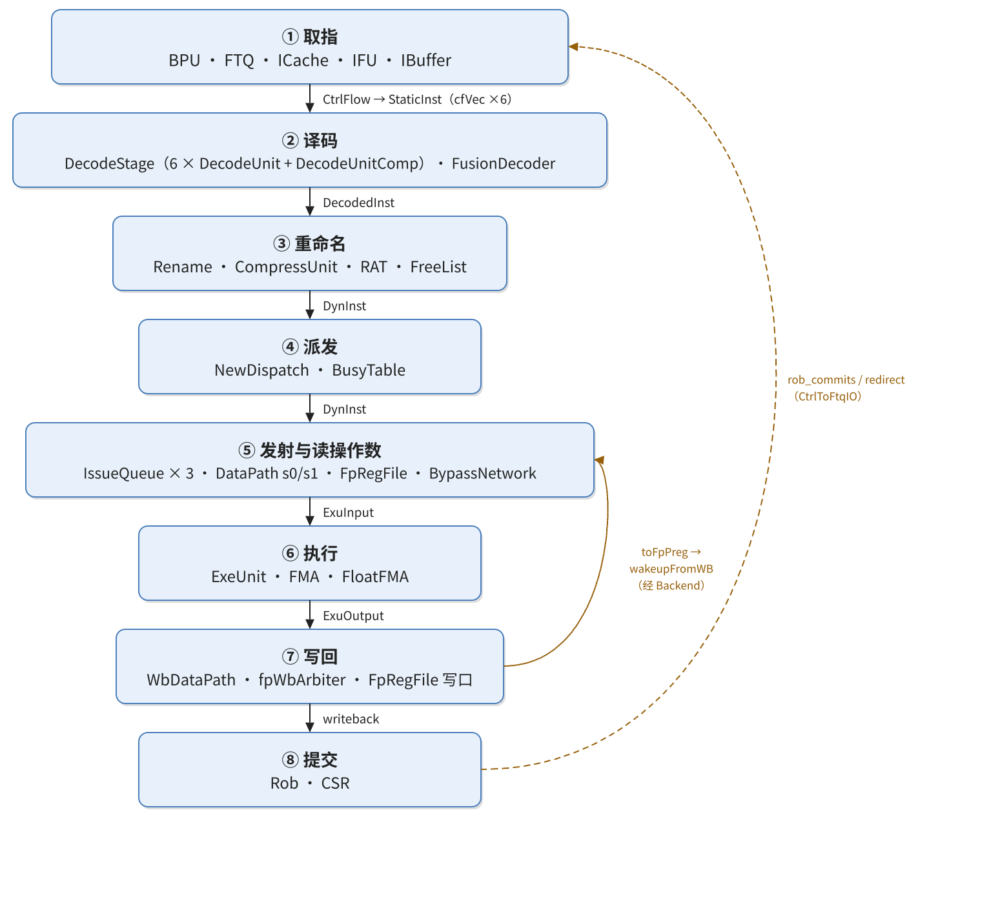

| 阶段 | 承担部件 | 进入时的 Bundle | 离开时的 Bundle |
|---|---|---|---|
| 取指 | `Predictor`、`Ftq`、`ICache`、`NewIFU`、`IBuffer` | 预测地址 | `CtrlFlow` |
| 译码 | `DecodeStage`（`DecodeUnit`×6、`DecodeUnitComp`、`VTypeGen`）、`FPDecoder`、`FusionDecoder` | `CtrlFlow` | `DecodedInst` |
| 重命名 | `Rename`、`CompressUnit`、`RenameTableWrapper`（RAT）、`FreeList` | `DecodedInst` | `DynInst` |
| 派发 | `NewDispatch` | `DynInst` | `DynInst`（入队）、`RobEnqIO` |
| 发射 | `Scheduler`、`IssueQueue`、`WbFuBusyTable` | `DynInst` | `IssueQueueIssueBundle` |
| 读操作数 | `DataPath`（s0/s1）、`FpRegFile`、`BypassNetwork` | `IssueQueueIssueBundle` | `ExuInput` |
| 执行 | `ExuBlock`、`ExeUnit`、`FMA` 包装、`FloatFMA` | `ExuInput` | `ExuOutput` |
| 写回 | `WbDataPath`、`WbArbiter`、`FpRegFile` 写口 | `ExuOutput` | 写口、`writeback` |
| 提交 | `Rob`、`CSR` | `RobEnqIO`、`writeback` | `RobCommitIO` |

　　表里列了九行，其中「发射」与「读操作数」在后文合并为一节叙述：队列选中和读寄存器堆是同一件事的两拍，中间只隔一个 s0/s1 流水寄存器，拆成两节反而把一次交接写成两次。剩下的八节，每节对应一个阶段。

---

## 3. 取指：把 PC 变成一条带上下文的指令

### 3.1 这一级要解决的问题

　　取指要同时定三件事：下一条该从哪里取（地址从哪来），那一处的字节是什么（数据从哪来），这一串字节在哪里切成指令（边界在哪）。三件事分别由预测器、缓存和预译码承担，任何一件做错，后面的译码都会拿到错的位模式。

　　RISC-V 允许 16 位压缩指令与 32 位指令混排，一条 32 位指令可能横跨两个 cache line，分支目标也可能落在半个 cache line 中间。取指级因此不能简单地「按 4 字节对齐切」：它必须先按预测给出的入口地址取一段字节，再用预译码逐条找出每条指令的末尾，最后才把切好的指令送下去。

### 3.2 部件与组织

　　前端由预测器 `Predictor`、取指目标队列 `Ftq`、指令缓存 `ICache`、取指单元 `NewIFU`、非缓存取指通路 `InstrUncache` 和指令缓冲 `IBuffer` 组成。这些部件不在同一层：`Frontend` 只是 LazyModule 外壳，实现放在 `FrontendInlined`，后者再包一层 `FrontendInlinedImp`；`ICache` 与 `InstrUncache` 由 `FrontendInlined` 例化（`Frontend.scala:68-69`），其余四个由 `FrontendInlinedImp` 例化（`Frontend.scala:106-109`）。`FrontendImp` 自己不做任何逻辑，只把内层的 IO 克隆一份再连起来（`Frontend.scala:55-63`）。层次关系如图 2，取指级的数据流如图 3。

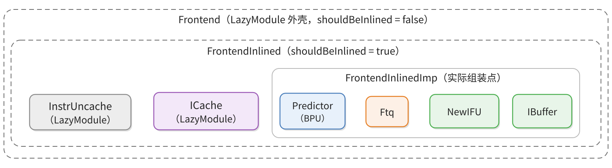

　　`ICache` 与 `InstrUncache` 留在 `FrontendInlined` 这一层，是因为它们要经 LazyModule 的 diplomacy 节点连到访存侧的 `MemBlock`（`XSCore.scala:70-73`），而 BPU、FTQ、IFU、IBuffer 之间只有内部连线，放在内层即可。

### 3.3 关键信号

　　取指级有九条连线，其中四条汇聚在 `Ftq` 上。`Ftq` 是取指阶段唯一的地址生产者与登记处：预测器往它里面写预测结果，它把请求同时发给 IFU 和 ICache，IFU 把预译码结果写回来，后端把重定向和提交信息送回来。

| 部件 | 这一级做什么 | 给出什么 |
|---|---|---|
| `Predictor` | 按取指块 PC 与全局历史并行查询快表、FTB/TAGE、SC/ITTAGE，分三级给出预测 | `BpuToFtqIO.resp` 的 `s1`/`s2`/`s3` |
| `Ftq` | 管理取指表项与取指指针，向 IFU、ICache 发请求，接收后端的提交记录与重定向 | `FtqToIfuIO`、`FtqToICacheIO` |
| `ICache` | 按取指地址查缓存与 ITLB，缺失时经 miss unit 取数 | `IFUICacheIO` 的 line 数据与命中信息 |
| `NewIFU` | 在 F0–F3 里生成地址、拼字节、做预译码、展开 RVC | `FetchToIBuffer`、`IfuToFtqIO.pdWb` |
| `IBuffer` | 缓存取指结果，按后端接收能力组成 `CtrlFlow` 送出 | `CtrlFlow`（`cfVec`） |
| `CtrlBlock` | 汇总提交与重定向回送 FTQ，并报告译码缓冲能否接收 | `CtrlToFtqIO`、`canAccept` |

| 边 | Bundle | 产生者 | 消费者 | 携带什么 |
|---|---|---|---|---|
| BPU → FTQ | `BpuToFtqIO`（`BPU.scala:243`） | `Predictor` | `Ftq`（`NewFtq.scala:479`） | `resp`：s1/s2/s3 三份预测结果各带 `ftq_idx`，FTQ 择最成熟的一份写回 |
| FTQ → IFU | `FtqToIfuIO`（`NewFtq.scala:197`） | `Ftq` | `NewIFU` | `req`（`Decoupled(FetchRequestBundle)`）、`redirect`、`topdown_redirect`、`flushFromBpu` |
| FTQ → ICache | `FtqToICacheIO`（`NewFtq.scala:204`） | `Ftq` | `ICache` | 一个 `req`，带取指地址与 FTQ 坐标 |
| ICache → IFU | `IFUICacheIO`（`FrontendBundle.scala:80`） | `ICache` | `NewIFU`（`IFU.scala:72`） | cache line 数据、命中/缺失、异常信息 |
| IFU → FTQ | `IfuToFtqIO`（`IFU.scala:47`） | `NewIFU` | `Ftq` | `pdWb`，预译码回写的指令边界与分支信息 |
| IFU → IBuffer | `FetchToIBuffer`（`FrontendBundle.scala:240`） | `NewIFU`（`IFU.scala:957-984`） | `IBuffer` | 最多 `PredictWidth` 条指令位、PC、`pd`、空位掩码 |
| IBuffer → 后端 | `CtrlFlow`（`Bundle.scala:144-168`） | `IBuffer`（`IBuffer.scala:87-112`） | `CtrlBlock` | 见第 4 节 |
| CtrlBlock → FTQ | `CtrlToFtqIO`（`CtrlBlock.scala:43`） | `CtrlBlock`（`CtrlBlock.scala:342-358`） | `Ftq`（`NewFtq.scala:481`） | `rob_commits`、`redirect`、`ftqIdxAhead` |
| CtrlBlock → IBuffer | `FrontendToCtrlIO.canAccept`（`Bundle.scala:492`） | `CtrlBlock`（`CtrlBlock.scala:504`） | `IBuffer`（`Frontend.scala:431`） | 后端译码缓冲是否还能接收新指令 |

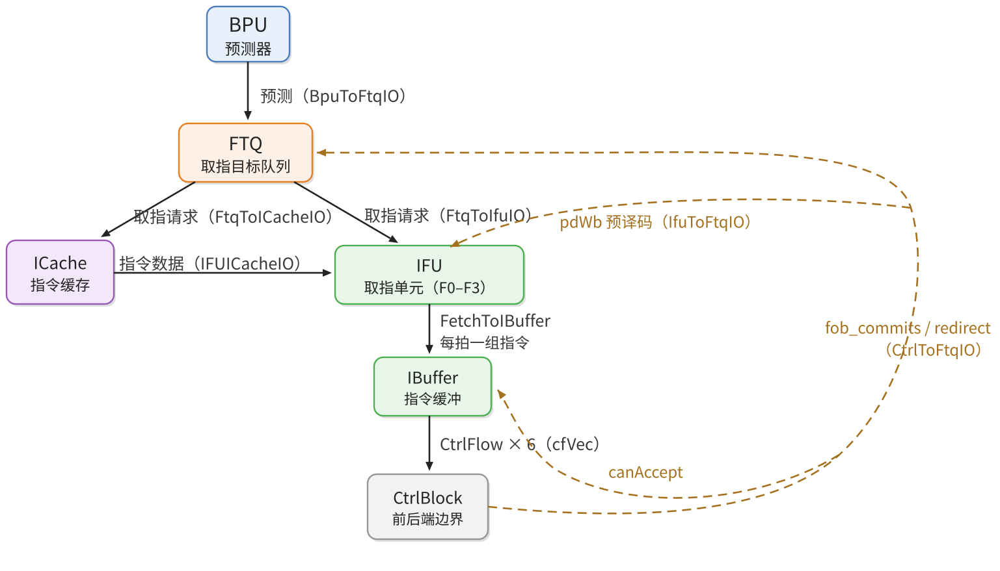

　　`resp` 里的 s1、s2、s3 是 BPU 三级预测流水上三个不同取指块的当前结果，不是同一个块的三次快照。三级的差别在于等谁的结论：s1 只有 FauFTB 快表，它是唯一标了 `is_fast_pred` 的部件，Composer 把它的输出直接旁路到 s1（`Composer.scala:27-32`、`FauFTB.scala:84`）；s2 等 FTB 和 TAGE（`FTB.scala:787-801`、`Tage.scala:687-696`）；s3 等 SC 的统计校正和 ITTAGE（`SC.scala:339-343`）。三份结果各自带 `ftq_idx`（`FrontendBundle.scala:691-697`），FTQ 按「s3 有重定向就用 s3，否则看 s2，否则用 s1」挑最成熟的一份（`FrontendBundle.scala:735-742`），选中 s1 时写 `bpuPtr` 指向的新表项，选中 s2/s3 时写响应自带 `ftq_idx` 指向的旧表项（`NewFtq.scala:615-618`）。一个取指块因此在三拍里被陆续补全：s1 建项，s2、s3 修正方向与目标，表项里还记下结论来自哪一级（`NewFtq.scala:674`）。

　　BPU 与 IFU 之间没有直接连线。预测器把结果登记进 FTQ，一条表项记录一次取指目标的起始地址、分支预测信息与预测方向；FTQ 再把这条表项同时交给 IFU 取字节、交给 ICache 查缓存（`Frontend.scala:200-211`）。这样安排的原因是 IFU 的取指必须与 FTQ 的登记顺序一致：IFU 只能取 `ifuPtr` 追上 `bpuPtr` 之前的表项，条件写在 `entry_is_to_send && ifuPtr =/= bpuPtr` 里（`NewFtq.scala:916`）。预测器还没写进来的目标，IFU 取不到。

　　IFU 内部按 F0 到 F3 四级推进。F0 从 FTQ 表项里取出起始地址（`IFU.scala:241-263`）；F1 按 `PredictWidth` 生成每个槽位的 PC，并算出这一组取指在 cache line 里的截断位置 `cut_ptr`（`IFU.scala:307-343`）；F2 把 cache line 数据拼接、按 `cut` 截断，再由 `PreDecode` 逐字节找出指令边界（`IFU.scala:356-540`，截断在 510 行，预译码在 518-529 行）；F3 把 16 位压缩指令展开成 32 位，连同各个有效位一起送出（`IFU.scala:559-598`，RVC 展开在 572-582 行）。

　　F2 得到的指令边界不只用于切分，还要回写 FTQ：`pd` 里的「是否分支、是否跳转、是否返回、预测方向」会被后端用来重定向。回写通道就是 `IfuToFtqIO.pdWb`（`IFU.scala:1175`），FTQ 把它写进自己的 pd 存储（`NewFtq.scala:981-990`）。写回之后，这条表项才带着完整信息被后端看见。

　　`IBuffer` 是取指级的出口缓冲，也是前后端之间唯一的指令通道。IFU 每拍把一组指令压进 `FetchToIBuffer`，IBuffer 按 `IBufEntry` 存下（`IBuffer.scala:52`、`IBuffer.scala:66`），出队时由 `toCtrlFlow` 转成 `CtrlFlow`（`IBuffer.scala:87-112`），经 `io.backend.cfVec` 送给后端（`Frontend.scala:439`）。

　　反压走的不是 `cfVec` 的 `ready`。`CtrlBlock` 用 `io.frontend.canAccept` 告诉前端「译码缓冲还能不能收」（`CtrlBlock.scala:504`），前端把这根线接到 `ibuffer.io.decodeCanAccept`（`Frontend.scala:431`），IBuffer 靠它决定要不要腾空输出寄存器。`cfVec` 上每路的 `ready` 虽然也被 `CtrlBlock` 赋值，但 IBuffer 并不读它。

　　后端往前端的回送走 `CtrlToFtqIO`。里面有两类信息：`rob_commits` 是 ROB 的提交记录，FTQ 用它把对应表项标记为已提交（`NewFtq.scala:1319`）；`redirect` 是重定向，FTQ 据此冲刷 ICache、IFU 和 BPU，并把取指指针挪到正确目标。

### 3.4 FMUL 在这一级

　　前端的所有动作都只作用在指令字和地址上，操作数还在浮点寄存器堆里没有被读出，所以特殊值在这一段没有任何身份。取指级按 FTQ 给出的范围切出指令块，ICache 命中与否、ITLB/PTW 是否等待、IBuffer 是否背压，决定了这条指令什么时候进入后端（`IFU.scala:241-263`、`IFU.scala:292-320`、`IFU.scala:357-420`、`IFU.scala:558-620`）。

　　`FMUL.S` 是 32 位指令，低两位为 `11`，预译码在 F2 一眼就能定出它是 4 字节、不是压缩指令，`pd.isRvc` 为假。F3 的 RVC 展开对它不做任何事，`f3_expd_instr` 里原样保留 32 位编码。预译码只看编码中决定控制流和指令边界的少数几位，对这条 32 位 `fmul`，它给出 `valid=1, isRVC=0, brType=notCFI, isCall=0, isRet=0`（`PreDecode.scala:72-82`）；它不判断这个位置是不是浮点指令，更不判断操作数类型，运算类别留给后端译码。

　　PredChecker 校验的是预测器有没有把非控制流位置当成跳转。`fmul` 正常情况下不触发 `remaskFault`，也不产生 `mispredict`；如果同一取指窗口里有更早的分支被预测错误，这条 `fmul` 会随窗口一起被屏蔽，这属于通用前端恢复，不是乘法自身产生的异常。

　　进入 IBuffer 时，指令携带的是指令字、PC、FTQ 指针与偏移、预译码信息和取指异常（`IFU.scala:953-990`、`IBuffer.scala:228-324`）。入队宽度取决于 `PredictWidth`，C 扩展打开时是 16 个半字候选位置，不等于每拍能入队 16 条 32 位指令；`enqEnable` 还受 `fixedRange` 和有效掩码限制，队列满时这条指令就停在 IBuffer 里等。

　　这一级为 FMUL 留下的是三样东西：32 位指令位、`pc`、以及一对坐标 `ftqPtr` 和 `ftqOffset`。坐标的含义是「这条指令来自 FTQ 的第几条表项、表项内第几个槽位」。后端后来无论发现误预测、异常还是需要提交，都拿这对坐标回 FTQ 定位；指令退休时，FTQ 也靠它把表项标记为已提交。前端此时并不知道这是一条浮点乘法指令，`pd` 里只记了它是不是分支、是不是 RVC。特殊值第一次被硬件看见，要等到执行单元的入口；在此之前，流水线只关心「指令是不是有效」「源什么时候就绪」，从不关心寄存器里的位模式代表什么。

### 3.5 怎么在源码里确认

　　打开 `Frontend.scala`，先看 `FrontendInlinedImp` 例化了哪四个模块，再看 `io.backend.cfVec <> ibuffer.io.out` 这一句，确认前端交出去的是 `CtrlFlow`。然后打开 `NewFtq.scala`，搜 `FtqToIfuIO` 和 `FtqToICacheIO`，确认两路请求同源；搜 `pdWb` 的写入点，确认预译码结果确实回到 FTQ。最后在 `IFU.scala` 里按 F0 到 F3 的顺序读一遍，看 `cut` 和 `PreDecode` 分别在哪一级。

---

## 4. 译码：从 32 位编码到 15 列控制信号

### 4.1 这一级要解决的问题

　　取指级刻意不做语义判断，送下来的是纯粹的位模式。译码要做的是把「这条指令是什么」翻译成「这条指令怎么走」：走哪个执行单元、做什么运算、读哪几个源、写不写寄存器、是否需要拆成多个微操作。翻译的结果是一组固定宽度的控制字段，后面的重命名、派发、发射都只读这组字段，不再回头查指令编码。

　　固定宽度是这一级最重要的设计约束。译码表有十几张子表，覆盖基础整数、浮点、位操作、向量、加密、调试、压缩等扩展，每张表的每一行都必须给出同样多的列（`DecodeUnit.scala:806-818`）。只有这样，查表结果才能直接展开成一个 `DecodedInst`。

### 4.2 部件与组织

　　译码级在 `CtrlBlock` 内部。`CtrlBlock` 是后端的第一大块，把「取指之后、发射之前」的控制逻辑装在一起：它例化 `NewDispatch`、`DecodeStage`、`FusionDecoder`、`RenameTableWrapper`、`Rename`、`RedirectGenerator` 和 `Rob`（`CtrlBlock.scala:90-99`）。`DecodeStage` 自己再装一个复杂译码器 `DecodeUnitComp`、六个简单译码器 `DecodeUnit` 和一个 `VTypeGen`（`DecodeStage.scala:104-108`）。模块层次见图 4。

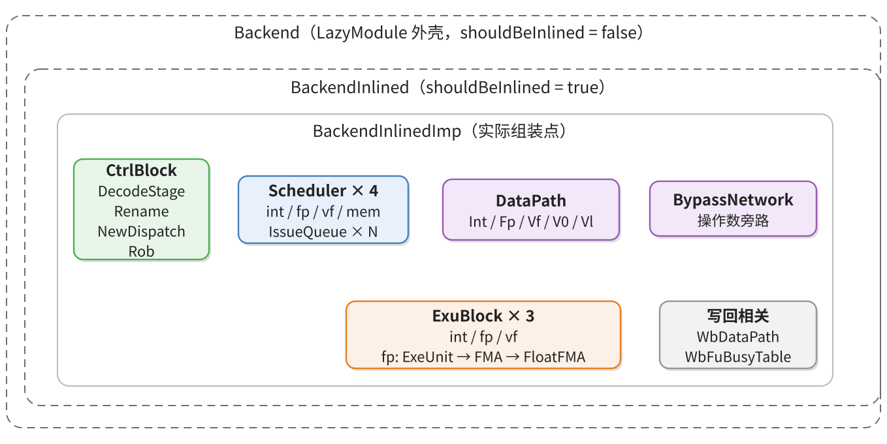

　　简单译码器与复杂译码器分工不同。六个 `DecodeUnit` 各查一次主表，得到 15 列通用控制信号；`DecodeUnitComp` 不重查主表，它拿简单译码器的结果判断这条指令要不要拆成多个 uop，并按拆分规则生成后续 uop。`FusionDecoder` 与 `DecodeStage` 并列，检查相邻两条指令能不能合并成一个融合操作。

### 4.3 关键信号

| 部件 | 这一级做什么 | 给出什么 |
|---|---|---|
| `CtrlBlock` | 把前端 `CtrlFlow` 改名成 `StaticInst`，译码拥塞时暂存 | `StaticInst` |
| `DecodeStage` | 把六路输入分给六个译码器，汇总译码结果，提前发 RAT 读地址 | `DecodedInst`、`RatReadPort` |
| `DecodeUnit` | 查主表得到 15 列通用控制，并调用 `FPDecoder` 补浮点控制 | `DecodedInst` 的控制列 |
| `FPDecoder` | 由指令编码给出浮点精度与舍入模式 | `FPUCtrlSignals` 的 `fmt`、`rm` |
| `DecodeUnitComp` | 判断 uop 是否需要拆分，并按规则生成后续 uop | uop 拆分结果 |
| `FusionDecoder` | 检查相邻两条指令能否融合 | `FusionDecodeReplace`、`FusionDecodeInfo` |
| `VTypeGen` | 由指令与已有配置推出向量类型 | `VType` |

| 边 | Bundle | 产生者 | 消费者 | 携带什么 |
|---|---|---|---|---|
| 前端 → 边界 | `CtrlFlow`（`Bundle.scala:144-168`） | `IBuffer` | `CtrlBlock` | 指令位、PC、`ftqPtr`/`ftqOffset`、预译码结果 |
| 边界内部 | `StaticInst`（`Bundles.scala:43-57`） | `CtrlBlock`（`CtrlBlock.scala:481-482`） | `DecodeStage.io.in`（`DecodeStage.scala:46`） | `CtrlFlow` 的字段加两个改名 |
| 译码器输入 | `StaticInst`（`Bundles.scala:43-57`） | `DecodeStage`（`DecodeStage.scala:117-119`） | `DecodeUnit.io.enq.ctrlFlow` | 同上 |
| 译码器输出 | `DecodedInst`（`Bundles.scala:78-146`） | `DecodeUnit`（`DecodeUnit.scala:834`） | `DecodeStage.io.out` | 15 列控制信号、`lsrc`、`fpu` 控制、`preDecodeInfo`、`pc`、`ftqPtr` |
| 融合 → 控制块 | `FusionDecodeReplace`（`FusionDecoder.scala:512`） | `FusionDecoder`（`FusionDecoder.scala:538`） | `CtrlBlock`（`CtrlBlock.scala:603-605`） | 融合后要替换的控制字段 |
| 融合 → 重命名 | `FusionDecodeInfo`（`FusionDecoder.scala:506`） | `FusionDecoder` | `Rename.io.fusionInfo`（`Rename.scala:56`） | 融合槽位与第二个源的选择 |
| 译码 → 重命名 | `DecodedInst`（`Bundles.scala:78-146`） | `DecodeStage`（`DecodeStage.scala:234-236`） | `Rename.io.in`（经 `decodePipeRename`，`CtrlBlock.scala:576-579`） | 同上 |
| 译码 → RAT | `RatReadPort`（`RenameTable.scala:37`） | `DecodeStage`（`DecodeStage.scala:271-275`） | `RenameTableWrapper`（`CtrlBlock.scala:507-509`） | `lsrc(0..2)` 作为读地址 |

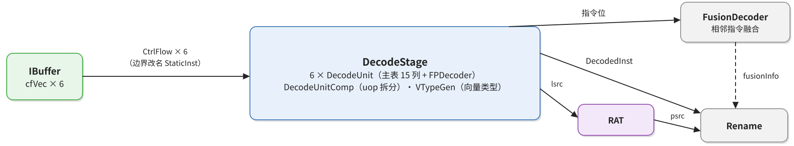

　　边界这一小段值得单独看。`FrontendToCtrlIO` 的 `cfVec` 是六路 `DecoupledIO(new CtrlFlow)`（`Bundle.scala:486`），`CtrlBlock` 收到后先做一次改名：新建 `Wire(Vec(DecodeWidth, new StaticInst))`，用 `connectCtrlFlow` 把 `CtrlFlow` 的字段逐个搬过来（`CtrlBlock.scala:481-482`）。两个类型字段一一对应，只有 `backendException` 改叫 `isFetchMalAddr`、`pd` 改叫 `preDecodeInfo`。

　　改名之后还有一级暂存。当 `DecodeStage` 这一拍收不下全部指令时，剩下的要留在 `CtrlBlock` 里，这就是 `decodeBufBits`——一个 `Reg(Vec(DecodeWidth, new StaticInst))`（`CtrlBlock.scala:417`）。`DecodeStage` 的输入因此在三处之间做选择：缓冲里有没有指令、这一拍前端送来的指令能不能直接进、以及哪几路真正就绪，选择逻辑在 `CtrlBlock.scala:498-502`。

　　`DecodeStage` 内部的消费方式很直接：每一路输入接到对应简单译码器的 `io.enq.ctrlFlow`（`DecodeStage.scala:117-119`）。端口名叫 `ctrlFlow`，类型已经是 `StaticInst`，这是历史命名留下的痕迹。`DecodeUnit` 用 `instr` 查表得到控制信号，再用 `connectStaticInst` 把 `StaticInst` 里同名字段整体拷进 `DecodedInst`（`DecodeUnit.scala:834`）。

　　`connectStaticInst` 的实现是按字段名求交集（`Bundles.scala:146-152`），所以 `pc`、`ftqPtr`、`ftqOffset`、`isLastInFtqEntry`、`preDecodeInfo`、`exceptionVec` 这些字段会自动带下去，译码器不需要逐条赋值。这条规则也解释了为什么 `DecodedInst` 里保留了一批看起来与译码无关的取指字段：它们要让 ROB 在提交时还能定位到 FTQ 表项。

　　译码级还提前做了一件属于下一级的事：把 `lsrc` 送到重命名表的读地址口。这一步在译码结果送出的同一拍发生（`DecodeStage.scala:271-275`），因为重命名表是同步读，地址打一拍数据才回来；提前发地址，等 `DecodedInst` 经 `decodePipeRename` 到达重命名级时，读出的 `psrc` 正好可用。

### 4.4 FMUL 在这一级

　　`FMUL_S` 在 `VecDecoder.scala` 里占一行：`FMUL_S -> OPFFF(SrcType.fp, SrcType.fp, SrcType.X, FuType.fmac, VfmaType.vfmul, F, T, F, UopSplitType.SCA_SIM)`（`VecDecoder.scala:548`）。这一行给出 15 列里的 9 列，其余由 `OPFFF` 的固定值补齐：不写整数寄存器、不写向量寄存器、不产生扩展异常、不阻塞后来的指令、允许 ROB 压缩、无立即数。

　　`fuType = FuType.fmac` 决定它进浮点发射队列，`fuOpType = VfmaType.vfmul` 决定它在乘加单元里做乘法，`fpWen = T` 决定结果写浮点物理寄存器。第三个源被写成 `SrcType.X`，编码是全零，意思是「没有这个源」：重命名不为它查表，数据通路不为它建读端口，执行级拿到的是 0。指令编码里 `lsrc(2)` 仍然被赋成了 `inst.VD`（`DecodeUnit.scala:853-863`），但没有任何一级会用它。

　　主表之外还有一个专用译码器 `FPDecoder`，补出精度与舍入模式，结果写进 `DecodedInst.fpu`（`DecodeUnit.scala:830-833`）。它给出的 `FPUCtrlSignals` 有五个字段：`typeTagOut`、`wflags`、`typ`、`fmt`、`rm`（`Bundle.scala:171-177`）。其中 `typeTagOut`、`wflags`、`typ` 由译码逻辑决定（`FPDecoder.scala:194`、`FPDecoder.scala:229`），`fmt` 与 `rm` 则从指令编码原样带过来。`FMUL_S` 在 `isFP32Instrs` 列表里，所以 `fmt` 取 `VSew.e32`（`FPDecoder.scala:293-299`、`FPDecoder.scala:341`）；`rm` 原样保留指令的 3 位字段，值为 `111` 时留到执行级用 `fcsr.frm` 解释（`FPDecoder.scala:342`）。

　　`DecodeUnitComp` 按 `uopSplitType` 决定拆分规则，`SCA_SIM` 没有对应分支，FMUL 原样通过（`DecodeUnitComp.scala:160`、`DecodeUnitComp.scala:211`）。`DecodeUnit` 给出的默认值是 `uopIdx = 0`、`firstUop = true`、`lastUop = true`、`numUops = 1`、`numWB = 1`（`DecodeUnit.scala:836-840`），所以从译码出来只有一个 uop。

　　`vfmul` 这个取值是纯乘与乘加共用一条通路的分岔点。`FloatFMA` 收到 `vfmul` 时把第三源清零（`FloatFMA.scala:89`），包装层 `FMA` 也因此跳过第三源的装箱检查（`FMA.scala:29-30`）。清零带来一个不显眼但很深的后果：`fp_c_is_zero_f32` 恒为 1（`FloatFMA.scala:643`），`has_zero_f32_reg2` 随之恒为 1（`FloatFMA.scala:652`），五路选择中“零”这一支成了所有有限结果的默认通路，`otherwise` 对 `fmul` 不可达。

　　译码项把“这条指令要写 `fflags`”记在两处，各有各的去处。`DecodeUnit` 的 `wfflagsInsts` 列表含 `FMUL_S/D/H`（`DecodeUnit.scala:989`），结果写进 `decodedInst.wfflags`（`DecodeUnit.scala:1044`），随派发写进 ROB 表项的 `wflags`（`RobBundles.scala:140`），提交时由它决定这个表项要不要更新 `fcsr`。`FPDecoder` 给出的 `fpu.wflags` 在译码器出口与前者按或合并（`DecodeUnit.scala:834`），随 uop 一路送到执行单元，写回时作为 `ExuOutput.wflags` 的门控。只记一处，要么执行单元不知道标志该不该采，要么 ROB 不知道提交时该不该把标志送给 `fcsr`；两处记录换来的是同一条信息在两条路径上各走各的，最后在提交级汇合。

### 4.5 怎么在源码里确认

　　先 `grep FMUL_S` 找到那一行，再打开 `OPFFF` 的构造器定义核对参数顺序，最后到 `DecodedInst.allSignals` 确认 15 列的名字与顺序（`Bundles.scala:129-130`）。三处对得上，这一行的含义才算读准。若要看浮点字段，再搜 `FPDecoder` 里的 `fmt` 和 `rm` 赋值。

---

## 5. 重命名：逻辑寄存器号变成物理寄存器号

### 5.1 这一级要解决的问题

　　程序里的 `f1`、`f2` 是逻辑名。如果后来的指令要写 `f1`，而前面还有指令要读旧的 `f1`，硬件就必须等，这就是假相关。重命名的办法是给每次写分配一个新的物理寄存器，逻辑名到物理名的映射记在 RAT 里。这样读旧值的指令仍指向旧物理寄存器，写新值的指令拿到新物理寄存器，两条指令可以并行。

　　这一级同时要完成三件互相牵连的事：读 RAT 把 `lsrc` 换成 `psrc`，从 FreeList 分配 `pdest`，从 ROB 领取 `robIdx`。三件事都必须在同一拍定下来，因为后面的派发要用 `pdest` 和 `robIdx` 去写忙表和 ROB。

### 5.2 部件与组织

　　`Rename` 模块内部例化压缩单元 `CompressUnit`、五组 FreeList（整数、浮点、向量、`v0`、`vl`），并管理 RAT 的写端口（`Rename.scala:105-115`）。RAT 表本体不在 `Rename` 里，而是 `CtrlBlock` 里的 `rat = Module(new RenameTableWrapper)`（`CtrlBlock.scala:94`）：它的读端口接在 `DecodeStage` 上，写端口接在 `Rename` 上。这样摆是因为读地址必须在译码级发出、读数据在重命名级使用，表放在两级之间最自然。部件层次如图 6。

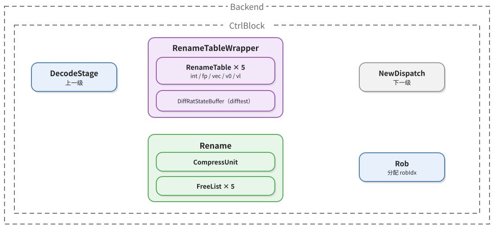

### 5.3 关键信号

| 部件 | 这一级做什么 | 给出什么 |
|---|---|---|
| `DecodeStage` | 送出译码结果，并提前把 `lsrc` 当 RAT 读地址发走 | `DecodedInst`、`RatReadPort` |
| `RenameTableWrapper` | 保存逻辑名到物理名的映射，按读地址返回 `psrc` | `psrc` |
| FreeList（五组） | 按寄存器类型分配空闲物理寄存器 | `pdest` |
| `CompressUnit` | 判断相邻指令能否共用一个 ROB 表项，算出压缩包大小 | `instrSizes`、`masks`、`needRobFlags`、`canCompressVec` |
| `Rename` | 填 `psrc`、`pdest`、`robIdx` 与压缩信息，并向 RAT 提交新映射 | `DynInst`、`RatWritePort` |

| 边 | Bundle | 产生者 | 消费者 | 携带什么 |
|---|---|---|---|---|
| 译码 → 重命名 | `DecodedInst`（`Bundles.scala:78-146`） | `DecodeStage` | `Rename.io.in`（`Rename.scala:55`） | 控制列、`lsrc`、`pc`、`ftqPtr` |
| 译码 → RAT | `RatReadPort`（`RenameTable.scala:37`） | `DecodeStage` | `RenameTableWrapper` | `lsrc(0..2)` |
| RAT → 重命名 | `RatReadPort`（`RenameTable.scala:37`）的返回值 | `RenameTableWrapper` | `Rename.io.intReadPorts` 等（`Rename.scala:62-66`） | `psrc(0..2)`，按寄存器类型分路 |
| FreeList → 重命名 | `allocatePhyReg`（`BaseFreeList.scala:35`） | 各 FreeList | `Rename`（`Rename.scala:409-415`） | `pdest` |
| 重命名 → 派发 | `DynInst`（`Bundles.scala:178-260`） | `Rename.io.out`（`Rename.scala:80`） | `NewDispatch.io.fromRename`（`NewDispatch.scala:100`） | `psrc`、`pdest`、`robIdx`、控制列、`srcState` |
| RAT 写回 | `RatWritePort`（`RenameTable.scala:43`） | `Rename`（`Rename.scala:67-71`） | `RenameTableWrapper` | 逻辑名到新物理名的映射 |

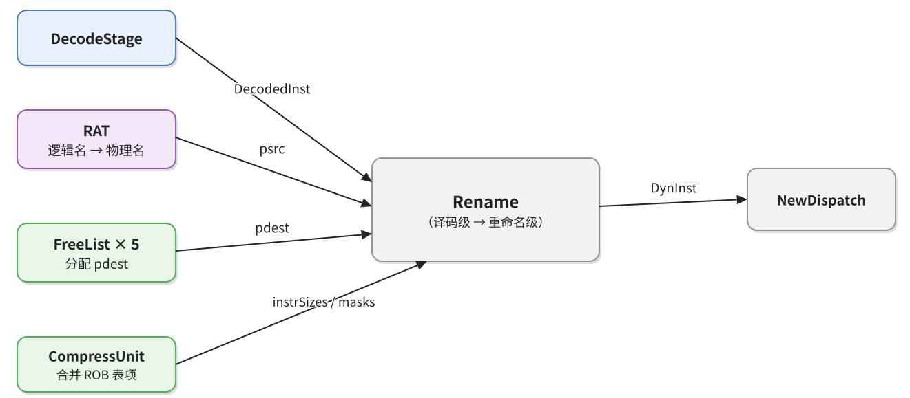

　　`psrc` 的选择按 `srcType` 的独热码进行：整数、浮点、向量三路读端口用 `Mux1H` 选一路（`Rename.scala:391-393`）。`SrcType` 是 4 位独热码，整数 `0001`、浮点 `0010`、向量 `0100`、`v0` `1000`，全零表示不读寄存器（`package.scala:31-56`）。`Mux1H` 在所有选择位为零时输出 0，所以没有源的那一路 `psrc` 自然是 0；这个 0 是占位值，不是物理寄存器 0。

　　`pdest` 由 `MuxCase` 按目标类型选择对应的 FreeList（`Rename.scala:409-415`），`robIdx` 由 ROB 头指针加上本包内前面指令占用的表项数得到（`Rename.scala:346`）。`robIdx` 一旦分配，写回、异常、提交都靠它定位。

　　`CompressUnit` 决定这一拍的多条指令能不能共用一个 ROB 表项。条件是：指令有效、不是融合指令、`lastUop`、没有异常或触发、且 `canRobCompress`（`CompressUnit.scala:50-53`）。连续满足条件的指令被打成一包，只有最后一条占表项，包内条数记在 `numUops`/`numWB` 里（`Rename.scala:353-368`）。

　　重命名还补了一批译码没有给的字段。`storeSetHit`、`loadWaitStrict`、`ssid` 三项在这里由存储依赖预测表的读结果填入（`Rename.scala:310-312`）——前面第 3 节说过，这三项在 `CtrlFlow` 里是空的。

### 5.4 FMUL 在这一级

　　FMUL 的 `psrc(0)`、`psrc(1)` 来自浮点 RAT，`psrc(2)` 因为 `srcType` 全零而为 0。`pdest` 走 `fpFreeList`，因为 `fpWen` 为真。`OPFFF` 把 `canRobCompress` 固定为真，所以 FMUL 允许与邻居压缩进同一个 ROB 表项；是否真的合并取决于前后指令是否也满足条件。压缩带来的一个后果是 `numUops` 可能大于 1。这个字段在这一级确定，后面 ROB 用它判断表项何时可以提交：表项里所有 uop 都写回且指令都已退休，才算完成。

　　整个过程只看寄存器号。一个装着规范 NaN 的物理寄存器和一个装着 1.0 的物理寄存器，在重命名表里没有任何区别；它不读寄存器内容，也就无从判断这个源是不是特殊值（`Rename.scala:392-393`、`Rename.scala:644-646`）。重命名之后，指令的身份由物理源、物理目的和 ROB 表项确定，值的类型仍然未知。

### 5.5 怎么在源码里确认

　　先看 `Rename.io.in` 的类型是 `DecodedInst`、`io.out` 的类型是 `DynInst`，两级的分界就清楚了。再搜 `uops(i).psrc`，看 `Mux1H` 的三路来源；搜 `pdest`，看 `MuxCase` 的分支；搜 `robIdx`，看它由哪个指针加出来。最后在 `CtrlBlock` 里搜 `decodePipeRename` 和 `renamePipeDispatch`，确认这两级各有一拍流水。

---

## 6. 派发：uop 进入发射队列

### 6.1 这一级要解决的问题

　　重命名之后，一条 uop 的去向由 `fuType` 决定：整数、浮点、向量、访存四类执行单元各有一组发射队列。派发要把它送到其中一个队列的空位，同时把同一个 uop 的入队请求交给 ROB，让 ROB 表项在指令执行之前就先建立起来。

　　这里有一个必须解决的竞争：同一拍可能有多条同类型的 uop，它们都满足同一个候选队列集合，如果各自独立挑选，可能挑中同一个空位。派发的做法是先按 `fuType` 的独热码找出所有候选队列，再比较各候选的占用计数，挑负载轻的，并且在同一个包内把前面 uop 已经占用的队列从候选里扣掉。

### 6.2 部件与组织

　　派发由 `NewDispatch` 完成，它是 `CtrlBlock` 的直接子模块（`CtrlBlock.scala:90`）。它下游有两个方向：一侧是四个 `Scheduler` 里的发射队列，另一侧是 `Rob`。`Scheduler` 是 `Backend` 里的 LazyModule（`Backend.scala:180-183`），浮点这一组里面有三个发射队列，每个 18 项（`Parameters.scala:423-443`）。派发级的部件组织如图 8。

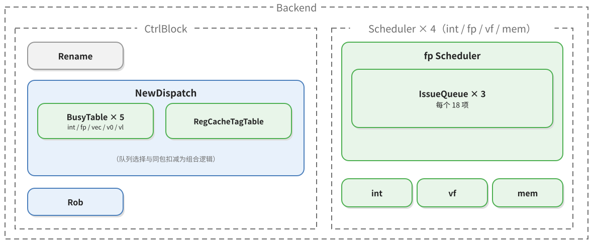

### 6.3 关键信号

| 部件 | 这一级做什么 | 给出什么 |
|---|---|---|
| `Rename` | 送出已补全后端字段的 uop | `DynInst` |
| `BusyTable` | 按物理寄存器号记录是否还有未写回的生产者 | 忙闲位 |
| `NewDispatch` | 按 `fuType` 选队列、比较占用、扣同包名额，用忙表算 `srcState`，并向 ROB 申请入队 | 队列的 `DynInst`、`RobEnqIO` |
| `IssueQueue` | 接收 uop，建立等待表项 | 队列表项 |
| `Rob` | 按派发顺序登记表项 | ROB 表项 |

| 边 | Bundle | 产生者 | 消费者 | 携带什么 |
|---|---|---|---|---|
| 重命名 → 派发 | `DynInst`（`Bundles.scala:178-260`） | `Rename` | `NewDispatch.io.fromRename`（`NewDispatch.scala:100`） | 全部后端字段 |
| 派发 → 发射队列 | `DynInst`（`Bundles.scala:178-260`） | `NewDispatch.io.toIssueQueues`（`NewDispatch.scala:106`） | `IssueQueue.io.enq`（`IssueQueue.scala:50`） | 同一条 `DynInst`，含 `srcState` 初值 |
| 派发 → ROB | `RobEnqIO`（`RobBundles.scala:272`） | `NewDispatch.io.enqRob`（`NewDispatch.scala:103`） | `Rob.io.enq`（`Rob.scala:67`），中间在 `CtrlBlock` 打一拍（`CtrlBlock.scala:712-718`） | `robIdx`、`numUops`、`numWB`、`wfflags`、`ftqPtr` |
| 忙表 → 派发 | 忙表读结果 | `BusyTable` | `NewDispatch`（`NewDispatch.scala:288-308`） | 每个 `psrc` 是否还有未写回的生产者 |

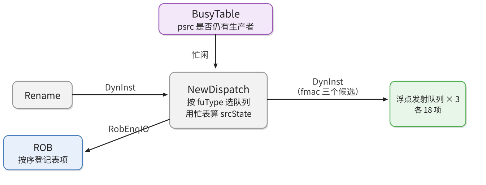

　　`DynInst` 里的 `srcState` 初值不是重命名给的，而是派发用忙表算出来的：`allSrcState(i)(j)(k) := readEn && busyTables(k).io.read(readidx).resp || SrcType.isImm(...)`（`NewDispatch.scala:288-308`）。忙表按物理寄存器号索引，记录该寄存器是否还有未写回的生产者；`SrcType.isImm` 为真（即 `srcType` 全零）的源直接算就绪，因为它不读寄存器。

　　ROB 的入队请求在 `CtrlBlock` 里要打一拍：`sink.valid := RegNext(source.valid && !rob.io.redirect.valid)`，数据用 `RegEnable` 跟着有效位打拍（`CtrlBlock.scala:712-718`）。这条路径与派发到发射队列的路径不是同一拍，ROB 表项比队列项晚一拍建立；因为 ROB 只是记录顺序和状态，晚一拍不影响正确性。

### 6.4 FMUL 在这一级

　　`FuType.fmac` 同时出现在三个浮点队列的执行单元配置里，所以 FMUL 有三个候选队列。三个队列各附着不同的执行单元组合：队列 0 接 FEX0 与 FEX1，队列 1 接 FEX2 与 FEX3，队列 2 只接 FEX4。`NewDispatch` 先在候选里按占用计数挑一个（`minIQSel`，`NewDispatch.scala:359-430`），再把同包内后续 uop 的候选里扣掉已占用的队列。

　　三个 FMA 执行单元是面积与吞吐的折中：一个单元每拍只能开始一条乘法，三份可以并行三条；代价是多两份 Booth 编码器、压缩树和读端口。队列只有三个、执行单元有五个，是因为同组的整数与浮点单元本就该共享入队口：队列 0 发给 FEX0 与 FEX1，队列 1 发给 FEX2 与 FEX3，分别把一条 FMA 通道和一条除法通道配成一对，除法的长延迟正好由同组的乘加指令填补。若每个执行单元各配一个队列，发射逻辑要翻一倍，而单条队列的出队带宽本来就够两个单元用。

　　对 FMUL，`psrc(0)`、`psrc(1)` 的就绪状态由浮点忙表决定；`psrc(2)` 的 `srcType` 是 `X`，`SrcType.isImm` 为真，派发时直接算作就绪（`NewDispatch.scala:304`）。所以它入队时只等两个生产者。派发本身还受 ROB 表项、派发队列和 IQ 空间约束，延迟可变。特殊值在这里的唯一痕迹是：如果某个源来自一条同样产生特殊值的指令，它和其他结果一样通过物理寄存器号就绪，队列里没有任何按值区分的通路。

### 6.5 怎么在源码里确认

　　从 `FuConfig` 的 `name` 找到对应的 `ExeUnitParams`，再看它属于哪个 `IssueBlockParams`、哪个 `SchdBlockParams`；`Parameters.scala` 里 `fpSchdParams` 这一段就是「执行单元—发射队列—写回端口」的总表。再回到 `NewDispatch`，搜 `toIssueQueues` 和 `enqRob`，看这两个方向分别接去哪里。

---

## 7. 发射与读操作数：等到齐、选最老、把操作数取出来

### 7.1 这一级要解决的问题

　　uop 进了队列并不等于马上能执行：它的源可能还没算出来。发射级要做的是在队列里持续观察每个源的就绪状态，一旦某个 uop 的所有源都齐了，就在候选里挑最老的一条送给执行单元。挑最老是为了保证公平，避免后到的短指令一直插队。

　　选中之后还要把操作数取出来。`psrc` 是物理寄存器号，寄存器堆是同步读，这一拍给地址，下一拍才拿数据；而这期间生产者可能刚刚写回，寄存器堆里还是旧值。所以取数不能只看寄存器堆，还要看旁路网络。这两件事合起来构成「读操作数」这一级。

### 7.2 部件与组织

　　发射队列由 `Scheduler` 例化，每个 `IssueQueue` 里有一组表项 `Entries` 和年龄检测逻辑。队列旁边还有 `WbFuBusyTable`，记录每个执行单元在未来几拍是否已被占满。读操作数由 `DataPath` 完成，它分成 s0、s1 两级，中间一组寄存器；浮点寄存器堆 `FpRegFile` 挂在 `DataPath` 上，旁路网络 `BypassNetwork` 是 `Backend` 里的独立模块（`Backend.scala:211`）。发射与读操作数的部件组织如图 10。

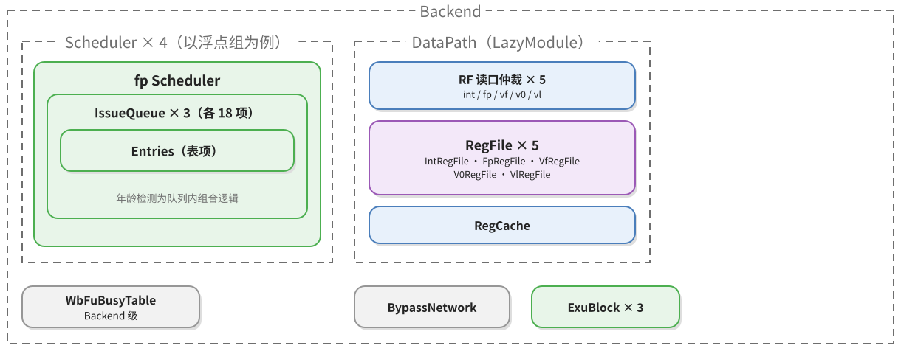

### 7.3 关键信号

| 部件 | 这一级做什么 | 给出什么 |
|---|---|---|
| `NewDispatch` | 把 uop 送入目标队列 | `DynInst` |
| `IssueQueue` | 维护每个表项的源状态与年龄，选择最老的可发射项 | `IssueQueueIssueBundle` |
| `WbDataPath` | 广播写回的 `pdest` | `wakeupFromWB` |
| 其他执行单元 | 提前通知将要写回的 `pdest` | `wakeupFromIQ` |
| `DataPath` | s0 仲裁读口并读寄存器堆，s1 选择前递或旁路，拼成 `ExuInput` | `ExuInput` |
| `FpRegFile` | 按 `psrc` 提供浮点寄存器值 | 读数据 |
| `BypassNetwork` | 提供尚未写进寄存器堆的最近结果 | 前递数据 |

| 边 | Bundle | 产生者 | 消费者 | 携带什么 |
|---|---|---|---|---|
| 派发 → 队列 | `DynInst`（`Bundles.scala:178-260`） | `NewDispatch` | `IssueQueue.io.enq` | 控制列、`psrc`、`pdest`、`robIdx`、`srcState` |
| 队列内部 | `Status`（`EntryBundles.scala:21-64`）与 `EntryBundle`（`EntryBundles.scala:100`） | `IssueQueue` | `Entries` | `Status`（源状态）与 `payload`（发射后要用的字段） |
| 写回 → 队列 | `wakeupFromWB`（`IssueQueue.scala:59`） | `WbDataPath` | 三个浮点队列 | 写回的 `pdest` |
| 执行单元 → 队列 | `wakeupFromIQ`（`IssueQueue.scala:60`） | 其他执行单元 | 队列 | 提前唤醒的 `pdest` 与延迟信息 |
| 队列 → 数据通路 | `IssueQueueIssueBundle`（`Bundles.scala:509-538`） | `IssueQueue.io.deqDelay` | `DataPath.io.fromFpIQ`（`DataPath.scala:894`） | `rf` 读端口、`srcType`、`immType`、`common`（`ExuInput` 形状）、`addrOH` |
| 数据通路 → 执行单元 | `ExuInput`（`Bundles.scala:609-680`） | `DataPath.io.toFpExu`（`DataPath.scala:922`） | `ExeUnit.io.in` | `src(0..2)`、`fuType`、`fuOpType`、`pdest`、`robIdx`、`fpu`、`dataSources` |

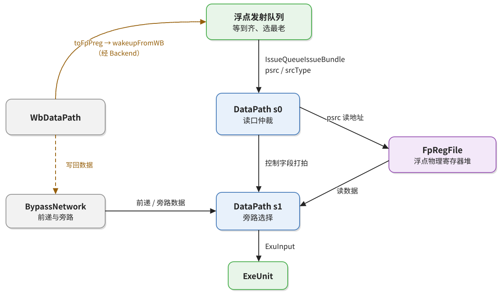

　　发射条件是队列项自己的三个判断：所有源的 `srcState` 都是 ready、没有发射过、没有被阻塞（`EntryBundles.scala:39-45`）。满足条件的项进入年龄比较，最老的胜出。年龄由 `AgeDetector` 维护，队列项按入队顺序排成环形。

　　源从 busy 变 ready 有两条路。第一条是写回广播：生产者写回时把 `pdest` 广播到三个浮点队列，队列把它与每一项的 `psrc` 比较，命中就把对应的 `srcState` 置为就绪（`EntryBundles.scala:296-337`）；另有一份延迟一拍的 `wakeupFromWBDelayed` 给需要更晚唤醒的消费者。第二条是执行单元之间的提前唤醒：某些功能单元在结果真正写回之前就能通知别的队列，代价是如果生产者被取消，要发 `og0Cancel`/`og1Cancel` 把唤醒撤回。

　　选中之后，队列把这一项的内容送进 `DataPath`。出队包里的 `rf` 是读端口，`addr` 接 `psrc`，`srcType` 说明读的是哪类寄存器（`IssueQueue.scala:789-792`）。

　　`DataPath` 的 s0 级把 `psrc` 送进读端口仲裁，胜出的地址接到寄存器堆读口（`DataPath.scala:356-361`）；s1 级从寄存器堆拿到数据，同时用 `s1_toExuData.fromIssueBundle(s0.bits)` 把控制字段搬过来（`DataPath.scala:603-606`）。最终的操作数由 `BypassNetwork` 按优先级选出：同拍前递、上一拍旁路、再晚一拍的旁路、零、`v0`、寄存器堆、寄存器缓存、立即数（`BypassNetwork.scala:139-175`）。

### 7.4 FMUL 在这一级

　　FMUL 的第三源在入队时就是 ready，所以它实际只等 `psrc(0)`、`psrc(1)` 两个生产者。第三源在 `IssueQueue.scala:324` 处因为 `SrcType.isNotReg` 被记成 `DataSource.imm`，但 `FmacCfg` 既没有 `immType` 也不是访存单元，旁路网络的 `readImm` 被屏蔽（`BypassNetwork.scala:159`），所有选择信号为假时 `Mux1H` 输出 0。所以送到执行单元的 `src(2)` 是 0，哪怕 `DataPath` 的 s1 寄存器里还留着上一条指令的旧值。

　　前两个源在常规情况下走 `readRegOH`，从浮点寄存器堆读出；如果生产者刚写回不久，寄存器堆里可能还是旧值，这时 `readForward` 或 `readBypass` 会接管。走哪条取决于生产者的写回时刻与消费者到达 s1 的时刻相差几拍。

　　发射级本身不读数据。选择依据是就绪状态和年龄仲裁，不承诺全局严格 oldest-first；同一拍可能有多个候选，最终选中谁取决于队列内部的优先级。它只知道两个浮点源已经就绪，不知道 `0x7F7FFFFF` 乘 `2.0` 会越界；执行单元也不在发射时做任何预判。特殊值对发射的唯一影响，是它可能改变某个生产者的延迟：如果生产者是一条特殊值指令，而这条指令在功能单元里走了不同长度的路，消费者的唤醒时刻就会跟着变。`FmacCfg` 是定延迟，这条通路对它不存在；这也是定延迟单元在队列一侧省事的地方。

### 7.5 怎么在源码里确认

　　先看 `EntryBundles.SrcStatus` 有哪些字段，再看 `canIssue` 的表达式，最后看 `IssueQueue` 里 `deq.bits.rf` 和 `deq.bits.common.dataSources` 的赋值。读操作数一侧，从 `DataPath` 的 s0 输入出发，跟到 `s1_toExuData`，再跟到 `BypassNetwork` 的 `Mux1H`，三个源各自的路径就都清楚了。

---

## 8. 执行：从 `ExeUnit` 到 FMA 核心

### 8.1 这一级要解决的问题

　　执行级把一个 `ExuInput` 变成 `ExuOutput`。对 FMUL，输入是三个 64 位的 NaN-boxed 浮点源和一个 9 位的 `fuOpType`、一个 3 位的舍入模式，输出是 64 位结果和 5 位异常标志。中间要完成指数与尾数拆包、Booth 编码、部分积压缩、加法对齐、规格化、舍入、特殊值处理和重新装箱。

　　功能单元按 `FuConfig` 配置，配置里写明源数据组数、结果宽度、是否需要 `frm`、固定延迟。执行单元外壳 `ExeUnit` 负责把这些配置变成端口与流水；真正做运算的是核心 `FloatFMA`。

### 8.2 部件与组织

　　浮点调度块对应一个 `ExuBlock`，里面按 `FuConfig` 实例化多个 `ExeUnit`；FMA 单元内部是包装类 `FMA`，包装类里面才是 `FloatFMA`（`FuConfig.scala:715-728`）。`ExuBlock` 在 `Backend` 里由 `BackendInlinedImp` 例化（`Backend.scala:186`、`Backend.scala:208`）。执行级的部件组织如图 12。

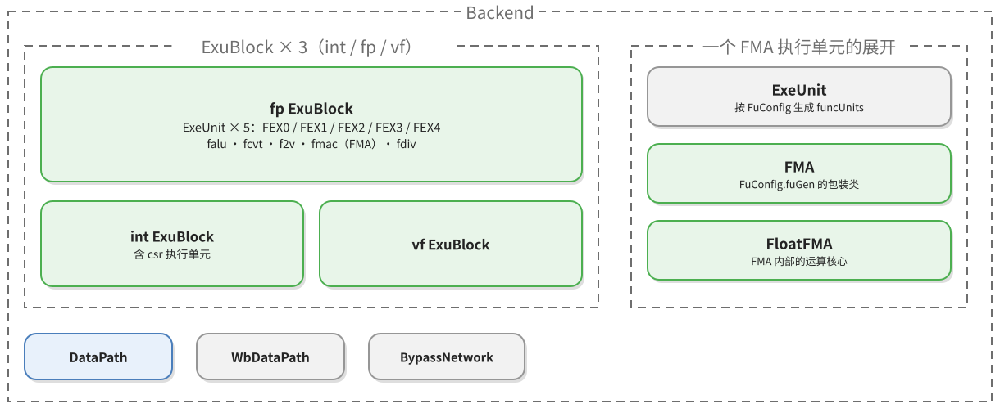

### 8.3 关键信号

| 部件 | 这一级做什么 | 给出什么 |
|---|---|---|
| `DataPath` | 取操作数、选旁路，拼成一条待执行的 uop | `ExuInput` |
| `ExeUnit` | 按功能配置把 `ExuInput` 转成功能单元输入，并把结果打包 | `FuncUnitInput`、`ExuOutput` |
| `FMA` | 截取 `opcode`，做 NaN-box 检查，把三个源与舍入模式接到浮点核心 | `FloatFMA` 的输入 |
| `FloatFMA` | 乘法时把第三个源置零，三级流水算出结果与 `fflags` | 结果、`fflags` |
| `CSR` | 提供 `fcsr.frm` | `frm` |
| `WbDataPath` | 汇总执行结果，排队等写口 | 写回数据 |

| 边 | Bundle | 产生者 | 消费者 | 携带什么 |
|---|---|---|---|---|
| 数据通路 → 执行单元 | `ExuInput`（`Bundles.scala:609-680`） | `DataPath` | `ExeUnit.io.in` | 三个源、`fuType`、`fuOpType`、`pdest`、`robIdx`、`fpu`、`dataSources` |
| 执行单元 → 功能单元 | `FuncUnitInput`（`FuncUnit.scala:73`） | `ExeUnit`（`ExeUnit.scala:242-243`） | `FMA.io.in` | `src(0..2)`、`fuOpType`、`pdest`、`robIdx`、`fpu` |
| 功能单元内部 | `FloatFMA` 的端口 | `FMA`（`FMA.scala:32-38`） | `FloatFMA.io` | `fp_a`、`fp_b`、`fp_c`、`round_mode`、`fp_format`、`op_code` |
| 执行单元 → 写回 | `ExuOutput`（`Bundles.scala:712-755`） | `ExeUnit.io.out` | `WbDataPath.io.fromFpExu`（`WbArbiter.scala:93`） | `data`、`pdest`、`robIdx`、`fpWen`、`fflags`、`wflags` |

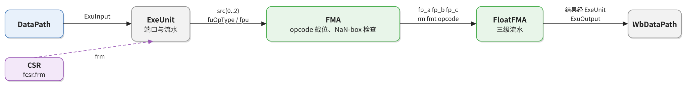

　　`ExeUnit` 把数据通路送来的 `src` 直接接到功能单元（`ExeUnit.scala:306`），控制字段在 `ExeUnit.scala:453-456` 接入。舍入模式在这里做最后一次选择：指令自带的 `rm` 不是 `111` 就用它，是 `111` 就用 `fcsr.frm`（`FpPipedFuncUnit.scala:14-16`）。`frm` 从 CSR 经 `Backend`（`Backend.scala:662`）送到执行块，再打一拍（`ExuBlock.scala:43`）。

　　`FmacCfg` 的配置是：三个 `FpData` 源、`writeFpRf` 为真、`writeFflags` 为真、`latency = CertainLatency(3)`、`destDataBits = 64`、`needSrcFrm` 为真（`FuConfig.scala:715-728`）。`HasPipelineReg` 按这个延迟把输入的控制字段打三拍，使 `pdest`、`robIdx` 与核心的结果在同一拍对齐（`FuncUnit.scala:166-238`）。

### 8.4 FMUL 在这一级

　　执行单元是包装层 `FMA`，内部实例化 `yunsuan.fpu.FloatFMA`（`FMA.scala:13`、`FMA.scala:23`）。包装层做了三个转换。第一，把 9 位的 `fuOpType` 截成核心要的 4 位操作码（`FMA.scala:13-48`），`VfmaType.vfmul` 的低 4 位正好是 `FmaOpCode.fmul`。第二，判断三个操作数是不是合法的 NaN-boxed 值：32 位格式看高 32 位是否全 1，第三源的检查多一个 `!(opcode === VfmaType.vfmul)` 的门控（`FMA.scala:25-30`）——FMUL 没有第三操作数，送进来的 0 会让高 32 位不全为 1，不加这个门控就会被误判成未装箱值。第三，把源、`rm`、`fp_fmt`、`opcode` 和三个标志接到核心，再把结果与 `fflags` 送出去。

　　`FloatFMA` 内部用 `fire`、`fire_reg0`、`fire_reg1` 三级有效信号划分流水（`FloatFMA.scala:48-50`）。核心对 FMUL 有一处自己清零：`fp_c_f32 = Mux(is_fmul, 0.U, ...)`（`FloatFMA.scala:84-92`）。它不假设上游一定送来 0，而是再清一次。这三层（旁路网络输出 0、包装关掉第三源的 NaN 检查、核心清零）叠在一起，保证第三源既有一个确定的值，又不会被当成特殊值。

　　`FloatFMA` 是一条没有事务状态机的三级流水。第 0 拍采样输入，组合出符号、指数、有效数以及 NaN、sNaN、无穷、零这些分类信号；分类结果随 `fire` 打入第一级寄存器，再打两级，到第 3 拍以 `_reg2` 的名字参与选择。中间两拍照常做有效数相乘、小数点移动与舍入，哪怕输入是 NaN、算出的中间量毫无意义。

　　分类不是一条“先判断再计算”的控制流，而是一组并行比较。`fp_a_is_zero_f32`、`fp_a_is_nan_f32`、`fp_a_is_snan_f32`、`fp_a_is_inf_f32` 这些信号同时产生（`FloatFMA.scala:636-644`、`FloatFMA.scala:669-681`、`FloatFMA.scala:683-695`、`FloatFMA.scala:697-709`），到第 3 拍才由五路选择器决定用哪一路结果。装箱失败的信息并进同一组信号：该源不能算作零（`FloatFMA.scala:637`）、它是一个 NaN（`FloatFMA.scala:670`）、它不是 sNaN（`FloatFMA.scala:684`）。

　　这一级是整条通路里唯一“知道”特殊值的地方，也是代价所在。每个 FEX 的 FMA 都要为两个源准备指数与尾数的比较电路，还要把分类结果沿三拍寄存下去；三个 FEX 各有一份 `FloatFMA`，这份面积就乘了三份。换来的是执行单元对外的定延迟——不管走哪条分支，第 3 拍一定出结果，`valid` 不因数据而停。工程上这是一次明确的取舍：用面积换时序确定性，避免让浮点异常判断成为流水线的可变延迟源。

### 8.5 怎么在源码里确认

　　先在 `FuConfig.scala` 里找到 `FmacCfg`，看 `fuGen` 指向哪个包装、`srcData` 有几组、`latency` 是多少；再打开包装，确认 `inData.src(0..2)` 的来源和 `opcode` 的截位方式；最后进核心，按端口名找到 `fp_a`/`fp_b`/`fp_c` 的第一处使用。

---

## 9. 写回：结果回到寄存器堆和 ROB

### 9.1 这一级要解决的问题

　　执行单元输出的结果要同时到达三个地方：浮点寄存器堆的写端口、所有等待这个 `pdest` 的发射队列、以及 ROB 的写回记录。三处用途不同：寄存器堆是架构状态，队列唤醒是为了让消费者尽快发射，ROB 记录是为了判断表项能否提交。

　　这三处不能各自为政：同一个写回事件必须同时发生，否则会出现「寄存器堆已写、队列还没唤醒」或「队列已唤醒、ROB 不知道」的不一致。

### 9.2 部件与组织

　　`WbDataPath` 收集全部执行单元的写回请求，内部按调度块分成四个仲裁器，浮点这一路是 `WbArbiter`（`WbArbiter.scala:84-120`）。输出分成三组：到各类物理寄存器堆的写端口（`toFpPreg` 等）、到 `CtrlBlock` 的 `writeback`、以及到发射队列的唤醒广播。写回级的部件组织如图 14。

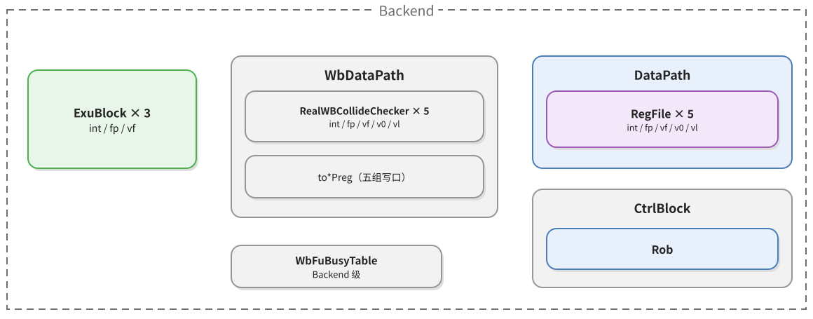

### 9.3 关键信号

| 部件 | 这一级做什么 | 给出什么 |
|---|---|---|
| `ExeUnit` | 输出结果、`pdest` 与 `fflags` | `ExuOutput` |
| `WbDataPath` | 汇总各执行单元的写回，为每个写口选数据，并送出 ROB 写回记录 | 写口数据、ROB 写回记录 |
| `FpRegFile` | 接收写口数据并按地址写入 | 寄存器堆新值 |
| `Backend` | 把写回广播到所有发射队列 | `wakeupFromWB` |
| `Rob` | 按 `robIdx` 记录写回，累计 `fflags` | 可提交状态 |

| 边 | Bundle | 产生者 | 消费者 | 携带什么 |
|---|---|---|---|---|
| 执行单元 → 写回 | `ExuOutput`（`Bundles.scala:712-755`） | `ExeUnit` | `WbDataPath.io.fromFpExu`（`WbArbiter.scala:93`） | `data`、`pdest`、`fpWen`、`robIdx`、`fflags` |
| 写回 → 寄存器堆 | `RfWritePortWithConfig`（`Regfile.scala:48`） | `WbDataPath.io.toFpPreg`（`WbArbiter.scala:106`） | `DataPath` 的写口（`DataPath.scala:352-354`） | 写地址、写数据、写使能 |
| 写回 → 队列 | `wakeupFromWB`（`IssueQueue.scala:59`） | `Backend`（`Backend.scala:387`） | 三个浮点队列 | `pdest` |
| 写回 → ROB | `ExuOutput`（`Bundles.scala:712-755`） | `WbDataPath.io.toCtrlBlock.writeback`（`WbArbiter.scala:118`） | `Rob.io.writeback`（`Rob.scala:71`），经 `CtrlBlock`（`Backend.scala:261`） | 同上，另加 `wflags` |

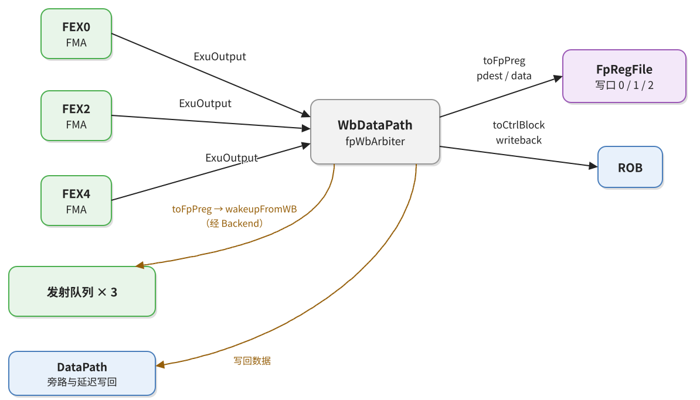

　　浮点寄存器堆有五个写端口，按执行单元固定分配：FEX0 用端口 0，FEX2 用 1，FEX4 用 2，两个 fdiv 单元用 3、4（`Parameters.scala:425-443`）。FMUL 走 FEX0/2/4，所以它的结果只会出现在端口 0、1、2 上。

　　写口本身还有一拍：写地址和数据先打一拍，写使能再打一拍（`DataPath.scala:352-354`）。这意味着从写回总线广播到真正写进寄存器堆之间隔了一拍，等待的消费者在这一拍里靠旁路取数。`Backend` 里另存一份延迟一拍的写回副本，专供 `wakeupFromWBDelayed` 使用（`Backend.scala:330-336`）。

### 9.4 FMUL 在这一级

　　执行单元的输出先装箱再写回。单精度结果在高 32 位填 1，半精度结果在高 48 位填 1，双精度原样输出（`FloatFMA.scala:854-862`）；标志位按精度从 `fflags_f64`、`fflags_f32`、`fflags_f16` 中选出（`FloatFMA.scala:864-868`）。装箱后的 `0xFFFFFFFF7F800000` 与普通结果在寄存器堆里没有形式差别，特殊值的信息只剩 `ExuOutput.fflags` 的五位。

　　FMUL 的结果在第 3 拍有效，`fflags` 与 `wflags` 同时给出。`wflags` 来自 `FPDecoder` 的 `wflags` 字段，表示这条指令是否要写 `fcsr.fflags`；对 `FMUL.S`，它取决于指令的 `TYP` 位。结果写进 `pdest` 指向的浮点物理寄存器，同时以 `pdest` 广播唤醒三个队列里等待它的消费者。

　　写回是否真的发生，要看 `out.valid` 与写回端口的握手，不能只看数据线上出现了结果。写回之后到提交之前，这条指令在数据上已经完成，在顺序上还没有。它的 `pdest` 一直占着，直到 ROB 提交时才归还 FreeList。

### 9.5 怎么在源码里确认

　　从 `FMA.io.out.bits.res.data` 出发，顺着 `ExuOutput` 找到 `WbDataPath.io.fromFpExu`，再到 `toFpPreg` 和 `toCtrlBlock.writeback`，最后到 `DataPath` 的写口和 `Rob`。这条链上每个模块都只做一件事，反着找比正向追更容易。

---

## 10. 提交：按序退休

### 10.1 这一级要解决的问题

　　乱序执行允许指令乱序完成，但架构状态必须按程序顺序更新。提交级负责按 ROB 的顺序逐条退休：检查表项里的所有 uop 是否都写回、指令是否已完整取到、有没有异常要在这个时刻抛出，然后把 `fflags` 汇入 CSR、把旧物理寄存器归还 FreeList、把提交信息送回 FTQ。

### 10.2 部件与组织

　　`Rob` 是 `CtrlBlock` 里的 LazyModule（`CtrlBlock.scala:53`），在 `CtrlBlockImp` 里取出模块实例（`CtrlBlock.scala:99`）。它两侧接的东西最多：入口是派发的 `RobEnqIO` 和各执行单元的写回，出口是提交信息 `RobCommitIO`、重定向 `Redirect`、以及给 CSR 的 `fflags`。提交级的部件组织如图 16。

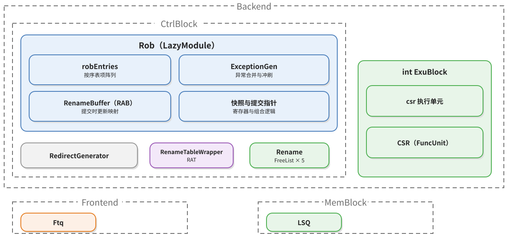

### 10.3 关键信号

| 部件 | 这一级做什么 | 给出什么 |
|---|---|---|
| `NewDispatch` | 发 ROB 入队请求 | `RobEnqIO` |
| `WbDataPath` | 送写回记录 | `ExuOutput` 到 ROB |
| `Rob` | 维护表项的写回进度，按序挑出可提交项 | `RobCommitIO` |
| `CtrlBlock` | 把提交记录与重定向转给 FTQ | `CtrlToFtqIO` |
| `CSR` | 接收 `fflags`，更新 `fcsr` | 架构状态 |
| `Rename`（含 RAT、FreeList） | 提交映射、回收物理寄存器 | RAB |
| `Ftq` | 标记表项已提交，按重定向改取指 | 取指状态 |

| 边 | Bundle | 产生者 | 消费者 | 携带什么 |
|---|---|---|---|---|
| 派发 → ROB | `RobEnqIO`（`RobBundles.scala:272`） | `NewDispatch` | `Rob.io.enq`（`Rob.scala:67`） | `robIdx`、`numUops`、`numWB`、`wflags`、`ftqPtr`/`ftqOffset` |
| 写回 → ROB | `ExuOutput`（`Bundles.scala:712-755`） | 各执行单元经 `WbDataPath` | `Rob.io.writeback`（`Rob.scala:71`） | `pdest`、`robIdx`、`fflags`、`wflags` |
| ROB → 后端各处 | `RobCommitIO`（`Bundle.scala:405`） | `Rob.io.commits`（`Rob.scala:75`） | `CtrlBlock`、`Rename`、CSR | 每条提交指令的 `ftqIdx`/`ftqOffset`、`fflags`、`fpWen` 等 |
| ROB → FTQ | `CtrlToFtqIO.rob_commits`（`CtrlBlock.scala:43-44`） | `CtrlBlock`（`CtrlBlock.scala:342-343`） | `Ftq`（`NewFtq.scala:1319`） | 已提交指令的 FTQ 坐标 |
| ROB → FTQ | `Redirect`（`Bundle.scala:303`） | `Rob` 与 `RedirectGenerator`（`CtrlBlock.scala:345-347`） | `Ftq` | 重定向目标、原因、级别 |

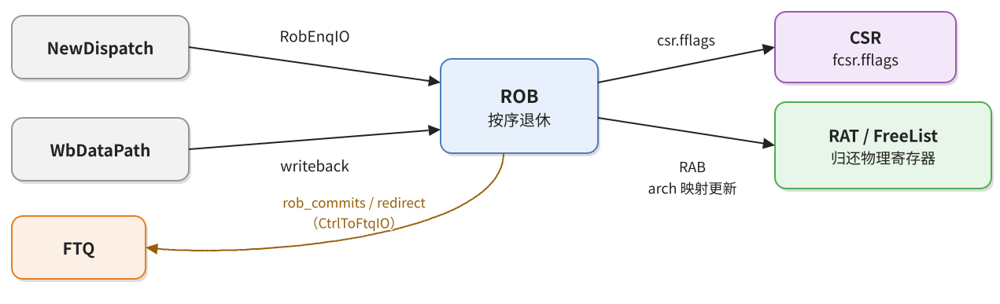

　　写回时，ROB 按 `robIdx` 命中表项，把 `uopNum` 减去本次写回的 uop 数；有标准写回命中就置 `stdWritebacked`，提交逻辑靠它判断表项是否写完（`Rob.scala:1035-1067`）。`fflags` 是按位或进去的（`Rob.scala:1062-1067`）：同一个表项里可能有多个 uop，它们的异常标志按位或，符合 IEEE 754 的粘滞语义。

　　提交时，`fflags` 从表项取出，按 `wflags` 门控后汇成一路送到 CSR（`Rob.scala:715-717`），CSR 再把它或进 `fcsr.fflags`（`CSR.scala:651-659`）。同一时刻，`RobCommitIO` 把 `ftqPtr`/`ftqOffset` 送到 `CtrlBlock`，再由 `CtrlToFtqIO` 送回 FTQ，FTQ 据此把表项标记为已提交并释放。

　　表项内部的合并发生在写回时：一个 ROB 表项可以含多个 uop，各 uop 的 `fflags` 按位或进表项（`Rob.scala:1059-1067`）。于是同一条 `fmul` 的标志要经过两级“或”和两级打拍才到达 `fcsr`，软件读到新值的时刻晚于提交，但这条延迟与操作数是不是特殊值无关。

　　提交还负责浮点状态位。`dirtyFs = fpWen || wflags` 随提交送出（`RobBundles.scala:191`），CSR 据此把 `mstatus.FS` 置为 `11`、`SD` 置 1（`CSR.scala:1037`）；这条规则对写浮点寄存器和写 `fflags` 一视同仁，一条只写 `fflags` 的浮点指令同样会把浮点状态标脏。

### 10.4 FMUL 在这一级

　　FMUL 的 `fflags` 在提交时汇入 `fcsr`，`pdest` 对应的物理寄存器归还 FreeList，逻辑映射更新。如果 FMUL 与邻居被压缩成一个包，它们作为一个表项一起退休，`fflags` 也一起汇入 CSR。

　　FMUL 一般不会触发重定向——它不是分支，也不产生访存异常。它唯一可能引起冲刷的情况是浮点异常被精确报告，这取决于 `fcsr` 的异常使能位；在这条通路里，重定向由 `RedirectGenerator` 根据异常和分支结果统一产生。

### 10.5 怎么在源码里确认

　　从 `Rob` 的 `fflags` 写入口找到写回逻辑，再看 `robEntries(i).fflags` 的按位或语句，最后看提交时 `fflagsDataRead` 如何被读出。要看重定向，搜 `CtrlBlock` 里 `io.frontend.toFtq.redirect` 的赋值，两条来源分别是 ROB 冲刷和 `RedirectGenerator`。

---

## 11. 全线：八级串起来

　　把前面八节的首尾接起来，就是一条指令从取指到提交的完整路径。图 18 里节点是部件，边是它们之间传递的 Bundle；实线是正常通路，虚线是回送与旁路。

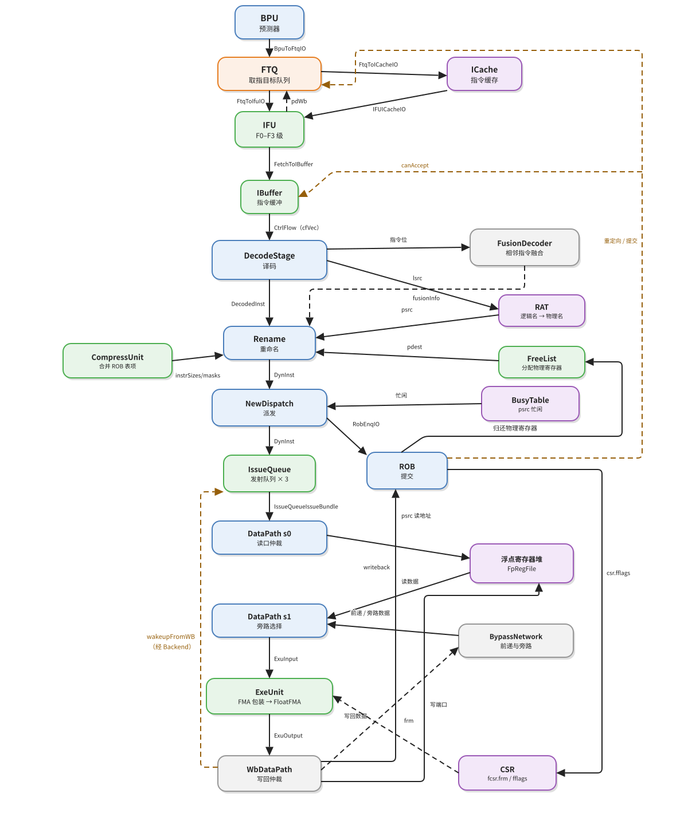

　　以发射队列选中（`deq.fire`）为 T0，各事件的相对时刻如下。

| 时刻 | 事件 | 依据 |
|---|---|---|
| T0 | 队列选中，s0 有效，`psrc` 送到浮点寄存器堆读口 | `IssueQueue.io.deq`、`DataPath` 的 s0 |
| T1 | s1 有效，寄存器堆数据返回，旁路选择完成，`ExuInput` 有效 | `s1_toExuValid`、`s1_fpPregRData` |
| T1 + 1 | 压缩树第五层、3:2 合并、宽加法器 | `fire` → `fire_reg0` |
| T1 + 2 | 前导零检测、规格化移位、GRS 提取 | `fire_reg0` → `fire_reg1` |
| T1 + 3 | 舍入、特殊值选择、装箱，`ExuOutput` 有效 | `latency = 3` |
| T1 + 3 | 写回广播，队列唤醒，ROB 记录写回 | `Backend` 的 `fpWriteBack`、ROB 写回 |
| T1 + 4 | 写地址与写数据打拍，写使能有效 | `DataPath` 的写口寄存器 |
| 之后 | 按序提交，`fflags` 汇入 `fcsr` | ROB 提交 |

　　提交时刻不固定，取决于这条指令前面还有多少条未提交的指令。FMUL 自身写回后就可以等待提交，但要等所有更老的指令都退休。

　　整条路径上，类型只换了五次：`CtrlFlow` 在前后端边界变成 `StaticInst`，在译码出口变成 `DecodedInst`，在重命名出口变成 `DynInst`，在数据通路出口变成 `ExuInput`，在执行单元出口变成 `ExuOutput`。每换一次，都有一批字段被消费、一批字段被补上。记住这五次变换，比记住十五个模块的名字更有用。

---
## 附录：源码索引

| 主题 | 文件:行 |
|---|---|
| 前端模块 | `Frontend.scala:68-69`、`Frontend.scala:106-109` |
| 前后端 Bundle | `Bundle.scala:144-168`、`Bundle.scala:484-495` |
| 取指流水 | `IFU.scala:241-598` |
| 预译码 | `PreDecode.scala:72-84`、`PreDecode.scala:95` |
| FTQ 出口 | `NewFtq.scala:916` |
| IBuffer | `IBuffer.scala:87-112` |
| CtrlBlock 组成 | `CtrlBlock.scala:90-99` |
| 译码级 | `DecodeStage.scala:104-108`、`DecodeUnit.scala:806-834` |
| 译码项与浮点译码 | `VecDecoder.scala:548-550`、`FPDecoder.scala:341-342` |
| wflags 两处记录 | `DecodeUnit.scala:834`、`DecodeUnit.scala:989`、`DecodeUnit.scala:1044`、`RobBundles.scala:140` |
| 重命名 | `Rename.scala:55`、`Rename.scala:391-415` |
| 派发 | `NewDispatch.scala:100-106` |
| 发射队列 | `IssueQueue.scala:47-79`、`EntryBundles.scala:21-64` |
| 数据通路 | `DataPath.scala:352-361`、`DataPath.scala:603-606` |
| 旁路网络 | `BypassNetwork.scala:139-175` |
| 执行单元 | `FuConfig.scala:715-728`、`ExeUnit.scala:306` |
| FMA 包装 | `FMA.scala:13-48` |
| 第三源清零与有效数 | `FloatFMA.scala:84-92`、`FloatFMA.scala:134-139` |
| 分类信号 | `FloatFMA.scala:636-644`、`FloatFMA.scala:669-709` |
| 指数上溢与下界 | `FloatFMA.scala:597-604` |
| 标志位计算 | `FloatFMA.scala:629-634` |
| 五路选择 | `FloatFMA.scala:788-819` |
| 装箱与输出 | `FloatFMA.scala:854-868` |
| 写回 | `WbArbiter.scala:84-120` |
| ROB 表项合并与提交 | `Rob.scala:709-719`、`Rob.scala:833`、`Rob.scala:1035-1067` |
| `fcsr` 更新 | `CSR.scala:651-659`、`CSR.scala:1030`、`CSR.scala:1037` |
| 执行单元分布 | `Parameters.scala:427`、`Parameters.scala:431`、`Parameters.scala:435` |
