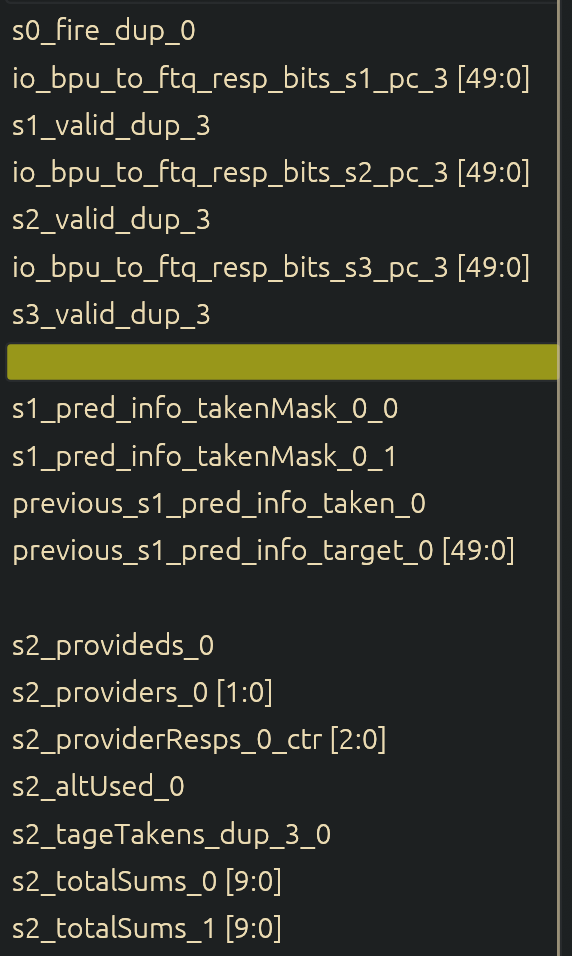
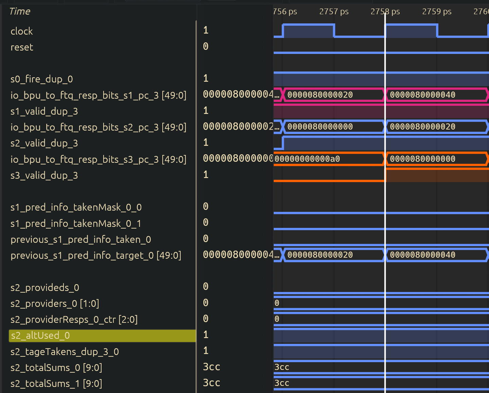
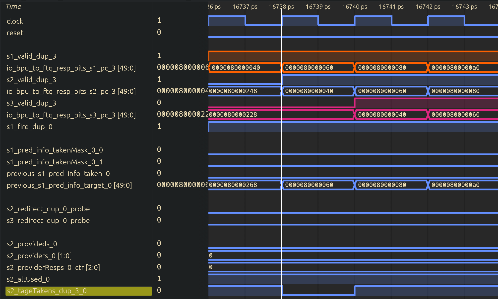
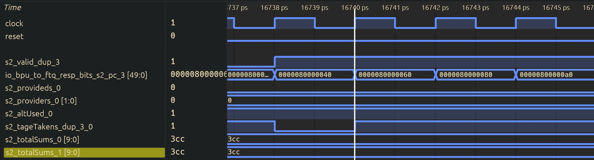
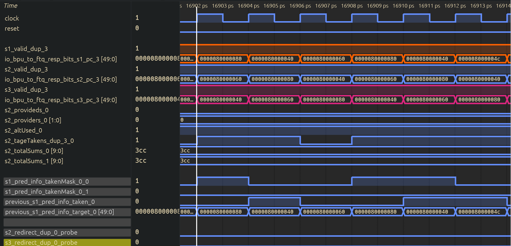
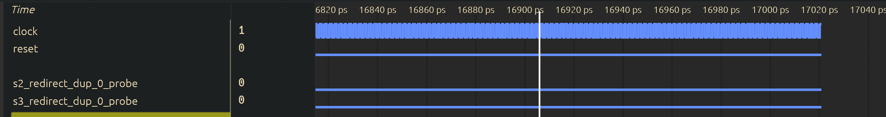

# 1.BPU → FTQ 流程

本文主要分析处理器复位后，BPU 如何从 S0 发出第一个预测请求，以及这个预测块如何经过 S1、S2、S3，最终被 FTQ 接收。

本次测试程序中只有少量顺序指令，不包含条件分支。因此，本文的重点是观察 BPU 流水线自身的推进过程，以及 BPU 和 FTQ 之间的握手、分配关系。

## （1）BPU 与 FTQ 的关系

在查看波形之前，首先需要明确 BPU 和 FTQ 各自负责什么。

BPU 根据当前起始 PC 预测下一个取指块的信息，包括预测块的起始地址、结束位置、是否存在 taken CFI，以及下一个预测地址。FTQ 负责保存这些预测块，后续 ICache、IFU 以及分支重定向逻辑可以通过 FTQ 表项找到对应的预测信息。

因此，本次实验观察的不是“一条 add 指令如何进入 FTQ”，而是“包含这些顺序指令的一个预测块如何进入 FTQ”。整体关系如下：

```text
                    BPU

    S0  ─────→  S1  ─────→  S2  ─────→  S3
    │           │                         │
 发起预测    产生快速预测              校验早期预测
                │                         │
                └──────→ FTQ ←───────────┘
                       接收预测块
```

从图中可以看到，S1 可以向 FTQ 提供早期预测结果。S2、S3 并不是等到全部完成之后才第一次向 FTQ 分配表项，而是继续处理同一个预测块；如果后级发现早期预测需要修改，再对已经分配的 FTQ 表项进行修正。

### （1.1）找到需要观察的模块和信号

在波形中先定位前端模块下的 BPU 和 FTQ。BPU 的层次通常类似：

```text
TOP.SimTop.cpu.l_soc.core_with_l2.core.frontend.inner_bpu
```

具体层次名称应以实际波形为准。找到 BPU 后，先加入下面这些信号：

| 波形信号 | 位宽 | 核心含义 | 对应源码信号 | 波形观察重点 |
| --- | --- | --- | --- | --- |
| `s0_valid` / `s0_fire` | 1bit | S0 是否存在有效预测请求，以及该请求是否真正发出 | `s0_valid`、`s0_fire` | 找到复位后的第一次请求 |
| `s1_valid` | 1bit | S1 中是否保存着有效预测块 | `s1_valid` | 应在 S0 请求成功后的下一拍有效 |
| `s2_valid` | 1bit | S2 中是否保存着有效预测块 | `s2_valid` | 应在 S1 成功推进后有效 |
| `s3_valid` | 1bit | S3 中是否保存着有效预测块 | `s3_valid` | 应在 S2 成功推进后有效 |
| `s0_pc` / `s0_startPc` | 实现相关 | S0 本次预测请求的起始 PC | `s0_startPc` | 用于确定第一次请求 P0 |
| `s1_pc` / `s1_startPc` | 实现相关 | S1 中预测块的起始 PC | `s1_startPc` | 应与对应的 S0 PC 一致 |
| `s2_pc` / `s2_startPc` | 实现相关 | S2 中预测块的起始 PC | `s2_startPc` | 用 PC 继续追踪同一个预测块 |
| `s3_pc` / `s3_startPc` | 实现相关 | S3 中预测块的起始 PC | `s3_startPc` | 确认 P0 最终到达 S3 |
| `bpu_to_ftq.resp.valid` | 1bit | BPU 当前向 FTQ 提供的预测结果有效 | BPU → FTQ 响应 valid | 单独为 1 不代表 FTQ 已接收 |
| `bpu_to_ftq.resp.ready` | 1bit | FTQ 当前可以接收 BPU 的预测结果 | BPU → FTQ 响应 ready | 与 valid 同时有效才完成握手 |
| `bpu_to_ftq.resp.fire` | 1bit | BPU 和 FTQ 在本周期完成一次握手 | `valid && ready` | 判断 FTQ 接收预测块的核心信号 |
| `ftq_alloc` / `bpu_in_fire` | 1bit | FTQ 对预测块执行分配或写入 | FTQ 入队使能 | 需要与 fire、写指针和 PC 一起判断 |
| `bpuPtr` / FTQ 写指针 | 实现相关 | 下一次普通 BPU 预测要写入的 FTQ 位置 | FTQ BPU 写指针 | 正常分配后应向前移动 |
| `redirect` / 后级修正信号 | 1bit | 后级预测或执行结果是否修正当前取指流 | redirect、override | 顺序场景中重点确认是否保持为 0 |

如果信号名带有 `_dup_0`、`_dup_1` 等后缀，表示该控制信号在生成电路时产生了多个副本，用于降低扇出或改善时序。它们不是额外流水级。选择其中一个与目标数据通路对应的副本观察即可。

### （1.2）valid、ready 和 fire 的区别

在后面的分析中会频繁使用 valid、ready 和 fire，因此这里先说明三者的区别：

* `valid=1`：发送端已经准备好一份有效数据。
* `ready=1`：接收端当前能够接收数据。
* `fire=1`：valid 和 ready 同时为 1，本周期真正完成传输。

它们之间的关系可以简单理解为：

```text
fire = valid && ready
```

假设某个预测块已经到达 S1，此时 `s1_valid=1`，但 FTQ 的 ready 为 0，那么这个预测块仍然需要停留在 S1，不能进入下一阶段。只有 ready 变为 1、握手成功后，预测块才能被 FTQ 接收并继续向 S2 推进。

另外，流水线连续工作后，`s1_valid`、`s2_valid`、`s3_valid` 可能连续多个周期保持为 1。此时每个周期处理的可能是不同预测块。因此，不能只根据 valid 的上升沿追踪 P0，还必须同时查看各阶段 PC。

## （2）复位后 S0 发出第一次预测请求

首先将波形移动到复位释放的位置，观察 reset、S0 PC、S0 valid/fire，以及各预测器的初始化完成信号。


复位释放后，BPU 不一定立即发出请求。部分预测器内部包含 SRAM，这些 SRAM 需要先完成初始化。只有初始化完成，并且 S1 可以接收新的预测请求时，S0 才能够真正 fire。

对应控制关系可以概括为：

```scala
s0_fire := s1_ready && sramResetDone
```

其中：

* `sramResetDone=1` 表示参与预测的 SRAM 已完成复位初始化，此信号不在波形中产生，通过相应的调试信息打印。
* `s1_ready=1` 表示 S1 当前可以接收来自 S0 的新预测块。
* `s0_fire=1` 表示 S0 在本周期真正发出了一次预测请求。


复位阶段信号说明：

| 信号名 | 位宽 | 核心功能 | 对应源码位置 | 波形关键说明 |
| --- | --- | --- | --- | --- |
| `reset` | 1bit | 处理器复位信号 | 顶层复位输入 | 先确认复位释放的时钟边沿 |
| `sramResetDone` | 1bit | BPU 内部预测器 SRAM 初始化完成 | BPU 初始化控制逻辑 | 为 0 时不能发出正常预测请求 |
| `s1_ready` | 1bit | S1 可以接收新的预测请求 | BPU 流水线控制逻辑 | 和初始化完成共同决定 S0 是否推进 |
| `s0_valid` | 1bit | S0 当前预测请求有效 | BPU S0 控制逻辑 | 若设计未保留该信号，应以 S0 fire 为实际请求依据 |
| `s0_fire` | 1bit | S0 请求真正进入预测流水线 | `s1_ready && sramResetDone` 或对应实现 | 第一次拉高即本文跟踪起点 |
| `s0_pc` | 实现相关 | 当前预测请求的起始 PC | `s0_startPc` | 第一次 fire 时的值记为 P0 |


## （3）预测块从 S0 进入 S1

找到第一次 S0 fire 后，接下来观察 S1 valid 和 S1 PC。


S0 fire 表示 S0 中的请求在当前时钟边沿被接收。经过这个边沿后，S1 valid 应置为 1，同时 S0 的起始 PC 被锁存为 S1 PC。其基本逻辑如下：

```scala
val s1_startPc = RegEnable(s0_startPc, s0_fire)

when(s0_fire) {
  s1_valid := true.B
}
```

因此，图 2 中应当看到如下关系：

```text
周期 a：s0_fire=1，s0_pc=P0
时钟边沿
周期 b：s1_valid=1，s1_pc=P0
```

这里的“下一周期”不表示 S0 预测计算结束，而表示 P0 已经进入 S1。在 S1 中，uBTB、aBTB 等快速预测部件的结果会被组合成早期预测结果，并准备送给 FTQ。

S0 → S1 波形信号说明：

| 信号名 | 位宽 | 核心功能 | 对应 Chisel 源码位置 | 波形关键说明 |
| --- | --- | --- | --- | --- |
| `s0_fire` | 1bit | S0 请求被流水线接收 | BPU 的 S0 流水控制 | 周期 a 为 1，表示 P0 开始进入预测流水线 |
| `s0_pc` | 实现相关 | S0 请求的起始 PC | `s0_startPc` | 周期 a 应等于 P0 |
| `s1_valid` | 1bit | S1 中存在有效预测块 | `s1_valid` | 在锁存边沿后置为 1 |
| `s1_pc` | 实现相关 | S1 当前预测块的起始 PC | `s1_startPc` | 周期 b 应仍为 P0 |
| `s1_target` / next PC | 实现相关 | S1 产生的早期预测目标 | `s1_prediction.target` | 无有效 taken CFI 时应表现为顺序 fall-through |

由于测试主体没有分支，冷启动时通常不会存在有效的 taken 分支命中。因此，S1 产生的下一预测地址应来自顺序 fall-through 路径。不过，具体的地址，应结合预测块对齐方式和 FallThroughPredictor 的输出判断。


## （4）S1 预测结果被 FTQ 接收

P0 到达 S1 后，BPU 已经可以向 FTQ 发送早期预测结果。接下来需要同时查看 S1、BPU → FTQ 接口以及 FTQ 内部的分配信号。


首先观察 BPU → FTQ 接口：

```text
bpu_to_ftq.resp.valid = 1：BPU 提供的预测块有效
bpu_to_ftq.resp.ready = 1：FTQ 可以接收新的预测块
```

在无后级修正的普通情况下，S1 的推进和 BPU → FTQ 的握手发生在同一个周期。也就是说，当 P0 位于 S1，并且 FTQ ready 时，一方面 P0 的早期预测结果被 FTQ 接收，另一方面 P0 继续向 S2 推进。

FTQ 分配不能只看一个 `ftq_alloc` 名称。还需要确认写入的预测块 PC 是 P0，并且 FTQ 的普通 BPU 写指针在时钟边沿后向前移动。这样才能证明发生的是“新预测块入队”，而不是 S2/S3 对旧表项的修正。

BPU → FTQ 及分配信号说明：

| 信号名 | 位宽 | 核心功能 | 对应 Chisel 源码位置 | 波形关键说明 |
| --- | --- | --- | --- | --- |
| `s1_valid` | 1bit | S1 预测结果有效 | BPU S1 流水控制 | P0 等待发送给 FTQ 时为 1 |
| `bpu_to_ftq.resp.valid` | 1bit | BPU 输出预测响应有效 | BPU → FTQ 接口 | 应与普通 S1 输出条件对应 |
| `bpu_to_ftq.resp.ready` | 1bit | FTQ 可以接收预测响应 | FTQ → BPU 反压信号 | 为 0 时，P0 不能完成入队 |
| `bpu_to_ftq.resp.fire` | 1bit | BPU 与 FTQ 完成握手 | `resp.valid && resp.ready` | 第一次为 1 表示 FTQ 接收 P0 |
| `resp.bits.pc` / `startPc` | 实现相关 | 本次响应对应的预测块 PC | BPU 响应数据 | 必须等于 P0，防止跟错预测块 |
| `ftq_alloc` / `bpu_in_fire` | 1bit | FTQ 执行预测块写入 | FTQ 入队控制逻辑 | 应与普通响应握手对应 |
| `bpuPtr` | 实现相关 | FTQ 的 BPU 写指针 | FTQ 指针控制逻辑 | 入队边沿后由 N 变为 N+1 |
| `redirect` / override | 1bit | 当前写入是否属于后级修正 | FTQ/BPU 修正逻辑 | 普通首次分配时应确认没有走修正路径 |

结合图 3，可以按照参考文章的方式逐周期解释：

在**2154 ps**，P0 已经位于 S1，因此 `s1_valid` 和 BPU 的响应 valid 为高。如果此时 FTQ ready 也为高，则 `bpu_to_ftq.resp.fire` 同时为高，说明 FTQ 在本周期接收 P0 的预测结果。

经过周期 a 末尾的有效时钟边沿后，FTQ 将 P0 写入 `bpuPtr=N` 指向的表项，并将普通写指针更新为下一位置。与此同时，P0 进入 S2。因此在**2156 ps**中，应看到 FTQ 指针已经变化，并且 `s2_valid=1、s2_pc=P0`。


## （5）预测块继续进入 S2 和 S3

FTQ 接收 P0 后，BPU 内部仍会继续处理这个预测块。接下来观察 `s2_valid`、`s3_valid` 及其对应 PC。


各级的基本推进关系如下：

```scala
s1_fire := s1_valid && s2_ready && ftq_ready
s2_fire := s2_valid && s3_ready
s3_fire := s3_valid

when(s1_fire) { s2_valid := true.B }
when(s2_fire) { s3_valid := true.B }
```

S2 中会使用比 S1 更完整的预测信息。例如，mBTB 提供候选分支信息，TAGE/SC 对条件分支方向进行进一步预测。到达 S3 后，BPU 将后级结果与 S1 的早期预测进行比较。

S1 → S2 → S3 波形信号说明：

| 信号名 | 位宽 | 核心功能 | 对应 Chisel 源码位置 | 波形关键说明 |
| --- | --- | --- | --- | --- |
| `s1_fire` | 1bit | S1 预测被 FTQ 接收并向 S2 推进 | BPU S1 流水控制 | P0 完成早期预测的关键事件 |
| `s2_valid` | 1bit | S2 中存在有效预测块 | `s2_valid` | S1 fire 后，P0 在 S2 中有效 |
| `s2_pc` | 实现相关 | S2 当前预测块 PC | `s2_startPc` | 必须仍等于 P0 |
| `s2_fire` | 1bit | S2 结果向 S3 推进 | BPU S2 流水控制 | 后级未阻塞时通常下一拍发生 |
| `s3_valid` | 1bit | S3 中存在有效预测块 | `s3_valid` | S2 fire 后，P0 在 S3 中有效 |
| `s3_pc` | 实现相关 | S3 当前预测块 PC | `s3_startPc` | 必须仍等于 P0 |
| `s3_fire` | 1bit | S3 完成本次预测处理 | BPU S3 流水控制 | 表示 P0 已完成 BPU 后级处理 |
| `s2_redirect` / `s3_override` | 1bit | 后级发现早期预测需要修正 | BPU 后级比较逻辑 | 为 1 时应继续追踪被改写的 FTQ 表项 |
| `meta.valid` | 1bit | 后级预测元数据有效 | BPU → FTQ meta 接口 | 用于向已分配的 FTQ 表项补充训练信息 |

假设不存在停顿，可以得到下面的时序：

```text
周期 a：P0 在 S0，s0_fire=1
周期 b：P0 在 S1，S1 结果与 FTQ 握手
周期 c：P0 在 S2，FTQ 中已经存在 P0 表项
周期 d：P0 在 S3，完成后级校验
```

需要注意，流水线开始连续工作后，周期 c 中的 S1 可能已经在处理 P1，周期 d 中的 S1、S2 可能分别在处理 P2、P1。因此，看到多个 valid 同时为 1 是正常现象。只有各级 PC 都等于 P0 时，才能将这些信号归为同一个预测块。


## （6）完整波形时序总结

将前面四张波形图放到同一条时间线上，可以得到从复位后首次请求到 FTQ 接收、再到 S3 完成校验的完整过程。


完整波形建议至少包含以下信号，并按照控制信号、PC、接口和 FTQ 状态分组排列：

```text
clock / reset

s0_valid(or s0_fire)  s0_pc
s1_valid              s1_fire  s1_pc
s2_valid              s2_fire  s2_pc
s3_valid              s3_fire  s3_pc

bpu_to_ftq.resp.valid
bpu_to_ftq.resp.ready
bpu_to_ftq.resp.fire

ftq_alloc(or bpu_in_fire)
bpuPtr
redirect / override
```

最终时序记录如下：

| 观察事件 | 实际周期/时刻 | PC 或 FTQ 指针 | 波形现象 | 对应结论 |
| --- | --- | --- | --- | --- |
| 复位释放 | 【待填写】 | reset vector=【待填写】 | reset 由 1 变为 0 | BPU 开始等待内部初始化完成 |
| 第一次 S0 请求 | 【待填写】 | s0_pc=P0=【待填写】 | `s0_fire=1` | P0 开始进入 BPU 流水线 |
| P0 进入 S1 | 【待填写】 | s1_pc=【待填写】 | `s1_valid=1` | S1 生成早期预测结果 |
| BPU 与 FTQ 握手 | 【待填写】 | resp PC=【待填写】 | `resp.valid && resp.ready` | FTQ 接收 P0 的预测信息 |
| FTQ 分配表项 | 【待填写】 | bpuPtr：【待填写】→【待填写】 | `ftq_alloc=1`，条目写入 | P0 被保存到 FTQ |
| P0 进入 S2 | 【待填写】 | s2_pc=【待填写】 | `s2_valid=1` | 后级预测器继续处理 P0 |
| P0 进入 S3 | 【待填写】 | s3_pc=【待填写】 | `s3_valid=1` | P0 到达预测校验阶段 |
| 后级处理完成 | 【待填写】 | FTQ 表项=【待填写】 | redirect/override=【待填写】 | 早期预测被保留或修正 |

从理论上看，在无停顿情况下，P0 会按 S0、S1、S2、S3 每拍向后推进。但实际分析必须以 fire 为准：如果某一级 valid 为 1 而 ready 为 0，预测块会停留在该级，后续 valid 的变化也会相应推迟。

## （7）结论

通过以上波形分析，需要最终确认以下几点：

* BPU 在复位和预测器初始化完成后，由 S0 对 P0 发出第一次预测请求。
* S0 fire 后，P0 的 PC 被锁存到 S1，S1 valid 置位并产生早期预测结果。
* 当 BPU 响应 valid 与 FTQ ready 同时有效时，`bpu_to_ftq.resp.fire` 置位，FTQ 接收 P0。
* FTQ 的分配使能和写指针变化证明 P0 被写入一个新的 FTQ 表项，而不是只在接口上短暂出现。
* P0 随后继续进入 S2、S3；各级 PC 保持一致，证明跟踪的是同一个预测块。
* S3 的后级比较决定是否保留 S1 的早期预测，或对已有 FTQ 表项进行修正。


# 2. 条件分支预测决策

前面已经观察了顺序取指时，预测块从 S0 进入流水线并被 FTQ 接收的过程。接下来，在程序中加入条件分支，观察同一个预测块在 S1、S2、S3 中的方向预测如何变化，以及 TAGE 的 provider、alternate 和 SC 如何参与最终决策。

## （1）构造包含条件分支的循环

首先使用一个最简单的奇偶循环：令 i 从 0 开始，每轮判断 `i & 1`，偶数时跳转，奇数时顺序执行，然后将 i 加一并返回循环开头。程序持续运行，由仿真周期上限停止。下面列出前 10 轮的真实方向：

```text
i：           0   1   2   3   4   5   6   7   8   9
beq 真实方向： T   N   T   N   T   N   T   N   T   N
```

其中 T 表示 taken，N 表示 not-taken。程序可以写成：

```asm
    .section .text
    .globl _start
    .option norvc
    .option norelax
    .balign 64
_start:
    addi t0, zero, 0          # i = 0
    addi t3, zero, 0          # 奇数路径计数

    .balign 64
loop:
    andi t2, t0, 1
branch_even:
    beq  t2, zero, even_path  # 偶数：taken；奇数：not-taken
    addi t3, t3, 1           # 仅奇数执行
even_path:
    addi t0, t0, 1
    jal  zero, loop           # 无条件返回，仿真通过周期上限停止
```

这里仅有一个循环、一条条件分支：`branch_even` 的 `beq` 负责奇偶判断。末尾的 `jal zero, loop` 无条件返回同一循环开头，不增加第二条条件分支，也不保存返回地址。每执行完一轮，就用新的 i 再做一次奇偶判断。此前有限次版本的回边用于控制同一个循环的次数，也不属于嵌套循环；本节将其简化为无条件返回，以集中观察这一条 `beq` 的 T/N 交替行为。


程序的真实分支结果可以直接从条件推出：第一次到达 `branch_even` 分支时 `t0=0、t2=0`，因此 `beq` 必须 taken；第二次 `t2=1`，因此必须 not-taken。补充波形时，还应使用执行单元中的实际分支结果或提交/分支日志验证动态执行次数，避免将错误路径上的预测请求当作已执行的循环迭代。

将这个程序替换到测试镜像后，从复位开始保留预测器初始化和分支训练过程。默认通过 `CYCLES=100000` 限制运行时间，需要更多样本时增加到 `CYCLES=1000000`，无需改变程序或分支地址。程序没有退出指令，达到周期上限而停止是预期现象，不应当作正常退出 trap 或差分验证成功。增加观察时长可以提供更多训练机会，但不保证出现 alternate 命中或固定的 S2 修正窗口。

## （2）找到方向预测与修正信号

接下来，在BPU与TAGE中找到方向预测、TAGE 命中和 SC 信号。

BPU 信号的公共路径为 `TOP.SimTop.cpu.l_soc.core_with_l2.core.frontend.inner_bpu`；下面表格中的 BPU 信号使用相对于该路径的名称。TAGE 信号在其子模块 `predictors.tage` 下，S2/S3 的 `io_out_*` 方向输出也在该子模块下。



条件分支预测信号说明：

| 信号名 | 位宽 | 核心功能 | 对应源码逻辑 | 波形关键说明 |
| --- | --- | --- | --- | --- |
| `s1_pred_info_takenMask_0_0` | 1bit | S1 早期预测方向 | S1 预测结果的 taken 或 taken mask | 若是块级结果，需确认选中的 CFI 是 `branch_even` 分支 |
| `io_out_s2_full_pred_0_br_taken_mask_0` | 1bit | S2 给出的方向 | S2 预测结果 | 与寄存保存的同一块 S1 结果比较 |
| `io_out_s3_full_pred_0_br_taken_mask_0` | 1bit | S3 后级方向 | S3 预测结果 | 检查是否再次改变 S2 的预测 |
| `s2_redirect_dup_0_probe` | 1bit | S2 对早期预测进行修正 | S2 valid 与预测差异判断 | 可能由方向、目标、分支位置或命中信息差异触发 |
| `s3_redirect_dup_0_probe` | 1bit | S3 对前级预测进行修正 | S3 valid 与预测差异判断 | 记录与 S2 修正的先后关系 |
| `s2_provideds_0` | 1bit | 存在最长历史的 tagged 命中表 | TAGE 的 provider 有效标记 | 命中表示找到条目，不表示 taken 或预测正确 |
| `s2_providers_0`、`s2_providerResps_0_ctr` | 实现相关 | 主预测表编号及方向计数器 | provider 选择结果 | 用于核对历史长度、预测方向与弱状态 |
| `s2_altUsed_0` | 1bit | 是否采用备用方向 | TAGE 预测源选择结果 | 不等于 alternate 命中，备用方向可能来自 base |
| `resp_meta_use_alt_on_na_0_r` | 1bit | 随预测元数据保存的弱 provider 替代策略 | TAGE metadata 寄存器 | 是寄存后的元数据，使用时需对齐同一动态预测块 |
| `s2_tageTakens_dup_3_0` | 1bit | TAGE 选择后的方向 | provider/alternate/base 选择输出 | 与命中、计数器和选择信号一起观察 |
| `s2_totalSums_0`、`s2_totalSums_1` | 各10bit，有符号 | 按 TAGE 方向分别准备的两组 SC 得分 | SC 表贡献与 TAGE 计数器贡献相加 | TAGE 方向为0选 `_0`，为1选 `_1`；不是两个分支槽 |
| `previous_s1_pred_info_taken_0`、`previous_s1_pred_info_target_0` | 1bit / 地址位宽 | 保存的 S1 块级方向和目标 | BPU 的前级预测寄存器 | S2 比较时使用，不能用当拍其他块的 S1 结果替代 |
| 执行实际方向、误预测标记 | 按执行接口确认 | 执行确认的方向与预测错误标记 | 分支执行/重定向或更新接口 | 此处是观察内容说明，不是已确认的 VCD 信号名称 |

`s1_pred_info_takenMask_0_0` 是第0槽有效与该槽预测 taken 的组合结果。判断目标 `beq` 时，还要核对 S1 valid、预测 hit 和该槽的 offset；值为0可能是预测 not-taken，也可能是槽无效。`io_out_s2_full_pred_0_br_taken_mask_0` 与 `io_out_s3_full_pred_0_br_taken_mask_0` 同样需要结合候选槽位置和有效信息。

这份波形中没有确认可直接使用的 `alt_hit`、alternate 编号/计数器及独立的 `sc_used` 信号。下文的 alternate 命中与 SC 采用条件需要从内部逻辑进一步判断，不应把 `s2_altUsed_0` 当作 `alt_hit`，也不应将 SC 得分符号当作 SC 采用标记。

## （3）首次遇到分支：cold miss

首先定位第一次包含 `branch_even` 的预测块。该分支的指令地址为 `0x80000044`，所在预测块的起始地址为 `0x80000040`。



在 **2758 ps**，该预测块进入 S1，`s1_pred_info_takenMask_0_0=0`，早期预测沿顺序路径推进。这里的0表示第0槽没有给出有效的 taken 结果，不能单凭这一位判断该槽已经识别到 `beq` 并预测 not-taken。

在 **2760 ps**，同一个预测块进入 S2，`previous_s1_pred_info_taken_0=0` 保存了它的早期块级方向。此时 `s2_provideds_0=0`、`s2_altUsed_0=1`，说明 TAGE 没有匹配到有效 provider，采用备用方向路径。这是本次首次查询的 cold miss 表现；`s2_altUsed_0` 表示备用方向被采用，不代表另一张 tagged 表命中。

在 **2760～2764 ps**，`s2_redirect_dup_0_probe` 和 `s3_redirect_dup_0_probe` 均保持为0，说明后级没有在这一窗口中修正早期预测。至此，这次首次预测表现为“provider 未命中、使用备用方向、后级无修正”。是否与分支真实执行方向一致，需要另外对照执行结果。

首次分支信号记录：

| 信号名 | 位宽 | 核心含义 |
| --- | --- | --- |
| 分支 PC / 块 PC | 实现相关 | 锁定 `branch_even` 分支 和 包含 `branch_even` 的预测块|
| `s2_provideds_0` | 1bit | 主预测条目是否存在 |
| `s2_altUsed_0` | 1bit | 是否使用备用方向 |
| `s1_pred_info_takenMask_0_0` | 1bit | `branch_even` 分支的早期方向 |
| 后级最终方向 | 1bit | 本次有效方向预测 |
| `s2_redirect_dup_0_probe` / `s3_redirect_dup_0_probe` | 1bit |    `    |
| 执行实际方向 | 1bit | `branch_even` 分支的真实方向 |
| 后端误预测恢复/训练 | 1bit及元数据 | 真实结果反馈 |

## （4）TAGE 如何选择 provider 和 alternate

接下来，将波形定位到 **16730～16745 ps**，观察包含 `branch_even` 的预测块在后续查询中的预测源选择。



在 **16738 ps**，S2 中的预测块起始 PC 为 `0x80000040`，其中包含地址为 `0x80000044` 的 `branch_even`。此时 `s2_provideds_0=0`、`s2_altUsed_0=1`，说明本次没有有效 provider，TAGE 采用备用方向。

`s2_provideds_0` 是 provider 的有效标记，只有它为1时，`s2_providers_0` 和 `s2_providerResps_0_ctr` 才分别表示有效 provider 的表编号和方向计数器。本图中 `s2_provideds_0=0`、`s2_altUsed_0=1`，TAGE 通过备用方向路径产生预测结果，所选方向由 `s2_tageTakens_dup_3_0` 给出。

那么，存在多个命中表时又如何选择？下面结合源码说明一般选择规则；

TAGE 会在多张历史长度不同的表中并行匹配。先在每张表中判断 `entry.valid && entry.tag == queryTag`，然后在命中表中选择历史最长的一张作为 provider。去掉 provider 后，再选择剩余命中表中历史最长的一张作为 alternate。

例如，只有 T1、T4、T7 命中时，provider 是 T7，alternate 是 T4。T6 没命中，即使它与 T7 编号相邻，也不能作为 alternate。若只有 T7 命中，则只有 provider，没有 tagged alternate。

在源码中，这一选择关系可以表示为：

```scala
val hasProvider = hitTableMask.reduce(_ || _)
val providerTableOH = getLongestHistTableOH(hitTableMask)

val hitTableMaskNoProvider = hitTableMask.zip(providerTableOH).map {
  case (hit, selected) => hit && !selected
}
val hasAlt = hitTableMaskNoProvider.reduce(_ || _)
val altTableOH = getLongestHistTableOH(hitTableMaskNoProvider)
```

provider/alternate 身份由历史长度和命中决定，不是由 useful 计数器大小决定。它们的 taken/not-taken 方向则来自各自的方向计数器。对于本文所讨论的 3-bit 无符号方向编码，0～3 表示 not-taken，4～7 表示 taken；3 和 4 是弱状态。

找到 provider 后，还要判断是否采用它。下面用 `useProvider` 表示该选择逻辑：

```scala
val useProvider = hasProvider && !(useAltOnNa && providerCtr.isWeak)
```

如果 provider 不弱，采用 provider；如果 provider 弱但策略没有要求使用备用预测，也采用 provider；只有 provider 弱且备用策略被启用时，才绕过它。此时若没有 tagged alternate，则回退到基础方向来源。


将一般选择规则整理如下，其中图 8 对应的是 provider 未命中的情况：

| provider 状态 | alternate 状态 | 策略状态 | 选择结果 | 波形需要核对的证据 |
| --- | --- | --- | --- | --- |
| 未命中 | 无 tagged alternate | 任意 | 基础方向来源 | TAGE 有效标记及 base 方向 |
| 命中且非弱 | 任意 | 任意 | provider | provider 编号、计数器与 TAGE 输出一致 |
| 命中且弱 | 任意 | 不绕过弱 provider | provider | 弱状态与策略位同时观察 |
| 命中且弱 | 命中 | 绕过弱 provider | alternate | TAGE 输出与 alternate 方向一致 |
| 命中且弱 | 未命中 | 绕过弱 provider | base | 不应把不存在的 alt 数据解释成有效方向 |

有时 provider 和 alternate 的方向相同，此时仅看 `s2_tageTakens_dup_3_0` 无法判断到底用了谁，需要查看选择信号或预测 metadata。如果两者方向不同，则可以结合选择信号，直接验证 TAGE 输出与被选中的方向一致。

## （5）SC 的方向得分如何影响最终预测

继续查看 **16730～16745 ps**，将 SC 总和与同一次预测的 TAGE 方向放在一起。



在 **16738 ps**，S2 的块 PC 为 `0x80000040`，`s2_tageTakens_dup_3_0=0`。此时两路总和都显示为十六进制 `3cc`。它们在本次 VCD 中的位宽为10bit，按有符号补码解释为-52，其选择关系可以整理为以下关键逻辑；这里使用易读变量名表示组合条件：

```verilog
selectedSum = s2_tageTakens_dup_3_0
            ? $signed(s2_totalSums_1)
            : $signed(s2_totalSums_0);
scTaken = selectedSum >= 0;

// sumAboveThreshold 表示被选得分通过当前阈值判断。
useSc = s2_provideds_0 && sumAboveThreshold;
finalTaken = useSc ? scTaken : s2_tageTakens_dup_3_0;
```

`_0`、`_1` 是按 TAGE 预测方向分别准备的两组得分。当前 TAGE 方向为0，选用 `s2_totalSums_0`，SC 得分的符号倾向 not-taken。同时，`s2_provideds_0=0`，使本路 SC 采用条件为0，最终保留 `s2_tageTakens_dup_3_0=0` 的备用方向结果。

图 9 展示的过程是：TAGE 选择 not-taken → 选中 SC 第0组得分 −52 → provider 有效条件为0 → 保留 TAGE 方向。

## （6）后续预测：方向变化与后级一致

接下来，将波形移动到 **16904～16916 ps**。这一窗口内，包含 `branch_even` 的预测块两次经过 S1、S2、S3，可以观察早期方向随查询变化，以及后级是否要求修正。



在 **16904 ps**，块 `0x80000040` 位于 S1，`s1_pred_info_takenMask_0_0=0`。到 **16906 ps**，该块进入 S2，保存的早期块级方向为0，目标为 `0x80000060`，`s2_tageTakens_dup_3_0=0`。此时 `s2_redirect_dup_0_probe=0`。到 **16908 ps**，该块到达 S3，`s3_redirect_dup_0_probe=0`，这次预测沿顺序路径完成了后级处理。

在 **16910 ps**，块 `0x80000040` 再次位于 S1，`s1_pred_info_takenMask_0_0=1`。到 **16912 ps**，该块进入 S2，保存的早期方向为1，目标为 `0x8000004c`，与 `branch_even` 的 taken 目标一致，`s2_tageTakens_dup_3_0=1`。此时 `s2_redirect_dup_0_probe=0`。到 **16914 ps**，该块到达 S3，`s3_redirect_dup_0_probe=0`。

两次查询的关键信号整理如下：

| 查询 | S1 时刻 | S2 时刻 | 保存的早期方向与目标 | S2 TAGE 方向 | S3 时刻 | 后级修正 |
| --- | --- | --- | --- | --- | --- | --- |
| 顺序路径 | 16904 ps | 16906 ps | 0，`0x80000060` | 0 | 16908 ps | S2=0、S3=0 |
| taken 路径 | 16910 ps | 16912 ps | 1，`0x8000004c` | 1 | 16914 ps | S2=0、S3=0 |

这两次 S2 查询中，`s2_provideds_0=0`、`s2_altUsed_0=1`，方向均来自备用路径。图 10 直接展示了早期方向与后级方向保持一致的两次查询；执行结果是否正确，需要将同一次动态分支的执行或误预测标记对齐后确认。

注意图中同一时刻的 S1 和 S2 可以属于不同预测块。例如在 **16912 ps**，S2 处理 `0x80000040`，实时 S1 已经处理 `0x8000004c`。此时应使用 `previous_s1_pred_info_taken_0` 对照 S2，而不是使用实时 S1 的 takenMask。

## （7）S2 redirect 的观察结果

最后检查 `s2_redirect_dup_0_probe` 和 `s3_redirect_dup_0_probe`，观察后级修正是否发生。



当前 VCD 的时间范围截至 **17021 ps**。已解析的这两根修正信号在全程均未拉高，目标分支后续查询窗口内也保持为0。因此，本份波形记录到了后级不要求修正的情况，S2 redirect 触发样本尚未出现。

S2 redirect 的关键判断可以概括为：

```verilog
// 以下是预测比较关系的概括，不是实际生成信号名。
s2Redirect = s2Valid &&
    (takenDiff || targetDiff || cfiPositionDiff || otherPredictionDiff);
```

对于图 10 中的两次查询，保存的早期方向与后级方向分别保持0和1，修正信号均为0。实际误预测恢复还可能由执行阶段产生，需要单独观察后端 redirect，不能由本图中两根 BPU 内部信号代替。

图 11 目前配套的结论是“该窗口未发生 S2/S3 修正”。后续延长循环、重新生成波形并找到 `s2_redirect_dup_0_probe=1` 的样本后，再替换为方向修正截图，并对齐保存的 S1 方向、S2 新方向、目标与 FTQ 指针。

## （8）本次波形的决策过程

将图 7～图 11 中的观察结果整理如下：

| 观察窗口 | 关键波形值 | 决策结果 |
| --- | --- | --- |
| 首次目标块查询，2758～2764 ps | provider 无效、备用路径采用，S2/S3 redirect=0 | 首次 provider miss，后级未修正 |
| 后续查询，16738 ps | provider=0、altUsed=1、TAGE方向=0 | 采用备用方向 not-taken |
| SC 得分，16738 ps | 两路总和均为 −52，provider=0 | SC 采用条件为0，保留 TAGE 方向 |
| 顺序路径，16904～16908 ps | 早期方向=0、S2 TAGE方向=0 | 各级未发出修正 |
| taken 路径，16910～16914 ps | 早期方向=1、目标=`0x8000004c`、S2 TAGE方向=1 | 各级未发出修正 |
| S2/S3 修正检查 | 两根 redirect 全程为0 | 尚无 S2 redirect 触发样本 |

本次波形展示了 provider 未命中时的备用方向选择、SC 得分与采用条件的关系，以及早期方向和后级方向的一致性。多个 tagged 表命中后的 provider/alternate 竞争选择、执行确认的正确预测，以及 S2 redirect 修正，还需要相应波形证据补充。
