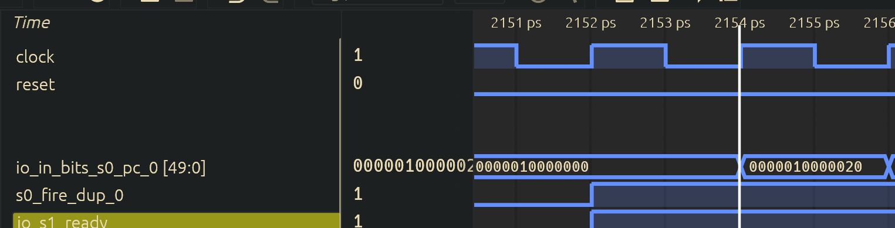
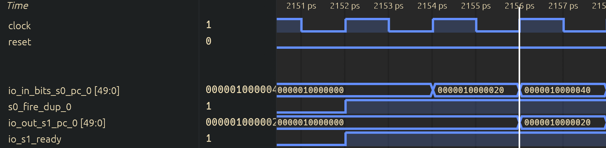
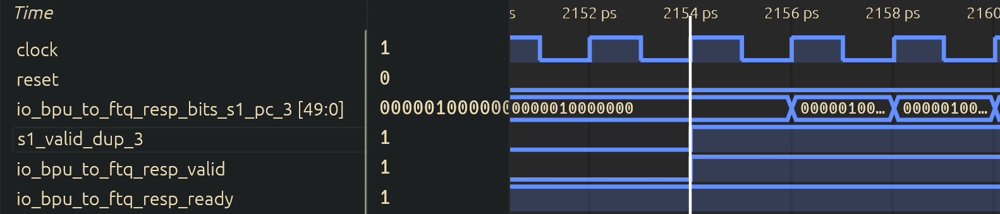
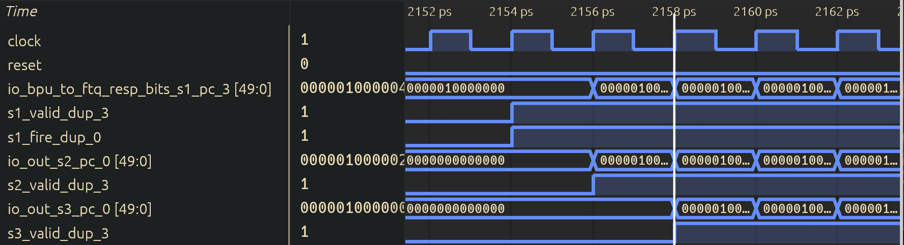
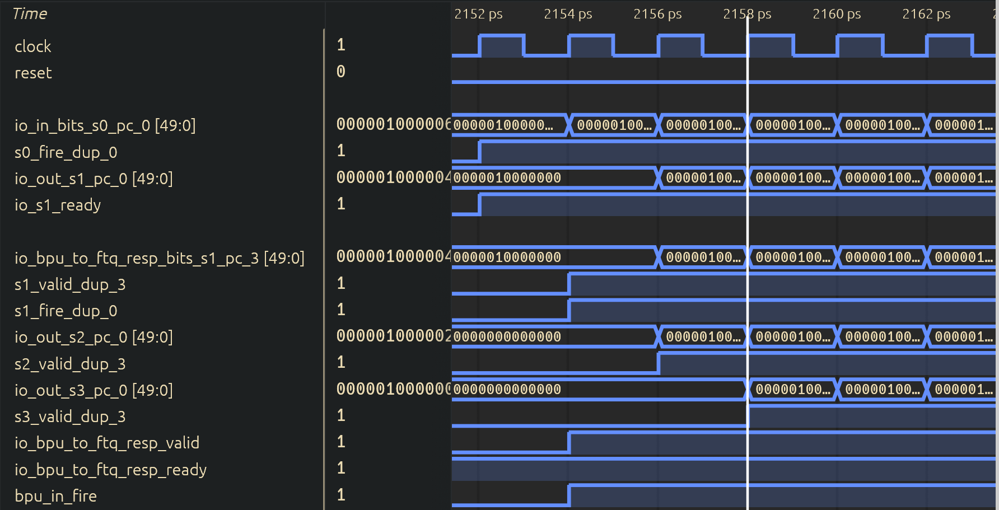

# 1. 复位后首次预测块的 BPU → FTQ 流程

本文主要分析处理器复位后，BPU 如何从 S0 发出第一个预测请求，以及这个预测块如何经过 S1、S2、S3，最终被 FTQ 接收。

本次测试程序中只有少量顺序指令，不包含条件分支。因此，本文的重点是观察 BPU 流水线自身的推进过程，以及 BPU 和 FTQ 之间的握手、分配关系。

## （1）BPU 与 FTQ 的关系

在查看波形之前，首先需要明确 BPU 和 FTQ 各自负责什么。

BPU 根据当前起始 PC 预测下一个取指块的信息，包括预测块的起始地址、结束位置、是否存在 taken CFI，以及下一个预测地址。FTQ 负责保存这些预测块，后续 ICache、IFU 以及分支重定向逻辑可以通过 FTQ 表项找到对应的预测信息。

因此，本次实验观察的不是“一条 add 指令如何进入 FTQ”，而是“包含这些顺序指令的一个预测块如何进入 FTQ”。整体关系如下：

```text
                    BPU

    S0  ─────→  S1  ─────→  S2  ─────→  S3
    │           │                         │
 发起预测    产生快速预测              校验早期预测
                │                         │
                └──────→ FTQ ←───────────┘
                       接收预测块
```

从图中可以看到，S1 可以向 FTQ 提供早期预测结果。S2、S3 并不是等到全部完成之后才第一次向 FTQ 分配表项，而是继续处理同一个预测块；如果后级发现早期预测需要修改，再对已经分配的 FTQ 表项进行修正。

### （1.1）找到需要观察的模块和信号

在波形中先定位前端模块下的 BPU 和 FTQ。BPU 的层次通常类似：

```text
TOP.SimTop.cpu.l_soc.core_with_l2.core.frontend.inner_bpu
```

具体层次名称应以实际波形为准。找到 BPU 后，先加入下面这些信号：

| 波形信号 | 位宽 | 核心含义 | 对应源码信号 | 波形观察重点 |
| --- | --- | --- | --- | --- |
| `s0_valid` / `s0_fire` | 1bit | S0 是否存在有效预测请求，以及该请求是否真正发出 | `s0_valid`、`s0_fire` | 找到复位后的第一次请求 |
| `s1_valid` | 1bit | S1 中是否保存着有效预测块 | `s1_valid` | 应在 S0 请求成功后的下一拍有效 |
| `s2_valid` | 1bit | S2 中是否保存着有效预测块 | `s2_valid` | 应在 S1 成功推进后有效 |
| `s3_valid` | 1bit | S3 中是否保存着有效预测块 | `s3_valid` | 应在 S2 成功推进后有效 |
| `s0_pc` / `s0_startPc` | 实现相关 | S0 本次预测请求的起始 PC | `s0_startPc` | 用于确定第一次请求 P0 |
| `s1_pc` / `s1_startPc` | 实现相关 | S1 中预测块的起始 PC | `s1_startPc` | 应与对应的 S0 PC 一致 |
| `s2_pc` / `s2_startPc` | 实现相关 | S2 中预测块的起始 PC | `s2_startPc` | 用 PC 继续追踪同一个预测块 |
| `s3_pc` / `s3_startPc` | 实现相关 | S3 中预测块的起始 PC | `s3_startPc` | 确认 P0 最终到达 S3 |
| `bpu_to_ftq.resp.valid` | 1bit | BPU 当前向 FTQ 提供的预测结果有效 | BPU → FTQ 响应 valid | 单独为 1 不代表 FTQ 已接收 |
| `bpu_to_ftq.resp.ready` | 1bit | FTQ 当前可以接收 BPU 的预测结果 | BPU → FTQ 响应 ready | 与 valid 同时有效才完成握手 |
| `bpu_to_ftq.resp.fire` | 1bit | BPU 和 FTQ 在本周期完成一次握手 | `valid && ready` | 判断 FTQ 接收预测块的核心信号 |
| `ftq_alloc` / `bpu_in_fire` | 1bit | FTQ 对预测块执行分配或写入 | FTQ 入队使能 | 需要与 fire、写指针和 PC 一起判断 |
| `bpuPtr` / FTQ 写指针 | 实现相关 | 下一次普通 BPU 预测要写入的 FTQ 位置 | FTQ BPU 写指针 | 正常分配后应向前移动 |
| `redirect` / 后级修正信号 | 1bit | 后级预测或执行结果是否修正当前取指流 | redirect、override | 顺序场景中重点确认是否保持为 0 |

如果信号名带有 `_dup_0`、`_dup_1` 等后缀，表示该控制信号在生成电路时产生了多个副本，用于降低扇出或改善时序。它们不是额外流水级。选择其中一个与目标数据通路对应的副本观察即可。

### （1.2）valid、ready 和 fire 的区别

在后面的分析中会频繁使用 valid、ready 和 fire，因此这里先说明三者的区别：

* `valid=1`：发送端已经准备好一份有效数据。
* `ready=1`：接收端当前能够接收数据。
* `fire=1`：valid 和 ready 同时为 1，本周期真正完成传输。

它们之间的关系可以简单理解为：

```text
fire = valid && ready
```

假设某个预测块已经到达 S1，此时 `s1_valid=1`，但 FTQ 的 ready 为 0，那么这个预测块仍然需要停留在 S1，不能进入下一阶段。只有 ready 变为 1、握手成功后，预测块才能被 FTQ 接收并继续向 S2 推进。

另外，流水线连续工作后，`s1_valid`、`s2_valid`、`s3_valid` 可能连续多个周期保持为 1。此时每个周期处理的可能是不同预测块。因此，不能只根据 valid 的上升沿追踪 P0，还必须同时查看各阶段 PC。

## （2）复位后 S0 发出第一次预测请求

首先将波形移动到复位释放的位置，观察 reset、S0 PC、S0 valid/fire，以及各预测器的初始化完成信号。



复位释放后，BPU 不一定立即发出请求。部分预测器内部包含 SRAM，这些 SRAM 需要先完成初始化。只有初始化完成，并且 S1 可以接收新的预测请求时，S0 才能够真正 fire。

对应控制关系可以概括为：

```scala
s0_fire := s1_ready && sramResetDone
```

其中：

* `sramResetDone=1` 表示参与预测的 SRAM 已完成复位初始化，此信号不在波形中产生，通过相应的调试信息打印。
* `s1_ready=1` 表示 S1 当前可以接收来自 S0 的新预测块。
* `s0_fire=1` 表示 S0 在本周期真正发出了一次预测请求。


复位阶段信号说明：

| 信号名 | 位宽 | 核心功能 | 对应源码位置 | 波形关键说明 |
| --- | --- | --- | --- | --- |
| `reset` | 1bit | 处理器复位信号 | 顶层复位输入 | 先确认复位释放的时钟边沿 |
| `sramResetDone` | 1bit | BPU 内部预测器 SRAM 初始化完成 | BPU 初始化控制逻辑 | 为 0 时不能发出正常预测请求 |
| `s1_ready` | 1bit | S1 可以接收新的预测请求 | BPU 流水线控制逻辑 | 和初始化完成共同决定 S0 是否推进 |
| `s0_valid` | 1bit | S0 当前预测请求有效 | BPU S0 控制逻辑 | 若设计未保留该信号，应以 S0 fire 为实际请求依据 |
| `s0_fire` | 1bit | S0 请求真正进入预测流水线 | `s1_ready && sramResetDone` 或对应实现 | 第一次拉高即本文跟踪起点 |
| `s0_pc` | 实现相关 | 当前预测请求的起始 PC | `s0_startPc` | 第一次 fire 时的值记为 P0 |


## （3）预测块从 S0 进入 S1

找到第一次 S0 fire 后，接下来观察 S1 valid 和 S1 PC。



S0 fire 表示 S0 中的请求在当前时钟边沿被接收。经过这个边沿后，S1 valid 应置为 1，同时 S0 的起始 PC 被锁存为 S1 PC。其基本逻辑如下：

```scala
val s1_startPc = RegEnable(s0_startPc, s0_fire)

when(s0_fire) {
  s1_valid := true.B
}
```

因此，图 2 中应当看到如下关系：

```text
周期 a：s0_fire=1，s0_pc=P0
时钟边沿
周期 b：s1_valid=1，s1_pc=P0
```

这里的“下一周期”不表示 S0 预测计算结束，而表示 P0 已经进入 S1。在 S1 中，uBTB、aBTB 等快速预测部件的结果会被组合成早期预测结果，并准备送给 FTQ。

S0 → S1 波形信号说明：

| 信号名 | 位宽 | 核心功能 | 对应 Chisel 源码位置 | 波形关键说明 |
| --- | --- | --- | --- | --- |
| `s0_fire` | 1bit | S0 请求被流水线接收 | BPU 的 S0 流水控制 | 周期 a 为 1，表示 P0 开始进入预测流水线 |
| `s0_pc` | 实现相关 | S0 请求的起始 PC | `s0_startPc` | 周期 a 应等于 P0 |
| `s1_valid` | 1bit | S1 中存在有效预测块 | `s1_valid` | 在锁存边沿后置为 1 |
| `s1_pc` | 实现相关 | S1 当前预测块的起始 PC | `s1_startPc` | 周期 b 应仍为 P0 |
| `s1_target` / next PC | 实现相关 | S1 产生的早期预测目标 | `s1_prediction.target` | 无有效 taken CFI 时应表现为顺序 fall-through |

由于测试主体没有分支，冷启动时通常不会存在有效的 taken 分支命中。因此，S1 产生的下一预测地址应来自顺序 fall-through 路径。不过，具体的地址，应结合预测块对齐方式和 FallThroughPredictor 的输出判断。


## （4）S1 预测结果被 FTQ 接收

P0 到达 S1 后，BPU 已经可以向 FTQ 发送早期预测结果。接下来需要同时查看 S1、BPU → FTQ 接口以及 FTQ 内部的分配信号。



首先观察 BPU → FTQ 接口：

```text
bpu_to_ftq.resp.valid = 1：BPU 提供的预测块有效
bpu_to_ftq.resp.ready = 1：FTQ 可以接收新的预测块
```

在无后级修正的普通情况下，S1 的推进和 BPU → FTQ 的握手发生在同一个周期。也就是说，当 P0 位于 S1，并且 FTQ ready 时，一方面 P0 的早期预测结果被 FTQ 接收，另一方面 P0 继续向 S2 推进。

FTQ 分配不能只看一个 `ftq_alloc` 名称。还需要确认写入的预测块 PC 是 P0，并且 FTQ 的普通 BPU 写指针在时钟边沿后向前移动。这样才能证明发生的是“新预测块入队”，而不是 S2/S3 对旧表项的修正。

BPU → FTQ 及分配信号说明：

| 信号名 | 位宽 | 核心功能 | 对应 Chisel 源码位置 | 波形关键说明 |
| --- | --- | --- | --- | --- |
| `s1_valid` | 1bit | S1 预测结果有效 | BPU S1 流水控制 | P0 等待发送给 FTQ 时为 1 |
| `bpu_to_ftq.resp.valid` | 1bit | BPU 输出预测响应有效 | BPU → FTQ 接口 | 应与普通 S1 输出条件对应 |
| `bpu_to_ftq.resp.ready` | 1bit | FTQ 可以接收预测响应 | FTQ → BPU 反压信号 | 为 0 时，P0 不能完成入队 |
| `bpu_to_ftq.resp.fire` | 1bit | BPU 与 FTQ 完成握手 | `resp.valid && resp.ready` | 第一次为 1 表示 FTQ 接收 P0 |
| `resp.bits.pc` / `startPc` | 实现相关 | 本次响应对应的预测块 PC | BPU 响应数据 | 必须等于 P0，防止跟错预测块 |
| `ftq_alloc` / `bpu_in_fire` | 1bit | FTQ 执行预测块写入 | FTQ 入队控制逻辑 | 应与普通响应握手对应 |
| `bpuPtr` | 实现相关 | FTQ 的 BPU 写指针 | FTQ 指针控制逻辑 | 入队边沿后由 N 变为 N+1 |
| `redirect` / override | 1bit | 当前写入是否属于后级修正 | FTQ/BPU 修正逻辑 | 普通首次分配时应确认没有走修正路径 |

结合图 3，可以按照参考文章的方式逐周期解释：

在**2154 ps**，P0 已经位于 S1，因此 `s1_valid` 和 BPU 的响应 valid 为高。如果此时 FTQ ready 也为高，则 `bpu_to_ftq.resp.fire` 同时为高，说明 FTQ 在本周期接收 P0 的预测结果。

经过周期 a 末尾的有效时钟边沿后，FTQ 将 P0 写入 `bpuPtr=N` 指向的表项，并将普通写指针更新为下一位置。与此同时，P0 进入 S2。因此在**2156 ps**中，应看到 FTQ 指针已经变化，并且 `s2_valid=1、s2_pc=P0`。


## （5）预测块继续进入 S2 和 S3

FTQ 接收 P0 后，BPU 内部仍会继续处理这个预测块。接下来观察 `s2_valid`、`s3_valid` 及其对应 PC。



各级的基本推进关系如下：

```scala
s1_fire := s1_valid && s2_ready && ftq_ready
s2_fire := s2_valid && s3_ready
s3_fire := s3_valid

when(s1_fire) { s2_valid := true.B }
when(s2_fire) { s3_valid := true.B }
```

S2 中会使用比 S1 更完整的预测信息。例如，mBTB 提供候选分支信息，TAGE/SC 对条件分支方向进行进一步预测。到达 S3 后，BPU 将后级结果与 S1 的早期预测进行比较。

S1 → S2 → S3 波形信号说明：

| 信号名 | 位宽 | 核心功能 | 对应 Chisel 源码位置 | 波形关键说明 |
| --- | --- | --- | --- | --- |
| `s1_fire` | 1bit | S1 预测被 FTQ 接收并向 S2 推进 | BPU S1 流水控制 | P0 完成早期预测的关键事件 |
| `s2_valid` | 1bit | S2 中存在有效预测块 | `s2_valid` | S1 fire 后，P0 在 S2 中有效 |
| `s2_pc` | 实现相关 | S2 当前预测块 PC | `s2_startPc` | 必须仍等于 P0 |
| `s2_fire` | 1bit | S2 结果向 S3 推进 | BPU S2 流水控制 | 后级未阻塞时通常下一拍发生 |
| `s3_valid` | 1bit | S3 中存在有效预测块 | `s3_valid` | S2 fire 后，P0 在 S3 中有效 |
| `s3_pc` | 实现相关 | S3 当前预测块 PC | `s3_startPc` | 必须仍等于 P0 |
| `s3_fire` | 1bit | S3 完成本次预测处理 | BPU S3 流水控制 | 表示 P0 已完成 BPU 后级处理 |
| `s2_redirect` / `s3_override` | 1bit | 后级发现早期预测需要修正 | BPU 后级比较逻辑 | 为 1 时应继续追踪被改写的 FTQ 表项 |
| `meta.valid` | 1bit | 后级预测元数据有效 | BPU → FTQ meta 接口 | 用于向已分配的 FTQ 表项补充训练信息 |

假设不存在停顿，可以得到下面的时序：

```text
周期 a：P0 在 S0，s0_fire=1
周期 b：P0 在 S1，S1 结果与 FTQ 握手
周期 c：P0 在 S2，FTQ 中已经存在 P0 表项
周期 d：P0 在 S3，完成后级校验
```

需要注意，流水线开始连续工作后，周期 c 中的 S1 可能已经在处理 P1，周期 d 中的 S1、S2 可能分别在处理 P2、P1。因此，看到多个 valid 同时为 1 是正常现象。只有各级 PC 都等于 P0 时，才能将这些信号归为同一个预测块。


## （6）完整波形时序总结

将前面四张波形图放到同一条时间线上，可以得到从复位后首次请求到 FTQ 接收、再到 S3 完成校验的完整过程。



完整波形建议至少包含以下信号，并按照控制信号、PC、接口和 FTQ 状态分组排列：

```text
clock / reset

s0_valid(or s0_fire)  s0_pc
s1_valid              s1_fire  s1_pc
s2_valid              s2_fire  s2_pc
s3_valid              s3_fire  s3_pc

bpu_to_ftq.resp.valid
bpu_to_ftq.resp.ready
bpu_to_ftq.resp.fire

ftq_alloc(or bpu_in_fire)
bpuPtr
redirect / override
```

最终时序记录如下：

| 观察事件 | 实际周期/时刻 | PC 或 FTQ 指针 | 波形现象 | 对应结论 |
| --- | --- | --- | --- | --- |
| 复位释放 | 【待填写】 | reset vector=【待填写】 | reset 由 1 变为 0 | BPU 开始等待内部初始化完成 |
| 第一次 S0 请求 | 【待填写】 | s0_pc=P0=【待填写】 | `s0_fire=1` | P0 开始进入 BPU 流水线 |
| P0 进入 S1 | 【待填写】 | s1_pc=【待填写】 | `s1_valid=1` | S1 生成早期预测结果 |
| BPU 与 FTQ 握手 | 【待填写】 | resp PC=【待填写】 | `resp.valid && resp.ready` | FTQ 接收 P0 的预测信息 |
| FTQ 分配表项 | 【待填写】 | bpuPtr：【待填写】→【待填写】 | `ftq_alloc=1`，条目写入 | P0 被保存到 FTQ |
| P0 进入 S2 | 【待填写】 | s2_pc=【待填写】 | `s2_valid=1` | 后级预测器继续处理 P0 |
| P0 进入 S3 | 【待填写】 | s3_pc=【待填写】 | `s3_valid=1` | P0 到达预测校验阶段 |
| 后级处理完成 | 【待填写】 | FTQ 表项=【待填写】 | redirect/override=【待填写】 | 早期预测被保留或修正 |

从理论上看，在无停顿情况下，P0 会按 S0、S1、S2、S3 每拍向后推进。但实际分析必须以 fire 为准：如果某一级 valid 为 1 而 ready 为 0，预测块会停留在该级，后续 valid 的变化也会相应推迟。

## （7）结论

通过以上波形分析，需要最终确认以下几点：

* BPU 在复位和预测器初始化完成后，由 S0 对 P0 发出第一次预测请求。
* S0 fire 后，P0 的 PC 被锁存到 S1，S1 valid 置位并产生早期预测结果。
* 当 BPU 响应 valid 与 FTQ ready 同时有效时，`bpu_to_ftq.resp.fire` 置位，FTQ 接收 P0。
* FTQ 的分配使能和写指针变化证明 P0 被写入一个新的 FTQ 表项，而不是只在接口上短暂出现。
* P0 随后继续进入 S2、S3；各级 PC 保持一致，证明跟踪的是同一个预测块。
* S3 的后级比较决定是否保留 S1 的早期预测，或对已有 FTQ 表项进行修正。
