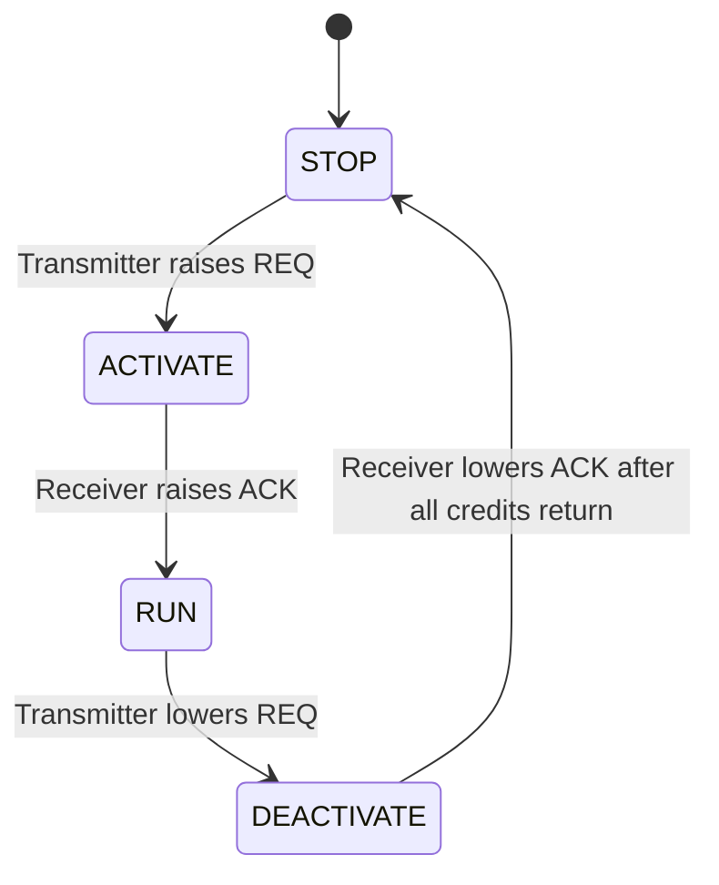
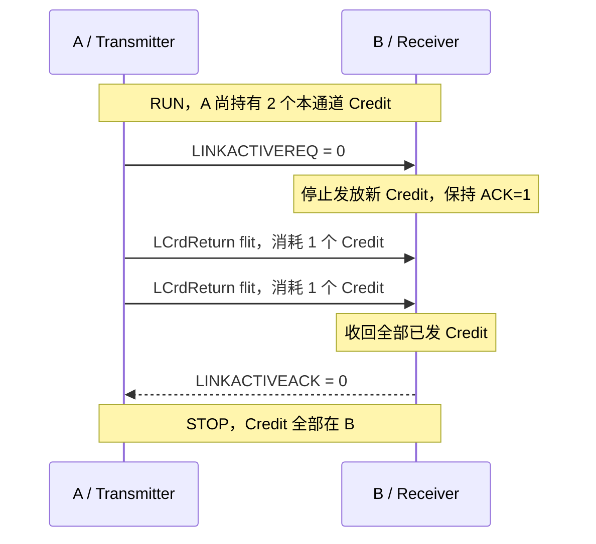

# CHI Link：通道、Pend、L-Credit 与 LinkActive

一笔 CHI Transaction 可以包含多条 REQ、SNP、RSP、DAT 消息。本篇先解释一条消息怎样穿过原生 CHI Link，再解释链路怎样安全启动和停用。协议基线为 [CHI Issue E.b](https://documentation-service.arm.com/static/6295e03db334256d9ea8ae86)。

## 1. Channel、Link 与 Port

| 概念 | 含义 |
|---|---|
| Channel | 单方向、单种消息类别的传输接口，具有独立的 flit 和 L-Credit 信号 |
| Link | 同一方向的一组 Channel，共用该方向的 LinkActive 握手 |
| Port | 一对相反方向的 Link，以及相关的活动/一致性控制信号 |

REQ/RSP/SNP/DAT 是消息类别；加上 TX/RX 才表示相对于本节点的方向。

| 类别 | 常见消息 | 典型方向 |
|---|---|---|
| REQ | `ReadShared`、`ReadUnique`、`WriteBackFull`、`CleanUnique`、`PCrdReturn` | RN→HN，HN→SN |
| SNP | `SnpShared`、`SnpUnique`、`SnpCleanInvalid`、`SnpSharedFwd` | Home/互连→可被 Snoop 的 RN |
| RSP | `Comp`、`DBIDResp`、`CompDBIDResp`、`CompAck`、`RetryAck`、`PCrdGrant`、`SnpResp` | 两个方向均可能存在 |
| DAT | `CompData`、`DataSepResp`、`CopyBackWrData`、`NonCopyBackWrData`、`SnpRespData` | 两个方向均可能存在 |

规范流程中 `NCBWrData` 是 `NonCopyBackWrData` 的简写。本组使用 `NCBWrData` 绘制流程，并在字段/opcode 核对时使用对应的正式名称。

典型 RN-F Port 如下：

```text
RN-F → 互连：TXREQ、TXRSP、TXDAT       共用 TX LinkActive
互连 → RN-F：RXRSP、RXDAT、RXSNP       共用 RX LinkActive
```

不同 Node 类型具有不同接口，不能把 RN-F 的通道列表套用到所有 SN 或 RN-I。尤其 RN-I 不要求普通 SNP 接口。

## 2. FLIT、FLITV、FLITPEND 与 LCRDV

对一条从 A 到 B 的 Channel：

```text
A（Transmitter）                               B（Receiver）
    FLIT、FLITV、FLITPEND ------------------------>
    <------------------------------------- LCRDV
```

| 信号 | 驱动方 | 含义 |
|---|---|---|
| `FLIT` | 发送方 | 编码后的消息字段；DAT flit 还包括数据和相关控制信息 |
| `FLITV` | 发送方 | 本周期有一个有效 flit 传输 |
| `FLITPEND` | 发送方 | 下一周期可能传输 flit，提前通知接收侧以便局部时钟门控 |
| `LCRDV` | 接收方 | 本周期发放一个本 Channel 的 Link Credit |

原生 CHI Link 没有逐拍 `READY` 信号。接收方先发 Credit，承诺以后接收相应数量的 flit；发送方有可用 Credit 时才能发有效 flit。接收方不能在 `FLITV=1` 的这一拍临时拒绝已承诺的传输。

在 CHI E.b 中，每个 packet 为一个 flit。一个完整缓存行的数据可能拆成多个 DAT packet/flit。因此，256-bit DAT 传输 64-byte 整行通常使用两个 DAT flit，每个都消耗一个 DAT L-Credit。

内部 `Decoupled(valid, ready, bits)` 可以通过适配器连接到原生 Link。内部握手和 Link 传输可能隔着队列、流水寄存器，分析波形时不能把它们当成同一拍。

## 3. FLITPEND 的严格关系

在有效的同步采样周期中，§14.4 要求：

```text
FLITV(t)=1  ⇒  FLITPEND(t-1)=1
FLITPEND(t-1)=0  ⇒  FLITV(t)=0
```

反方向不成立：`FLITPEND=1` 不保证下一拍真的传输。发送方可以尚无 Credit 时先置 Pend，也可以置 Pend 后没有发送；若难以提前预测，可以保持 Pend 为高。

| 周期 | FLITPEND | FLITV | 解释 |
|---|---:|---:|---|
| t0 | 1 | 0 | 预告下一周期可能发送 |
| t1 | 0 | 1 | 发送 flit A；t0 已预告 |
| t2 | 1 | 0 | t1 Pend 为 0，因此 t2 不发送；预告 t3 |
| t3 | 1 | 0 | 此次预告未实际发送，这是允许的 |
| t4 | 0 | 1 | 发送 flit B；t3 已预告 |

Pend 不消耗 Credit，也不代表 Transaction 被接受。它与下面的 `FLITV`、Credit 计数、LinkActive 状态共同构成合法传输条件。

## 4. L-Credit 机制

### 4.1 发放、使用与返还

每个 Channel 独立计数。E.b 规定单个接收 Channel 可提供的 L-Credit 数为 1–15；Credit 是容量承诺，不要求硬件恰好采用同样数量的简单 FIFO 项。

1. 接收方确认自己能接收更多 flit，用 `LCRDV` 发放 Credit。
2. 发送方记录已收到而未使用的 Credit。
3. 每发一个 flit，消耗一个 Credit。
4. 接收方释放相应接收资源后，可以再通过 `LCRDV` 发放 Credit。

**新 Credit 不能在收到它的同一周期使用。** 若周期开始时可用计数为 `C(t)`，本周期收到一个 Credit 的指示为 `grant(t)`，发送一个 flit 的指示为 `send(t)`，则：

```text
C(t+1) = C(t) + grant(t) - send(t)
send(t)=1 的必要条件：C(t)>0
```

两项可以同拍发生，但发送只能使用本拍开始前已持有的 Credit。

以下例子处于 RUN；所有发送均假设上一拍已经置 Pend：

| 周期 | 拍初 C | LCRDV | FLITV | 拍后 C | 解释 |
|---|---:|---:|---:|---:|---|
| t0 | 0 | 1 | 0 | 1 | 收到首个 Credit，不能同拍使用 |
| t1 | 1 | 1 | 1 | 1 | 使用旧 Credit，同时收到新 Credit |
| t2 | 1 | 0 | 1 | 0 | 最后一个 Credit 被使用 |
| t3 | 0 | 0 | 0 | 0 | 不能继续发送 |
| t4 | 0 | 1 | 0 | 1 | 接收方再次提供容量 |
| t5 | 1 | 0 | 1 | 0 | 恢复发送 |

接收方既要考虑已经存入的数据，也要考虑已发出 Credit 对尚未到达 flit 的容量预留。不能只看“当前 FIFO 还没满”就任意发 Credit。

### 4.2 L-Credit 与 P-Credit

| 比较项 | L-Credit | P-Credit |
|---|---|---|
| 作用层次 | Link / Channel | Request Retry 协议 |
| 承诺 | 接收一个 flit | 接受一笔使用匹配 Credit 重发的请求 |
| 发放方式 | 接收方驱动 `LCRDV` | Completer 发送 RSP `PCrdGrant` |
| 关联 | 当前链路的当前 Channel | Credit 来源 Completer 和 `PCrdType` |
| 使用方式 | 每个有效 flit 消耗一个 | REQ 重发时 `AllowRetry=0`，使用对应类型 |
| 归还方式 | 链路停用时用 `*LCrdReturn` Link flit | 用 REQ `PCrdReturn` 返回不用的授权 |

得到 P-Credit 的 RN 仍需要 REQ L-Credit 才能把重发请求送上链路。得到 REQ L-Credit 则只说明下一跳可以接收 flit，不代表 Home 有完整事务处理资源。

### 4.3 不同通道还要满足前进依赖规则

拆分 Channel 不会自动消除死锁。E.b §13.4.1 对 RN 要求：接收 RSP 和 DAT 必须能够前进，不能依赖其他 Channel 先前进；接收 SNP 不能依赖发送 REQ 先前进，但可以依赖发送 RSP/DAT。尤其不能因为 CompAck 发不出去，就停止接收所有 Outstanding 请求的 Comp/CompData。

这些是协议对资源依赖的要求，不是简单的全局仲裁优先级。Router 的虚通道、缓存端口和协议事务缓冲仍要按各自实现保证前进。

## 5. LinkActive 握手与四个状态

对 A→B 的一组 Channel：

```text
A 驱动 LINKACTIVEREQ ──────────→ B
A 接收 LINKACTIVEACK ←────────── B
```

在 A 的 Port 上，它们叫 `TXLINKACTIVEREQ`、`TXLINKACTIVEACK`；在 B 的 Port 上，同一对线叫 `RXLINKACTIVEREQ`、`RXLINKACTIVEACK`。B→A 的反向 Link 使用另一对握手线。

| 状态 | REQ | ACK | flit 与 Credit 的行为 |
|---|---:|---:|---|
| STOP | 0 | 0 | 不传 flit、不发 Credit；所有 Credit 在接收方 |
| ACTIVATE | 1 | 0 | 不发 flit；发送方准备接收 Credit，接收方先确认进入 RUN |
| RUN | 1 | 1 | 接收方可发 Credit，发送方用已持有 Credit 发 flit |
| DEACTIVATE | 0 | 1 | 接收方停止发新 Credit并收回所有已发 Credit；发送方继续接收在途 Credit 并归还 |



STOP/RUN 是稳定状态，ACTIVATE/DEACTIVATE 是过渡状态。一对握手覆盖同方向所有 Channel，但不合并它们的 Credit 池：REQ Credit 不能拿来发 DAT。

## 6. 启动与停用

### 6.1 从 STOP 启动

1. 复位后握手、`FLITV` 和相关 `LCRDV` 输出为低，发送方没有 Credit。
2. 发送方置 `LINKACTIVEREQ=1`，请求启动。
3. 接收方就绪后置 `LINKACTIVEACK=1`。
4. 接收方在置 ACK 的同拍或之后可以发 Credit；不能在确认启动之前发 Credit。
5. 发送方进入 RUN，并持有此前收到的 Credit、满足 Pend 关系后，发送有效 flit。

由于 ACK 与 Credit 的路径可能有不同延迟，发送方在仍观察为 ACTIVATE 时也必须准备记录到达的 Credit；此时还不能发送 flit。

### 6.2 从 RUN 停用

停用需要收回容量承诺。仅把 REQ 拉低或等 FIFO 空都不足够。

1. 发送方决定停用，建议在没有更多 Protocol flit 要发送时发起。
2. 发送方把 `LINKACTIVEREQ` 拉低，进入 DEACTIVATE。
3. 接收方观察到该变化后停止发新 Credit；状态切换边界可能仍有在途 Credit。
4. 发送方用 flit 消耗并归还全部剩余 Credit。通常使用本通道的 L-Credit Return flit；DEACTIVATE 仍允许合法的 Protocol flit。
5. 接收方继续接收在途 flit，确认所有 Channel 的已发 Credit 均已回收后，拉低 ACK。
6. Link 返回 STOP，发送方不再持有 Credit。

`ReqLCrdReturn`、`RespLCrdReturn`、`SnpLCrdReturn`、`DataLCrdReturn` 是不同 Channel 的 Link flit。E.b 规定它们的 `Opcode=0`、`TxnID=0`，其他字段不用。每个 Return flit 消耗一个已持有的本通道 Credit，在接收侧终止，不交给协议事务状态机。

这里“归还”要区分方向：正常时 Receiver 用 `LCRDV` 给 Transmitter 可用额度；停用时 Transmitter 用 Return flit 把未用额度交回 Receiver。

### 6.3 一个带两个剩余 Credit 的例子



图为握手动作示意，隐藏了每个 Return flit 的 Pend 预告和路径延迟。

## 7. TX/RX 联动与 SACTIVE

### 7.1 两个方向不能任意独立启停

E.b §14.6 要求 TXLINK 与 RXLINK 协调：双方均为稳定 STOP 时，如果对方激活本地 RX Link，本地也要及时激活 TX Link；双方均为稳定 RUN 时，如果对方发起 RX Link 停用，本地也要及时发起 TX Link 停用。

启动时，本地不能先确认接收方向而迟迟不启动发送方向：`RXLINKACTIVEACK` 的上升不得早于本地 `TXLINKACTIVEREQ` 的上升。停用时，RX ACK 的下降不得早于 TX REQ 的下降。再次启动还要遵守完整四相握手。完整组合状态机及异步路径竞争规则见 §14.6；单方向四态图不能替代它。

### 7.2 三种活动信号的分工

| 信号/机制 | 表达什么 | 不能据此推出什么 |
|---|---|---|
| FLITPEND | 下一拍可能发某 Channel 的 flit | 下一拍一定发送、事务已经完成 |
| LINKACTIVE | 该方向 Link 的启停与 Credit 收尾状态 | 所有协议事务已经完成 |
| TXSACTIVE / RXSACTIVE | 本地/对端存在进行中或即将开始的协议活动 | 当前一定有 flit 在链路上传输 |

`TXSACTIVE` 必须不晚于事务首个 flit 发送时置高，并保持到所有事务最后相关 flit 已发送/接收之后。等待 `PCrdGrant` 的 Retry 请求仍在进行中，不能仅因队列暂时为空就清除活动指示。

SACTIVE 可以用于决定电源策略，但不替代 LinkActive 握手。Link STOP 本身也不证明缓存已清空或节点可以退出一致性域；缓存清理、系统一致性接口和电源控制要分别完成各自要求。

## 8. 在 XSCache 源码中怎样定位

以下是实现例子，基线为 `OpenXiangShan/XSCache` commit `e491e177c8fae1146947b1137015f424ca2938f3`，不代表课程所有历史配置：

- [LinkLayer.scala](https://github.com/OpenXiangShan/XSCache/blob/e491e177c8fae1146947b1137015f424ca2938f3/src/main/scala/xscache/chi/LinkLayer.scala)：`ChannelIO` 定义四类信号；`LCredit2Decoupled`、`Decoupled2LCredit` 实现接口转换和 Credit 计数，包含 Link Return flit 的生成/过滤。
- 同文件发送侧使用持续置高的 `flitpend`，这是 §14.4 允许的保守预告方式，不能据此认为 Pend 没有协议约束。
- [LinkMonitor.scala](https://github.com/OpenXiangShan/XSCache/blob/e491e177c8fae1146947b1137015f424ca2938f3/src/main/scala/coupledL2/LinkMonitor.scala)：分别跟踪 TX/RX 状态，并连接各通道适配器。阅读时同时检查 LinkActive、接收侧 Credit 回收指示和系统一致性控制。

## 9. 参考与后续阅读

- [CHI E.b 规范](https://documentation-service.arm.com/static/6295e03db334256d9ea8ae86)：§13.1–13.6、§13.8、§13.11；§14.1–14.7。关键依据为 §14.2 的 Credit 使用时机、§14.4 的 Pend 关系，以及 Tables 14-1/14-2 的 Link 状态行为。
- 下一篇：[CHI Transaction](CHI-Transaction.md)。协议级 Retry 见 [Read / Write / Snoop / Dataless / Retry](CHI-Read-Write-Snoop-Dataless-Retry.md)。
