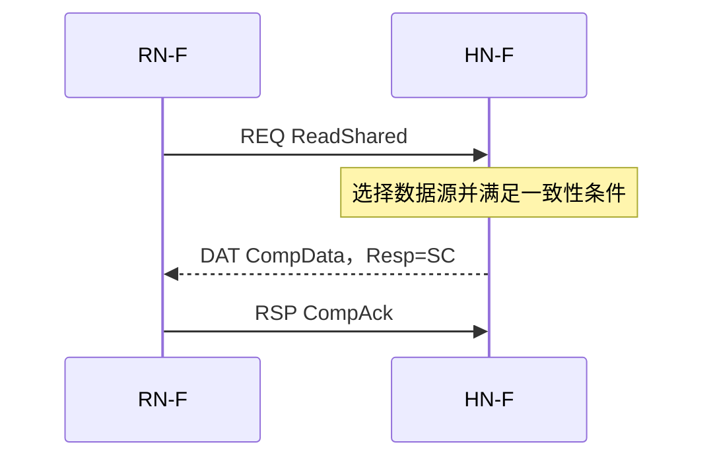
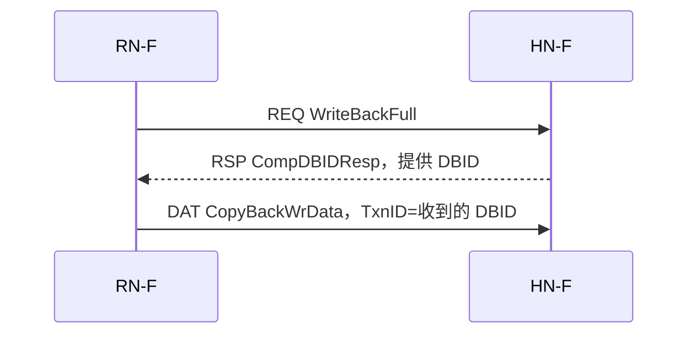
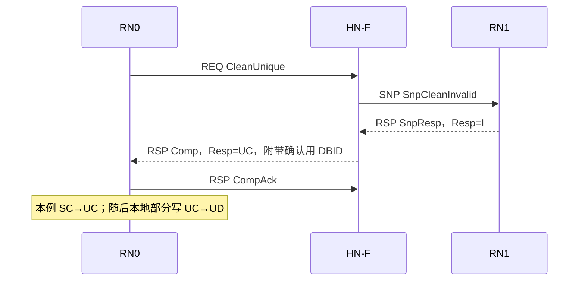
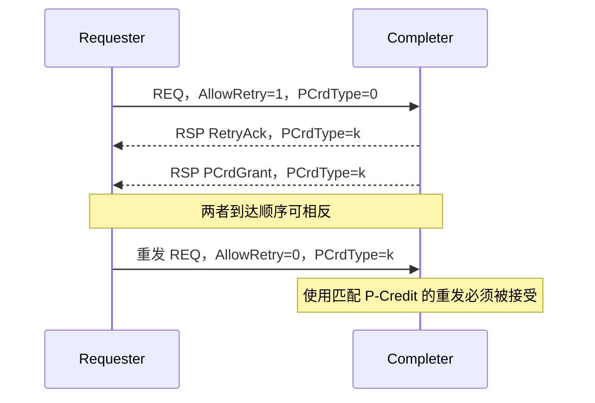

# CHI Read / Write / Snoop / Dataless / Retry

本篇解释 CHI 中常见操作的意图与基本消息组合。Read/Write 是访问操作，Snoop 是一致性协调，Dataless 是一类不向发起者交付数据的完成流程，Retry 是请求暂未被接受时的重发机制。它们不是五种互斥的传输通道。

协议基线为 [Arm CHI Issue E.b](https://documentation-service.arm.com/static/6295e03db334256d9ea8ae86)。本篇用正常、无错误、无 Exclusive、无 Stash、无 Memory Tagging 的场景入门；字段关联和直接传输见 [CHI Transaction](CHI-Transaction.md)，Link 流控见 [CHI Link](CHI-Link.md)。

## 1. 先区分数据、权限与责任

一次访问通常需要回答三个问题：

- **数据**：Requester 是否取得要读的字节，未覆盖的旧字节是否需要保留？
- **权限**：本地是否可以读取或修改，其他 RN 的副本是否必须失效？
- **责任**：谁负责保存比下层更新的数据，谁在驱逐时必须交回数据？

| 概念 | 谁发起 | 解决的问题 | 主要消息 |
|---|---|---|---|
| Read | Requester | 取得数据及相应缓存权限 | REQ，DAT；某些流程还有 RSP |
| Write | Requester | 把写入数据或缓存副本交给下层 | REQ、RSP、DAT；有不传普通数据的特殊写入形式 |
| Snoop | Home/互连 | 协调其他 RN 的副本、权限与数据来源 | SNP，RSP 或 DAT |
| Dataless | Requester | 取得权限、通知驱逐或执行维护，完成不向该 Requester 返回行数据 | REQ、RSP；内部仍可能产生 SNP/DAT |
| Retry | Completer 拒绝后由 Requester 重发 | 管理事务处理资源不足 | `RetryAck`、`PCrdGrant`、重发 REQ |

### 1.1 本篇使用的缓存状态

| 状态 | 含义 | 可直接本地写入？ |
|---|---|---:|
| I | Invalid，没有有效副本 | 否 |
| UC | Unique Clean，唯一、干净的完整副本 | 是 |
| UD | Unique Dirty，唯一、承担脏数据责任的完整副本 | 是 |
| SC | Shared Clean，可共享，不承担脏数据写回责任 | 否 |
| SD | Shared Dirty，可共享，承担脏数据写回责任 | 否 |

**SC 不保证数据等于 DRAM。** 例如一个 RN 为 SD，另一个 RN 为 SC，二者都保存最新值，DRAM 仍可为旧值；区别是 SD 一侧承担写回责任。CHI 还有 UCE（Unique Clean Empty）和 UDP（Unique Dirty Partial），说明权限与有效字节也可以分开管理，本篇完整行示例不使用它们。

状态名是 Cache 的语义状态，不能直接当作 `Resp` 字段的独立二进制编码表。响应还涉及 PassDirty 以及 opcode 的解释；详见 Transaction 第 2 节。

## 2. Read：取得数据和相应权限

### 2.1 Load 与 CHI Read 的关系

普通 Load 若在本地 Cache 命中，不必产生 CHI Read。只有本地层次不能满足访问、或访问类型要求向外发送时，才会在相应接口看到请求。因此 CPU 指令、缓存操作和 CHI Transaction 不是一一对应关系。

| Read 类型 | 请求意图 | 主要条件或结果 |
|---|---|---|
| `ReadShared` | 取得可缓存副本，允许共享 | 可以返回合法的 Shared 或 Unique 状态，不能固定认为必为 SC |
| `ReadClean` | 取得 Clean 副本 | 与 `ReadShared` 的脏数据责任许可不同 |
| `ReadNotSharedDirty` | 取得不为 Shared Dirty 的副本 | 常用于不希望接收 SD 责任的 Requester |
| `ReadUnique` | 取得数据与唯一权限 | Home 需撤销其他有效副本；本地随后可执行 Store |
| `ReadOnce` | 做一次 coherent 读，不分配常规 coherent cache 副本 | Home 仍可能需要从其他 RN 取得最新数据 |
| `ReadNoSnp` | 非 Snoopable 读 | 不要求普通 Snoopable 读的一致性动作；不能拿它任意读取可能有脏副本的共享地址 |

HN→SN 的后端读常用 `ReadNoSnp`，因为 RN 间的一致性已由 HN 负责；这不表示原始 RN 的读请求本身是非一致性的。

`ReadNoSnp` 也不等于“任何位置都绝不出现 SNP”：E.b 允许特定情况下使用 `SnpOnceFwd`，其行为不得改变该非 Snoopable 请求应观察到的值。是否合法要结合规范条件判断。

### 2.2 一次普通读

假设 RN 初始为 I，HN 本地有合法数据，选择返回 SC；RN-F 的 `ReadShared` 使用 `ExpCompAck=1`：



`CompData` 把数据与完成信息放在 DAT 中；另一合法组合是 RSP `RespSepData` 加 DAT `DataSepResp`。后者的两部分不能只收到一个就默认完成整笔读。E.b 还支持有条件的早发 CompAck，不能把“等整行所有数据到齐才发 Ack”写成通用硬性规则。

无论 Ack 能否提前发送，Requester 都必须接收本次请求要求的所有数据和响应，才能释放相应接收资源、使用所需字节。完整流程与条件见 Transaction。

## 3. Write：把数据交给下层

### 3.1 Store、权限升级与 CHI Write

Core 已持有 UC/UD 等可写副本时，普通 Store 可以只修改本地 Cache，不向 CHI 发 Write。若只有 SC，先申请唯一写权限；若本地 miss 且需要保留旧字节，通常需要读数据和取得权限。脏行驱逐时的 WriteBack，则是把此前积累的修改交回下层。

### 3.2 CopyBack 与 Non-CopyBack

| 类别 | 代表 REQ | DAT 消息 | 主要用途 |
|---|---|---|---|
| CopyBack | `WriteBackFull/Ptl`、`WriteCleanFull`、`WriteEvictFull` | `CopyBackWrData` | 交回缓存副本，报告相关缓存状态/数据责任 |
| Non-CopyBack | `WriteNoSnpFull/Ptl`、`WriteUniqueFull/Ptl` | `NonCopyBackWrData`，流程简写 `NCBWrData` | 写入新数据，不采用 CopyBack 的副本交接语义 |

`WriteBack`、`WriteClean`、`WriteEvict` 的本地状态变化不同，不能全部理解为“写完以后本地一定失效”。E.b 的 `WriteEvictOrEvict` 还有 Home 选择取数据或只完成驱逐的分支。

`WriteUnique` 让 Home 执行所需一致性动作后写入数据；它不等于给 Requester 返回一份唯一可缓存副本。`WriteNoSnp` 的使用则必须与地址属性及系统软件的一致性安排相符。

### 3.3 CopyBack Write 示例

假设 RN-F 驱逐完整 UD 行，无并发 Snoop 改变该行状态：



`CompDBIDResp` 是完成信息与数据接收标识的组合，**它在写数据发送之前到达，不能解释成“Home 已经收到数据”**。RN 必须继续交付要求的全部 DAT；此流程不再额外发送独立 CompAck，CopyBack WriteData 承担相应的收尾/排序作用。

Home 接收数据后可保存于 Home Cache，或按策略继续写入后端。RN 交回最新值，不意味着 DRAM 同一时刻必已更新。

### 3.4 Non-CopyBack Write 示例

以无 OWO、`ExpCompAck=0`、无 DWT 的 `WriteNoSnpFull` 为例，选择一种合法时序：

```text
RN → HN：REQ WriteNoSnpFull
HN → RN：RSP DBIDResp，返回 DBID
RN → HN：DAT NCBWrData，TxnID=该 DBID
HN → RN：RSP Comp
```

Home 也可以合并为 `CompDBIDResp`。`DBIDResp` 与 `Comp` 职责不同，分离流程允许的时序不能由上面的单个例子推断；是否需要等待写数据、是否有早完成限制，还取决于内存类型、属性和顺序要求。DBID 单独到达不表示 Write 已完成，Comp 单独到达也不允许丢掉尚未发送的数据。

### 3.5 Full、Ptl 与 Byte Enable

`Full` 对应完整行写入，`Ptl` 支持部分字节有效。DAT 的 `BE` 对应每个数据字节：有效位为 1 才表示该字节参与相应写入/数据交接。保留的旧字节必须有正确来源，不能把未使能字节当成写入零。

一条 64-byte line 在 256-bit DAT 上需要两个 flit，数据位置由 `DataID` 识别；不能只发送其中一个，再以 REQ 已发出为理由结束普通整行写。特殊取消、并发 Snoop 和部分有效状态要按相应规则处理。

## 4. Snoop：协调其他 RN 的副本

Snoop 由 Home/互连发送，要求目标 RN-F 检查本地行，并执行降级、失效、供数或转发等动作。它不是一个独立的 CPU Load/Store。

| SNP 类型 | 核心语义 |
|---|---|
| `SnpShared` / `SnpSharedFwd` | 获取可共享副本，Snoopee 不再保留 Unique 权限；Fwd 形式可直接供数给原 Requester |
| `SnpClean` / `SnpCleanFwd` | 获取 Clean 副本并使保留副本为 Shared；不是仅查询是否 Clean |
| `SnpNotSharedDirty` / Fwd 形式 | 获取 Shared Clean 副本，并使保留副本不为 Unique |
| `SnpUnique` / `SnpUniqueFwd` | 取得所需副本，同时使 Snoopee 的副本失效 |
| `SnpCleanShared` | 移除 Snoopee 的 Dirty 状态，必要时交回脏数据 |
| `SnpCleanInvalid` | 失效副本并取得需要保留的脏数据 |
| `SnpMakeInvalid` | 失效副本，允许丢弃其脏数据，不返回数据；用于协议明确允许覆盖/丢弃旧值的操作 |
| `SnpQuery` | E.b 的纯状态查询，不改状态、不返回数据 |

Snoop 的合法响应取决于 opcode、当前状态、`RetToSrc`、转发要求及并发事务，不能只按“Dirty 一定回数据、Clean 一定不回数据”判断。

```text
RSP SnpResp：              无数据，报告状态/动作结果
DAT SnpRespData：          有数据，报告状态并提供行数据
RSP SnpRespFwded：         向 Home 报告已向 Requester 转发
DAT SnpRespDataFwded：     转发后还向 Home 提供一份数据
```

`SnpResp(Resp=I)` 中，`SnpResp` 是 opcode，I 是相关响应状态；不要把 `RespI` 写成另一条正式 opcode。

例如 RN0 持有 UD，RN1 读取该行，Home 选择非转发流程：

```text
RN1 → HN：ReadShared
HN  → RN0：SnpShared
RN0 → HN：SnpRespData，提供最新数据与合法状态/责任信息
HN  → RN1：CompData
RN1 → HN：CompAck
```

Home 不能使用已经过期的 DRAM 值替代最新数据。提供数据给 Home 也不应直接称为“写入 DRAM”；Home 如何保存或继续写回是后续动作。

## 5. Dataless：完成响应不交付行数据

### 5.1 范围

Dataless Transaction 的关键是**对原 Requester 的完成响应不含行数据**。它可能触发其他 RN 的脏数据返回、后端写入或 Stash 数据移动，所以整个系统未必没有 DAT。

另一方面，Read 的 `CompAck` 不带数据，并不能据此把该 Read 称为 Dataless。要按事务类型和完整流程判断。

| REQ | 意图 | 简化收尾 |
|---|---|---|
| `CleanUnique` | 取得唯一权限，以便保留已有数据并执行 Store | `Comp` → `CompAck` |
| `MakeUnique` | 保证整行覆盖时取得所有权，不需要旧行数据 | `Comp` → `CompAck` |
| `Evict` | 通知 Home：不再缓存一条 Clean 行 | `Comp`；无 CompAck |
| `CleanShared` | 清理脏副本，允许保留共享副本 | `Comp`；无 CompAck |
| `CleanInvalid` | 清理并失效相关副本 | `Comp`；无 CompAck |
| `MakeInvalid` | 按该操作的语义失效，可丢弃 Dirty 旧值 | `Comp`；无 CompAck |

表中不覆盖 Persist/Stash 的扩展完成组合。`MakeInvalid` 不可替代要求保留脏数据的 `CleanInvalid`。

### 5.2 普通权限升级：CleanUnique

假设 RN0 和 RN1 都持有 SC，数据为 `X=0`，RN0 要修改几个字节：



本例其他副本为 Clean，因此没有 DAT。若其他节点承担脏数据责任，Home 还可能需要处理脏数据返回；即使原 Requester 不收行数据，这仍是 Dataless。

### 5.3 MakeUnique 为什么单独讲

E.b 要求 MakeUnique 的 Requester 保证写遍缓存行所有字节，因此可以失效并丢弃其他副本的旧数据。Requester 初始可以没有完整旧数据；它不能在拿到权限后读取未构造的新行字节，也不能只改几个字节就假设其他字节正确。

完整覆盖后的最终状态是 UD。`Comp` 的 `Resp=UC` 不能据此误写成“该事务最终留下与旧内存相同的 UC 行”。权限返回与随后完整行构造应结合协议规则理解。普通的保留旧字节写入应选择相应读/权限流程，而非通用地套用 MakeUnique。

### 5.4 Clean Evict

```text
RN → HN：REQ Evict
HN → RN：RSP Comp
```

此流程没有 `DBIDResp`、没有写数据，也没有 Home→RN 的 `CompAck`。如果 Home 想在驱逐时取得数据，应讨论 `WriteEvictFull` 或 `WriteEvictOrEvict` 的合法分支，不能替换 Evict 的消息组合。

## 6. Retry 与 P-Credit

### 6.1 为什么需要 Retry

L-Credit 保证链路接收容量，不保证 Completer 有目录/事务跟踪等处理资源。对允许 Retry、但当前无法接受的请求，Completer 返回 `RetryAck`，避免已到达的 REQ 占住网络资源持续等待。

Completer 需要记住它欠哪个 Requester、哪类处理资源的 P-Credit。资源可用时，通过 RSP `PCrdGrant` 授权重发。

`PCrdType` 是 **Protocol Credit Type**，E.b 支持 16 种值，含义由实现定义。它可以区分读写缓冲资源，但并不与某个 opcode 机械一一对应。

### 6.2 一次重发



对本篇普通请求，首次发送置 `AllowRetry=1`。`PrefetchTgt` 不适用这个 Retry 流程，因为它不返回对应响应。

重发条件和关联规则：

1. 已收到该请求的 `RetryAck`，并取得来自对应 Completer、类型匹配的一个 P-Credit。
2. `PCrdGrant` 若先到，Requester 要记录 Credit，不能丢弃或立即重发尚未收到 RetryAck 的请求。
3. Credit 不固定绑定原请求 TxnID。同一 Completer 和类型的多个已 Retry 请求，可以按合法分配策略选择一笔重发。
4. 重发使用 `AllowRetry=0`、匹配的 `PCrdType`。大部分字段保持原意，但规范允许 TxnID、QoS 等特定字段变化；不应要求所有字段逐位不变。
5. 每次授权只消费一次。若不再使用，需要按规则发送 REQ `PCrdReturn` 归还。

收到 RetryAck 不要求停止所有同 opcode 的新请求；真正约束是保留/管理待重发上下文、限制 Outstanding，并正确分配 Credit。`RetryAck` 不提供数据或权限，也不是最终访问错误。

### 6.3 Retry 后的缓存状态可能变化

等待 Credit 期间，其他合法事务仍可能 Snoop 该 RN 的缓存副本。Requester 不能假设原先的命中状态、权限或 CopyBack 数据永远不变。

即使 Home 在此期间取得了数据，原 Read 的数据要求也不会消失：若重发后完成普通 Read，仍须通过合法 DAT 交付数据或采用规范允许的相应特殊流程。不能只发送一个无数据 `Comp` 就代替普通 ReadShared 的数据返回。

## 7. 把五种操作串起来

以 RN0/RN1、HN 和 SN 为例，选择一种合法实现策略：

| 步骤 | 操作与消息 | 缓存结果或意义 |
|---|---|---|
| 1 | RN0 `ReadShared` 被 Retry，取得匹配 Credit 后重发 | 仍需等待本次读的数据/完成 |
| 2 | HN 从 SN 取数，向 RN0 发 `CompData`，RN0 发 `CompAck` | 本例 RN0 得到 SC，`X=0` |
| 3 | RN1 `ReadShared`，HN 必要时 Snoop RN0，再向 RN1 供数 | 本例 RN0/RN1 都为 SC |
| 4 | RN0 `CleanUnique`；HN 使 RN1 失效，完成并取得 CompAck | 本例 RN0 为 UC，RN1 为 I |
| 5 | RN0 本地部分修改 `X=1` | RN0 为 UD，无对应的外部 CHI Write |
| 6 | RN0 驱逐，`WriteBackFull` → `CompDBIDResp` → `CopyBackWrData` | 最新值交回 Home，RN0 为 I；DRAM 更新时机取决于后续路径 |

每一步的 ID 传递、等待条件与资源释放见 [CHI Transaction](CHI-Transaction.md)。Snoop 响应和 Retry 实现需要结合所用源码与配置验证；本篇不把 LinkNan/ZhuJiang 的未核实内部机制作为协议事实。

## 8. 参考

- [CHI E.b 规范](https://documentation-service.arm.com/static/6295e03db334256d9ea8ae86)：§2.3.1 Read、§2.3.2 Write、§2.3.5 Dataless、§2.8 Ordering、§2.10 Data transfer、§2.11 Request Retry。
- 同规范 §4.1 Cache line states、§4.2 Request types、§4.3 Snoop request types、§4.4 Request/Snoop 对应关系、§4.7 Requester 状态转移。关键表为 Table 4-24、Table 4-38；字段/opcode 定义见 §13.10 和 Appendix A。
- 阅读入口：[README](README.md)。下一篇：[CHI Link](CHI-Link.md)。
