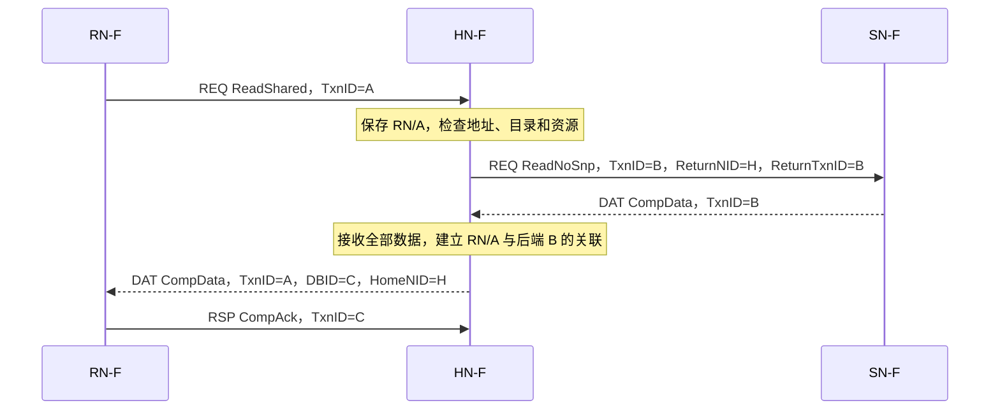
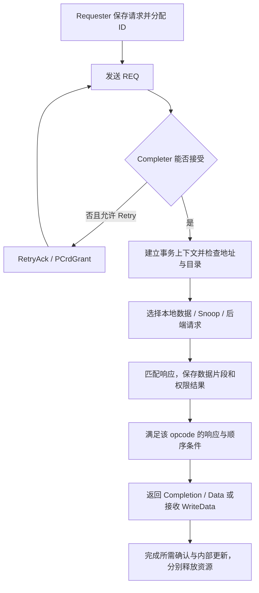
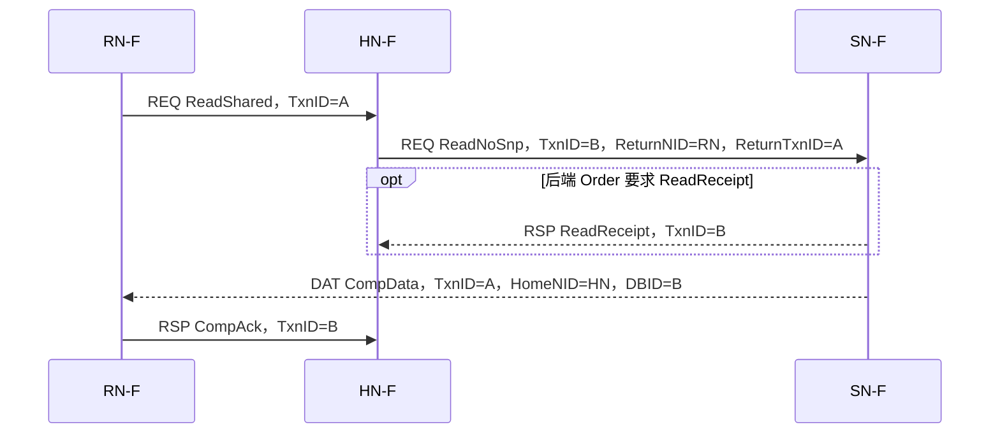
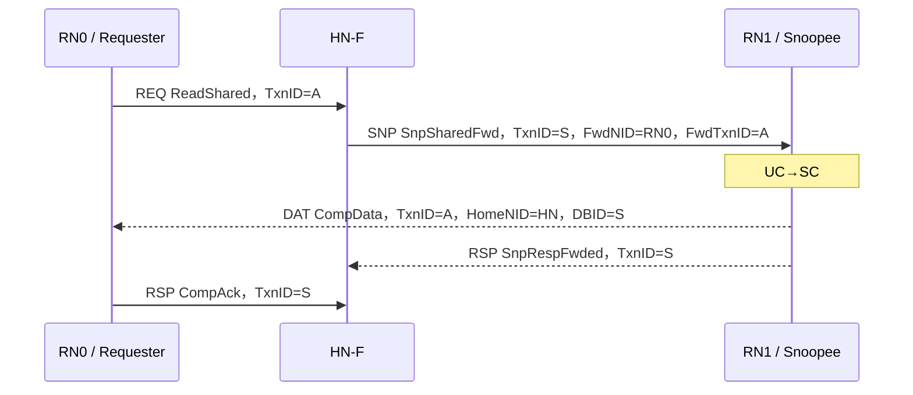
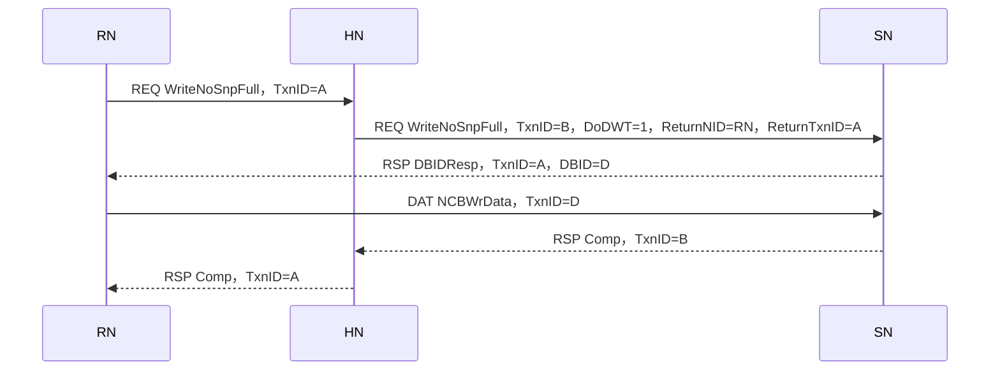
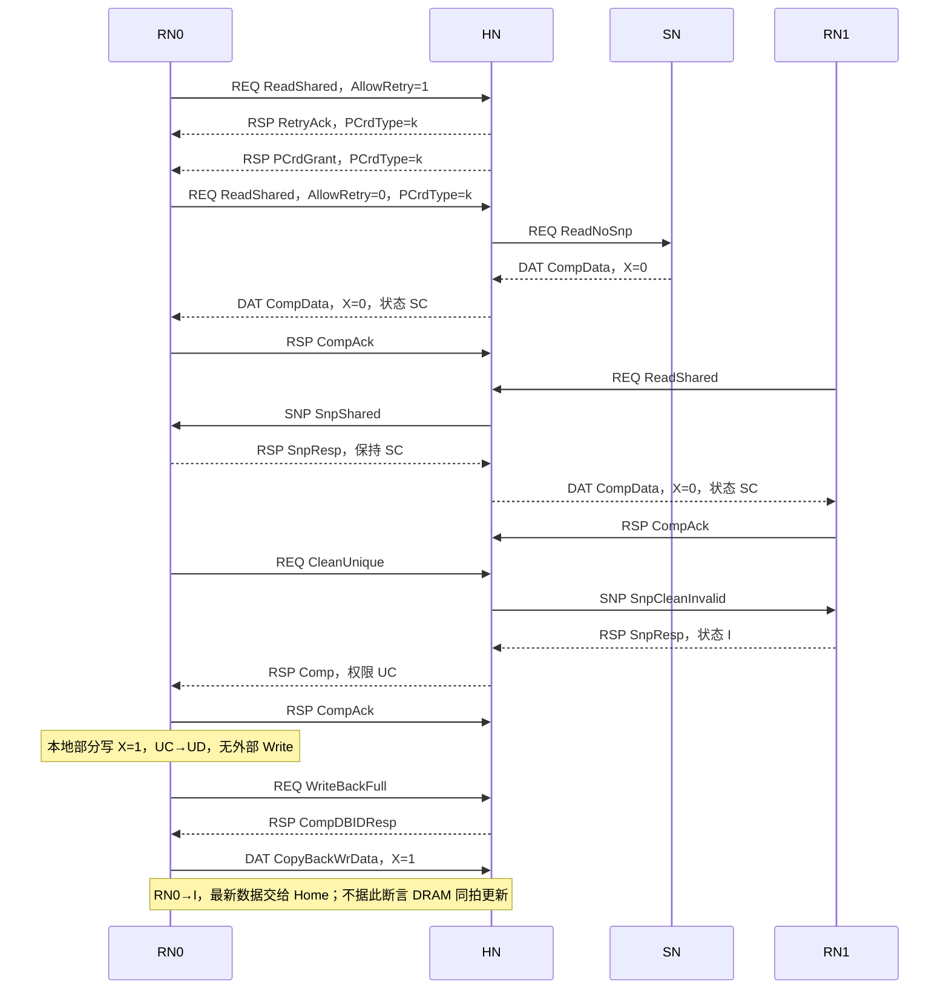

# CHI Transaction：ID、处理流程与直接传输

CHI Transaction 是一次协议操作的完整过程，可以包含多条请求、响应、Snoop 和数据消息。理解它需要同时跟踪消息依赖、ID 关联、数据/权限变化，以及每个节点的完成条件。

本篇以 [CHI Issue E.b](https://documentation-service.arm.com/static/6295e03db334256d9ea8ae86) 为基线，使用正常、无 Exclusive/Atomic、无 Stash、无 Memory Tagging 的例子。操作含义见 [Read / Write / Snoop / Dataless / Retry](CHI-Read-Write-Snoop-Dataless-Retry.md)，链路信号见 [CHI Link](CHI-Link.md)。

## 1. Transaction、Message、Packet 与 Flit

```text
Transaction：完整协议操作，例如一次 ReadShared
Message：参与该操作的一条请求、响应、Snoop 或数据消息
Packet：消息经过网络时的承载单元
Flit：Link 上的一次传输单元
```

E.b 的每个 packet 是一个 flit。完整 64-byte 行在 256-bit DAT 上分成两个数据 packet/flit；流程图把整行画成一根箭头，只是省略重复的数据传输。

Requester/Completer 是针对当前一段事务的角色：RN 向 HN 请求时，HN 是 Completer；HN 向 SN 发出独立后端请求时，HN 又是该请求的 Requester。原始 RN 请求与后端请求不能假定共用一个 TxnID。

## 2. ID Field：先看作用域，再看值怎样传递

### 2.1 字段分工

| 字段 | 主要位置 | 用途 |
|---|---|---|
| SrcID | REQ/RSP/DAT/SNP | 标识该消息的源节点 |
| TgtID | REQ/RSP/DAT | 标识目标节点；原 REQ 的目标可被互连按映射调整 |
| TxnID | REQ/RSP/DAT/SNP | 标识接收方应匹配的请求、Snoop 或由 DBID 指定的上下文 |
| DBID | RSP/DAT，适用性取决于 opcode | Completer 提供的关联标识，后续可被填入 WriteData 或 CompAck 的 TxnID |
| HomeNID | 相关 DAT | 指明 Read 的 CompAck 应发往哪个 Home |
| ReturnNID / ReturnTxnID | 相关 HN→SN REQ | 指明后端读数据或 DWT DBIDResp 的接收节点与事务号 |
| FwdNID / FwdTxnID | Forwarding SNP | 指明 Snoopee 应向谁转发读数据，并使用哪个 TxnID |
| DataID | DAT | 标明当前数据片段在行内的位置，不是事务号 |
| CCID | DAT | 标识原请求关注的 critical 128-bit chunk，不是数据片段计数器 |

**SNP flit 本身没有与 REQ/RSP/DAT 相同的 TgtID 字段。** SNP 的目标由互连投递机制确定；流程表中的 HN→RN1 是路径说明，不能据此在 SNP payload 中虚构 TgtID。

### 2.2 三个容易混淆的关联

```text
RN 发 REQ：TxnID = RN 分配的 A
HN 回响应：TxnID = A，DBID = HN 提供的 C
RN 发后续 WriteData / CompAck：TxnID = C
```

DBID 不要求是物理数据 RAM 的地址；它是 Completer 提供的关联标识。也不能把所有 DAT 的 TxnID 都解释为 RN 原请求 ID：Read Data 通常匹配 A，WriteData 通常使用响应给出的 DBID。

TxnID 的唯一性受发起节点与尚未释放的请求上下文约束，不是全芯片全局唯一。不同 RN 可以同时使用相同数值。DBID 的必要唯一性也具有作用域：E.b 允许 Completer 对不同 Requester 使用同值，在需要匹配时通过 SrcID/Node 及相应上下文区分。

后端请求、Snoop 和原始请求各有 ID 命名空间，硬件必须保存关联关系；数字相同不能证明它们就是同一笔请求。

### 2.3 多 beat 的 DataID

对完整 64-byte 行：

| DAT 数据宽度 | 普通整行 flit 数 | 各片段的 DataID |
|---|---:|---|
| 128 bits | 4 | 0、1、2、3 |
| 256 bits | 2 | **0、2** |
| 512 bits | 1 | 0 |

DataID 以 128-bit chunk 的位置编码，不是按链路宽度从零连续计数。256-bit 整行的高半行是 DataID=2，不能写成 1。表只针对普通完整行；较小 Size、特殊数据流程及字节有效性需按 §2.10 判断。

数据可能按 critical-chunk/wrap 等合法顺序交付，不能只按到达先后放入低/高半行。Requester 要按 DataID 保存片段，按 Size/流程记录哪些片段到齐。

### 2.4 Cache State 与 Resp 编码

UC/UD/SC/SD 是状态语义。`Resp` 是根据消息类型解释的传输编码，其中还表达 PassDirty。UC 和 UD 不能简单各分配一个独立 Resp 值；是否转移 Dirty 责任、Requester 的最终状态，要结合 opcode 和 PassDirty 判断。

SC 可以与 SD 共享同一份比 DRAM 更新的数据，因此不能由 `Resp=SC` 推断“DRAM 一定最新”。完整状态表见 E.b §4.1，响应合法组合见 §4.5–4.8。

## 3. 普通 Read：逐条追踪 ID 和处理步骤

### 3.1 场景假设

- RN 初始为 I，发 `ReadShared`，`ExpCompAck=1`。
- HN 确认没有需要获取最新值的 peer RN 副本。
- HN 无可用本地数据，向 SN 发 `ReadNoSnp`。
- 使用非 DMT 路径，后端 `Order=00`，不要求 ReadReceipt。
- HN 选择给 RN 返回 SC，采用 CompData 组合响应。
- 本例为易读而等待整行到齐再发 CompAck；这不是 E.b 的唯一合法时序。

RN 分配 A，HN 给后端请求分配 B，给 RN 的 CompAck 关联分配 C。A/B/C 是符号，不暗示固定字段宽度，也不要求数值相等。



### 3.2 ID 传输表

表中的 `—` 表示本例不用于关联，不表示字段物理不存在或必须填零；具体无效字段的编码要求见 Appendix A。

| 消息 | SrcID | TgtID | TxnID | DBID | 其他关联 |
|---|---|---|---|---|---|
| RN→HN `ReadShared` | RN | HN | A | — | ExpCompAck=1 |
| HN→SN `ReadNoSnp` | HN | SN | B | — | ReturnNID=HN，ReturnTxnID=B，ExpCompAck=0 |
| SN→HN `CompData` | SN | HN | B | — | 本后端请求无 CompAck |
| HN→RN `CompData` | HN | RN | A | C | HomeNID=HN |
| RN→HN `CompAck` | RN | HN | C | — | 使用前一步的 HomeNID 与 DBID |

RN 收到的数据 TxnID 匹配自己的 A，HN 收到的后端数据匹配 B，而 HN 收到 CompAck 时匹配 C。Home 必须能从 C 找到需要收尾的事务上下文。

### 3.3 数据、权限与完成

RN 收齐要求的数据并满足本地处理条件后，可缓存为本例的 SC。ReadShared 也有其他合法状态结果；SC 是例子选择。

对于使用 CompAck 的 RN-F ReadShared，HN 需要通过确认机制控制同地址后续 Snoop 的排序。E.b §2.8.3 要求 HN 在收到该 CompAck 前不发后续同地址 Snoop；不能把这个规则扩展成所有 ReadNoSnp/ReadOnce 路径都一样。

后端 HN→SN 请求不发送 CompAck。它与原始 RN→HN 的确认流程是不同事务段。

## 4. 带 Snoop 的 Read 与 Dataless 权限升级

### 4.1 Snoop 自己有 TxnID

假设 RN0 发 ReadShared，RN1 持有一份 SC，HN 本地保有可用的相同数据，选择非转发 Snoop：

| 消息 | 关键 ID | 意义 |
|---|---|---|
| RN0→HN `ReadShared` | SrcID=RN0，TxnID=A | 原始请求 |
| HN→RN1 `SnpShared` | SrcID=HN，TxnID=S | Home 发起的 Snoop；本例 RetToSrc=0 |
| RN1→HN `SnpResp` | SrcID=RN1，TgtID=HN，TxnID=S | 匹配 Snoop S，不匹配原始请求 A |
| HN→RN0 `CompData` | TxnID=A，DBID=C，HomeNID=HN | RN0 接收数据与完成 |
| RN0→HN `CompAck` | TxnID=C，TgtID=HN | 确认原请求完成响应 |

无数据的 SnpResp 只能完成对应的 Snoop 步骤，不能代替 RN0 所需的数据。若 RN1 持有 UD/SD 的最新值，HN 必须使用正确的供数流程，不能使用过期内存。

### 4.2 CleanUnique 的 ID 流程

假设 RN0/RN1 都为 SC，RN0 已有完整数据、要进行部分写。选择 CleanUnique：

```text
RN0 → HN：REQ CleanUnique，TxnID=A
HN  → RN1：SNP SnpCleanInvalid，TxnID=S
RN1 → HN：RSP SnpResp，TxnID=S，Resp=I
HN  → RN0：RSP Comp，TxnID=A，DBID=C，Resp=UC
RN0 → HN：RSP CompAck，TxnID=C
```

本例 RN0 的状态为 SC→UC，RN1 为 SC→I。RN0 随后本地写入，UC→UD，这次 Store 本身不必发 CHI Write。

CleanUnique 是 Dataless，因为完成不给 RN0 行数据；若其他节点存在需保留的脏数据，系统内部仍可能产生 DAT。MakeUnique 则要求保证整行覆盖，详见操作专题，不用它替代本例的部分写权限升级。

## 5. Write：DBID 如何变成 DAT.TxnID

### 5.1 CopyBack Write

假设 RN 驱逐完整 UD 行，不考虑并发 Snoop；RN 的原请求号为 A，Home 提供 DBID D：

| 消息 | SrcID | TgtID | TxnID | DBID |
|---|---|---|---|---|
| RN→HN `WriteBackFull` | RN | HN | A | — |
| HN→RN `CompDBIDResp` | HN | RN | A | D |
| RN→HN `CopyBackWrData` | RN | HN | **D** | — |

所有本次 CopyBackWrData flit 的相关 SrcID/TgtID/TxnID 保持一致，DataID 标识不同片段。Home 用 DAT.TxnID=D 匹配写数据，不是用 DAT.DBID 再传一遍 D。

Requester 必须在收到 CompDBIDResp 后才能发送 CopyBackWrData。该流程没有额外独立 CompAck；HN 必须等待要求的写数据，不能在回 CompDBIDResp 时假设数据已经到达。

E.b §2.6.3 允许 RN 在收到 CompDBIDResp 后复用原请求 TxnID=A，因为后续写数据通过 D 关联；这并不允许丢弃尚未交付的数据。HN 的 DBID D 要等全部写数据接收后才能按该流程复用。地址/目录/MSHR 资源还有各自的释放条件，不应全与 TxnID 同寿命。

### 5.2 Non-CopyBack Write

对无 OWO、无 DWT、ExpCompAck=0 的普通 WriteNoSnpFull，选择分离响应：

```text
REQ WriteNoSnpFull：TxnID=A
RSP DBIDResp：     TxnID=A，DBID=D
DAT NCBWrData：    TxnID=D
RSP Comp：         TxnID=A，DBID=D
```

也可以用 CompDBIDResp 合并 DBID 与 Completion。上面的顺序是一种合法选择，不能当成全部写流程的强制顺序。Requester 必须同时处理数据发送义务与要求的完成响应。

需要 Ordered Write Observation（OWO）的 WriteUnique/WriteNoSnp 有额外顺序和 CompAck 规则，可能使用 NCBWrDataCompAck 合并数据与确认；这些不能套用到所有普通 WriteBack。本篇主例不使用 OWO。

## 6. 节点怎样处理和结束事务

### 6.1 从请求到完成的处理框架

下面描述常见实现框架；CHI 不要求所有节点恰好使用名为 MSHR 的结构。



流程图中的处理阶段可以重叠，不能视为必须串行的 RTL 流水级。实现通常保存：原 Requester/TxnID、地址与属性、后端请求号、Snoop 等待集合、数据片段有效位、返回状态、DBID，以及完成/确认标志。

### 6.2 不同位置的“完成”

| 观察位置 | 必须检查什么 |
|---|---|
| Requester Read 接收侧 | 所需完成响应、全部数据片段，以及要求的其他响应是否到齐 |
| Requester Write 发送侧 | 所需响应是否收到；要求的 WriteData/取消/确认是否已经合法交付 |
| HN 的 Snoop 路径 | 需要的 Snoopee 是否均已响应，最新数据和权限结果是否确定 |
| HN 的后端路径 | 各独立后端请求是否满足其响应和数据条件 |
| HN 的确认路径 | 对该类操作需要的 CompAck 或隐含确认是否到达 |
| HN 内部资源 | 数据保存、目录更新、相关地址 hazard 是否处理到可释放状态 |
| Link | flit 已传输及相应容量回收；它不代表协议操作已完成 |

普通写的 Completion 是协议完成保证，不能一概解释成 DRAM 物理写入或持久化完成。不同请求、地址属性和顺序要求的保证见 §2.8；Persistence 又有独立操作与响应。

### 6.3 乱序与依赖

- 不同 Channel 独立传输，不能靠“先发必先到”做关联；使用 ID 和状态记录。
- 不同事务可乱序完成；同地址或存在顺序关系的事务仍需满足各自约束。
- `RetryAck` 和 `PCrdGrant` 可以反序到达，P-Credit 匹配 Completer 与 PCrdType，而非绑定一个原请求 ID。
- 普通 CompData 流程在 E.b 允许收到首个数据 flit 后发 CompAck；分离流程可以收到 RespSepData 后提前发 CompAck。提前 Ack 不能代替继续接收其余数据，也不能提前释放仍需使用的接收状态。
- 对本篇普通 ReadShared，Requester 原 TxnID 复用要等待要求的全部响应；CopyBack 的原 TxnID 则可按第 5 节提前复用。不存在通用的“所有 ID 都等到最后一条消息才能回收”规则。

更复杂的请求中还有 ReadReceipt、Persist、CMO、TagMatch 等响应，本篇不把这些省略项视为永远不存在。

### 6.4 Retry 的 ID 与 Credit 匹配

假设 RN 向 HN 发出请求 A，HN 给出 Credit 类型 k：

| 消息 | SrcID | TgtID | TxnID | Credit 关联 |
|---|---|---|---|---|
| 首次 REQ | RN | HN | A | AllowRetry=1，PCrdType=0 |
| RetryAck | HN | RN | A | PCrdType=k，匹配被拒绝的请求 |
| PCrdGrant | HN | RN | **0** | PCrdType=k；DBID 也为 0，不绑定 A |
| 使用 Credit 重发 REQ | RN | 相应 Completer 路径 | A 或新分配的 A′ | AllowRetry=0，PCrdType=k |
| 不使用时的 PCrdReturn | RN | Credit 来源 HN | **0** | PCrdType=k，无对应完成响应 |

原 REQ 的 TgtID 可能经过互连映射，因此重发目标的选择要遵守 §3.2/§3.4，不能仅按最初注入网络的地址路由值猜测 Credit 来源。

Requester 收到 RetryAck 后可以按规范复用旧 TxnID=A，但仍必须保存待重发请求和 Credit 关联信息。**协议请求还在等待，不等于原线上 TxnID 永远不能复用。** 与 Write 的例子相同，ID 寿命、待办操作寿命和内部缓冲寿命要分别处理。

## 7. DMT / DCT / DWT：在普通流程上改变数据路径

### 7.1 三种直接传输的关系

| 机制 | 全称 | 普通数据路径 | 优化数据路径 |
|---|---|---|---|
| DMT | Direct Memory Transfer | SN→HN→RN | SN→RN |
| DCT | Direct Cache Transfer | peer RN→HN→Requester RN | peer RN→Requester RN |
| DWT | Direct Write-data Transfer | RN→HN→SN | RN→SN |

三者都省去 Home 对相应数据的中转，但控制请求仍通过 Home。Home 继续协调地址、顺序和适用的一致性操作。“Direct” 是协议路径含义，不保证网络零跳，也不要求 SN 直接连接 DRAM 或 HN 没有 Router。

这些是有条件的能力，合法性与节点配置都需要核对。尤其 DWT 用于相应 Non-CopyBack Write，不能应用到 WriteBackFull。E.b §4.2.3 只允许原始 RN 写请求不使用 OWO 时采用 Home 与 Subordinate 间的 DWT；Memory Tagging 等附加要求也要另行核对。

### 7.2 DMT：Return 字段让 SN 找到原 RN

假设 RN 初始 I，发 ReadShared；HN 判断无需 Snoop，选择 SN 直接供数的合并响应流程。原 RN 号为 A，HN 后端请求号为 B。下面选择等待全部数据后发送 CompAck：



| SN 的输出字段 | 来自后端 REQ 的哪个字段 |
|---|---|
| CompData.TgtID | ReturnNID=RN |
| CompData.TxnID | ReturnTxnID=A |
| CompData.HomeNID | SrcID=HN |
| CompData.DBID | TxnID=B |

RN 的 CompAck **发往 HomeNID=HN，而不是发数据的 SrcID=SN**；确认的 TxnID 使用收到的 DBID=B。HN 虽没收到数据，仍能从确认和后端要求的响应跟踪完成。若后端 Order 要求 ReadReceipt，也必须处理该响应。

DMT 还有 `RespSepData + DataSepResp` 分离形式。Home 返回 RespSepData，SN 直接返回 DataSepResp；Requester 在收齐所需响应/数据后完成本地接收，允许的早发 CompAck 条件与合并形式不同。

### 7.3 DCT：Fwd 字段让 Snoopee 找到原 Requester

采用 E.b §5.1.3 的干净行例子：RN1 初始 UC，RN0 初始 I。HN 发 SnpSharedFwd，让 RN1 直接供数。



| 转发 DAT 字段 | 来源 |
|---|---|
| TgtID=RN0 | SNP.FwdNID |
| TxnID=A | SNP.FwdTxnID |
| HomeNID=HN | SNP.SrcID |
| DBID=S | SNP.TxnID |

RN1→HN 的 SnpRespFwded 匹配 Snoop S，说明已转发和两侧的状态结果；RN0→HN 的 CompAck 也使用 S，但对应原读的确认。Home 要记录这两类不同完成条件，不能把收到其中一个当成另外一个也已到达。

在这个合法干净例子中，RN1/RN0 最终都为 SC。其他场景可能要求 Snoopee 还向 Home 提供数据，使用 SnpRespDataFwded；脏数据责任如何转移必须结合响应字段判断。Forwarding 请求也不保证目标始终能供数，目标可能没有有效副本，Home 必须处理合法的未转发响应。

### 7.4 DWT：SN 直接分配写数据目的地

假设普通 Non-CopyBack WriteNoSnpFull，无 OWO/CompAck、无 Memory Tagging，节点支持 DWT。原 RN 请求号为 A，HN 后端请求号为 B，SN 分配 DBID D。图中选择等待写数据后返回各级 Comp，便于追踪；这种等待不是全部 DWT 流程的强制要求。



关键关联：

```text
SN→RN DBIDResp：TgtID=后端 REQ.ReturnNID，TxnID=后端 REQ.ReturnTxnID
RN→SN WriteData：TgtID=DBIDResp.SrcID，TxnID=DBIDResp.DBID
SN→HN Comp：   TgtID=后端 REQ.SrcID，TxnID=后端 REQ.TxnID
HN→RN Comp：   匹配 RN 原请求 A
```

`DoDWT` 只适用于规范指定的 HN→SN 写请求，不是 RN 可以随意对所有 REQ 设置的通用直接传输位。DBIDResp 的源决定数据目的地，所以 RN 必须记录返回节点，不能始终把 DAT 发回原请求的 Home。

原始 WriteUnique 也可以在 Home 完成相应一致性处理后，采用合法的后端 DWT 写路径；DWT 本身不免除原始操作要求的 Snoop。

### 7.5 对照直接传输与缓存命中

LLC hit 是数据来源的选择，DMT/DCT/DWT 是数据路径的选择，二者不是同一层面的概念。普通 LLC hit 通常由 Home 供数；DMT 的提供者是 SN，DCT 的提供者是 peer RN，DWT 的目的地是 SN。直接传输改变了谁发送/接收 DAT，所以必须同步改变 Return/Fwd、HomeNID 和 DBID 的关联。

## 8. 一个缓存行的完整旅程

用 RN0、RN1、HN、SN 连接前面的机制。假设普通 64-byte 行 `X`，初始 RN0/RN1 为 I、DRAM 的 `X=0`；各读选择 SC，Home 保存最新数据，权限升级用 CleanUnique。



这个故事选择了多种合法策略中的一种。故事中的第二次读是否必须 Snoop、数据来自哪里，都取决于 Home 的目录和缓存状态，不是 ReadShared 的固定动作序列。

## 9. 分析波形时的核对顺序

1. 确定观察接口是原生 Link 还是内部 Decoupled，并使用对应有效传输判据。
2. 记录 Channel、opcode、SrcID/TgtID/TxnID；SNP 单独按其投递目标记录。
3. 给原始 REQ、后端 REQ、Snoop 建立关联，记录响应中的 DBID/HomeNID。
4. 对 DAT 按 DataID 与有效字节保存片段，不按到达顺序猜位置。
5. 列出该 opcode 要求的响应、数据和确认，逐项核对；记录 Retry 时还需 Credit 来源与类型。
6. 分别判断接收完成、发送义务完成、同地址排序解除和内部资源释放。

## 10. 参考

- [CHI E.b 规范](https://documentation-service.arm.com/static/6295e03db334256d9ea8ae86)：§2.3 Transaction structure、§2.4–2.6 ID 字段和传递、§2.8 Ordering、§2.10 Data transfer、§2.11 Request Retry。
- DMT/DCT 字段：§2.6.1，Figures 2-23–2-26。CopyBack 字段和 ID 复用：§2.6.3，Figure 2-28。DWT：§2.3.2 与 §13.10.24。
- Cache 状态与响应：§4.1、§4.5–4.8。具体 DCT 干净行例子：§5.1.3，Figure 5-3。DataID：Table 2-15 和 Table 13-40。
- 返回：[学习入口](README.md)。
