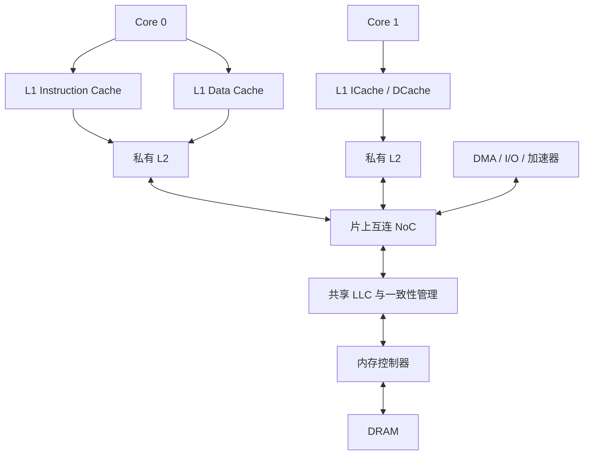
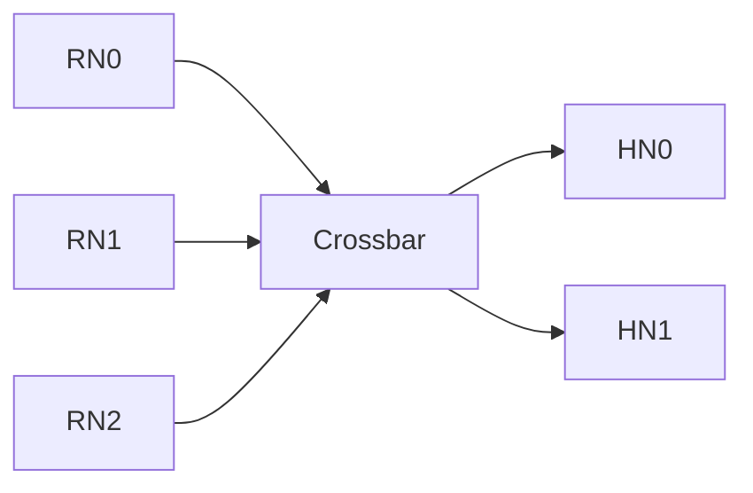
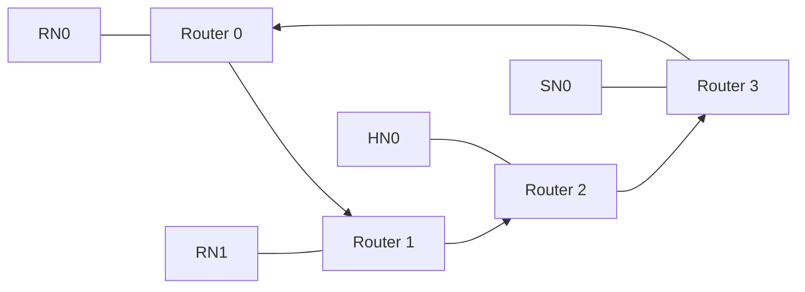
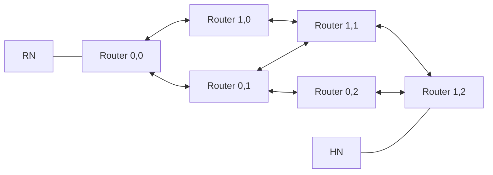

# NoC 基础：内存层次与网络拓扑

内存层次解决容量、速度和数据复用问题，NoC 连接访问这些数据的组件。学习 CHI 前，应先建立系统图，再区分缓存层级、协议节点和网络路由器。

## 1. 为什么需要内存层次

处理器不能把所有访问都直接送到 DRAM。靠近 Core 的 Cache 用较小容量换取较低访问延迟；更远的存储用更大容量保存工作集。下面是一个概念示例，实际系统不一定具有每一级：



图中的 LLC 与一致性管理可以集成，也可以拆开；NoC 中也可以连接多个 LLC bank、Home 和内存控制器。

| 组件 | 主要作用 | 理解时应注意 |
|---|---|---|
| L1I | 缓存指令 | 指令缓存与数据缓存的访问和维护机制可能不同 |
| L1D | 缓存 Load/Store 使用的数据 | 有数据不等于有写权限 |
| L2 | 降低 L1 miss 的代价，管理上层副本 | 可以私有，也可以由一个 cluster 共享 |
| LLC | 最后一级缓存，减少后端访问 | “最后一级”是层级含义，不固定等于 L3 |
| Directory / Snoop Filter | 记录或筛选可能持有缓存行的节点 | 保存元数据，不必保存缓存行数据 |
| 内存控制器 | 将后端读写转成 DRAM 命令并调度 | CHI Completion 不一定等于 DRAM 已完成一次物理写入 |
| DRAM | 提供主要内存容量 | 脏行存在时，DRAM 可能保存旧值 |

寄存器和 Store Buffer 也影响 Core 的访存行为。Store Buffer 可以暂存待处理的 Store，但它不是与 L1/L2 同类的共享缓存层级。页表和 TLB 解决地址翻译，也不能当作保存普通数据的缓存层次。

## 2. 读访问怎样穿过层次

以普通 cacheable Load 为例：

1. Core 查本地缓存；若有有效数据且权限满足，直接使用。
2. L1 miss 时向下一级申请数据，通常以 cache line 为管理和填充粒度。
3. L2 hit 时可以从 L2 返回；L2 miss 时继续向共享层或互连发请求。
4. 一致性管理者判断最新数据来自 LLC、DRAM 还是另一 Core 的私有 Cache。
5. 数据返回并填充所需层级后，Load 获得它需要的字节。

多核场景下，“沿层级向 DRAM 查找”并不是唯一数据路径。假设 Core 0 已把 `X` 改为 `1`，而 DRAM 仍为 `0`，Core 1 的一致性读必须得到最新的 `1`。系统可能让 Core 0 提供数据，并不需要先把 DRAM 更新后才能回答 Core 1。

## 3. 写访问为什么还要考虑权限

Cache 中有一份有效数据，只能证明它可读，不能证明它可直接修改。多个 Cache 都有共享副本时，写入者需要先取得唯一写权限，使其他副本失效。

| 本地条件 | 普通 Store 的后续动作 |
|---|---|
| 已有完整数据和可写权限 | 本地修改，设置脏状态；不必每次发外部 CHI Write |
| 有共享数据，没有写权限 | 请求升级权限，等待必要的一致性操作完成 |
| 没有有效数据，且要保留未写字节 | 获取所需数据与写权限，之后局部修改 |
| 保证覆盖整个缓存行 | 可考虑不读取旧数据的权限/写入流程；须满足相应 opcode 的条件 |
| 脏行需要驱逐 | 把最新数据及其责任交给下层，再释放副本 |

本组例子使用 write-back 缓存：本地写不必立即更新 DRAM。写回 Home/LLC 与继续写入 DRAM 是不同阶段。write-through、write-allocate/no-write-allocate 则是缓存策略，不能仅凭一个 CHI opcode 推断整个系统的策略。

Inclusive、Exclusive、Non-inclusive 描述上下层缓存内容的包含关系，也不是 MESI/MOESI 的权限状态。详细实现见 [XSCache](../NoC-Master/XSCache.md)。

## 4. 缓存层级与 CHI 节点的关系

缓存层级按存储位置命名，CHI Node 按协议职责命名。

| 系统组件示例 | 可能承担的 CHI 角色 | 不应直接等同的概念 |
|---|---|---|
| 带 coherent cache 的 CPU cluster / L2 出口 | RN-F | RN-F 不固定等于一颗 Core 或一级 L2 |
| 不保存 coherent cache 的 DMA | RN-I；需要 DVM 接收能力时可为 RN-D | I/O coherent 不代表绕过 CPU Cache 中的最新数据 |
| 地址归属和一致性管理单元 | HN-F | HN-F 不要求一定包含 LLC 或 Directory |
| 非一致性地址路径的 Home | HN-I | HN-I 不能承担 HN-F 的一致性协调职责 |
| 后端内存访问端口 | SN-F / SN-I，按节点能力和系统设计选择 | SN 是协议角色，不是 DRAM 存储颗粒 |

Home 的选择来自系统地址映射，通常称为 System Address Map（SAM）。在多个 Home/bank 的系统里，可以用地址位或散列分配地址；具体映射由实现决定。Home 选定后，网络再决定如何到达它。

香山课程已有两类资料，应分别阅读：

```text
TileLink 路径示例：L1 --TileLink--> CoupledL2 --TileLink--> HuanCun
CHI 路径示例：     L1 --TileLink--> CoupledL2 --CHI--> OpenLLC / 下级
```

它们代表不同配置和源码基线。CHI Snoop 在 RN-F 内部可以转成面向 L1 的 TileLink Probe；由 RN-F 对外返回 CHI Snoop Response。结合 [XSCache 场景分析](../NoC-Master/XSCache-Scenarios.md)可以看到这种跨协议关系。

## 5. Crossbar：交叉开关

Crossbar 在输入与输出之间提供交换连接，多个不冲突的输入可同时访问不同输出；争用同一输出的输入需要仲裁。



它适合端点数量较少、希望减少网络跳数的场景。代价是端口增加后连接、MUX 和仲裁逻辑会扩大；理想的 N×M 全连接交换结构，其交叉连接规模随 N×M 增长。实际实现可能分级或部分连接。

“一跳”并不意味着“一周期”：流水级、仲裁等待和目标反压都会影响延迟。

## 6. Ring：环形网络

Ring 用环上相邻路由器连接端点。消息经过若干跳到达目标。



图为单向环示例。双向环可以按路由策略选择方向，降低部分路径的跳数。环的连接较规整，但端点数增多时平均距离通常增加；许多消息可能争用同一段环链路。增加环数或拆分消息网络可以提升容量，效果取决于具体设计。

环存在循环连接，流控设计需要处理资源依赖中的环；不能仅因为消息最终目的地明确，就认为网络不会死锁。

## 7. Mesh：网格网络

Mesh 把路由器按行列排列，通常连接上下左右相邻路由器，便于扩展到较多端点。



二维 Mesh 中，端点之间可以有多条几何路径。例如 XY 路由先沿 X 再沿 Y。最短路径跳数为坐标差的曼哈顿距离，但消息的实际延迟还包含队列与仲裁等待。

Mesh 提供更多并行链路，布局也较规整；代价是更多 Router、缓冲和路由逻辑，以及热点目标和跨区域链路的拥塞。自适应路由是否可用、怎样保证无死锁，都属于具体网络设计。

| 比较项 | Crossbar | Ring | Mesh |
|---|---|---|---|
| 连接方式 | 输入与输出交换连接 | 相邻 Router 首尾相连 | 行列相邻 Router 连接 |
| 跳数 | 小型集中式结构通常较少 | 随环距离增加 | 随二维坐标距离增加 |
| 主要争用 | 同一输出 | 共用环链路 | 输出端口、热点及跨区链路 |
| 扩展代价 | MUX、仲裁与布线增长 | 路径变长、共享链路压力增加 | Router、缓冲与链路数量增加 |
| 典型适用 | 较少端点 | 规模适中的规整互连 | 较多端点的可扩展互连 |

这张表是结构比较，不能推出任何一种拓扑在所有负载下性能更好。

## 8. 协议路径与网络路径

普通后端读的协议路径可以是 `RN → HN → SN → HN → RN`。在 Ring 或 Mesh 中，每段 Node 到 Node 的消息都可能经过多个 Router。

CHI 定义节点职责、消息、ID 和链路规则，并不限定使用 Ring 或 Mesh。`DMT` 把数据路径变成 `SN → RN`，省去 Home 对数据的接收和再次发送；它仍可能穿过多个 Router。协议上的“直接”不等于物理上零跳或一根专线。

Node 边界的原生 CHI Link 与 NoC 内部 Router 链路也不必采用相同格式。实现可以在内部重新封装消息、使用虚通道和其他网络流控，但必须在 CHI 接口边界保持协议要求；不能假定每一跳都有一套相同的 CHI LinkActive 信号。

还要区分三类顺序：同一地址的一致性顺序、处理器体系结构的内存顺序、网络中消息的到达顺序。NoC 能正确传输 flit，并不自动满足前两类顺序。

## 9. 参考与后续阅读

- [CHI E.b 规范](https://documentation-service.arm.com/static/6295e03db334256d9ea8ae86)：§1.1–1.6，尤其 §1.2 Topology、§1.5 Coherence overview、§1.6 Component naming；Chapter 3 Network Layer。
- 下一篇：[缓存一致性](Cache-Conherence.md)。节点细节见 [CHI Node](CHI-Node.md)，直接传输见 [CHI Transaction](CHI-Transaction.md)。
