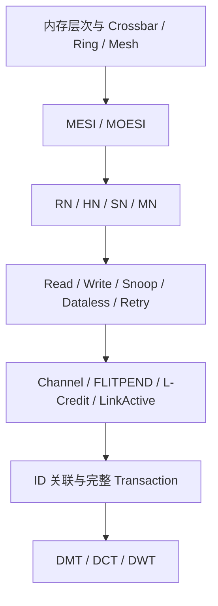

# NoC 与 CHI 协议学习入口

本组文档从内存层次出发，依次解释缓存一致性、CHI 节点、协议操作、链路传输和完整事务。阅读时始终追踪三个问题：最新数据在哪里、谁有写权限、当前消息属于哪笔事务。

## 1. 阅读顺序与文档分工

| 顺序 | 文档 | 要回答的问题 |
|---|---|---|
| 1 | [NoC 基础：内存层次与网络拓扑](NoC-Basics.md) | 数据存在哪里，Core、Cache 和内存控制器如何连接？ |
| 2 | [缓存一致性：MESI 与 MOESI](Cache-Conherence.md) | 多份副本如何共享数据、转移写权限并保存最新值？ |
| 3 | [CHI Node](CHI-Node.md) | RN、HN、SN、MN 分别负责什么？ |
| 4 | [CHI Read / Write / Snoop / Dataless / Retry](CHI-Read-Write-Snoop-Dataless-Retry.md) | 协议操作表达什么意图，何时需要读数据、写数据、Snoop 或重发？ |
| 5 | [CHI Link：通道、Pend、L-Credit 与 LinkActive](CHI-Link.md) | 一条消息如何通过链路，容量和启停如何管理？ |
| 6 | [CHI Transaction：ID、处理流程与直接传输](CHI-Transaction.md) | 多条消息如何关联，各节点何时完成，DMT/DCT/DWT 如何改变路径？ |

Read/Write 与 Retry/Snoop/Dataless 放在同一篇，因为它们共同描述访问意图与协议操作。通道、Pend、L-Credit 和 LinkActive 放在同一篇，因为它们共同决定链路上什么时候可以传输。ID 与直接传输放在 Transaction 中，通过实际消息解释字段的来源和用途。

## 2. 协议版本与例子的范围

本组 CHI 专题以 **Arm IHI 0050E.b，2021-08-16** 为协议基线。旧版本中的 `Slave Node` 在该版本称为 `Subordinate Node`，缩写仍为 `SN`。不同 Issue 的 opcode、字段宽度和可选能力不能混用。

本组图例默认使用正常完成、无错误、无 Exclusive/Atomic、无 Stash、无 Memory Tagging 的普通访问；额外条件在对应例子中列出。图中按一种合法顺序绘制消息，不表示所有消息都必须按该顺序到达。依赖关系由正文说明。

CHI E.b 的一致性粒度为 64-byte cache line，DAT 数据宽度可为 128、256 或 512 bits。文中把整行数据绘成一根箭头时，实际可能对应多个 DAT flit。

协议要求与香山实现分别说明：

- 协议规则以 Arm 规范为依据，章节末给出对应章节和表格。
- 课程中的 TileLink/HuanCun 与 CHI/OpenLLC 场景各有源码和配置基线，不能把两条路径拼成同一套固定硬件。
- CHI 允许某项功能，不表示每个香山配置都启用了该功能。

## 3. 八项主题定位

| 主题 | 主要位置 |
|---|---|
| 内存层次结构 | `NoC-Basics.md` 第 1–4 节 |
| Read / Write | `CHI-Read-Write-Snoop-Dataless-Retry.md` 第 2–3 节 |
| Crossbar / Ring / Mesh | `NoC-Basics.md` 第 5–7 节 |
| DMT / DCT / DWT | `CHI-Transaction.md` 第 7 节 |
| CHI 通道、Pend、L-Credit | `CHI-Link.md` 第 1–4 节 |
| CHI ID Field 传输 | `CHI-Transaction.md` 第 2–5 节及第 7 节 |
| CHI Transaction 处理流程 | `CHI-Transaction.md` 第 3–6 节及第 8 节 |
| LinkActive | `CHI-Link.md` 第 5–8 节 |

## 4. 如何读波形

先确定观察的是原生 CHI Link，还是内部转换后的 `Decoupled` 接口：

- 原生 Link：由 `FLITV` 标识实际传输，发送必须使用此前获得的本通道 L-Credit。
- 内部 `Decoupled`：由 `valid && ready` 标识握手；这不是原生 CHI 的逐拍握手定义。
- 先记录 channel/opcode 和 ID，再关联地址、DataID、权限及完成条件。RSP/DAT 不一定包含原始地址。
- 看到 REQ 发出、`Comp` 到达或一次 DAT 到达，都不足以普遍断言整笔事务已结束。

## 5. 与香山实现资料的衔接

- [XSCache 原理与源码分析](../NoC-Master/XSCache.md)：缓存组织和 TileLink 路径。
- [XSCache 典型场景分析](../NoC-Master/XSCache-Scenarios.md)：L1/L2 命中缺失、替换，以及 CHI Snoop 向 L1 Probe 的转换。

## 6. 主要依据

- [Arm AMBA 5 CHI Architecture Specification，Issue E.b](https://documentation-service.arm.com/static/6295e03db334256d9ea8ae86)：协议规则的主要依据。
- [Arm Learn the architecture — Introducing AMBA CHI，1.2](https://documentation-service.arm.com/static/68590853961937560be90eb2)：辅助理解结构和流程；涉及版本差异时以 E.b 规范为准。
